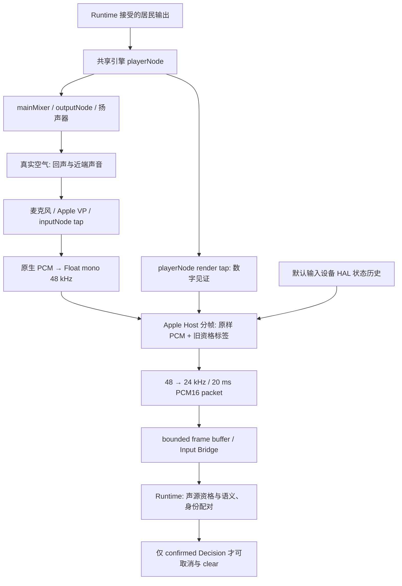

# Eterna Aftelle · Apple Voice Progress v1 · Apple VP 架构复审

日期：2026-10-13（Asia/Shanghai）

结论：**APPLE_VALIDATION_DESIGN_READY**。本报告具备提交主控审核的架构解释、证据边界和分层验证顺序；不表示实验先决条件已满足，不授权实现、实体实验、后端迁移或正式插话。**Apple VP Review = REVIEW_PENDING；Apple VP Validation = NOT_STARTED；Test3 = BLOCKED；execution_authorized = false。**

## 1. 身份、范围与证据规则

- 源码基线：`a7563f9a16aebeaa05398a155c6b38b604362f91`；独立分支：`Apple-Voice-Progress-v1`。
- ACE3 Step 2A/2B = **FROZEN**；Step 2C = **PAUSED / UNREVIEWED**。原工作区的未提交工作未纳入本分支或本审计，也未被判断完成、失败或可删除。
- 本轮只读指定源码、已发布历史报告及直接关联的输入 Bridge / Runtime 授权片段；仅新增本文档。未启动 App、设备、录音、播放、HIL、构建或测试；未读取任何 PCM 内容，未访问 SSD/quarantine。
- 本报告源码行号均对应上述冻结基线。历史报告中的旧行号、运行身份和“下一步”只解释历史，不能冒充当前代码或授权。

| 标记 | 本报告中的证据含义 |
|---|---|
| **CONFIRMED / STATIC** | 冻结源码可直接确认的路径或条件；不证明设备实际行为。 |
| **CONFIRMED / HISTORICAL_REPORTED** | 已发布报告中的历史测量或复算事实；本轮未读原音频、未独立重算，结论只适用于原运行。 |
| **HYPOTHESIS** | 有机制或现象支持但尚未证明的因果解释、候选策略。 |
| **UNVERIFIED** | 缺少当前版本、目标物理路线、时间/身份见证或实际运行证据。 |

主要历史材料：[Apple 接线审计](../test3_aec_review_20261004/apple-graph-audit.md)、[Apple 历史状态](../test3_aec_review_20261004/apple-status.md)、[Apple 声学效果审计](../test3_aec_review_20261004/apple-acoustic-effect.md)、[历史材料版本说明](../test3_aec_review_20261004/README.md)、[ACE3 系统审计](../test3_aec3_system_audit_20261012.md)、[Step 2A 实现](../test3_ace3_step2a_implementation.md)、[Step 2B 实现](../test3_ace3_step2b_implementation.md)。Test3 合同与 Test2 能力边界见同目录 [合同修订草案](01_test3_acceptance_revision_draft.md)。

## 2. 实际 Apple 输入/输出拓扑

### 2.1 共享引擎与启用条件

**CONFIRMED / STATIC**：`AppController` 两个正式初始化仍明确选择 `.webRTCAEC3`，并把同一 `SystemMacSpeechVoiceProcessingEngine` 交给 capture 与 player（[AppController.swift](../../../apps/macos/Aftelle/AppController.swift#L776)，776–791、827–842）。Apple VP 后端代码保留，但当前正式默认并未恢复 Apple。

在显式选 `.appleVoiceProcessing` 时：

1. 引擎构造将一个 `AVAudioPlayerNode` 连接到同一引擎的 `mainMixerNode`（[MacSpeechAudioCapture.swift](../../../apps/macos/Aftelle/MacSpeechAudioCapture.swift#L1465)，1465–1479）。
2. `inputNode.setVoiceProcessingEnabled(true)` 后检查 input 和 output 两个 enabled 标志；失败则抛错。WebRTC 模式反而拒绝启用 VP 的状态，因此当前代码没有“Apple VP → WebRTC AEC3”双 AEC 串联（1480–1499）。
3. 同一 `inputNode` bus 0 安装采集 tap，再 prepare/start engine；不是另开一个采集 engine（1239–1303）。
4. Apple 配置还要求 HAL detector `start()` 成功，否则整体配置失败（1500–1506）。这是现有后端与额外活动检测器的耦合条件，失败不能直接证明 Apple AEC 无效。
5. Debug 保存配置时、采集启动时两个快照，字段为 input/output enabled、input bypassed、input AGC enabled（1295–1299、[2356–2364](../../../apps/macos/Aftelle/MacSpeechAudioCapture.swift#L2356)）。它们是两个时点状态，不是持续逐帧内部 AEC 状态。

Apple 官方 [WWDC19 音频引擎说明](https://developer.apple.com/videos/play/wwdc2019/510/)描述 VP 处理输入并使引擎两侧 I/O 节点共同进入 VP，切换要求引擎停止且不在手动渲染模式。这里只用作 API 语义参考，不能据此认定目标设备组合或 Test3 已通过。

### 2.2 设备绑定与 render reference

**CONFIRMED / STATIC**：指定文件中的 engine 配置没有设置独立硬件设备 ID；HAL detector 从 `kAudioHardwarePropertyDefaultInputDevice` 取得输入设备，并监听该设备的 VAD 属性（[MacSpeechDeviceMonitor.swift](../../../apps/macos/Aftelle/MacSpeechDeviceMonitor.swift#L116)，116–207、356–383）。route monitor读取系统默认输入/输出，并监听设备列表与默认路由变化（[444–495](../../../apps/macos/Aftelle/MacSpeechDeviceMonitor.swift#L444)）。本轮未查询当前设备，因此当前路由 **UNVERIFIED**。

历史接线审计确认过共享引擎、目标 USB 输入与内置扬声器，未发现可复现的独立播放引擎、设备错绑或转换损坏；这是历史特定运行的排除证据，不是所有新运行的永久保证（`apple-graph-audit.md:13–15,27`）。

render tap 位于 `playerNode` bus 0、mixer之前（[MacSpeechAudioCapture.swift:2154–2177](../../../apps/macos/Aftelle/MacSpeechAudioCapture.swift#L2154)）。它是应用排程输出的数字见证，可以解释供音时序和历史相关；不包含最终设备增益、扬声器非线性、空气传播或房间声场。不能把这个 tap 称作独立测得的扬声器声压，也不能证明 Apple 内部逐样本使用了它。

### 2.3 PCM 实际流向：Apple 处理与旧 Gate 分开



**CONFIRMED / STATIC**：原生输入经 `captureAECConverter` 转为 Float mono 48 kHz，Apple HAL读取闭包按帧内容时间取状态，再进入 `processCaptureSpans`（[MacSpeechAudioCapture.swift:1893–2002](../../../apps/macos/Aftelle/MacSpeechAudioCapture.swift#L1893)）。Apple 分支按 480 samples / 10 ms 分帧、更新分类，随后直接 `captureSpan(samples: frame)` 返回；没有执行 WebRTC 的 DSP，也没有走 WebRTC `gatedCaptureSpans` 清零路径（[MacSpeechAcousticEchoHost.swift:1321–1361](../../../apps/macos/Aftelle/MacSpeechAcousticEchoHost.swift#L1321)、1501–1510）。

返回 span 转成24 kHz并附资格标签，形成20 ms PCM16包（[MacSpeechAudioCapture.swift:423–460](../../../apps/macos/Aftelle/MacSpeechAudioCapture.swift#L423)、665–699），加入带 capture generation、sequence和snapshot的frame buffer（2017–2045）。Input Bridge构造 `.acousticEchoProcessed` 的音频帧时使用 `frame.pcm16Bytes`（[MacSpeechRealtimeBrainInputBridge.swift:808–819](../../../apps/macos/Aftelle/MacSpeechRealtimeBrainInputBridge.swift#L808)）。因此“旧Apple Gate拒收真人”首先指拒收其活动/声源资格，不能直接写成旧Host删除了Apple输出PCM。

反过来，tap有非零PCM也不能证明近端人声质量：它可能含回声，或已在Apple内部改变了真人。buffer丢弃、转换失败、generation拒收、播放边界余数丢弃均须另列。20 ms包还可能包含多个输入span；代表snapshot不等于每个输出样本的完整物理来源。

## 3. HAL VAD 与旧 Host/Gate 的额外阻断

### 3.1 HAL 来源与时间有效性

**CONFIRMED / STATIC**：detector启用默认输入设备的 `kAudioDevicePropertyVoiceActivityDetectionEnable`，监听 `...State`，通知时查询属性并保存读取时间、状态、status与sequence（`MacSpeechDeviceMonitor.swift:116–207,297–336,412–422`）。Apple [WWDC23 说明](https://developer.apple.com/videos/play/wwdc2023/10235/)同样将其定义为输入设备的 enable/state/listener/query接口，不能等同于Apple处理后PCM的逐帧声源真值。

当前时间历史只选择“读取时间 ≤ capture内容时间”的最近记录，缺内容时间或没有记录则nil；保留容量256，没有固定最大年龄规则（[MacSpeechDeviceMonitor.swift:38–65](../../../apps/macos/Aftelle/MacSpeechDeviceMonitor.swift#L38)、251–277）。这防止直接借用未来读取，却不能反推出HAL在ADC采样时的真实状态。通知读取时间、声音内容时间、回调进入时间必须分别记录；长时间没有通知既不能证明漏事件，也不能证明每个后来采样的状态已新鲜。

`nil`成为read-invalid并可重置已开Gate；`false`是有效读值但不满足near-end条件（[MacSpeechAcousticEchoHost.swift:1823–1835](../../../apps/macos/Aftelle/MacSpeechAcousticEchoHost.swift#L1823)）。历史没有足够事件确定短句期间是否曾瞬间翻转、漏通知或通知合并，不能制造事件频率上限解释失败。

### 3.2 旧规则与独立失败机制

旧Apple qualifies要求同时满足：HAL读有效且true、处理后RMS≥0.012，以及播放时有可用render匹配且最大相关≤0.25（[MacSpeechAcousticEchoHost.swift:832–833](../../../apps/macos/Aftelle/MacSpeechAcousticEchoHost.swift#L832)、1554–1565）。相关匹配在已保留合法参考中选择最大匹配（1730–1808）。高相关只能证明存在可匹配回声成分，不能排除同时有真人。

Gate需3个合格帧落在最多5帧窗中，已开时20个不合格帧可关闭（847–850、1566–1605）。这些是现有研发算法数值，不是本报告建议重新批准的产品阈值。HAL=false、能量不足、参考缺失、相关拒绝、确认窗不足以及时间/身份拒收须分别计数，不能混成一个“Apple AEC失败”。

Input Bridge还检查播放状态、Gate open和同一非零epoch，决定是否保留 `.sourceGatedNearEnd` 活动（[MacSpeechRealtimeBrainInputBridge.swift:1206–1218](../../../apps/macos/Aftelle/MacSpeechRealtimeBrainInputBridge.swift#L1206)）。它可抑制已保留PCM对应的插话资格。**不得直接恢复旧HAL+RMS+相关+3/5规则，也不得将任一条件绕过后取得的Gate open当作产品PASS。** 新近端检测器只可先作为research shadow；其回声误报及真人漏检独立评价，不能用旧HAL=false掩盖新检测器误报。

### 3.3 Runtime 授权仍独立

Input Bridge发送的声学facts明确 `sourceAttributionConfirmed: false`（[1703–1725](../../../apps/macos/Aftelle/MacSpeechRealtimeBrainInputBridge.swift#L1703)）。Runtime要求该字段及near-end、far-end、Gate/epoch、稳定路由和设备可用等事实；单独的语义 `.realtimeBrain` 来源返回false（[RuntimeCore.swift:5950–5968](../../../apps/macos/RuntimeCore/RuntimeCore.swift#L5950)）。STS能解释表达和意图，不能认证声音来自物理真人。

Controller提交声学证据前检查session、capture generation、当前播放turn/response/context与route attempt，执行confirmed Decision前再核对身份及transition（[AppController.swift:3817–3866](../../../apps/macos/Aftelle/AppController.swift#L3817)、4251–4299）。Cascaded正式声学入口另有 `formalSpeechSourceAttributionVerified = false`（691）。这些锁本轮保持原样。

provisional pause/resume是另一层播放行为（3741–3813），不能视为正式cancel或授予用户轮次；未来仍须单独报告回声触发的provisional次数与体验影响，防止“正式interrupt零”遮住实际误停。

## 4. 四类历史现象分别裁定

| 现象 | 已确认的历史事实 | 可以/不能解释什么 |
|---|---|---|
| 真人短句 HAL 0/51 | `apple-graph-audit.md:19,22`；同构实体真人轮约510 ms短句，帧808–858，共51个10 ms Host帧，HAL缓存true为0/51 | 不是51条真人短句，也不是约400 ms现场验证。证明旧HAL条件在该区间无覆盖；HAL实时物理状态及原因仍UNVERIFIED。 |
| 纯回声 HAL true 239帧 | 同binary纯回声轮1050个播放帧中HALtrue239，Gate0（`:20`） | HALtrue既不等于真人，也不等于239次正式误中断。旧附加门可能挡住本轮误报，但一次Gate0不认证长期可靠或零回声。 |
| Gate拒真人 | 短句14/51帧能量合格；分离合格1/51但该帧音量不合格；14个能量合格帧相关0.311–0.699，均超过旧0.25；本轮长句Gate也0（`:19–21`） | HAL与相关性是独立否决。原生tap短句有能量、无该片段削波迹象；16→48转换在正负各1079帧复算一致。不能直接证明真人被Apple AEC完全消掉，也不能证明真人已经保真。 |
| 不同运行抑制效果差异 | `apple-acoustic-effect.md:19–28`：负控40×250 ms窗口Apple/混合旁录RMS比中位−6.60 dB；真人轮内已标纯回声6×250 ms窗口−47.93 dB。负控35/40窗Apple能量更低，但部分仍几乎同形回声；较早窗也可强抑制 | 不是统一AEC ERLE、产品阈值或同版本Apple/WebRTC排名。旁录是同麦混合输入，真实SPL/硬件增益/内部VP状态不足；同源同数字gain不能证明声场相同。不能断言整轮AEC关了或Apple必然失败。 |

上述为 **CONFIRMED / HISTORICAL_REPORTED**。原记录版本/二进制与当前冻结版本不同（`test3_aec_review_20261004/README.md:17–25`）；本轮不能将历史结论升级为当前Apple正控通过或物理效果复测。

**HYPOTHESIS**：HAL并非适用于该route/短句的可靠近端指标；最大短窗相关附加门可误挡双讲；VP内部自适应、AGC、其他处理或未记录声学状态可能解释跨轮差异。前两项有旧条件和反例支持，但修改后的完整安全性未验证；跨轮差异没有唯一归因。

**UNVERIFIED**：当前Apple VP在目标route的稳定纯回声抑制、真人solo起音/尾音与语音质量、持续双讲保留、自然插话、模糊短语的可澄清性，以及最新设备/VP状态/实际回调延迟。现有证据不足以宣称Apple已满足Test3，也不足以判Apple技术路线必然不可行。

## 5. 可复用与待批准修改的组件

| 组件 | 可复用内容 | 需要先补的边界；本轮均未改 |
|---|---|---|
| Apple VP引擎、shared player/capture | 已有显式模式、VP启用双标志检查、tap、生命周期/route重建；配置和启动时VP/bypass/AGC快照 | 只恢复独立research入口的方案待批；正式默认仍WebRTC。HAL依赖不得让“AEC层未测”伪装成“AEC层失败”。 |
| Apple原生输入/decision/HAL见证 | 原生tap各声道、时间、format、HAL读取和旧qualification分支的Debug trace | 有容量/截断成本；不能与无边界旧PCM capsule一并默认打开。新的内部原因不可假造。 |
| ACE3 O1/O6冻结诊断 | native callback、converter、Host提交/开始/完成、FIFO事件；schema1固定标量、arm/seal、INVALID/lost/pending、离线完整性reader | 已有16,384槽、224-byte stride、4,128,768-byte组件容量证书及≤60秒arm窗口（`test3_ace3_step2a_implementation.md:42–57,70–82`）。是既有资源上限，不是App RSS/设备无扰动保证。 |
| ACE3 O3/O4冻结账本 | converter/packet/编码/buffer的区间与终态；PASS/ZERO与RMS分开、fragment计数与INVALID规则 | 现有O3 gateInput parent依赖WebRTC AEC frame；Apple分支原样返回且无该祖先。不可直接称已有Apple完整账本；需要另批Apple source身份/最终返回观测映射，不能伪造AEC事件补齐。 |
| Input/Output Bridge、Runtime取消与身份保护 | session/generation/sequence/turn/response/context、单次Decision消费、stale fence、clear与代际隔离 | 保持source确认false。待源资格和合同获批后，才提出最小接口兼容接入；本轮不改Runtime API。 |
| Test3LocalAudioRunner | 显式mode、共享engine、物理模式检查、供音ledger、分层trace、清理与安全计数（[434–489](../../../apps/macos/Aftelle/Test3LocalAudioRunner.swift#L434)、769–809、1080–1096） | 旧硬编码路由/时长与软件注入、stub语义需独立review后适配HIL；不直接运行旧默认case。647–669的测试proposal是fixture机制，不是STS理解能力。 |

Apple Debug软件注入在转换后加入PCM并可把HAL有效值设true（`MacSpeechAudioCapture.swift:1924–1933,1958–1959`）；对Apple模式，这发生在Apple VP之后。只能测下游机械路径，不能证明Apple AEC在真实空气双讲中保留了近端。Step2A/2B合成/真实库测试断言通过也不能授予声源或物理HIL资格。

冻结Step2B明确O0物理真值/O5 Runtime received尚未实现，DSP支持未知、设备P99/CPU/RSS/underrun未测（`test3_ace3_step2b_implementation.md:234–241`）。原工作区未冻结Step2C既不作为复用完成项，也不作为已知缺陷。

## 6. 独立 Apple 验证顺序

目标链为 **Apple VP输出PCM → 近端语音活动检测 → STS语义判断 → Runtime授权**。声源资格与语义意图分别评价：以同route纯回声负控及近端/双讲正控检验一个最小近端活动资格方法，再由主控批准其与现有 `sourceAttributionConfirmed` 的映射。这里不新增生物身份认证器或额外声学分类硬门槛；VAD说“有声音”、STS说“像语音”均不能单独证明存在真人。声源未确认时，不授权正式interrupt、不创建用户轮次，也不让回声触发主动追问。

### 6.1 先用现有证据确定新实验有何判别力

本轮已经复用发布的标量和历史解释，不重跑旧录音。后续第一步应编制只读证据索引，确定已有窗口是否能区分“Apple输出就缺人声”“输出保留但VAD漏检”“VAD候选正确但旧资格门拒绝”“Runtime身份/授权拒绝”；读取私人资产须另有明确授权。

只在旧证据无法回答一个会改变下一步决策的问题时才安排新物理窗口。已有HAL/相关性反例不需为了再次证明旧Gate失败而重复录音；旧固定暂停策略及其400 ms研究停止条件也不自动重开。新的研究指标与产品目标由 [合同草案](01_test3_acceptance_revision_draft.md)分开处理。

### 6.2 A–E 的最小实验与独立输出

| 顺序 | 新判别问题与最小条件 | 必须分别报告的结果 |
|---|---|---|
| A 纯居民播放 | 新冻结Apple research模式、无近端源；使用相同内容/输出条件检查起播、稳定播放与尾段 | **PCM层**：残留波形、能量/相关的描述统计与时变性；**检测层**：每种候选误报/旧HAL与相关否决；**授权层**：无正式interrupt、无虚假用户轮次/追问，provisional单列。零最终动作不能掩盖检测误报。 |
| B 近端独自讲话 | 居民不播放；独立HIL物理播放器输出已登记短句/正常语音，经空气与真实麦克风采集 | **PCM层**：起音、尾音、可懂度和对照保留；**检测层**：覆盖/漏检及读取时间；**授权层**：shadow不触发正式动作。与A分开，不能只看RMS证明真人质量。 |
| C 持续双讲 | A/B都取得可解释证据后，独立近端播放器与居民同步播放；真值与对齐可检查 | **PCM层**：近端内容保留与残回声并列；**检测层**：持续性/漏检/错把回声认真人；**授权层**：仍封闭。失败先定位到层，再决定是否改一个组件。 |
| D 正常自然插话 | 声源资格方案与合同已批后，先HIL验证明确插话，再少量真人最终校验 | PCM/VAD/STS候选/Runtime Decision各有事件身份与实际时刻。明确意图经资格确认后停止居民；检查cancel、clear、generation、旧音频拒收和用户轮次唯一性。confirmed→本地clear仍≤50 ms。 |
| E 短促模糊与澄清 | 可信近端的简短附和、模糊表达，以及配对纯回声反例 | 简短附和不必强制中断；可信讲话未听清可自然询问；未确认源或纯回声不得主动追问。约400 ms是语音持续时间测试维度，不是400 ms内必须完成完整中断；不要求所有极短声音完整转录。 |

A–C先作为**无正式Runtime动作的隔离research**；D–E的真实授权验证须后续独立批准，不能通过给测试facts直接置true绕开声源验证。HIL的近端是物理播放器代理，报告必须写 `PHYSICAL_HIL_PROXY`；其成功不能冒充真人最终PASS或人类声源认证。有限真人验收主要解决自然语音、意图及可懂度的代理缺口，不让用户承担无明确假设的反复调参。

每层失败输出独立原因：`PCM_SUPPRESSION_OR_DISTORTION`、`ACTIVITY_DETECTION_MISS_OR_FALSE_CANDIDATE`、`SOURCE_QUALIFICATION_UNVERIFIED_OR_REJECTED`、`SEMANTIC_AMBIGUITY`、`RUNTIME_IDENTITY_OR_AUTHORIZATION_REJECTED`、`LOCAL_CANCEL_CLEAR_FAILURE`、`EVIDENCE_INVALID`。这些为报告标签，非新增Runtime API或生产枚举。

## 7. 自动化物理 HIL 的开测先决条件

后续Step3以自动化物理HIL为主，少量真人作最终校验。开测前须完成并由主控批准：

1. **合同版本和目的**：采用经批准的backend中立版本、目标route、A–E窗口和必须保留的产品红线；源资格方案未完成时，只批隔离PCM/VAD观察，不能批正式Runtime授权。
2. **独立物理源**：近端播放器不在Mac内部虚拟混音、不写capture PCM、不借软件注入；声音经过真实空气到麦克风。记录源素材的非私人身份、外部实际播放与起止真值；来源身份与评估标签不得喂给在线判断器。
3. **可复现环境**：冻结源码/构建/编译宏/显式mode、VP状态与route见证；固定并记录设备角色、几何、输出设置和变更。报告公开版本去掉设备UID、私人音频及私人路径。无法测量的SPL/增益/内部状态明确标未知。
4. **分层观测**：Apple tap前后可取得的合法对照、native/converter/Host/packet/buffer链、实际Runtime received和Decision/clear时刻；内容时间、真实到达、播放器真值的对齐方法事前固定。无法唯一建立物理支持时保留DSP_SUPPORT_UNVERIFIED。
5. **诊断无扰动与资源**：复用冻结O6的完整性/封口协议；先批准Apple分支来源映射与需要的最小新增见证，完成非设备等价检查及实际设备负载预算审查。不得把尚缺的O0/O5或未冻结Step2C说成已具备。
6. **评价方法和成本**：主控批准近端保留/可懂度、持续双讲、自然插话的评价方法、固定试次表、有限设备时间/CPU/RSS/存储/Provider预算与取消条件；若没有依据，不先造ERLE、SNR、准确率或总时延数字。本报告只保留正式≤50 ms本地clear要求和已冻结诊断资源边界。
7. **操作隔离**：显式前台会话、无always-on监听；A–C禁止正式cancel/clear权限，D–E另批；失效时停止测量和收口，不自动切正式后端，不通过更改标准续跑。

目前上述协议和测量条件未全部具备，**执行资格仍BLOCKED**。DESIGN_READY指审核材料可供选择与修订，不是“可直接按旧runner开始实验”。

## 8. 可证伪停止条件与成本边界

| 触发条件 | 当场停止/处置 | 能/不能得出的结论 |
|---|---|---|
| 身份、目标route、VP enabled/bypass/AGC见证或时间对齐不满足登记条件；意外软件注入/其他声源 | 本窗口EVIDENCE_INVALID，停止本轮，不自动修设备或重跑 | 不能判断Apple声学成功/失败。 |
| 任一有标签纯回声被授予错误声源资格/确认（即使Runtime guard挡住最终动作），或产生正式interrupt、虚假用户轮次或主动追问 | 拒绝该候选规则/接入，封闭授权；保留全部失败证据 | 产品安全失败；不得放宽负控要求取得PASS。普通HAL/VAD活动候选与provisional误报另报，不将活动读数等同于权威资格，也不用最终guard掩盖错误资格。 |
| Apple输出已按批准方法确认丢失/损坏目标近端，而下游更换VAD无法恢复缺失信息 | 停止VAD/STS调参，回到PCM层定位；不无限扩窗或提高近端播放强度 | 该运行/方案PCM层失败；不外推所有Apple路线必败。 |
| Apple输出保留已确认近端但近端detector持续漏检，或旧HAL/相关门仍否决该语音 | 停止该检测/资格候选，保留分支与PCM见证 | 不能写成AEC失败。新的活动检测仍须配对纯回声验证，不能绕过资格锁。 |
| STS把回声文本当用户、模糊近端被强造完整内容，或语义与当前声学身份无法配对 | 停止语义/轮次接入；不得触发用户轮次、追问或cancel | 语义/资格失败，不能用语言合理性证明真人。 |
| Runtime接受stale/错误身份、重复cancel/clear、旧generation音频，或confirmed→clear超过正式≤50 ms | 停止Runtime接入，不降低本地clear标准 | Runtime/取消链失败，与Apple PCM/VAD独立。 |
| O6 overflow/lost/pending/缺seal或计数不守恒；达到登记的设备时间、资源、存储或Provider预算 | 停止并封口INVALID/预算终止；不扩ring、不隐去丢事件、不延长预算 | 不认证Test3，也不把诊断失效算作纯声学失败。 |
| 下一窗口没有新的、事前可验证的区分假设 | 不重复旧实验，提交现有结果与缺口 | 保持BLOCKED，等待新假设/主控决策。 |

最小成本策略为一次登记计划只测一个目标route、按A→B→C→D→E顺序逐层推进；每窗口结束立即离线审查，前置失败不自动执行后续窗口。具体时长、试次数、代表性场景与Provider花费上限由主控事前批准，未批准前不开测。单次诊断arm沿用≤60秒上限，不能把它当作充分验收时长。研究失败不触发自动rerun、无限参数扫描或新增模型训练。

## 9. 主控待批准项与最终锁定状态

待批准：合同backend中立版本；独立research Apple入口及最小诊断映射；近端检测与声源资格的分工、因果规则和反例集合；HIL对照/真值/对齐与评价方法；资源/试次预算；逐层进入条件；少量真人最终验收的覆盖范围。正式后端迁移和Runtime授权须另行决策，不能随设计审核自动生效。

```text
APPLE_VALIDATION_DESIGN_READY
ACE3 Step 2A/2B = FROZEN
ACE3 Step 2C = PAUSED / UNREVIEWED
Apple VP Review = REVIEW_PENDING
Apple VP Validation = NOT_STARTED
Test3 = BLOCKED
execution_authorized = false
```

Stage 7越界检查：**PASS（本轮文档审计范围）**。触碰六条红线：无；修改文件仅本文档；生产代码/Runtime API/DR schema/DR fixture/正式合同/Provider权限/取消语义均未改；无新增平台target、scheduler/Memory owner或Stage8；未运行实体实验、未启用正式中断。编译、App/设备及声学测试：**NOT_RUN**。提交与推送由主任务只暂存两份新增报告后收口；完成后停止，等待主控审核。
