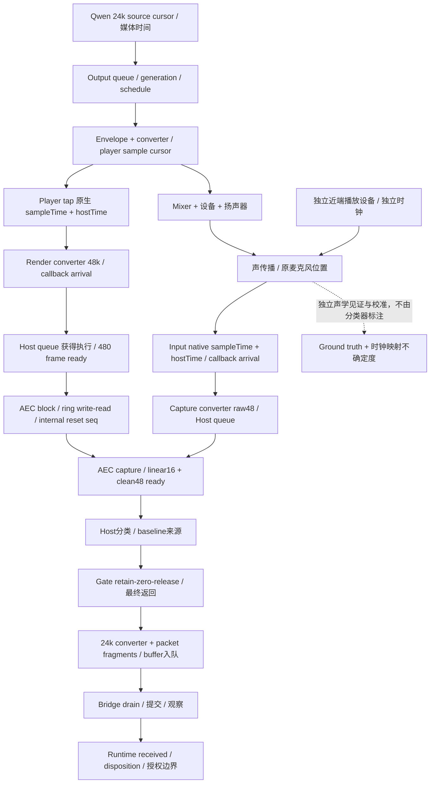

# Eterna Aftelle · ACE3 Step 2 · 音频可观测性与时序对账设计

日期：2026-10-12（Asia/Shanghai）

源码基线：`ACE3` / `2b873f527ed93cebcc698d8b335671c555d419b6`

结论：**DESIGN_READY**，仅表示本设计可送主控复审并申请最小诊断插桩授权。插桩尚未实现、验证或获准执行；Step 3A 尚不具备执行前提。

正式状态：**Step 1 = FROZEN；Step 2 = REVIEW_PENDING；Step 3 = NOT_STARTED；Test3 = BLOCKED；execution_authorized = false；NO_PATCH。**

## 1. 核验、范围与结论

已先读取 AGENTS.md，按已授权的音频链路范围使用 aftelle-context-mode；本轮只读源码、固定依赖、Step 1 报告及相关既有诊断定义，新增本设计文档。未重新开展算法审计、训练或调参。

| 前置条件 | 本轮核验 |
|---|---|
| 分支 / HEAD | `ACE3`，与上述预期 SHA 完全一致 |
| 上游 / 远端 | 跟踪 `origin/ACE3`；live remote SHA 与本地 HEAD 一致 |
| Step 1 | [冻结审计](test3_aec3_system_audit_20261012.md)存在，工作区字节与 HEAD 一致，含 ACCEPTED / FROZEN、BLOCKED、execution_authorized=false |
| 生产代码 | 开始时 tracked / staged diff 均为空；Step 1 提交只发布审计文档 |
| 原有 PCM | `tools/qwen_live_receive_probe/interrupt_segment.pcm`、`prompt_segment.pcm` 仍是原位 untracked，哈希与 Step 1 相同；未解码、播放或暂存 |
| SSD / quarantine | 本轮未读取、写入、恢复或删除其中资产；不以本轮未重算的全盘哈希宣称全盘内容验证 |
| 执行限制 | 未构建/启动 App、回放 PCM、操作音频设备或运行实验；未 commit/push |

主要结论：

1. **现有链路有丰富局部诊断，但没有端到端样本账本。** 按本任务的完整合同，11 个处理层均为 `PARTIALLY_OBSERVABLE`；部分字段已有采集能力，物理到达时间及完整跨层来源关系仍缺失。这不是“11 层都已经取得真实运行证据”。
2. **时钟问题尚不能定罪。** 已有 Capture 回调入口、锁等待、处理段耗时；Render 日志在提交 Host 之前完成。Host ordinal 是串行处理次序，转换器 hostTime 是内容时间，二者均不能代替实际 Render-ready 时间。不同设备的真实时钟漂移仍为 `UNVERIFIED`。
3. **声音损失必须分开量化。** AEC 输出变化、Gate 主动置零、转换/队列丢失、量化自然归零不是一件事。现有 `emittedSpans.silenced` 只测全零，且逐帧记录先于 Host 最终返回，不能证明真实 Gate 动作或下游交付。
4. **H1/H2 需要内部事件与状态来源，而非增加阈值日志。** 记录 Reset 的起因、返回事件、消费分支、delay cache、echo-path 通知及 baseline 的来源 epoch；只观察，不传播新 Reset，不清基线、不改变资格。
5. **未发现已证实的新生产工程缺陷。** 下文确认的是观测缺口与诊断容量/语义限制；H1/H2 仍是 `HYPOTHESIS`，H3/H6 的历史失败因果仍是 `UNVERIFIED`。实体真人在哪层丢失仍为 `UNVERIFIED`。

## 2. 证据索引和判定方法

行号绑定本报告 HEAD；简称后的数字为该文件行号。以下仓库链接可公开；固定依赖以版本与文件身份引用，不公开私人路径、音频内容或设备 UID。

| 简称 | 文件 / 直接相关入口 |
|---|---|
| C | [MacSpeechAudioCapture.swift](../../apps/macos/Aftelle/MacSpeechAudioCapture.swift#L37)：转换器、tap、packetizer、frame buffer、Capture/Render 回调 |
| H | [MacSpeechAcousticEchoHost.swift](../../apps/macos/Aftelle/MacSpeechAcousticEchoHost.swift#L189)：Host 分帧、AEC 调用、分类、Gate、timing trace / acoustic replay capsule |
| P | [MacSpeechAudioOutputPlayer.swift](../../apps/macos/Aftelle/MacSpeechAudioOutputPlayer.swift#L38)：播放格式转换、envelope、schedule |
| O | [MacSpeechAudioOutputHost.swift](../../apps/macos/Aftelle/MacSpeechAudioOutputHost.swift#L205)：播放队列、generation、完成回调、provisional pause |
| B | [AftelleAECBridge.mm](../../tools/webrtc_aec3/bridge/AftelleAECBridge.mm#L87)：AudioBuffer、AnalyzeRender / ProcessCapture / reset / stats |
| W | [MacSpeechWebRTCAECProcessor.swift](../../apps/macos/Aftelle/MacSpeechWebRTCAECProcessor.swift#L7)：480/160 帧契约、输出延迟、C bridge |
| I | [MacSpeechRealtimeBrainInputBridge.swift](../../apps/macos/Aftelle/MacSpeechRealtimeBrainInputBridge.swift#L727)：pump、packet trace、声学观察与资格转交 |
| R | [RuntimeCore.swift](../../apps/macos/RuntimeCore/RuntimeCore.swift#L5258)：接收观察、去重、新鲜度、正式授权 |
| Q | [QwenRealtimeResidentBrainAdapter.swift](../../apps/macos/RuntimeCore/QwenRealtimeResidentBrainAdapter.swift#L975)：输入发送与输出音频事件 |
| OB | [MacSpeechRealtimeBrainOutputBridge.swift](../../apps/macos/Aftelle/MacSpeechRealtimeBrainOutputBridge.swift#L202)：Runtime 输出身份校验及播放转交 |
| D | [RealtimeWebSocketTransport.swift](../../apps/macos/RuntimeCore/RealtimeWebSocketTransport.swift#L69)：NativeSpeechInternalDiagnosticEvent / NativeSpeechDiagnosticBuffer |
| A | [AppController.swift](../../apps/macos/Aftelle/AppController.swift#L691)：formal 开关及 provisional / confirmed 处理 |

固定 WebRTC 版本沿用 Step 1：`9f30e83c018647b05804571699cf22b1f0f3409e`。下文 `U/` 为该版本的 `modules/audio_processing/aec3/`，不是新拉取依赖；当前本地 checkout 的相关代码只读核对。

- `U/echo_canceller3.cc:167–255`：frame/subframe 与 64 个低频带样本 block 的装配、剩余 block 处理。
- `U/block_processor.cc:104–196,201–215`：Capture / Render buffer 事件、延迟控制和 EchoRemover 调用。
- `U/render_delay_buffer.cc:161–202,269–300,438–458`：Reset、excess/underrun、检测窗口。
- `U/render_delay_controller.cc:100–142`：Reset、新估计与保留旧估计。
- `U/echo_remover.cc:385–407`：echo-path 变化传播至滤波器与抑制状态。

覆盖等级严格用于“能否证明某一问题”：

| 等级 | 定义 |
|---|---|
| `ALREADY_OBSERVABLE` | 现有设施能直接记录该项事实；仍须说明本次是否有对应运行记录、是否完整、版本是否匹配 |
| `PARTIALLY_OBSERVABLE` | 有计数、代表快照、局部 PCM 或推导时间，但缺关键身份、边界、事件或完备性 |
| `NOT_OBSERVABLE` | 当前记录中没有该事实的直接见证，不能靠现有字段重命名补出 |

本轮是静态设计，不产生新的运行证据。Step 1 冻结负控足以证明 **42 个错误资格、4 条确认链**及已有局部状态；不能给未保存的时间戳和身份补值。`49 / 165` 是软件源资格帧数 / 唯一转发源块数，**不是召回率，不是实体真人正控**。既有 FIFO 反例的 `126.380375 ms` 是支持条件下的等待下界，不是实际检测延迟。相关历史数字不在本轮重算或改写。

## 3. 现有链路覆盖矩阵

### 3.1 信号、身份与时间

每行总体等级均为 `PARTIALLY_OBSERVABLE`；“已有”仅指代码采集能力。设备原生格式必须随运行记录，不能把冻结路线的 44.1/48 kHz 写成所有设备固定格式。

| 层 / 函数、位置 | 实际格式及已有来源身份 | 时间、发布与状态 | 完整合同尚缺什么 |
|---|---|---|---|
| 1. Qwen PCM：Q `handle(_ event:)`，1600 / 1886–1917；OB `run`，202–264 | 输出 PCM16LE、24k、mono；audio sequence、response/session identity；按 bytes/2 推进累计样本 | `timestampNanoseconds` = 累计输出样本/24k，是媒体内容时间；OB 先检查 session/response，再排队转交。不是扬声器时钟 | delta 的明确 source 起止游标、接受/拒绝/转交时刻、到播放 chunk 的关联；wire 诊断不能证明物理播放 |
| 2. Output Player：O `enqueue:205`、`scheduleAvailableChunks:446`、`handlePlaybackCompletion:546`；P `schedule:370`、`convertedBuffer:72` | 24k PCM 先 envelope，再重采样到共享引擎播放格式；冻结路线 44.1k；generation + chunk sequence | 排队、背压、scheduled/played 计数和 DEBUG observer；C `scheduleOutput:1149` 用 dataPlayedBack；completion 还经过 Task / actor。P:400 单独 reset converter | Provider span→envelope→转换输出 span→player sampleTime；实际开始/尾部、暂停后接续、设备输出见证；completion 不是声到麦克风时间 |
| 3. Render Tap：C `installRenderReferenceTapLocked:1929`、`processRenderedOutput:1960`、`recordTest3RenderCallback:2014` | playerNode 输出 tap，早于 mainMixer/物理设备；原生 float 经独立 converter 到 48k mono | 输入 when.hostTime/sampleTime、实际 frameLength/rate；DEBUG enteredAt；转换结果 hostTime、RMS、失败原因。记录在 H.processRender **之前**，不是 Host ready | 实际转换完成、Host queue 等待、Host/AEC ready、tap 与 scheduled 源区间关联、后级增益及物理播放证据 |
| 4. AEC3 Render FIFO：H `processRender:1136`、`processFrames:2268`；B `ProcessRender:87`；U BufferRender | Host 48k/480（10ms），保留不足帧余数；AEC 分频后以 64 个 band0 样本（4ms）处理，跨帧有装配状态 | Host queue.sync；call ordinal、frameInCall、renderFrameIndex、内容 hostTime、backend stats；AEC 内部 ring 有独立读写/Reset | queue 入口/获得执行/每帧 ready；Host 输入余数和内部 block/ring slot 的来源；实际 ring 消费与 reset epoch，不能用“10ms frame ID”替代 4ms block ID |
| 5. Raw Mic：C `startCapture:1048`、`processCapture:1616`、`processCaptureLocked:1679`、48k converter:699–859 | 输入设备原生 float→48k mono；冻结输入 48k；capture generation/fence；capsule raw48 是转换后、AEC 前，DEBUG软件注入若启用也在其前 | tap 请求 rate/100；实际批次可能 100ms。DEBUG enteredAt、lock wait、转换后 hostTime/count；Host 内容时间由 converter 推进 | 原生样本→raw48 的完整消费/产出和失败账、注入状态；fence 早退在现有 callback trace 之前；原生 ADC/驱动前声音不可由 raw48 推断 |
| 6. AEC3 Linear / Clean：H `processCaptureSpans:1258`；B `ProcessCapture:110`；W:47 | 每帧 raw48=480、linear16=160、clean48=480；capsule 保存 linear/clean PCM 和各自 offset | 同步 Host 队列内完成；capture frame index；W:7 的固定输出延迟用低频带样本计：linear=72、processed=144；含分帧历史 | 各帧处理开始/结束、内部 reset/block 依赖、输入消费范围；模型延迟不等于实际 wall-clock 延迟，线性输出不是简单 raw 降采样 |
| 7. Host Classification：H `classifyCapture:2840`、immediate:3455、adaptive:3471、baseline:3540 / freeze:3593 | raw/linear/clean RMS、相关性、timing/reference、classificationBranch、baseline/count/frozen、candidate/hangover 等已有 | 逐 Capture 帧记录，含 playback sequence、source gate epoch；历史参考可来自此前到达的内容帧 | baseline 的贡献 span/reset epoch；分类输入状态与修改后状态分离；观测时刻不能用 capture 内容时间替代；“near-end”枚举不是实体声源真值 |
| 8. Source Gate：H `gatedCaptureSpans:2731`、retain:3707、append pre-roll:3719、suppress:3737 / 3757、drain:3803 | 48k clean span；预留保存原 capture frame，释放时重写 gate-open/epoch；可 pass、保留、清零、挂起或丢弃 | `emittedSpans` 有 captureFrameIndex、gate/epoch、all-zero 标记；逐帧记录在 H:1385，最终 return 在1422 | 动作原因、原样本范围、保留/释放各自时刻；clean 原本全零 vs 主动清零；逐帧产物不等于最终返回（fallback 可使整批返回空） |
| 9. 24k Packet：C converter:547 / 595、packetizer:377–460、encoder:349、buffer append:275 | Gate float48→float24→PCM16LE24k mono；480 样本/20ms；packetizer 内存有 EvidenceSpan，输出只取代表快照 | captureGeneration + buffer sequence + 单个 snapshot；时间戳来自代表帧或 fallback now，并可单调夹紧到 last+1ns；buffer 上限25包 | stateful converter 跨 span 历史、每包全部 fragment、量化/非有限样本归零、实际生成/入队/丢弃时间；代表资格不能代表整包所有样本 |
| 10. Input Bridge：I `run:727` / pump:750–918、`observeResidentAcousticsIfNeeded:1273`、forward:1634 | 接收24k包，capture sequence 映射到另一 Runtime audioSequence；部分 AcousticPacketTrace 只覆盖 sourceGated activity | generation、连续性过滤；observerOnly 可在无包时产生观察；send 前后耗时；再次声学分类与 eligibility gate | 所有包（含零/非资格/拒收）的对应关系、队列 ready/提交/完成/异常结果；observerOnly 与 PCM 因果分开，不能据观察计数推送包数 |
| 11. Runtime Observation：R `observeRealtimeResidentBrainAcoustics:5258`、accept:5275、trace:5349、eligible:5622、interrupt:5777 / 5950；Q input:975 | session/lease/route epoch、capture generation、observation sequence、playback/gate 身份；Q 后续转16k并 batch/send | R 接收使用实际 monotonic receivedAt，部分 disposition 有 trace；早退 stale identity、某些 replay 分支无 trace；Q capsule 是发送后16k、只记 batch 末 audioSequence | packet/span→observation→Runtime处理结果全链；早退原因与完成时刻；16k batch 多父包；observe/eligible/provisional/formal 必须分开 |

### 3.2 边界、损失和现有证据的局限

| 层 | reset / route / generation 与损失条件 | 已有诊断可复用 / 不足 |
|---|---|---|
| 1–2 | 不活跃或 stale response 拒收；播放 generation 拒收/停止；背压；转换失败；pause 不等于 discard | OB/O 计数、scheduled/completion observer 可复用；必须补拒收/停止时尚未播放的 source 区间，不能把 schedule 当完成 |
| 3–4 | render converter reset；converter unavailable/error；Host FIFO 不连续/overflow/fallback；内部 Insert overrun、Capture excess reset、underrun 各不同 | H AudioCall/RenderFrame 有 ordinal/stats；error 提前返回可跳过 finish record；现有 ring-logger 是历史诊断证据，不是新实时记录器 |
| 5–6 | generation fence、converter失败、hostTime失效、不足480余数、route/fallback、AEC输出尺寸错误 | C Capture trace 有 convertedAt、hostCompletedAt、total；H capsule 有 raw/linear/clean。raw48 未必包含所有被拒回调；Apple 原生输入诊断只在 Apple 路线上有，不能覆盖本 WebRTC 原生输入 |
| 7–8 | Host route reset、playback状态变化、gate reset/pre-roll清空与候选冻结；内部 AEC reset 未作为 Host epoch 暴露 | H capsule 有当前 baseline、确认计数和 emittedSpans；缺状态来源和逐段终态；`resetSourceGate:4569` 清空预留不能只记数量 |
| 9 | outputConverter `try?` 失败整次不发布；若后一个 span 抛错，此调用之前已生成的局部 packets 也不会返回；packetizer reset 余数消失；encoder 非finite→0；buffer generation拒收/满时丢最老包/end清空 | C:349–366、547–612、275–325 为确认代码路径；不代表这些错误在冻结负控中确实触发。现有计数不提供被丢的完整 span。append 返回 Bool 在 C:1803 未消费为对账事件 |
| 10–11 | bridge旧代/序列/时间连续性拒收、ownership变化、send错误；Runtime identity/freshness/duplicate过滤；Q recovery/batcher可能暂存，发送完成也不等于远端消费 | I aggregate / selected packet trace、R observation trace、D诊断与capsule可复用；缺不经过正常 trace 的所有终态及 batch parent list |

更细粒度可直接归类：

- `ALREADY_OBSERVABLE`：H 已保存 raw48/linear16/clean48、分类分支、Gate代表状态；C 已记录部分 Capture 回调实际入口/锁等待；R 已记录部分观察接收时刻。这些需逐运行校验截断和代码版本。
- `PARTIALLY_OBSERVABLE`：两路 native sampleTime/hostTime、转换输出 cursor、Host 调用顺序、包级资格、跨层 generation。能局部定位，不能端到端证明。
- `NOT_OBSERVABLE`：实际扬声器/近端信号到达原麦克风的独立真值、全包来源账本、内部 Reset→Host baseline 关联、全部实际 ready/终态时间、当前版本实体真人逐层保留率。

当前 WebRTC 路线在 C `configureIfNeeded:1268` 排除 Apple Voice Processing；不得把 Apple VP 历史损伤当本路线现成根因。原生 tap 仍是系统交给应用的数据，**不是模拟麦克风膜片前的“绝对 Raw”**。若未来要判定驱动/Apple处理损失，必须有独立物理参考；本轮不启用 Apple 路线或新测试。

C:1710–1719 的既有 DEBUG `test3NearEndInjection.mix` 位于转换后、AEC前，必须把其启用状态、注入样本计数及来源类别写入manifest/旁路事件。3A要求软件注入未启用且计数为零；否则该运行不能归类为纯物理代理证据。复核冻结软件保护源时则保留其软件来源标签，不把capsule中的raw48误称未经注入的麦克风原声。本轮不更改该开关或执行注入。

## 4. 时钟、源身份和实际 ready 的对账图



一次 Capture callback 可装有多个 10ms 帧；未来记录应能重建如下关系，不能假定 Render 在同一墙钟窗口先到：

```text
内容轴： capture samples [c0,c0+4800) ── 约100ms内容 ──►
到达轴： callback_enter → capture_lock_acquired → convert_done → host_enqueue
处理轴： host_begin → frame1 AEC/class/Gate → … → frame10 → host_return
发布轴： output_convert_done → packet_ready → buffer_accept → bridge_drain
消费轴： bridge_submit → Runtime_received / decision_done → send_complete
预留轴： origin_span → retained ─────（未来若干帧）───── release_event
Render： callback_enter → convert_done → host_begin → block_insert → render_ready
```

`origin_span` 的内容时间不会随 pre-roll release 改写；release 时刻、release epoch 是另一组字段。所有事件还要记录 writer 入库时刻（可选）与 worker 持久化时刻；**worker 写盘晚，不等于处理晚**。

### 4.1 时间合同

1. 每个 native callback 保存原始 `sampleTime`、`hostTime`、两种有效位、frameLength、format/rate、callback entry 的 monotonic 值。保留 **原始值和换算值**，不能只存 converter 推导出的 hostTime。
2. C:796–843 在 native sampleTime 连续时用首锚点和名义采样率推导后续 hostTime，未持续用后续原始 hostTime 校核；C:762–793 检查覆盖/不连续不等于测得时钟频差。H `updateDrift:4435` 是帧计数指标，也不是硬件 clock skew。
3. Mac hostTime 与 Dispatch monotonic 的映射以运行记录的 clock identifier、timebase、配对采样误差核验，不因都写“ns”就等同。墙钟 Date 只用于文件索引；跨设备不得靠 Date/NTP 或同时发 play 命令建立亚帧对齐。
4. Render 与 Capture 分别拟合 `host_ns = a + b × native_sample_index`，报告有效跨度、残差、漂移 ppm 和置信/误差界。初始偏移、恒定时钟速差、回调批次/调度抖动、转换缓冲和队列等待分别估计。设备切换、sampleTime跳变、休眠/时钟不连续时分段并标 INVALID，不能一条直线穿过去。
5. 44.1→48 的名义样本数比例为160/147，48→24为1/2。用整数游标和有理比例核算，不逐帧截断后累加。名义比例只定义内容账，不证明两台硬件时钟严格同速，也不定义 AVAudioConverter 内部滤波支持。
6. requested bufferSize、实际frameLength、帧内位置与回调entry必须分别记录。100ms回调携带10个10ms内容帧，并不提供10个独立到达时刻。每个子帧可共享 callback arrival，但拥有独立 processing ready；不得给早期子帧回填虚构的过去到达时间。
7. 对每个边界记录 `entry / accepted / begin / ready / published / consumed / terminal` 中适用的实际时刻。Host queue.sync 等待 = host_begin − host_enqueue；Capture lock等待与 Host队列等待分开；已有 C conversion/host耗时是粗区间，不能完全归为 converter/DSP CPU 时间。
8. 真实事件时延从独立标定的麦克风到达区间算起。例如到达 `[a_lo,a_hi]`、资格 ready 为 `t`，报告 `[t-a_hi,t-a_lo]`。另报内容积累、锁/队列等待、计算、预留和发布耗时。时间映射无效则时延 INVALID；离线可获得输入的最早时刻仅为下界。

### 4.2 身份合同：不得把 sample identity 写成 human identity

拟增加的 Debug sidecar（不是 Runtime API 新字段）：

```text
Run: schema_version, run_id, build/source/config/diagnostic_hash, recorder_version
Clock: clock_id, timebase, mapping_segment_id, anchors, uncertainty, validity
Stream: stream_id, role, device_alias, format, nominal_rate, content_epoch
Span: stream_id, content_epoch, start_sample, sample_count       // [start,end)
Event: lane_id, event_seq, stage, kind, monotonic_time, parent_event_ids
State: route_attempt_alias, route_epoch, capture_generation, playback_generation,
       runtime_generation, playback_sequence, gate_epoch,
       converter_epoch, aec_instance_id, internal_reset_seq
Mapping: input_spans[], output_span, relation_kind, delay_model_id,
         consumed/produced cursors, support_validity, error_or_terminal_reason
Validity: valid | pending | unavailable | invalid(reason), lost_event_count
```

- 每个游标从所属 stream/content_epoch 的零开始；不复用来代表其他流。既有 frameIndex/sequence 保持原值并附映射，诊断不改其递增顺序。别把 route epoch、capture generation、gate epoch 和 AEC internal reset 合并成一个 epoch。
- `internal_reset_seq` 只是旁路观测编号。Host 原来不知道它，仍然不知道；worker 离线关联，不把它反馈到正式 Host 状态。分频 AudioBuffer / AEC object / converter 各有独立生命周期记录。
- 缺失使用 null + reason；0 可能是真实起点，不能当“未知”。原始 session/response/device ID 用本地随机别名表对应，公开文档不包含原值、私人路径或声纹。
- `EXACT_LEDGER` 表示字节/样本被消费、保留、移动或分包的准确归属；`NOMINAL_RESAMPLE` 表示名义位置映射；`DSP_SUPPORT_UNVERIFIED` 表示滤波/自适应历史的贡献范围未知。三者不能互换。
- AEC 当前帧输出具有可追踪的处理父帧，但不能声称只依赖同一 raw 区间；linear/clean 含分帧、滤波及历史参考。W 的72/144低频带样本延迟可作为该固定实现的对齐模型，须标注适用范围、起始/Reset瞬态及验证状态，不能当物理传播延迟。
- output player 的 Provider span→tap span 只有在 schedule 时建立了 player sample-clock 锚点、暂停/停止/转换余数都有账时才为可对齐。无锚点标 `PLAYBACK_MAPPING_UNVERIFIED`；不能直接令第一个 tap sample=第一个 Provider sample。独立声学见证仍是必需项。

## 5. 逐阶段 PCM 和资格账本

### 5.1 最小需要保留的数据

在未来另行授权、限定时长的私有诊断运行中，已有 capsule 的 raw48/linear16/clean48 可继续作为证据对象，但记录后端必须满足 §8 的硬上限。补齐原生输入（定位 converter 前损失）、**最终返回 Gate PCM** 和实际 forward24 PCM；Qwen/播放素材用私有资产哈希及原 span 关联。公开报告只含统计与脱敏身份。

每个 PCM sidecar 记录 stream/span、格式、有效区间、产生事件、私有存储引用及 seal 后哈希。不得只保存有声帧或被 Gate 放行帧，否则纯回声及漏检分母都被选择性过滤。非有限样本、clipping、量化到零单独计数；RMS、非零计数、起音/尾部分析由 worker/离线完成，不在每个实时 hook 重扫 PCM。

| 对账段 | 需要新增的证明 | 不能作出的推论 |
|---|---|---|
| native → raw48 | 输入块被 AVAudioConverter 请求/消费的范围、输出cursor、状态、首尾缓冲、失败/未处理余数；原生输入与raw48均有样本覆盖 | 原生 tap 完整 ≠ 膜片前信号完整；系统前损伤须外部见证 |
| raw48 → linear16 / clean48 | AEC frame/block关系、输出offset、内部状态epoch、delay model、各输出实际ready；比较共同有效频带与对齐后窗口 | clean 比 linear 能量小 ≠ 真人损伤；回声应被消除，混合信号不能直接当人声 |
| clean48 → Gate最终返回 | `PASS / RETAIN / RELEASE / ZERO / DISCARD / FALLBACK / ERROR / PENDING` 动作、原因、origin span、decision frame、release event；最终 Host return 集合 | `samples.allZero` ≠ `ZERO` 动作；逐帧 emittedSpans ≠ 最终返回；预留不得归属释放时的新声源 |
| Gate → float24 → PCM16 | converter 输入被消费与输出产出、内部跨调用关系；packet全部 fragment；encoder nonfinite/clamp/quantized-zero；packetizer余数 | 给当前转换输出附当前 snapshot ≠ 输出每个样本只来自当前span；浮点非零也可能量化为零 |
| packet → buffer → bridge → Runtime | 生成/接受/拒绝、drop-oldest、drain、提交、发送结果、ownership失效；captureSeq→RuntimeAudioSeq→observationSeq / batch列表 | activity=0 ≠ 未发送；send返回 ≠ Provider已消费；observerOnly没有PCM父包；一个代表snapshot不能认证整包 |

### 5.2 完整性与终态

同一阶段的**源样本所有权区间**必须满足：已输入 = 已消费并产生可说明输出 + 明确丢弃 + 尚在缓存 + INVALID未能对账。重采样两侧不同采样率不能直接用样本数相等；使用输入消费账、输出产出账及有理映射分别核对。信号处理的重叠支持范围不参加所有权求和。

- pre-roll RETAIN 只是状态，不算“交付一次”；之后 RELEASE、ZERO 或 DISCARD 才是终态。保留 origin capture span 和原 epoch，同时记录释放所使用的现行 gate epoch。
- packet fragment 每项含 output start/count、parent span(s)、kind及原snapshot身份；fragment计数有上限，超限标 INVALID，不能静默合并成一个近端代表。相邻同源区间可无损合并。
- 在 Host 发生 catch/fallback 或最后 residual protection 时，记录最终返回集合，并区分“已计算未返回”“本帧失败”“未处理后缀”“FIFO待留存”。不把整批空返回误记为每个 clean 样本原本静音。
- 在 converter 后半段 throw 时，分别记录已消费输入、局部已生成但未发布的包、内部仍缓存、未知支持区间。不得在诊断中补发或恢复这些样本。
- run seal 必须列 pending native/converter/Host remainder/pre-roll/packetizer/buffer/bridge/send；尾部未flush记 pending/未交付，不为完成账本而额外flush生产流程。
- 不足证据的样本标 INVALID并给原因，统计其时长、位置和覆盖比例；不能用零填洞，不能只从分母删除后报告更好保留率。

### 5.3 如何定位“真人损失”和“回声取得资格”

按 `ground_truth interval → native/raw48 → linear16/clean48 → gate action → forward24 → Runtime observation` 逐段查询。依次回答“物理信号是否到达”“应用是否收到”“哪一步开始能量/可辨识成分下降”“哪步主动清零/丢失”“是否晚于目标起音”“哪个分类首次授予资格”“资格是否跨包扩张”。

对纯回声，Step 1 负控的 source 标签可作为冻结反例，逐一关联三类错误资格分支和四条链；未来新HIL仍须独立近端静默见证。对双讲，不能仅凭混合PCM幅度变化分离人声贡献。只在有独立近端参考、时钟/声学传递校准有效、对齐和可辨识性检验成立的片段，报告近端成分保留量；否则报告 `MIXED_SOURCE_UNIDENTIFIABLE`，只给合流能量和Gate/样本终态。

实体真人 ground truth 需要 §10 的3C独立近讲见证和人工核验；软件注入或3A外放代理均不能替代。未知物理真值时，最多确认处理在哪层置零/掉样，不能确认“杀死了真人”。

## 6. 已确认观测缺口与最小插桩位置

以下为**拟议诊断点，未实施**。优先扩展既有 DEBUG 类型和 capsule/trace，增加 sidecar，不增加正式协议字段、分类计算或Runtime权限。每次观察既有计算结果，不再次调用带状态的 classifier、eligibility gate 或 baseline 更新函数。

| 点位 | 准确位置 / 记录时机 | 最小字段与目的 | 性能风险 / 验证办法（未来授权后） |
|---|---|---|---|
| O0 输出来源 | Q `handle:1886–1917` 的接受/丢弃；OB `run:218–264` 转交；O `enqueue:205`、schedule:446、completion:546；P `schedule:370–395` / reset:400 | delta/chunk alias、源24k区间、envelope及转换输入输出cursor、playback generation、player-clock锚点、enqueue/schedule/completion时刻及接受原因；暂停/停止/未播放后缀 | Actor侧可离线整理；不可为了hash再复制所有音频。用已知分段字节、暂停/跨代/失败边界的非设备夹具对账，不增加schedule回调或改变schedule时间 |
| O1 native与实际ready | C `processCapture:1616` 第一条可执行语句及fence早退；48k converter:699 的input block消费、产出/throw；C Render:1960；H queue.sync 外/内1136 /1258，AEC每帧调用前后及最终return | callback_id、native原始双时间/有效位、frameLength/rate、converter epoch/cursors/status、host_enqueue/begin/frame_ready/return、remainder前后及错误范围；所有早退有终态 | 增加取时/原子写；不得获取新锁。用不同批次长度和不连续时间夹具核对帧账；性能测入口/锁/队列尾延迟。Render记录必须延伸至Host完成 |
| O2 AEC内部Reset和buffer | B `ProcessRender:87` / `ProcessCapture:110` / reset:184 设置旁路调用上下文；U `echo_canceller3.cc:192–255` 装配；`block_processor.cc:121,136–192,208`；`render_delay_buffer.cc:161,269,438`；controller:100–142；echo_remover:385–407 | aec_instance、frame/block ID、block band0区间与装配余数、ring写入/读取slot版本、reset seq/cause、excess窗口min/计数/阈值快照、返回event与调用者消费分支、delay旧/新/缓存、echo_path_variability实际传参；记录Reset前后 | block频率高；只固定大小标量，复用已有计算值，不新增FIR全量copy或逐block文件IO。未来比较开关前后bitwise PCM/事件顺序；发生metadata overflow即本段因果INVALID |
| O3 Host与Gate来源 | H baseline:3540 / freeze:3593、timing/gate reset:4569 /4635；classification:2840 /3455 /3471；pre-roll:3719、suppress:3737 /3757 /3776、release:3803；最终return:1400–1424 | decision frame、已有输入指标、baseline贡献frame/span及其离线AEC epoch、update/freeze/clear原因；Gate动作枚举、origin span、旧/新gate状态、预留退出原因、release event、最终实际返回span列表 | 禁止重算分类/相关性。只读本次实际分支；旁路origin映射不得改变生产span类型或顺序。用pre-roll保留/释放/满/Reset/末尾fallback夹具核对不重记、不漏记 |
| O4 24k与队列账本 | C converter:547 /595、packetizer append/takeEvidence:387 /426、encoder:349、frameBuffer begin/end/append/drain:253 /266 /275 /325 | conversion transaction、全部parent fragments、float24与PCM16范围、packet_id、代表snapshot另列；非有限/量化计数离线；buffer接受/拒绝/丢最老/清空/取出区间、夹紧前后时间 | 不为写诊断再encode/再convert；有界fragment sidecar；私有PCM复制有带宽与缓存风险。用跨span成包、跨代、满队列、转换失败及未满一包尾部夹具核对终态 |
| O5 Bridge/Runtime结果 | I run:775 /780 /808 /862 /874–916、observe:1273 /1442–1486、forward:1634；R accept:5275–5341 所有return、trace:5349、eligible:5622；Q appendAudio:975–1006 | packet→audioSeq→observationSeq映射；observerOnly标志；已有分类结果/eligibility disposition；实际接收/处理完成/提交发送结果；Q16k batch全部父audioSeq及recovery暂存；provisional/formal/cancel/clear事件分别计数 | actor/非实时端复用D受限事件存储；early-return只补观察，不改return结果。用stale/duplicate/ownership/send failure夹具证明每个提交恰有终态；不把“观察成功”改为授权 |
| O6 记录器有效性 | 现有D ring/capsule入口、H arm/seal:2039 /4400、C trace上限；所有lane arm/seal/overflow | run/clock/device别名manifest、各stream末cursor、pending ranges、lost/overflow/oversize、seal原因、worker写盘错误、schema/build/hash | 有界内存与工作线程持久化；压力夹具强制所有overflow路径，证明音频继续原行为、证据明确INVALID、不阻塞callback；不因写盘失败触发AEC重置 |

这七组点是合同分组，并非七行代码。优先复用已有 frame index、callback trace、replay capsule 和 Runtime trace；缺少的跨层身份在 DEBUG sidecar 中传递。内部依赖诊断点与Swift侧点位可以分批审查，但任何未经采集的跨段不得由推断“补齐”。

### 6.1 本轮确认的观测问题（不是已证实的 Test3 根因）

| ID | 确认事实 / 代码证据 | 影响与分类边界 |
|---|---|---|
| G1 | C Render trace:1987 早于 processRender:1996；H beginReplay:4149 在串行队列内分配ordinal，未记录墙钟ready | 无法独立区分Render到达、排队、AEC可用；确认观测缺口 |
| G2 | H `recordAcousticReplayCaptureFrame:4361` 用allSatisfy(0)记录silenced；逐帧记录:1385先于最终return:1422 | 不能由该字段证明Gate主动清零或已转发；字段本身的实现语义明确，不据名称判生产Bug |
| G3 | C `takeEvidence:426–459` 只输出代表快照；I packet trace:832有资格/活动条件；Q输入capsule只留batch末sequence | 无法还原所有包内源区间与源身份扩张；H6因果仍未证 |
| G4 | C `try?` 转换:1702 /1797、fence早退:1630、buffer丢老/拒收；H catch与末尾fallback | 有具体未完成/未交付路径，却无完整逐源终态；不能推断冻结运行必然触发 |
| G5 | H ReplayCapture:1001–1045 使用reserveCapacity，不是硬容量上限；target seal依赖已见播放及目标帧（4183–4214） | 长时间未到目标可能继续增长，现有capsule不能直接作为无限期HIL记录器；确认诊断容量缺口，不是AEC算法失败证据 |
| G6 | C trace上限2500有truncated；H部分discontinuities上限32；D ring容量30000、覆盖计数，16k capsule容量320000字节且可截断batch | 有界形式及截断语义不统一；只看“文件保存成功”不能证明完整；10秒16k PCM只证明其保存窗口，不覆盖全运行 |
| G7 | C:1824–1827 把采集处理耗时交给Host并更新delay；当前DEBUG也含锁、Date、RMS扫描/PCM append | 插桩开销可进入延迟输入，不能保证“只记录就不影响系统”；属必须实测的观测扰动风险 |

## 7. H1 / H2 / H3 / H6 的确认与排除办法

这里只设计实验所需证据，不执行重放、反事实修改或实体测试。

| 假设 | 最小新增观测 | 什么能确认 / 什么能排除 | 停止与证据边界 |
|---|---|---|---|
| H1：Capture-origin Reset传播不对称 | O2记录excess触发前窗口状态、Reset前后ring/delay状态、返回kRenderOverrun、调用者实际分支、delay-controller新/缓存估计、EchoRemover路径变化通知；关联到同一次调用/随后block | 可确认特定Reset没有沿该分支触发flush/reset；若后续新delay及时触发通知，可排除“完全没有状态恢复”的强说法。需固定版本契约与授权反事实才能把不对称判为错误并证明导致失真/假资格 | 不把Insert overrun、Capture excess、underrun混用；不把四次Reset减少当Test3修复。ring单slot来源正确不能证明全FIR历史无问题 |
| H2：Host baseline跨内部Reset失效 | O2 epoch + O3贡献span、更新/冻结/清空时刻、classification使用版本、已有ERLE/保护状态；worker关联，不改变Host | 可确认某次决策用了哪个Reset以前的baseline；仅“跨Reset”不等于失效。需同一路径回声统计变化与独立真值，且受控反事实同时约束纯回声及保护源，才能证明因果 | E2基线来源98/99/333/370/700、704冻结为已有事实；不重报已修的未成熟基线冻结Bug，不再把fresh/cached ERLE相同解释成缓存滞后 |
| H3：Render/Capture实际时钟漂移或等待 | O1两路原始hostTime/sampleTime/valid、实际entry、Host enqueue/begin/ready、游标；O0 player锚点；§10声到麦克风校准 | 分设备拟合频差、残差与内容游标误差，并分解实际排队。若有效时段内映射误差有界且ready顺序一致，可排除该时段对应幅度的漂移/迟到；不能外推设备/长时运行 | 只有converter推导hostTime、短窗口或无校准不能判硬件不同步；未知clock segment不填0；不修改44.1/48率或调度来“对齐日志” |
| H6：转换/包身份/丢样导致起音损失或资格扩张 | O1输入消费/未处理账、O3实际Gate返回、O4所有fragments/终态、O5下游映射；必要的私有逐阶段PCM | 可确认某源区间存在于clean却在Gate主动清零/转换异常/队列丢弃，或非近端fragment和近端代表快照同包；若完整账覆盖并一致可排除该运行中的无解释丢样/身份串包 | 代表标签覆盖整包是现有代码事实，是否造成真人漏检/纯回声授权仍需物理标签和事件链；无PCM/fragment的旧记录保持UNVERIFIED |

冻结反例使用次序：先验证记录格式与既有 source/时间索引兼容；以后获准做确定性离线回归时，保持 E2 **42资格 / 4链 / 48 Gate帧 / 56唯一非零转发源**和软件保护 **49资格 /165唯一转发块**分别对账。四链372–374、972–974、1014–1016、1063–1065应可回查；不能以新计数口径“修复”它们。冻结记录没有的数据仍为空，不能由离线重建时间伪装原运行时间。

## 8. 有界记录器、伪代码与实时风险

### 8.1 复用范围与禁止复用的实现方式

可复用 H 的capsule数据语义、C callback字段、D事件schema/私有seal流程。D:255–310 的NSLock ring适用于原有非实时诊断使用，**不能直接把它从每个AEC block/音频callback调用**。H大数组append/reserveCapacity也不能作为新硬上限的证明。

历史 [ring-logger.diff](test3_aec_review_20261004/source-qualification-followup/ring-logger.diff)可参考slot/write/read/Reset事件定义；其中stdio打开文件、fprintf/fwrite、同步band0写出仅为历史诊断实现，不纳入实时HIL记录方案。不公开原始pointer地址作为身份，也不复制整套滤波器状态。

### 8.2 拟议写入协议

arm在非实时控制端完成：按声明的最长运行窗口、最大callback尺寸、流数量和事件率预分配固定事件槽与可选PCM slab；产生manifest、流/设备别名和初始epoch；确认所用原子操作在目标平台可无锁执行。持续时间/容量是诊断预算，复审时确定，不是新的Test3阈值。

事件lane按真实并发模型划分：已有Host串行段可以单producer；native Render/Capture入口不能未验证就当SPSC。多producer使用经验证的固定槽、有限尝试协议；不自旋等空位，不新增mutex，不在callback向Dispatch queue提交无限数量任务。槽未就绪时writer立即返回，记录旁路lost计数/invalid latch。

```text
// 伪代码；不代表当前已有API，也不授权实现。
on_stage_boundary(existing_context, existing_result):
    if !diagnostics_armed: return
    event = fixed_size_values(existing_context, existing_result)
    event.time = monotonic_now()            // 定义清楚是哪个边界
    if !lane.try_publish_once(event):
        lane.lost_count += 1               // 有界、已验证的无锁原子或单owner
        lane.invalid_latch = true          // 从首个丢失处起不能声称完整

on_private_pcm_boundary(span, borrowed_samples):
    if !private_pcm_armed: return
    slot = preallocated_pool.try_claim_once(size)
    if slot unavailable or size > configured_limit:
        mark_evidence_invalid(PCM_OVERFLOW_OR_OVERSIZE, span)
        return                             // 不阻塞、不改变音频返回值
    bounded_memcpy(slot, borrowed_samples) // 在borrow有效期内完成；不是写日志
    try_publish_descriptor(slot, span)      // 发布失败同样INVALID并安全回收

worker_drain():
    consume_published_slots()
    resolve_parent_fragments_and_clock_segments()
    write_private_artifacts_and_scalar_events()
    compute_hashes_energy_and_coverage_off_realtime_thread()
    record_overflow_write_error_pending_ranges_and_seal_reason()
```

诊断失败只使证据失效，不使AEC、Gate或Runtime进入新fallback/Reset，不补发音频。控制端可结束**诊断采集窗口**；不因diagnostic overflow自动停止居民播放或改音频生命周期。实际设备安全停止仍由既有控制流程负责。

私有PCM是回答声音损失所需的受控证据，不是实时文本日志。无授权只采标量；有授权也必须限时限量。一份float32 raw48、clean48、Gate48，加linear16、PCM16 forward24，约为688,000字节/秒；再加单声道float32 render48、native48约为1,072,000字节/秒，尚未含其他副本和元数据。该估算不是实测带宽或可承受容量。设备非mono/非48k须重算，run按manifest容量硬限制，不能任意增大至内存耗尽。

不在callback做字符串插值、JSON、文件IO、hash、压缩、频谱/相关重算或保存私密转录；不延长AVAudioPCMBuffer借用指针寿命；不通过额外retain/COW隐性创建无界PCM副本。固定事件若容纳不了fragment列表，用有界专属fragment槽，失败则INVALID，不静默截短。

### 8.3 扰动与等价性验证标准（均未运行）

| 检查 | 必须满足的标准 / 不成立时处理 |
|---|---|
| 代码与边界 | DSP/分类/阈值/参数/正式epoch/generation/Runtime授权无修改；只能读取既有结果。诊断reset编号不能进入决策条件。Debug sidecar不得变成正式Runtime/DR字段 |
| 确定性信号等价 | 在同一冻结输入、控制事件、delay输入和处理次序下，关闭/开启诊断的raw/linear/clean/Gate/forward PCM字节、资格分支、确认链、baseline/epoch、排队终态一致；以原样本身份核对，不能只比总数 |
| 真实时序扰动 | 实测 callback及Host等待p50/p95/p99/max、deadline/underrun/overrun、Reset、处理耗时反馈值、CPU/内存/队列深度；批准前先锁定诊断资源预算与可接受扰动标准。静态审计不能宣称零开销；没有实测不得启动正式3A |
| 耗时反馈 | C:1824 的值会受内层hook影响。尽量把聚合/写盘移出计时区，但不可为等价而在生产代码中减去估算开销、冻结时间或覆盖delay。确定性夹具的固定delay输入仅检验信号/逻辑，不替代真实时序等价 |
| 有界性 | 长时间未播放/未达到目标、worker停滞、磁盘错误、事件满/PCM满/oversize/fragment满均立即明确INVALID；实时线程不等锁/空位、不出现无界增长、生产处理仍走原分支 |
| 完整性 | 每流游标、父子fragments、每个消费/终态无无解释洞、无重复身份；pending单列。Reset/route跳变/所有early return都有旁路事件。漏一个关键事件就不能称该因果链已验证 |
| 回归两侧约束 | 纯回声42/4及软件49/165分开保持原意义；不因多转发回声改善“保留率”。以后声学代理/真人数据分层，不提升正式权限 |
| 隐私 | raw PCM和素材只保存受控私有资产；报告/公共Git只输出脱敏标量和引用身份。凭据、base URL配置、转录、个人路径、原始设备UID不进入事件 |

若性能不达标，先减少重复诊断、降低非关键摘要频率或缩短**证据窗口**并标明覆盖；不能改AEC帧顺序/阈值、跳过不利样本、自动换算法或降低Test3条件。

## 9. 内部状态和资格层的观察边界

状态至少分为三组：

- AEC3：render/capture block装配、ring、内部Reset、delay controller、滤波器与抑制状态。记录实际调用/事件，不把Host的estimatedDelay当全部内部状态。
- Host：timing reference/lock、raw/linear/clean baseline、candidate连续确认、pre-roll/hangover、gate epoch、playback/route状态。需知道每个baseline和保留span从哪一代而来。
- Bridge/Runtime：packet代表activity、再次声学分类、eligibility gate、observerOnly、provisional、正式证据/decision。各层拒绝和确认均保留本来的语义。

I:1442 的分类和1458的eligibility判断是现行路径；诊断不能额外再调用一次，否则会改变有状态确认。R:5275/5950 的观察与正式资格也是不同入口。`sourceAttributionConfirmed=false` 保持不变；HIL ground truth只供离线评价，绝不注入Runtime以解锁中断。

必须同时报告“错误资格帧”“Gate放行内容”“非零forward”“连续确认链”“provisional pause/resume”“Runtime正式确认/cancel/clear”。冻结负控正式取消为0并不能消除已有假资格或provisional影响。是否用户具有插话意图，不由3A波形标签或任何新增诊断自动认定。

## 10. Step 3A 物理声学HIL数据与同步合同

本节是未来授权前的合同。**未启动设备、播放、录音或Step 3。** 3A外放预录人声只标 `PHYSICAL_ACOUSTIC_PROXY`；3B人工嘴也保留设备代理类别；3C才有实体真人最终校验。三类结果不得合并为“真人PASS”。

### 10.1 每次运行的必要数据

| 对象 | 必备字段 / 私有保存内容 |
|---|---|
| 固定构建 | 源码/依赖/二进制/配置/诊断版本hash；路线、Apple VP实际启用状态、正式权限开关快照；所有诊断开关和容量；软件近端注入禁用且注入计数为零的见证 |
| 居民播放A | 素材alias/hash、授权来源、PCM格式与source spans；Mac输出设备alias、实际rate/channel、app/player/mixer/device增益、空间位置/方向；Provider span→schedule→tap映射及不确定度 |
| 近端代理播放B | 与Mac扬声器独立的物理设备alias、素材alias/hash、许可/同意、原始音频时长与有效发声区间、format、播放增益/位置/方向；其本机sample/monotonic时钟及启动/暂停/完成事件；没有这些能力则标unavailable并依声学校准建立有限映射 |
| 原采集M | 原麦克风设备alias、原生format、系统/硬件处理配置可知项、input sampleTime/hostTime、route/generation、native与raw48；“设备名称相同”不等于路线状态不变 |
| 独立见证W | 位于原麦克风附近且几何偏差可估计的声学见证通道，或经证明可用的原生采集校准；自身sample clock、与M的映射、标定精度、过载/噪声/丢帧状态。电气loopback只能证实送出信号，不能替代声音到达M |
| 时间标定 | 每个播放源独立的声学标记source interval、M/W接收interval、拟合段、误差范围、校准前后漂移、房间/几何状态；不可只写一个全局offset |
| 标签 | `PURE_ECHO / NEAR_ONLY / DOUBLE_TALK / WEAK_400MS`；独立标签来源、活动起止区间及不确定度、resident/near各自状态；quiet/pre/post/tail区间；未知区间显式UNKNOWN |
| 处理链 | §4 span/event/state/mapping合同，§5逐阶段PCM与终态，§6所有关键观测点；ready/arrival/Runtime received分开 |
| 封存 | arm/seal时刻、各lane lost/overflow、私有文件hash/大小/格式、pending和INVALID范围；保存成功不等于证据完整 |

本轮不选购/操作设备。Step 3授权前须核定现有独立播放器和声学见证是否满足合同；缺失时为 `CALIBRATION_UNAVAILABLE`，不得用软件注入作为替代。

### 10.2 到达麦克风的标定方法

1. 在**另行授权的非评分校准窗口**，A和B分别播放可识别、已知source区间的校准标记；记录原麦克风native及独立见证。依各自source sample与接收到达建立映射，不以play调用时间或dataPlayedBack回调作空气到达锚点。不得在评分的400ms弱短句中夹入标记。
2. 每个源独立做前后锚点、重复标定和时钟拟合，记录相关峰歧义、噪声、采样精度、几何误差及模型残差。评分期间只在已验证的稳定段内插；不确定度不满足目标测量精度则该段时延INVALID，不报精确毫秒。
3. 优先使用能与原麦克风建立可核验时间映射的声学见证；可用共享采集时钟的多通道测量时，仍须记录通道偏差。若只能用独立时钟见证，必须额外标定W→M并报告误差。若原麦克风自身发生drop/处理损失且无独立见证，无法区分未到达与已到达后丢失。
4. 校准与评分间保留由实测房间尾响确定的隔离区间并标注AEC当时状态；不为“干净开始”私自添加AEC Reset或改变增益。设备移动、音量改变、route/clock跳变使原映射失效，重新申请/执行相应标定后另起segment。
5. 双讲时两路信号可能不可辨识。独立源播放记录、声学见证和近端单讲/纯回声配对窗口用于检验；不能把混合信号的一个最大相关峰直接指定为近端到达。存在歧义则UNKNOWN/INVALID，不由Host分类结果反推真值。

“弱”必须用麦克风位置的有效声压/相对噪声与见证测量定义，并记录测量方法/误差；播放器数字音量小不自动等于近端弱声。“400ms”同时记录素材名义时长与实际有效发声区间、起音/尾部边界；不能用包含长静音的文件时长冒充发声覆盖。数值验收线由主控后续合同决定，本报告不新增Test3 PASS门槛。

### 10.3 评价合同与不可辨识项

| 评价 | 计算依据 / 分母与有效性 |
|---|---|
| 实际时延 | 各源在M位置的到达区间→raw/linear/clean/Gate-return/packet-ready/bridge-submit/Runtime-received/资格ready；报告区间、分布和最大值。样本内容delay、队列delay、确认累计delay各自列出 |
| 活动保留 | 由独立标签界定近端活动；比较同一源区间在各阶段的覆盖、可辨识成分、对齐后能量、起音/尾部缺失、非零与主动ZERO时长；频带/增益/量化影响单列 |
| AEC损失 | NEAR_ONLY及有独立参考的可辨识DOUBLE_TALK分别评估。配对测量只在声学传递稳定性通过检查后使用；非线性、混合不可分或参考不足时不得作精确人声衰减结论 |
| 纯回声错误资格 | 所有真值PURE_ECHO区间的分类分支/资格帧、四类后续动作分别计数；无近端播放不自动排除房间中真实其他人声，需受控环境及独立见证 |
| 错误确认与安全 | 连续链、pre-roll释放、Gate非零、provisional暂停、Runtime正式决定、Provider cancel和播放clear分别关联；保持正式attribution=false。正式被阻断的0次结果不是已解决假资格 |
| 源身份完整性 | 所有源span的消费、变换、预留、释放、丢弃、INVALID、pending可追溯；packet覆盖、重复和generation串接单列；源样本数不能与资格帧数混为一个比例 |
| 有效性 | 每场总时长/总活动与valid/UNKNOWN/INVALID比例均报告；overflow、无映射、过载、设备变化时停止评分并保留证据，不选择性隐藏失败片段 |

3A能证明真实空气混合条件下的系统处理行为，不能覆盖真人发声方向、头部/口腔声学、自然强弱变化和交互意图；3B可改善发声几何的可控性，仍是代理。3C需取得同意并用独立近讲参考/见证通道及人工时间标注核验原麦克风处的真人发声，保持时间误差说明；无需或不允许保存的私人内容应采取相应私有最小留存策略。三阶段ground truth只用于评价，不授予Runtime权限。

## 11. 分阶段实施顺序与停止条件

| 顺序 | 后续单独授权的范围 | 完成条件 / 停止条件 |
|---|---|---|
| 0. 主控复审本设计 | 本文及字段/点位范围；确认资源预算、私有留存、设备见证能力 | 当前仅保存报告；未批准前不改代码、不实验 |
| 1. 最小诊断骨架 | O6有界sidecar + O1真实边界时间 + O4逐源/包终态；复用既有raw/linear/clean schema | 先以非设备夹具验证容量、完整性、失败路径；缺父span/overflow即INVALID；禁止通过更改正式类型/权限补链 |
| 2. Reset / 资格因果 | O2内部事件、O3baseline/Gate来源，补O0播放映射、O5下游终态 | 冻结反例的源身份和计数可解释；H1/H2证据达到何种等级逐项说明，不在此步骤修Reset或阈值 |
| 3. 观测等价与资源复审 | 另行授权的确定性回归、性能/时序验证，先封存诊断开关与预算 | PCM/决定无解释差异、RT等待/耗时反馈失控、无界增长或任何权限改变均停止；诊断合格不等于声学合格 |
| 4. 申请Step 3A | 固定构建、私有素材许可、独立设备、M/W时钟映射、声学校准、ground truth与数据合同全部具备 | 设备/时钟/独立真值/观测任一缺失则不启动；先获实体执行授权，禁止自动开始 |
| 5. 3B / 3C | 由主控根据3A证据决定，独立任务与授权 | 代理结果不替代实体真人；任何新PASS合同仍由主控决定 |

通用停止条件：HEAD/分支/生产状态不符；诊断或资产敏感信息暴露；要求改变分类阈值/音频参数/Reset行为；需要启用未授权设备；证据overflow/未处理范围被当零；要把无物理标签数据称真人结果；需要更改正式声源资格、取消或中断权限。停止后保留原资产和失败证据，不自动修复Git、不清理quarantine。

## 12. 交付结论与Stage 7检查

**DESIGN_READY**：当前方案足以申请范围明确的最小诊断插桩；没有授权立即实施。最重要的缺口是实际ready/双时钟、内部Reset到baseline的来源关系、Gate实际动作到24k/Runtime的完整样本账、独立物理ground truth。已有Debug可以复用，但其截断、实时开销和身份语义必须先补足。

**Step 3A当前不具备执行前提**：上述插桩未实现/等价验证未运行，设备/声学见证/同步合同尚未在实体路线验证，也没有执行授权。实体真人损失位置保持UNVERIFIED；未证实新增生产工程缺陷；不提出或执行AEC/Host/Gate/Runtime修复，**NO_PATCH**。

Stage 7任务前后越界检查：

| 项目 | 结果 |
|---|---|
| 结论 | **PASS**，仅指本次文档设计任务的范围与边界 |
| 触碰红线 | 无；Host/Runtime职责及声源归属与正式中断权限保持 |
| 修改文件 | 仅本报告 `docs/stage7_5/test3_ace3_step2_observability_review.md` |
| 改代码 / Runtime API / DR schema / 平台target / Stage 8 | 均否 |
| 音频实验 / 回放 / 录音 / 外放 / 训练 / Step 3 | 均未运行 |
| 构建与App测试 | NOT_RUN；本次为文档设计，执行结构、引用、语义与Git完整性检查 |
| Git | 不commit、不push；原有PCM保持untracked，Step 1不改动 |
| 是否停止等待确认 | 是：交付后停止，等待主控复审；不是等待中自动进入实现 |

最终状态：**Step 1 = FROZEN；Step 2 = REVIEW_PENDING；Step 3 = NOT_STARTED；Test3 = BLOCKED；execution_authorized = false；NO_PATCH。**
