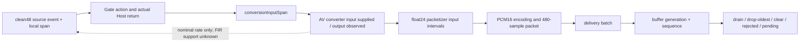

# Test3 · ACE3 Step 2B O3/O4 实现复核

日期：2026-10-13。基线分支 `ACE3`；冻结 HEAD `83d7234952e2f518d0a8b0723470526afe94fa97`。

**结论：IMPLEMENTED_TESTED。** 仅表示 O3/O4 旁路诊断实现及本轮授权的非设备检查通过，等待主控复审。未提交、未推送；没有声学算法修复。真实设备影响为 **NOT_MEASURED**。

依据：[Step 1 审计](test3_aec3_system_audit_20261012.md)、[Step 2 设计](test3_ace3_step2_observability_review.md)、[Step 2A 冻结实现及质量复核](test3_ace3_step2a_implementation.md)。三份文档均与 HEAD 字节一致，本轮没有修改。

## 1. 修改范围及实际落点

共 13 个源码、测试、工程及报告文件。未改 Bridge、AEC3 库、Runtime、Qwen Adapter、正式协议或参数。

| 文件 | 变更与函数位置（本轮工作区行号） |
|---|---|
| [MacSpeechAcousticEchoHost.swift](../../apps/macos/Aftelle/MacSpeechAcousticEchoHost.swift) | `processCaptureSpans:1283` 最终返回；`gatedCaptureSpans:2819` 输入/既有分类结果；`captureWhileGateIsOpen:3698`；`appendSourceGatePreRoll:3814`；`suppressClosedGateFrame:3838`；`suppressCaptureFrameAndCloseGate:3862`；`drainSourceGatePreRoll:3914`；`enterFallback:4617`；`resetSourceGate:4771`；同文件 DEBUG 辅助扩展 `5030` 起；测试专用 Gate 分支夹具 |
| [MacSpeechAudioCapture.swift](../../apps/macos/Aftelle/MacSpeechAudioCapture.swift) | FrameBuffer `begin:256/end:272/append:284/drain:348`；Encoder `encode:375`；Packetizer `append:423/reset:464`；Converter `deinit:579/convert:606/convert(captureSpans):665/resetForGenerationTransition:702`；`processCaptureLocked:1893` 内 `2009` 起的实际 delivery 边界；同文件 DEBUG 辅助扩展 `2444` 起 |
| [MacSpeechAudioObservationTypes.swift](../../apps/macos/Aftelle/MacSpeechAudioObservationTypes.swift) | 仅在 kind 8 后追加 9–24；Event 布局、旧 kind/status/cursor 均未改 |
| [MacSpeechAudioLedger.swift](../../apps/macos/Aftelle/MacSpeechAudioLedger.swift) | 新增 DEBUG 标量字段编码、既有分支/原因映射、Gate action/state、最终 Host span 记录 |
| [MacSpeechAudioLedgerCursor.swift](../../apps/macos/Aftelle/MacSpeechAudioLedgerCursor.swift) | 新增 converter/packetizer 标量游标、跨 run 未知历史标记、PCM16 非有限/量化归零区间记录 |
| [project.pbxproj](../../apps/macos/Aftelle/Aftelle.xcodeproj/project.pbxproj) | 仅新增上述两个 helper 的 file/build/group/source membership；无 target、配置或编译条件改动 |
| [AudioObservationTests.swift](../../tools/ace3_observation_tests/AudioObservationTests.swift) | main 增加独立 `--ledger-only` 入口；原测试断言未减少或重写 |
| [AudioLedgerTests.swift](../../tools/ace3_observation_tests/AudioLedgerTests.swift) | 新增 Gate、转换失败、混合包、编码、跨 run、容量及 pending 内存夹具 |
| [AudioLedgerPipelineTests.swift](../../tools/ace3_observation_tests/AudioLedgerPipelineTests.swift) | 新增真实方法串联、开关等价、buffer/fallback 夹具；可链接现有真实 AEC3 后端 |
| [check.sh](../../tools/ace3_observation_tests/check.sh) | 仅追加 helper/测试源文件；原默认 451 和可选 456 测试流程保留 |
| [inspect_ledger.py](../../tools/ace3_observation_tests/inspect_ledger.py) | 新增离线来源/fragment/终态对账；先调用原 `inspect.py` 检查外层完整性 |
| [ledger_tests.py](../../tools/ace3_observation_tests/ledger_tests.py) | 对明确标注为合成输入的标量文件做正例和故意破坏来源的负例检查 |
| 本报告 | 本轮实现、证据和限制；不更改冻结结论 |

`MacSpeechAudioObservation.swift`、原 `inspect.py`、`AudioObservationFixtures.swift` 与冻结 HEAD 字节相同。源码中少量换行收紧用于维持既有 Lint 基线，没有大范围格式化或规则豁免。

## 2. O3：来源、Gate 动作和最终返回

### 身份与时间

唯一运行身份来自 O6 arm header 的 `run_id`；事件 ticket 为 `event_id`，`parent` 只作事件引用。O3 clean48 来源以 **run + gateInput.event_id + [0, frameCount)** 标识，正常帧为 480 个 float48 样本。gateInput 的 parent 指向已完成的 O1 Capture AEC frame；该 frame 的原 raw48 调用游标仍由 O1 解释。

Gate 后续动作没有向生产 span 添加字段。离线仅在 `(Host object alias, playbackSequence, captureFrameIndex, capture contentTime)` 唯一匹配时关联出生事件；没有匹配、重复、跨 arm 的旧来源或不能证明的 AEC parent 均为 INVALID。contentTime 是已有内容时间，不是身份本身或真实到达时间。source 事件 ID 不被 RELEASE 重新生成。

`entered/began/completed` 继续使用 O6 单调时钟实际读取值。RETAIN/RELEASE/ZERO 记录在执行既有分支的位置；Host final 输出在 `queue.sync` 返回之后记录，外层 O1 call 的 completion 仍在函数返回 defer 处。100ms 一批中的多个 Gate frame 不会成为多个 native 到达事件。

### 事件合同

| kind | 内容和记录时机 |
|---|---|
| 9 `gateInput` | Gate 入口：clean48 count、原 frame index、playback sequence、Gate epoch、内容时间、O1 AEC frame parent；不读取/复制 PCM |
| 10 `gateAction` | 已走入的 PASS=1、RETAIN=2、RELEASE=3、ZERO=4、RESET_REMOVAL=5；原 snapshot 的 frame/playback/epoch/classification/gate-open；本源 `[0,count)` |
| 11 `gateDecision` | flag 16：Gate 方法结束时已有 `lastClassificationBranch`、分类、Gate 状态、pre-roll 数量、hangover 数量。非 flag 16：parent 指向 action，保存动作时的当前 epoch、原因及 context |
| 12 `hostOutput` | flag 8 summary 保存本次实际返回 span 数及 call status；其余记录每个实际返回 span 的 snapshot、原源长度，以及返回数组拼接后的 sample 区间。parent 为本次 Host call |
| 21 `gateReset` | 清除前的 epoch、playback sequence、原 pre-roll 数及 close reason；每个待清项另有 RESET_REMOVAL |
| 23 `hostFallback` | 既有 fallback enum 的固定整数原因；不记录字符串/PCM，不改变 fallback |

分类 code：1 echoOnly、2 nearEndSpeech、3 doubleTalk、4 uncertain。分类 branch code 1–12 依次对应源码既有的 playback_inactive、alternative_echo_reference、no_match_isolated_near_end、no_match_uncertain、resident_only、immediate_double_talk、adaptive_double_talk、isolated_near_end、unaligned_isolated_near_end、low_correlation_near_end、locked_echo、uncertain；0 为未知，不补造依据。

close reason 1–6 对应 nonUserHangover、sourceEvidenceReset、residualEchoProtection、playbackLifecycle、routeRebuild、hostFallback；0 为未提供。ZERO context 1 表示 pre-roll 容量到期，2 表示 closed-gate 批次，3 表示 closing-gate 的已有预留；当前关闭帧还携带实际 close reason。保留没有具体 reason 的 0，不能由它猜测声学根因。

fallback code 1–11 对应初始化、render、capture、delay、stats、FIFO、residual echo、source alignment、source classification、route rebuild、requested 的既有错误枚举；不是新增故障判断。

### 终态规则

- clean PCM 本来为零仍可为 PASS；主动 ZERO 只由执行的清零分支证明，不能从振幅推断。
- RETAIN 表示进入原 pre-roll，尚未交付；之后按原身份跟踪 RELEASE、ZERO、RESET_REMOVAL 或 PENDING。
- RELEASE action 保留原 snapshot epoch，state child 另存当前 epoch。最终 returned snapshot 可能带生产逻辑设置的新 epoch，两者并列，不改写原来源。
- RESET_REMOVAL 表示从预留容器移除，不能单凭它认定声音消失：关闭 Gate 时可能已经生成 ZERO span 并最终返回。
- 有实际 hostOutput span 才为 HOST_RETURNED；整批 fallback 返回空时，即使之前已经 PASS/ZERO，终态仍为 DISCARD。不存在出生/动作/最终结果的可靠关联则 INVALID。
- PENDING 仅表示窗口内最后已知仍在预留或没有终结记录。它不证明 seal 时对象仍存活；未观测到的销毁/窗口外行为不能补记为 DISCARD。
- nearEndSpeech/doubleTalk 始终是既有分类标签，**不是实体真人认证**。

## 3. O4：转换、编码、分包与队列合同



### 单位与产生位置

| kind | 身份、区间、时刻、终态 |
|---|---|
| 13 `convert24` | converter object alias + diagnostic epoch；entered 在等待原 lock 前，began 在原 lock 内；输入游标单位是 **input sampleRate 样本**，输出游标单位 float24；actual AV input block 是否 supplied、AV 返回 status、实际 output frameLength；completed 在原调用退出时。失败 status 保留 3 |
| 14 `conversionBatch` | 整次 `convert(captureSpans:)` 的开始/结束、span 数、成功返回 packet 数；中途 throw 保留失败，即使已有局部 packet |
| 22 `conversionInputSpan` | 每个实际进入循环的 Host span，调用 makeBuffer 前创建；parent 为 batch，snapshot + 源长度；makeBuffer/convert 失败不标成功。未执行到的后续 span 不能当作已消费 |
| 15 `packetInput` | 实际追加的 float24 区间、前后 pending 数、输入 snapshot。游标与 production EvidenceSpan 独立，既有 EvidenceSpan 行为不变 |
| 17 `encode16` / 24 `encodingZeroRange` | 在原编码循环观察已有编码值；非有限样本数、非零 float 自然量化为 0 的数量及连续区间；kind 24 parent 指向 encoder event，不记录 sample 值 |
| 16 `packetReady` | 现有 packets.append 完成后记录 packet event ID、480-sample float24/PCM16 区间、ready 时刻、原代表 snapshot；parent 指向产出它的 packetInput |
| 18 `packetReset` | 原 reset 前的游标/尾段；status 1 为 packetizer reset，2 为 converter reset，3 为 converter deinit，4 为 packetizer owner deinit；2/3 的内部 FIR 尾部不可计数为已知样本 |
| 20 `deliveryBatch` | 真实 `processCaptureLocked` 的转换/入 buffer 代码周围记录；generation、成功 packet 数、失败或空 Host 输出。不是 Runtime received |
| 19 `bufferAction` | object + generation + sequence；status 6 accepted、7 rejected、8 dropOldest、9 drain、10 clear。append 记录原锁等待及结束；终结记录使用真实被移除/取出的 frame 元数据 |

`bufferAction.inputStart/End` 属于 **queue sequence 区间**，不是音频样本游标。`frameCount=bytes.count/2` 才是 PCM16 样本数。converter 的 epoch、packetizer 的 epoch、原 Gate epoch、generation 是独立命名空间；后两者分别通过 snapshot 和实际 buffer entry 关联，不能互相替代。

flags 1/2/4 为无 snapshot、snapshot Gate open、无内容时间；8/16 为 Host summary/classification result；32 为 AEC 内部 epoch 未接入；64 为 DSP support 未知；128 为 arm 前或前一 run 的状态历史未知；256 为输入 buffer 已提交给 AV 回调；512 为实际看到输出 frames；1024 仅标记隔离 Gate 测试输入；2048 表示编码归零区间事件未能记录。原 kinds 1–8 的 flags 含义不变。

### fragment 与有状态转换

1. **EXACT_LEDGER**：float24 append → packet 的所有交集，必须连续覆盖 packet `[start,end)`，无重叠、无空洞；每包 480 样本。可唯一关联的编码事件和 queue 终态也属本地程序账本。
2. **NOMINAL_RESAMPLE**：把 converter 输出游标按 `inputRate/24000` 映射到已提交输入游标，以有理数保存边界，再与各 Host returned span 求交。列出所有可证明的逻辑 parent ID、source-span 局部区间、原 Gate 来源/动作及返回资格。
3. **DSP_SUPPORT_UNVERIFIED**：AVAudioConverter 回调 supplied 证明 buffer 已提供；API 没有暴露内部逐样本消费/滤波支撑。跨调用缓存、priming、群延迟、未来/历史贡献不能由名义比例还原。不能把 nominal parent 宣称为唯一物理来源。
4. **INVALID**：来源缺失/重复/预 arm、fragment 缺口、编码/交付数量不符、未唯一提交的 Host span、全局 O6 失效等；不以 snapshot 填补缺失 parent。
5. **PENDING**：仅指已观测但还没有后续终态的 packet/尾段/预留；无队列 entry 的 packet 不会被写为 delivered。

同一 packet 可以包含多个 append fragment、多个 nominal parent，以及不同 PASS/ZERO 状态。`representative_snapshot` 单独展示；不将它扩张为整个包的来源。packets 与 buffer entry 只在同线程的唯一 delivery envelope 内，按实际顺序及总数一致时关联；歧义为 INVALID。

转换器先产生局部 packet，后面的 span 再 throw 时，batch 内这些 packet 为 DISCARD_BATCH_FAILURE。实际输出但尚未送入 packetizer 的转换失败区间保留 INVALID_CONVERSION_OR_UNRETURNED_OUTPUT；不能称其已交付。跨 run 的有状态转换未做真实 reset 时，保留未知历史标记，不能假定新 FIR 起点。

## 4. 样本所有权与 INVALID

账本分命名空间校验，**不要求 48k 与 24k 数字相等**：

- Host 返回每个源 span 的 `[0,N)` 都列入 `host_input_ownership`。仅一次完整 AV input submission 才为 SUBMITTED；重复、未走到循环、缺少关联等记 INVALID 和原因，不静默省略。
- Gate 账本区分容器动作、内容清零、最终返回。RESET_REMOVAL 和 ZERO 不与最终交付计数重复相加。
- float24 实际产出按 packetizer 的实际 append、完整 packet、尾段 reset/deinit discard、末次 PENDING 或 INVALID 解释；转换失败的输出单列。
- packet 的 float24 fragment 覆盖必须完整；编码非有限/量化归零有原位置，但自然零值不冒充主动 ZERO。
- buffer identity 只能一次 accepted，最多一个 drain/drop/clear 终态；重复或没有 admitted 的终态为 INVALID。rejected 保持独立，不伪造 queue sequence。拒收的所有细分原因未增加生产判定，无法区分时不推测。
- O6 lost、pending producer、overflow、写失败、缺失 seal、ticket/run 不一致优先使账本 INVALID。原 reader 的文件长度及 reserved/written/lost/pending 守恒检查仍执行；控制侧 seal 结果也必须核对，不能只信磁盘 footer。

本次确定性 pipeline 的实测对账（fake/real 均为内存合成输入）：

| 层 | 结果 |
|---|---|
| 32 个 Host clean48 来源 | 15,360 samples；全部最终返回、各提交一次 |
| AV 实际 float24 输出 | 7,664 samples；两个 reset epoch 的首个 480 输入分别输出 232，其余为 240 |
| 完整 packet | 14 × 480 = 6,720 samples |
| packetizer 尾段 | reset/deinit 丢弃合计 944；`6,720 + 944 = 7,664` |
| buffer | 6 DRAINED、6 DROP_OLDEST、2 CLEARED；`6+6+2=14` |

`15360/2 - 7664 = 16` 只是名义差额，**不是测得的 16 个丢失输入样本、真人损伤或内部缓存精确数量**。这部分内部归属继续 DSP_SUPPORT_UNVERIFIED。

隔离两段 float24 240 样本的夹具证明一个 20ms 包可以混合不同资格；真实 Gate→AV converter 夹具则出现三个 append fragment 组成首包、nominal parent 来自两个 Host span。两种描述同时保留，不能强行合成“两个 callback 正好等于一个 packet”。

## 5. O1/O6 复用、资源与实时风险

schema_version 仍为 1；只追加新 kind，旧字段布局/事件含义不变。原 reader 可读取新文件；新 reader 先运行原完整性检查。MPSC reservation、release/acquire、worker、arm/seal、overflow/lost/pending 协议未改。

| 项目 | 结果 |
|---|---|
| event stride | 224 bytes，实测 |
| event slots | 16,384，未扩大 |
| recorder 容量证书 | **4,128,768 bytes**，保留原 64 KiB 元数据余量与 worker stack 预算 |
| 窗口 | 最长 60 秒；默认关闭、显式 arm/seal |
| 新游标 | 48-byte 值；每个已有 converter/packetizer 持有，不新增来源数组/字典 |
| 编码临时观测值 | 248-byte stride，包含可选 event 与两个 run-length 标量；不储存 PCM |
| Host/buffer | 每实例新增一个 UInt64 标识/关联标量；不新增流、队列、worker 或定时器 |

新增音频路径仅使用已冻结的非阻塞 recorder begin/finish、已有锁/Host queue 所有权内的标量更新及有界元数据遍历。未增加等待锁、spin、JSON、文件 IO、FFT、相关性或重复转换/编码；未额外复制完整 PCM。Host 最终返回的诊断仅读取局部结果，不在 queue 外读 Host 可变状态。converter 游标沿用原 lock，packetizer 游标沿用原值/锁所有权。

记录 pre-roll/returned spans/queue frames 的数量受原生产容器和本次 callback 范围约束，诊断不扩容生产容器。fragment 在离线 reader 中计算，不分配实时 fragment 表。编码 run-length 最坏可每样本产生事件；发生 ring 满会按 O6 规则失效并停止接纳，不截断后宣称完整。新 flag 2048 及全局 lost/INVALID 保留失败。

容量证书是本组件固定分配和预留额度的验证，**不是进程 RSS 或真实回调峰值证明**。新增原子操作、时钟读取、ARC、snapshot 标量构造、逐样本分支与 metadata 遍历均有成本；可能增加原 lock 持有时间及生产实际耗时反馈。未减去诊断耗时、固定 delay 或改阈值。

离线 Python 会建立列表/关联表并多次扫描事件，只在 seal 后、非音频线程运行；未作 60 秒满负载分析器吞吐基准，不把它的工作内存计为音频实时 ring，也不在 App 内启动它。真实设备 P99/CPU/RSS/underrun/实际 delay 反馈全部 **NOT_MEASURED**，留待单独授权的 Step 2D。

## 6. 非设备测试及退出码

工具：Xcode 27.0 / 27A266a；Apple Swift 6.4 (`swiftlang-6.4.0.34.1`)；SwiftLint 0.65.1。沿用 Step 2A 工程、scheme、配置、DerivedData、既有 bridge 与 AEC3 静态库；未下载模型、未启动 App 或音频设备。

| 检查 | 最终结果 | 退出码 |
|---|---|---:|
| Debug xcodebuild，CODE_SIGNING_ALLOWED=NO | BUILD SUCCEEDED | 0 |
| Release xcodebuild，同工程 | BUILD SUCCEEDED | 0 |
| 原 O1/O6 suite | **451 checks PASS** | 0 |
| 原 suite + 真实 AEC3 扩展 | **456 checks PASS**；原 63,360 PCM bytes / 66 snapshots 等价检查通过 | 0 |
| TSAN recorder-only | **38 checks PASS**，无 race 报告；仅 recorder 专项 | 0 |
| 旧 converter timing-only | **90 checks PASS** | 0 |
| 旧 Test3 timing-only | **8 checks PASS** | 0 |
| 新 O3/O4 Swift suite，fake backend | **81 checks PASS** | 0 |
| 新 suite，pipeline 链接真实 AEC3 | **81 checks PASS**；不是 81 个实体场景 | 0 |
| 新离线 ledger suite，fake/real 各一轮 | **各 69 checks PASS** | 各 0 |
| 冻结 HEAD / 当前源码 paired golden | PCM、决策、旧事件顺序、转换、packet、queue 摘要一致 | 0 |
| 非诊断 token 比较、符号隔离、布局证书、Git diff check | PASS | 各 0 |
| SwiftLint 全部本轮 Swift 文件 | 仅原 16 errors / 63 warnings；增量检查通过 | 2（历史错误），增量比较 0 |

451/456 与新增 81/69 分开报告。原测试仅增加 main 的新入口，原断言未减少。所有新数据为明示的合成内存输入；没有实体人声 ground truth。

新增覆盖：

| 要求 | 验证内容 |
|---|---|
| A/B | 真实 Host 方法上相同全零 PCM 可分别 PASS/ZERO；动作判断不靠振幅 |
| C/D/E | 私有 Gate 分支隔离夹具：RETAIN→RELEASE 保留原 frame；RESET_REMOVAL/PENDING；hangover PASS→ZERO，origin/current epoch 分开。此夹具标 flag 1024，离线不冒充有 AEC 祖先的 source |
| F | 第二帧 backend throw：首帧确已进入 Gate，但整批返回空；实际 returned span 为零、终态 DISCARD，fallback 原因明确 |
| G/H/I | 原 AV 转换器跨 span 实际产出、232/240 变化、两段 10ms 直接分包、实际 PASS/ZERO 混合包全部 fragment、代表 snapshot 不扩张 |
| J | 测试宏内的 post-convert 故障；已产生局部 packet 后 throw；后续未执行输入和同源重提均显式 INVALID |
| K | NaN/Infinity、非零自然量化归零、原零值；编码 bytes 不变、非有限/量化 run 区间分别记录 |
| L/M | 容量 2 buffer 的 drop-oldest、stale reject、begin/end clear、drain；generation 7→8，converter/packetizer reset 尾段与 deinit 尾段 |
| N | 缺失 AEC parent、跨 arm 来源、重复 ticket/来源/queue terminal、删 Host return、区间断裂、编码/交付数量不符；预 run FIR 历史不伪造 |
| O | worker 停滞导致 capacity+1 overflow、lost=1、停止接纳；in-flight seal pending=1；全局 INVALID 不产生局部 PASS；原 38/451 同时保留写失败等故障覆盖 |
| P | arm 前后相同输入比较；与冻结源码的独立 paired build 比较；无 observation 宏的旧定向测试、Release 符号检查 |

复现入口（均非设备）：先编译 Debug，再 `bash tools/ace3_observation_tests/check.sh --production-aec`；随后分别执行生成的 `step2a-tests` 和 `step2a-production-aec-tests`，传入本轮独立结果目录及 `--ledger-only`；对该目录运行 `python3 tools/ace3_observation_tests/ledger_tests.py <结果目录>`。旧 suite 只执行 `--converter-timing-only` / `--test3-timing-only`，没有运行其全量实验或 PCM replay。

TSAN 使用同一源列表和 `-sanitize=thread --recorder-only` 的编译/运行方式。paired golden 使用冻结源码副本与当前源码、同一份合成 fixture；其生成脚本和摘要仅保存在本地忽略目录。

本轮证据位于本地 `.build/ace3-step2b/`：`original-tests.log`、`new-fake.log`、`new-real.log`、`ledger-python-*.log`、`tsan.log`、`old-targeted.log`、Debug/Release build logs、`golden.log`、`golden-before/golden.json`、`golden-after/golden.json`、`lint-*.json`、`non-diagnostic-equivalence.json`、`symbol-isolation.json`、`layout.log`、`conservation-example.json`、`frozen-integrity.json`、`fixture-fake/ledger-artifacts.json` 和 `fixture-real/ledger-artifacts.json`。这些是本轮合成标量/构建证据，不提交生成文件，不引用私人音频内容。

## 7. DEBUG / Release 隔离

新增运行实现均在 `#if DEBUG && AFTELLE_AUDIO_OBSERVATION` 内；没有新增启用入口，沿用明确 arm。测试 Gate 状态设置、转换故障注入另需 `AUDIO_OBSERVATION_TESTING`。

最终产物 `nm` 检查：App Debug 有 ledger/recorder 符号；App Debug 的 `observationTestGate` / `observationTestFailure` 为 0；Release ledger/recorder/测试注入符号均为 0。无 Runtime API、DR 字段或正式协议新增。

原非诊断源码去除 observation 编译块后，允许三处等价语法归一化：单表达式 lock closure 改为显式 return、Host `queue.sync` 结果先绑定再返回、map 的显式 return。其余 token 比较完全一致：Host 20,430，Capture 9,581。仅作为静态旁证，与运行比较共同使用，不单凭 token/编译声称等价。

## 8. PCM、决策与 packet 等价性

开关 fixture 比较逐字节 PCM、完整既有 observation snapshot、Gate epoch、AEC 方法顺序及 delay 参数；pipeline 比较所有 packet bytes/顺序/代表 snapshot/activity、buffer frame/generation/sequence、接受/丢弃计数及 backend 调用。

冻结版与当前版使用同一编译模块名、相同输入及后端运行 paired golden；fake/真实 AEC3 的上述摘要一致。44.1k/48k 原输入转换的 float PCM bytes 及内容时间摘要也一致。旧 O1 事件在去除不可比的真实时钟/thread/run/object 别名并重映射旧事件 ticket 后，语义字段及旧事件相对顺序一致；**新增 O3/O4 ticket 不要求与冻结版本同号，真实耗时也不宣称相等**。

真实 AEC3 pipeline 的 packet bytes SHA-256（两版相同）：`271f016288f465403fcac0cd208c3ce7641c7e23cf7b71a3c0d072a97dd52dee`。完整 paired 摘要见本地证据，未在公开报告记录 PCM。

上述证据只覆盖确定性方法和合成事件。原 451 套件也经过 native callback 测试入口，但 pipeline 中的 delivery envelope 为明确的合成测试包围；不把它包装成设备已测、实际 Runtime 收到或真实 delay 反馈等价。设备闭环受到真实耗时反馈影响，仍需 Step 2D。

## 9. SwiftLint 增量结果

使用相同 SwiftLint 0.65.1 对冻结 HEAD 副本和最终文件检查，以文件、rule、severity、问题类型对应，未用整库历史失败充当本轮新增失败。

| 文件范围 | 冻结 HEAD | 本轮最终 |
|---|---|---|
| Capture | 5 errors / 21 warnings | 5 / 21 |
| Host | 11 errors / 42 warnings | 11 / 42 |
| 本轮 helper / Types / Swift tests | 无新增违规 | 0 errors / 0 warnings |
| 合计新增 | — | **0 errors / 0 warnings** |

原超长文件/类型等历史问题仍在；没有增加 disable、规则豁免、忽略路径或修改配置。历史规则对应一致，不要求消除原 16 errors。Python 文件语法及行为由独立 ledger suite 验证，不将其声称为 SwiftLint 覆盖对象。

## 10. 仍然未知的声源与时序

1. **O2 未实现**：AEC3 内部 reset epoch 不可见；O1 FIFO epoch、O3 Gate epoch、O4 converter epoch 均不能冒充它。H1/H2 没有因本次工作得到验证。
2. **内部消费/滤波贡献未知**：只能证明 AV input submission 和实际 output 数，不能还原每个输出样本的唯一物理支持，不能由输入输出差额定位真人损伤。
3. **O0/O5 未实现**：没有新增物理播放/真人真值或 Runtime received 观测；buffer DRAINED 不等于 Bridge/Runtime 正式接收或中断授权。
4. **来源不完整即失效**：arm 前的预留、跨 run converter 历史、旁路/fallback 未有 Gate 出生的 Host 输出、缺失或重复来源均明确 UNKNOWN/INVALID；不用代表 snapshot 猜补。未观测对象销毁或窗口外终态保持 PENDING/未知。
5. **真实性能未知**：P99/CPU/RSS/underrun 和实际 delay 反馈均 NOT_MEASURED；静态分析和 TSAN recorder 不是整条设备链并发/无扰动证明。convert24 completion 包含原 wrapper 的分包处理，不是独立的 AV DSP 完成时间；packetReady 是本地包创建边界，不是设备或 Runtime 到达。
6. **实体声学结论没有新增**：真人损失层仍 UNVERIFIED，纯回声错误资格未被修复；本轮只让已执行分支与 PCM 交付账本可检查，不能据合成夹具认定声源正确或 Test3 PASS。

## 11. Stage 7 与 Git / 资产完整性

按 [Stage 7 checklist](../stage7_forbidden_checklist.md) 任务前后检查：**PASS**。

| 项目 | 结果 |
|---|---|
| 触碰六条红线 | 无 |
| 是否改代码 | 是，仅本报告 §1 的 DEBUG 诊断和非设备测试 |
| Runtime API / DR schema / DR fixture | 未改 |
| Provider / Qwen / Runtime 权限及取消语义 | 未改 |
| AEC3 DSP、Gate规则、baseline、timing lock、pre-roll/hangover、delay输入 | 未改；等价性见 §7–8 |
| 平台 target / Stage 8 / scheduler / memory owner | 未新增或进入；O6 原 worker 未改变 |
| 设备启动 / 录音 / 外放 / HIL / 旧 PCM replay | 未执行 |
| Git | ACE3 / 原 HEAD 不变；index 空；未 commit/push；`git diff --check` 通过 |
| 冻结文件 | 三份冻结报告、O6 recorder、原 reader/fixture 与 HEAD 字节相同 |
| 两个原有 PCM | 原路径仍为 untracked；未读取、hash、暂存、移动、修改或删除其内容。未以内容校验冒充资产访问 |
| SSD / quarantine | 未访问、未修改 |
| 隐私 | 新诊断仅标量 ID/时间/区间/枚举/计数；无 PCM、转录、真实设备 UID、Key/Token 或私人绝对路径；本地证据不纳入源码交付 |
| 是否停止请求扩大范围 | 无需扩大本轮实现范围；下一阶段需要独立授权 |

## 12. Step 2C 条件与停止状态

**可提交主控复审，并申请 Step 2C 的单独授权。** 当前 O3/O4 已具备所列非设备账本和失败语义；不代表 Step 2C 已批准，更不代表 Step 3A 具备全部执行前提。O2 内部状态、其他设计观察点及 Step 2D 设备影响验证仍缺失。

本轮没有确认新的生产声学算法缺陷，也没有自动修复既有审计假设。后续应先复核来源键、nominal/DSP 边界、事件负载和 INVALID 处理，再决定授权；不能用观察到的类别替代实体声源真值。

```text
Step 1 = FROZEN
Step 2 Design = APPROVED
Step 2A = FROZEN
Step 2B = REVIEW_PENDING
Step 2C/2D = NOT_STARTED
Step 3A HIL = NOT_STARTED

Test3 = BLOCKED
execution_authorized = false
NO_PATCH（生产声学算法）
```

完成本轮交付后停止，等待主控审核；不 commit/push、不进入后续步骤、不修改 Test3 PASS 合同。
