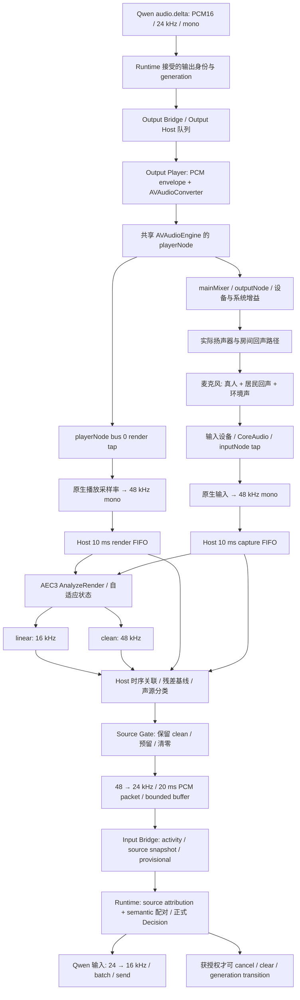
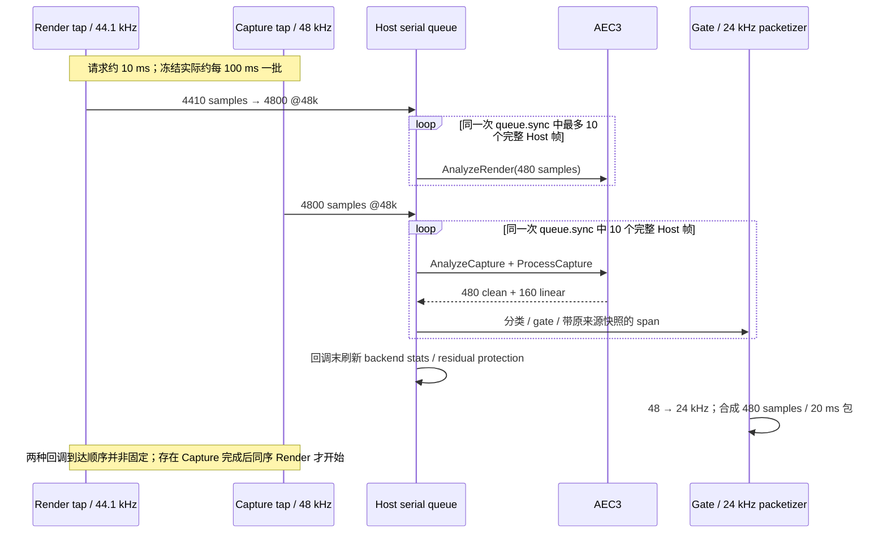

# Eterna Aftelle · Stage 7.5 / Test3 · AEC3 系统级审计

日期：2026-10-12（Asia/Shanghai）

审计分支：`ACE3`

审计源码：`30542375a0e74e77f9340a16d989d4101ffe3b98`

状态：**Test3 = BLOCKED；execution_authorized = false；NO_PATCH**

> 发布说明（ACE3 Step 1）：ACE3审计 = ACCEPTED / FROZEN。以下“本轮”及未提交、未推送等交付描述保留原审计形成时的记录；本次发布仅做链接脱敏与格式修正，未改变实验数字、技术判断或审计结论。

交付方式：本报告只保存在工作区，未提交、未推送；等待主控审核。

## 1. 结论与证据边界

1. **拓扑与同步**：当前正式路径确实是共享 AVAudioEngine 的 Player render tap → WebRTC AEC3，Capture 与 Render 各自转换到 48 kHz，Host 再按 10 ms 分帧。Render 包含应用的淡入淡出和播放前重采样，但 tap 位于 playerNode 输出、mainMixer 和物理设备之前，不能称为测得的最终扬声器 PCM。请求约 10 ms 不保证硬件回调为 10 ms；冻结运行实际为约 100 ms。整批串行提交与 AEC3 内部占用/Reset 的关系有强证据，**消除 Reset 已被证明不足以消除错误资格**。
2. **真人在哪里丢失**：已有软件保护源证明两处独立损失：AEC3 linear 尚有近端分量而 clean 接近零，以及 clean 尚有合格能量却被 Host/Gate 清零。它们不能代替当前版本、当前物理路线的实体真人证据。Apple 路线另有真实短语的 VAD 与相关性双重阻断；当前 WebRTC 路线未串接 Apple Voice Processing，不能把 Apple 历史失败移植为本路线的原因。
3. **资格与插话架构**：Host 把低相关、残差能量、clean/linear 一致性和历史基线组合为 near-end/double-talk。这些可以反映“当前参考解释不了的声音”，不能单独证明“有真实近端人声”，更不能证明插话意图。冻结纯回声完整命中这些现行规则：42 个错误资格帧、4 条确认链。正式 Runtime 中断仍被声源归属未验证条件阻止，但已发生 1 次 provisional pause/resume，播放体验并非完全不受错误资格影响。

本轮**没有确认一个尚未修复、能解释并修复 Test3 的 Aftelle 索引、数组、相关公式或 Runtime 越权 Bug**。这不是“代码无 Bug”的结论。固定 WebRTC 依赖存在一处新定位的 Reset 事件传播不对称，代码事实可确认，其是否属于应修缺陷及声学影响仍标为 **HYPOTHESIS**，见 §7。历史已修工程问题、当前算法限制、待证系统问题分别列出，不能混记为 Codex Bug。

### 1.1 分类规则

| 分类 | 本报告含义 |
|---|---|
| `CONFIRMED_ENGINEERING_DEFECT` | 有实现或契约错误证据；“已修”与“当前仍存在”必须区分。不能只凭失败输出反推实现 Bug。 |
| `CONFIRMED_ALGORITHM_LIMITATION` | 固定实现、固定路线或固定候选在冻结证据上不满足要求；不声称所有同类算法均不可能。 |
| `HYPOTHESIS` | 已有明确代码路径或现象，但缺少错误性、影响范围或因果验证。 |
| `UNVERIFIED` | 缺少对应输入、物理标签、设备状态或完整链路证据，不能判定。 |

只进行了 Git 操作、源码/依赖/文本证据阅读、哈希检查和保存标量的条件复核。未运行 App、构建、AEC 回放、模型、训练、实体录音、扬声器实验；未读取私人 PCM 内容或权重；未修改生产代码、参数或验收合同。以下历史实验数字来自已保存证据，**不是本轮重新执行的实验结果**。

## 2. Git 收口与资产保护

| 项目 | 核验结果 |
|---|---|
| 仓库 | [Eterna_Aftelle](../../) |
| 原分支 | `research/test3-audio-sdk`，与预期一致 |
| 原 HEAD / 审计基线 | `30542375a0e74e77f9340a16d989d4101ffe3b98`，`[7.5] 技术研发训练收口` |
| 原远端 | `origin = https://github.com/JerryYork3516/Eterna_Aftelle.git` |
| 待提交变更 | tracked / staged 变更均为 0；仅两个既有 untracked PCM。不创建空提交。 |
| 原分支推送 | 显式推送原分支成功，`Everything up-to-date`；live remote SHA 与 HEAD 一致。 |
| 新分支冲突检查 | 创建前本地及远端均不存在 `ACE3`。 |
| 新分支 | 从上述最新 HEAD 创建 `ACE3`，推送成功，跟踪 `origin/ACE3`；远端 SHA 同上。 |
| 本轮新 Git 提交 | 无。报告未提交、未推送。 |

两份原有 untracked 文件保持原位，未暂存、未解码、未播放：

| 文件 | SHA-256 |
|---|---|
| `tools/qwen_live_receive_probe/interrupt_segment.pcm` | `232f2366c35908e6ea177903d8489785fc349c97402892d60d88998f3375bfe3` |
| `tools/qwen_live_receive_probe/prompt_segment.pcm` | `c44ac037ded2066c8acf3b202b43ca4f88827d830bf96d8c13ce42cc9c67e4c8` |

SSD 只读本任务相关的 closeout、JSON 和清理说明文本；quarantine 未恢复、删除或修改；未全量重算 SSD 资产哈希。未暂存 API Key、私人音频、缓存、模型、生成物。未使用 `git add -A`、reset、clean、force push，也未覆盖原有改动。

## 3. 证据索引与版本绑定

仓库内链接相对于本报告；仅本地保存的证据使用引用身份。后文 `Sx:行号` 指向本表文件；范围后的函数名是定位依据，行号以审计 HEAD 为准。

| 索引 | 源码与范围 |
|---|---|
| S1 | [MacSpeechAudioCapture.swift](../../apps/macos/Aftelle/MacSpeechAudioCapture.swift#L37)：采集、共享引擎、格式转换、时间戳、20 ms packet 与 frame buffer。 |
| S2 | [MacSpeechAudioOutputPlayer.swift](../../apps/macos/Aftelle/MacSpeechAudioOutputPlayer.swift#L38)：Provider PCM → envelope → 播放格式。 |
| S3 | [MacSpeechAudioOutputHost.swift](../../apps/macos/Aftelle/MacSpeechAudioOutputHost.swift#L205)：播放队列、generation、pause/resume、设备切换。 |
| S4 | [MacSpeechAcousticEchoHost.swift](../../apps/macos/Aftelle/MacSpeechAcousticEchoHost.swift#L820)：AEC 调用、关联、基线、分类、Gate、诊断。 |
| S5 | [MacSpeechWebRTCAECProcessor.swift](../../apps/macos/Aftelle/MacSpeechWebRTCAECProcessor.swift#L7)：Swift/C 桥和输出延迟。 |
| S6 | [AftelleAECBridge.mm](../../tools/webrtc_aec3/bridge/AftelleAECBridge.mm#L19)：48 kHz AudioBuffer、AEC3 创建、render/capture、reset。 |
| S7 | [MacSpeechRealtimeBrainInputBridge.swift](../../apps/macos/Aftelle/MacSpeechRealtimeBrainInputBridge.swift#L750)：pump、activity、provisional、Runtime 声学观察。 |
| S8 | [AppController.swift](../../apps/macos/Aftelle/AppController.swift#L691)：路线绑定、formal 开关、provisional 与正式命令消费。 |
| S9 | [RuntimeCore.swift](../../apps/macos/RuntimeCore/RuntimeCore.swift#L5622)：观察配对、资格验证、正式中断决定。 |
| S10 | [QwenRealtimeResidentBrainAdapter.swift](../../apps/macos/RuntimeCore/QwenRealtimeResidentBrainAdapter.swift#L344)：音频 delta、输入格式转换与发送。 |
| S11 | [MacSpeechDeviceMonitor.swift](../../apps/macos/Aftelle/MacSpeechDeviceMonitor.swift#L39)：HAL VAD 时间历史和设备绑定。 |
| S12 | [MacSpeechAudioHost.swift](../../apps/macos/Aftelle/MacSpeechAudioHost.swift#L373)：route rebuild 与输入生命周期。 |
| S13 | [MacSpeechRealtimeBrainOutputBridge.swift](../../apps/macos/Aftelle/MacSpeechRealtimeBrainOutputBridge.swift#L218)：Runtime 输出身份校验与播放转交。 |

固定 WebRTC checkout 为 `9f30e83c018647b05804571699cf22b1f0f3409e`，位置 `.build/webrtc-aec3/checkout/src`；下文 `W/` 指此目录。`tools/webrtc_aec3/sync.sh`、VERSION、BUILD_METADATA 对应此版本。已有 checkout 差异为最小构建补丁及构建目录，未改 DSP。当前静态库 SHA-256 与 BUILD_METADATA 一致：

`b6a7235440eadc7b87a6251d53e651e36a734f1d88efc19f154a47de84c64898`

Xcode 工程同时在 Debug/Release 定义 `AFTELLE_WEBRTC_AEC3`，并链接 bridge 与该 xcframework（`apps/macos/Aftelle/Aftelle.xcodeproj/project.pbxproj:130–131,523,563`）。不以未执行的本轮构建证明可运行性。

### 3.1 冻结证据

| 索引 | 证据与适用范围 |
|---|---|
| E1 | [AEC 复审入口](test3_aec_review_20261004/README.md)：Apple、WebRTC 历史物理/软件路线、版本和局限。 |
| E2 | [源资格复审 findings](test3_aec_review_20261004/source-qualification-followup/findings.md)：42 / 4、ring 身份、Reset 原因、FIFO 排程反例；同目录 JSON 为结构化见证。 |
| E3 | [42 帧标量见证](test3_source_qualification_design_20261005/evidence/original-aec3-42-qualification-witnesses.json)：本轮复核当前分类条件的输入。 |
| E4 | 阶段定位报告（仅本地保存；引用身份：`test3-aec3-stage-localization:report.md`）：较早版本的软件近端注入，linear / clean / Gate 分层损失；不得升级为当前实体真人证据。 |
| E5 | [Apple graph audit](test3_aec_review_20261004/apple-graph-audit.md)、[acoustic effect](test3_aec_review_20261004/apple-acoustic-effect.md)：真实物理标签、VAD、通道与帧转换。 |
| E6 | [DTLN 固定候选复审](test3_source_qualification_design_20261005/README.md)：原 AEC3 保护区间、DTLN shadow、参考实现对照。 |
| E7 | [WebRTC negative](test3_aec_review_20261004/webrtc-negative.md)、[internal divergence](test3_aec_review_20261004/webrtc-internal-divergence.md)、[temporal support](test3_aec_review_20261004/webrtc-temporal-support.md)：旧负控、delay/主峰/时序替换失败。 |
| E8 | [HPF findings](test3_aec_review_20261004/hpf-followup/findings.md)、[fresh metrics](test3_aec_review_20261004/fresh-aec-metrics.md)、[rejected ERLE screen](test3_aec_review_20261004/rejected-erle-screen.md)：已排除或不足的修法。 |
| E9 | LocalVQE 最终内存恢复 closeout（仅本地保存；引用身份：`localvqe-source-memory-resume-20261012-748963bf:closeout.md`）：数学缓存复用后 CAL_TAU 失败；不是新物理验证。 |
| E10 | LocalVQE native pilot（仅本地保存；引用身份：`localvqe-source-pilot-20261012-external-308dc337:run-closeout.json`）、CAL_P diagnostic（仅本地保存；引用身份：`localvqe-calp-diagnostic-20261012-e4b19944:closeout.md`）：预算失败、求解器正确性与取证缺口。 |
| E11 | 渲染后参考取样与否决定位（仅本地保存；引用身份：`test3-render-reference-observation:report.md`）：历史 Apple 受控虚拟设备路线，Audio Unit post-render 与设备回读一致；只换参考的 8 次回放仍失败。 |

本轮对 E1 manifest 的 16 项源码哈希核验：15 项与当前一致；Runner 是已记录的后续证据保存补丁，当前哈希与 E2 的 runner_patch_snapshot 一致。E2 manifest 的 9 项源码、25 项已发布文件全部匹配。尤其 Host、Capture、Processor、Bridge、Input Bridge 未漂移，因此 42 帧证据可以约束当前分类实现。核心哈希：

| 文件 | SHA-256 |
|---|---|
| S4 Host | `51cbfbb9f6b2aefedc8af37c74b8892a68d2919bf260fcc082a07ca287a1df85` |
| S1 Capture | `ef09463cc03fac9e90d177d3d05e5c05ce4d1e6abec9d7a203f3a3608d13fc41` |
| S5 Processor | `370261422bbd280df5169b76b849b7b62355a25403def60d3aed68399e7034ff` |
| S6 Bridge | `1d1cb45377b5b2252af49a6abbb03026502aba408d98d90476c4611c9be9c45d` |
| S7 Input Bridge | `8becf334f6cdee299a97d1a75451638440e5013b9fd560cbd71c84379a013c19` |

E2 的实体负控明确为用户不说话、不敲击、无其他设备发声，Timesintelli USB 输入 + Mac 内置扬声器，软件注入为 0。采集 1120 个 Host 帧、render 1119 帧；播放中 1060 帧。手动结束使 post-start 1080 帧未达到目标 1100，`exact_replay_ready=false`，不能据此把已有片段说成损坏，也不能把片段的逐位复现说成完整验收。

## 4. 完整链路与真实时序

### 4.1 拓扑：Render 是电信号参考，麦克风包含物理回声

Apple Voice Processing 是替代 backend：`inputNode` 的 Apple 处理后信号进入 Host 的 Apple 分支；当前 `.webRTCAEC3` 初始化会拒绝仍启用 Voice Processing 的状态（S1 `configureIfNeeded:1268–1315`）。图中不存在“Apple VP → WebRTC AEC3”串行双 AEC。硬件或系统本身是否有其他处理，缺少逐项旁路观测，保留 UNVERIFIED。

Provider 的 sample-count 时间戳（S10:1899–1915）不是设备播放 hostTime。实际 Host render 参考从 tap 的 AVAudioTime 建立；不能把网络 delta 到达当作声学播放时间。Output Bridge/Host 先检查会话、response、generation，Player 在 schedule 前对字节做 envelope，再重采样（S2:184–230,342–416；S3:205–301；S13:218–301）。故参考不是未经处理的 Qwen 原始网络 PCM。

Render tap 安装在 `playerNode.installTap(onBus:0, bufferSize:480, format:nil)`（S1 `installRenderReferenceTapLocked:1929–1948`）。在冻结 44.1 kHz 输出上，480 个请求采样约 10.884 ms。参考未直接包含后续 mixer、设备音量、扬声器非线性与房间变化；本轮未发现 Player/Capture 主链自行更改播放增益的代码，也没有实测证据确认冻结运行发生了某次未知增益变化。因此“参考一定错误”与“参考就是最终物理 PCM”都不成立。

已有 E11 明确缩小过参考缺口：历史受控 Apple 路线 player 与 mixer 完全一致，Audio Unit post-render 与虚拟设备回读在 14 个窗口的相关/增益约为 1，差值 RMS 最大约 5.9e-9；差异位于 mixer 到 Audio Unit 输出之间。该受控结果不是当前实体扬声器测量，也没有确定具体内部滤波器。替换参考后，377 个 VAD/RMS 有效软件近端帧仍拒绝 357 个（原路径拒绝 366 个），首次开门反从187推迟到192。故不把“把 tap 挪到 mixer / 换最终参考”重提为充分修法。

### 4.2 回调与帧不是同一个时间单位

这是示意顺序，不声称每批 Render 必先于 Capture。冻结 112 对回调中 13 个同序 Render 在 Capture 完成后才开始（E2 `callback-order-result.json`）。输入 4800/48k、输出 tap 4410/44.1k 都是 100 ms 内容。Apple 官方说明 `bufferSize` 是请求值，平台可以选择其他大小，且 tap 可在非主线程调用：[AVAudioNode.installTap 官方文档](https://developer.apple.com/documentation/avfaudio/avaudionode/installtap(onbus:buffersize:format:block:))。不能把 100 ms 本身判为违反 AVAudioEngine 契约。

S4 `processFrames:2268–2367` 保留不足 480 样本的尾段，分割完整帧；容量 12 帧并不会自动拒收每次 10 帧的回调。S1 `captureProcessingLock:1616–1638` 串行 Capture；Render 有自己的 converter 锁，随后二者在 S4 serial queue 同步。**整个输入批次持有 Host queue**，而非逐帧跨流交替，确会把平台批次传递为 AEC3 连续调用的突发形态。没有记录到锁等待分解，不能把平台 100 ms 批次归因于该锁或主线程阻塞。

冻结 capture 回调总耗时 p99 19.937458 ms，最大 20.012167 ms；到达间隔最大 106.95475 ms。它们不是 10 ms 实时预算通过证据，也不能仅用总时长倒推出卡顿来源。

### 4.3 重采样、时钟与延迟

| 环节 | 当前实现与审计结论 |
|---|---|
| 播放 24 → 原生率 | S2:38–131 使用 AVAudioConverter；淡入淡出先于转换。冻结输出原生 44.1 kHz。 |
| Render 原生率 → 48k | S1:699–859 stateful converter；输出单声道，channelMap[0]。冻结 4410 → 4800。 |
| Capture 原生率 → 48k | 同 converter；冻结 USB 已是 48k；Apple 历史 16 → 48 路线另有精确帧数证据。 |
| AEC3 输入/输出 | S6:87–141；render/capture 都先 CopyFrom，分频后进入 AEC3；clean 合频输出 48k，linear 为 16k。`ProcessCapture(..., false)` 的 false 是 level-change 参数，不是关闭 AEC。 |
| 48k clean → 24k packet | S1:547–612、377–460；每 480 samples 为 20 ms。转换有状态，包可能跨两个 10 ms 声源快照。 |
| 24k → Qwen 输入 16k | S10:495–543、975–1003；这是后续格式适配，无法恢复 AEC/Gate 已丢失的内容。其滤波质量对物理短语的影响未验证。 |
| 时间戳 | S1:699–859 从首次 hostTime + native sampleTime/rate 建立连续游标，检查 sample 连续性；后续并非每次用最新 hostTime 重建。历史 48k 单样本取整容差已修，不重报。 |
| 外部 AEC delay | S1:2055–2094、S4:1775–1807：输入/输出 presentationLatency + 上次 capture 处理耗时。S4:3957 的匹配 delay 是诊断平滑量，不直接替代该 delay。 |
| 内部 delay | 默认 `use_external_delay_estimator=false`；AEC3 自己估计，外部 buffer delay 仍可影响 Reset 起点。不能把 setDelay 参数当内部真实声学 lag。 |
| 输出算法延迟 | S5:7–10，linear 72@16k = 4.5 ms，clean 144@16k = 9 ms；Host 对应 216/432@48k。不是 3 倍单位混淆。 |

`updateDrift`（S4:4435）统计帧数差，不是两只硬件时钟频偏的测量或补偿。分别使用转换游标与一个初始 hostTime 是否会在长时间运行中漂移，需要双时钟证据；冻结短样本不能证明此问题发生。后续 route ID、增益变化、CPU 处理耗时能否准确代表声学延迟也同属待证，而不是本轮确认的 Bug。

## 5. Reset、underrun 与回声路径状态

### 5.1 已确认的内部事件，与已否定的推论

E2 的独立占用模型对 5572 次内部 buffer 事件复现为零差异。6 次 Reset 包含 2 次启动、4 次非启动；后者位于 capture 200、600、800、1000，对应 AEC block 500、1500、2000、2500。250-block 观察窗的最小占用 26 超过默认阈值 8，触发 `DetectExcessRenderBlocks`；不是 render Insert 碰撞，render_insert 事件均为 0。内部另有 145 次 underrun，不能与 OutputHost 的播放 underrun 或 Host I/O 指标混为一谈。

最后一例：capture 851–860 没有新 Render，发生 24 次内部 underrun；861 补入 50 blocks 后持续保有余量。block 2500 Reset 使读指针比正常步进额外前移 24 blocks = 96 ms。代码位置：`W/modules/audio_processing/aec3/render_delay_buffer.cc:161–197,248–300,438–459`；默认配置 `W/api/audio/echo_canceller3_config.h:33–36,55`。**触发算术符合此版本规则，不自动等于调用契约错误。**

ring 身份取证不是靠相似波形挑峰：2772 次写均对应真实 band0 连续输入，2800 次读均是同槽最新先行写，没有未写槽、未来到达调用或缺日志。四条错误确认链的 31 个 GetBlock(0) 身份已核实；前两链内容间隔 99.843 ms、后两链 3.843 ms。全 run 有 83 个负内容 lag 锚点、73 次跨 Reset 读取；“数据已到达”不等于所有内容时刻均适合物理回声，也不等于完整 FIR 使用了未来数据。GetBlock(0) 不是完整自适应滤波器延迟。

历史因果 FIFO 排程消融消除了 4 次非启动 Reset，但原 Host 时序下的事后诊断仍有 **41 个错误资格、104 个 Gate 帧、110 个唯一非零源 span、3 个开闸点**。126.380375 ms 只是从保存回调入口推导的等待分量，未重建实际新决策时间。该反例否定“消除 Reset 就足以修好 Test3”；不否定所有可能排程设计。此消融已按负控失败停止，没有软件正控结果。

### 5.2 生命周期与状态所有权

| 状态 | 所属层 | 当前重置行为 / 风险判断 |
|---|---|---|
| 分频 AudioBuffer、AEC3 filter、delay controller、render delay ring | S6 / WebRTC | configure 全部新建；Bridge reset 只重建 AEC3，保留 AudioBuffer 与设置 delay（S6:53–80,184–196）。route rebuild 随后 configure 会刷新；fallback 的 reset-only 路径是否需要刷新分频状态，HYPOTHESIS。 |
| Host render/capture 尾段、历史参考、timing lock | S4 | playback start 清 FIFO/历史/锁；正常开始不重建 AEC3（S4:1823–1845）。保留已学习物理路径可以合理，不能一律称为旧状态 Bug。冻结开播边界丢弃 120 render 样本有记录，不是未解释整流丢失。 |
| residual baseline / candidate freeze | S4 | 由 high-confidence resident-only 帧建立；至少5帧成熟基线才可被候选冻结（S4:3593–3598），开播/route timing reset 清除。未成熟基线曾被永久冻结的问题已修。AEC 内部 Reset 没有显式 epoch 通知 Host，成熟基线可能跨内部重定位保留，影响未单独验证。 |
| source confirmation / pre-roll / hangover / source epoch | S4 | 与 AEC 自适应状态不同；播放、路由、reset/fallback 分支各自清理。不得把 gate epoch 当 AEC reset epoch。 |
| Converter / generation / frame buffer | S1、S3、S12 | generation 切换丢弃旧代输入与尾段；设备 ID 变化触发 route rebuild、停止队列和新 generation。 |
| Runtime lease / turn / response / interruption revision | S9 | Runtime 持有；必须配对且有效，Host 无权用“高相关/低相关”自行授予正式中断。 |

设备 ID 变化已有重建路径（S12:373–394，S3:725–754，S1:1317–1391；S4:1903–1945）。同设备音量、位置、房间变化是否被及时识别，缺少冻结标记；Bridge 恒传 `level_change=false` 不足以断言运行中实际有未通知的增益变化。不要以“每段都 reset”替代证据：它可能破坏 AEC 收敛并扩大近端损失。

## 6. 真人声音分层追踪（A–F）

| 层 | 判断 | 证据、代码与不能推导的结论 |
|---|---|---|
| A. 原始采集完整性 | 已有特定片段完整；当前实体真人 **UNVERIFIED** | E2 保存 raw/clean 各 537600 samples、linear 179200、render 537240，有边界余数解释；E5 的 16→48 转换在对应正负控各 1079 Host 帧无差异。不能由负控和软件源证明当前实体真人原始起音完整；inputNode 的 raw 也不是已分离的纯真人。 |
| B. Apple 输入处理 | 当前 WebRTC 未叠加 Apple VP；Apple 历史表现有局限 | E5 同一共享图上真实短语约 510 ms / 51 帧，HAL true=0；14 帧能量足够但最大历史相关 .311–.699，均不满足 ≤.25。一个低相关帧又不满足能量。通道相同、峰值 .151、转换精确，不支持 clipping/错误通道解释。 |
| C. AEC3 linear → clean | 软件源损失 **CONFIRMED_ALGORITHM_LIMITATION**；实体真人程度未验证 | E4 frame1201 注入近端 RMS .006528，linear 约 .005620/.005529，而 final 约 .00001616/.00001562，损失已发生在 Gate 之前。属于历史版本的阶段定位证据，不以此声称当前全部真人被 AEC 杀掉。 |
| D. Host 声源分类 | 纯回声获得真人类别已确认 | 当前源码与 E2 绑定，42 个错误资格均满足实际条件，详见 §6.1/§8。没有独立人体/声源证据的 proxy 被当作 near-end；数值本身并未算错。 |
| E. Gate 清零 | 软件源额外损失已确认；当前实体起音未验证 | E4 isolated frame1204 final projection .92585、RMS .01719，仍未转发。S4:2731–2838,3609–3803 实际返回保留或全零的 clean；有限 pre-roll 不能恢复已被 AEC 清除或不符合预留条件的起音。 |
| F. PCM → Runtime | 有身份保护，也有粒度/损失观测缺口 | S1:377–460 将多 span 组成 20 ms 包并优先选 source-gated near-end 快照，不是每采样完整 ancestry；S1:292–295 的 25 包缓存超额会丢最旧包。S7:750–855,1184–1237,1640–1765 有序号/generation/epoch/新鲜度保护。本轮未证实 42 帧来自这层错误，也不能承诺当前实体起音全程保留。 |

Apple 声学对照中，纯回声负控 40 个 250 ms 窗口的 Apple/sidecar 中位幅度比为 −6.60 dB，而另一有正控标签运行中的 6 个纯回声窗口为 −47.93 dB。二者处理效果明显不同，但真实 SPL/增益状态不足，不能唯一归因到 AEC 而排除 NS/AGC 等；也不能宣称 Apple 全程未工作（E5）。

S1:1710–1719 的 DEBUG 注入发生在输入转换之后：WebRTC 模式在 AEC 前，Apple 模式已经经过 Apple VP。故软件保护源既不验证麦克风，也不验证 Apple 前端对实体人声的保留。E4 之后的历史成熟 AEC 证据同样有近端损失，不能把问题统一归因于“尚未收敛”；不继续重跑失败调参。

### 6.1 42 个错误资格如何产生

本轮仅读取 E3 已保存标量，按当前 S4 的三条实际分支复核全部 42 帧：**8 个 low-correlation near-end、10 个 immediate double-talk、24 个 adaptive double-talk；条件不一致为 0**。这是独立条件核查，不是本轮重新计算 waveform、完整状态 replay 或真实正控。

| 确认链 capture frames | 实际资格路径 | 关键现象 |
|---|---|---|
| 372–374 | 3 个 low-correlation near-end | raw corr .041797/.055925/.069193；baseline count=4；timing miss 2/3/4，旧 lock 尚未失效。低相关残余被当作近端。 |
| 972–974 | adaptive → immediate → immediate | baseline count=5；raw corr .023344/.421392/.585130。不同分支仍可组成连续资格。 |
| 1014–1016 | 3 个 adaptive | raw corr .028611/.079379/.028565；处于 expected/locked 参考来源时，adaptive 不要求 historical 分支的 raw≥.35。 |
| 1063–1065 | 3 个 adaptive | raw corr .060821/.209560/.176235；clean 能量抬升，但物理标签仍是纯居民回声。 |

旧 lock 可容忍 5 次 miss，资格连续确认只需 3 帧。第一条链说明，锁的保持与源资格确认并非同一个安全含义。这里确有系统层面的时间状态耦合；它遵循现行策略，不能包装成 off-by-one。

42 是资格帧数；48 是 Gate 开状态帧数；56 是播放中唯一非零转发源帧数；4 是三帧确认链及相应声学证据增长次数。hangover 与 pre-roll 使它们不相等。**49/165 同理是软件保护区间的两个基线计数，不是“49 个通过、165 个总样本”的召回率。**

## 7. 已确认工程缺陷、待证问题与证据缺口

### 7.1 当前可确认 Bug 清单

**当前正式 AEC3 / Host / Gate / Runtime 中，达到本报告 `CONFIRMED_ENGINEERING_DEFECT` 标准且尚未修复的条目：0。** 没有据此给出生产补丁。本结论限于读取范围与保存证据，未证明不存在竞态、长时漂移、设备状态差异或其他实现缺陷。

以下历史工程缺陷必须保留，但不能再当作本轮新根因：

| 历史问题 | 分类 / 当前状态 | 当前核对位置与边界 |
|---|---|---|
| Apple input mute 回调曾错误控制输入；非 480 整倍数的 Apple 分帧处理；48k 单样本纳秒取整拒绝连续流 | `CONFIRMED_ENGINEERING_DEFECT`，已修，历史 DEVLOG 有记录 | S1 输入/转换路径、S4 `processFrames:2268–2367` 已包含相应处理；不能再次猜测同一未修 Bug。 |
| 未成熟 baseline 被候选永久冻结 | `CONFIRMED_ENGINEERING_DEFECT`，已修 | S4 `freezeResidualEchoBaseline:3593–3598` 只冻结至少5帧的成熟基线；[DEVLOG:234](../../DEVLOG.md?plain=1#L234) 记录修复。不能把当前第372帧 baseline=4解读为此旧缺陷仍存在。 |
| Test3 Runner 证据易失/关闭阶段保存不足 | `CONFIRMED_ENGINEERING_DEFECT`，证据工程，后续补丁已在当前 HEAD | [Test3LocalAudioRunner.swift](../../apps/macos/Aftelle/Test3LocalAudioRunner.swift#L1380) 的 ApplicationSupport 保留、已有目录保护、先 capsule 后 summary、原子写及 hash 记录；不是 DSP 修复。E1→E2 Runner 哈希变化由此解释。 |
| LocalVQE 异常早于失败证据保存；重复序列化导致内存耗用 | `CONFIRMED_ENGINEERING_DEFECT`，隔离实验基础设施；后续诊断/内存恢复已处理 | E10、E9。修复记录保存/表示后，数学结果仍失败；不得以资源问题否认后续 CAL_TAU 反例。 |

### 7.2 本轮新定位的系统级审计项

| ID | 文件 / 函数 / 行号 | 可验证事实 | 当前分类 / 缺少什么 |
|---|---|---|---|
| H1 | `W/modules/audio_processing/aec3/render_delay_buffer.cc`，`PrepareCaptureProcessing:269–275`；同目录 `block_processor.cc`，`ProcessCapture:136–156` | Capture 侧 excess 分支调用 Reset 并返回 `kRenderOverrun`；调用者只处理返回的 underrun。同类 Insert overrun 却设置 `kBufferFlush` 并 `delay_controller.Reset(true)`。 | **HYPOTHESIS**：事件传播不对称是确认的代码事实，尚不能只凭“不对称”证明错误或锁定 Test3 因果。 |
| H1 补充 | `render_delay_controller.cc`，`Reset:100–107`、`GetDelay:111–142`；`render_delay_buffer.cc`，`AlignFromDelay:304–327`；`echo_remover.cc:385–407` | GetDelay 可复用旧估计；Align 只有数值变更才报告新 delay；滤波器/抑制初态通过 EchoPathVariability 获知路径变化。Capture-origin reset 没有同一显式通知，但后续新估计有机会触发通知。 | 需核实本版本设计意图及冻结 Reset 后完整状态转换，不能声称所有 4 次 reset 后完全未恢复。未做反事实运行；**NO_PATCH**。 |
| H2 | S4 `updateResidualEchoBaseline:3540–3598`、`applyResidualEchoGateProtection:4466–4501`；S6 stats:202–217 | AEC 内部 reset epoch 不暴露给 Host；Host 成熟 baseline 在候选时冻结，E2 来源帧 98/99/333/370/700，704 冻结；保护依赖曾有 ERLE≥3 且当前 echo/uncertain，回调末生效。 | **HYPOTHESIS**：跨内部状态改变继承基线可能扩大误判；旧假资格处 fresh/cached ERLE 已相等，不能又归因于缓存滞后。 |
| H3 | S1 converter:699–859；S4 `updateDrift:4435` | 两路分别以初始锚点推进游标，现有 drift 指标不是硬件时钟频差。 | **UNVERIFIED**：缺长时同源时钟/游标/输出设备实际时间证据，不能判定 44.1/48 比率实现错误。 |
| H4 | S1 `installRenderReferenceTapLocked:1929–1948`；S6 capture:128–141 | tap 早于 mixer/设备，level_change 恒 false；物理增益变化没有绑定见证。 | **HYPOTHESIS**：需已存在的最终播放、volume、route-change 标记才能区分参考不匹配与正常回声路径变化；不把猜测当增益 Bug。 |
| H5 | S6 reset:184–196；S4 complete/fallback:1847–1900 | AEC 重建与 AudioBuffer 分频状态复用的生命周期不完全相同；route configure 又会全新建。 | **HYPOTHESIS**：需 reset-only 前后有限滤波记忆与实际 route 证据。没有现成反例支持改成每次重建全部状态。 |
| H6 | S1:547–612、377–460、1692–1708、1784–1827 | stateful converter 输出按当前 span 附快照，20 ms 包选代表快照；转换失败的 `try?` 路径缺逐阶段丢样本证据。 | **UNVERIFIED**：可能丢起音或放大单个 span 的包级资格；尚无精确输入/输出失败对账证明其导致历史 42/4 或实体漏检。 |

H1 的相关本地源码：block_processor.cc（仅本地保存；引用身份：`W/modules/audio_processing/aec3/block_processor.cc:136`）、render_delay_buffer.cc（仅本地保存；引用身份：`W/modules/audio_processing/aec3/render_delay_buffer.cc:269`）、render_delay_controller.cc（仅本地保存；引用身份：`W/modules/audio_processing/aec3/render_delay_controller.cc:111`）。固定依赖的这条路径比再次试相关阈值更值得先做状态契约复审，但本轮不改上游或运行新实验。

## 8. Host / Gate 与插话决策架构

### 8.1 每条分类臂的物理依据与限制

| 分支 / 位置 | 实际依据 | 能证明什么 / 不能证明什么 |
|---|---|---|
| `hasHighConfidenceResidentOnlyEvidence` S4:3432–3452 | raw 与参考 ≥.7，两个输出很弱或都追随参考（≥.55），配合 timing 来源/锁 | 是回声解释的支持；不能排除同时存在弱真人。软件 double-talk 110/189 帧也有高 raw corr，不能高相关一刀切。 |
| `hasImmediateDoubleTalkEvidence` S4:3455–3468 | raw corr≥.35，clean/linear RMS≥.012，残余与参考低相关，clean-linear≥.65 | 说明输出存在与选定参考不同且相互一致的分量。clean 和 linear 来自同一麦克风/AEC，非两只独立证人；纯回声 10 帧命中。 |
| `hasAdaptiveDoubleTalkEvidence` S4:3471–3537 | baseline≥5；raw/clean/linear 相对 baseline gain×当前 render RMS 的三路 excess power 均过门槛；clean-linear≥.65 | 依赖基线稳定、参考匹配和增益模型有效。expected/locked 来源无需 historical 分支的 raw≥.35；纯回声 24 帧命中。 |
| low-correlation near-end，`classifyCapture` S4:2913–2928 | 有 lock 或无 baseline 的 historical；raw/clean corr≤.25、linear corr≤.35、clean-linear≥.65、clean RMS≥.012 | “与这个参考不像”不能证明真人，延迟/滤波/非线性回声也可能满足；纯回声 8 帧命中。 |
| isolated / unaligned isolated，S4:3360–3425 | render 活跃、此前连续 50 帧输入安静、无关联等历史隔离证据，再结合当前能量 | 是一段历史观察，不是认证的耳机/物理隔离或声源身份；路径变化后的有效期未被实体正控证明。 |
| alternative echo reference，S4:3079–3329 | 合法历史窗口内 raw≥.7、clean/linear 相关≥.55、未解释残差小于门槛 | 有限历史反证；四条链 12 帧无合法 alternative，不能因此反推出真人。 |
| Apple，S4:1440–1570 | 有效 HAL VAD、RMS≥.012、历史最大相关≤.25，3-of-5；随后保持 | VAD/能量/相关的交集；E5 实体短语既无 VAD true，又在能量合格帧上相关不合格。仅修一项不保证恢复。 |
| 非播放期 near-end，S4:2731–2838 | 没有当前居民播放时允许 clean | 属于可接收输入的策略，不能把名称理解为做过声源鉴定。 |

timing 历史约 51 个 10 ms 帧，最大约 500 ms；有 expected/locked chronological 与 historical search 多种来源。expected/locked 可以先由时间位置选取，不是每次都要求 raw corr 达标（S4:2422–2575）。clean 48k→16k 的三样本均值与 WebRTC stateful band0 不等价（S4:3986–4069）。它会影响相似性，但已有 HPF/参考修复反例，不能直接宣称这就是可修的小 Bug。

### 8.2 连续确认、预留、保持和重复判断

源资格需连续 3 帧；timing lock 获取需 3 次、失效可等 5 miss；门开后 echo/uncertain 可继续保持至 20 帧；pre-roll 15 帧、仅保留特定 suppressed-near-onset 条件（S4:820–858,2635–2838,3609–3803）。因此：

- 确认 3 帧不等于前 30 ms 都可实时交付；在 100 ms callback 中这可能是同批计算，另有 converter、packet、pump、网络延迟。
- pre-roll 保存的是 clean。它不能恢复 AEC 已清零的真人，也不保证所有低能起音被保留；保留范围扩大又会带入更多回声。
- baseline、lock、isolation、alternative search、residual protection 是相互补偿的机制；没有建立独立的声源证据。假阳性与假阴性相互制约，删臂/加门槛只能拿冻结两侧反例检验。
- `adaptiveNearEndContinuationCandidate` 当前只有声明和赋值，无读取（S4:948,2764,2844,3528）；它是可确认冗余状态，不是已证明的误判原因。route rebuild 的 backend reset 随后 configure 也存在重复初始化（S4:1927 附近）。本轮不删除，不把清理当 Test3 修复。

### 8.3 四种权力没有全部混在一起，但前两层确实混用

| 层级 | 当前落点 | 审计结论 |
|---|---|---|
| 1. 残余/未知声检测 | Host 相似性、能量、baseline、关联 | 有具体信号依据。 |
| 2. 真实近端人声存在 | 同一套规则输出 near-end / double-talk、开 Gate | **没有充分独立声源证据**；冻结纯回声已证伪“这些标签等同于真人”。 |
| 3. 插话意图 / provisional | Input Bridge 的本地源触发与 Provider causal proposal；S7:944–1055；S8:3741–3783 | proposal 可走 `requiresNearEndSupport=false` 路径，仍有身份/播放/时效等条件；它不是声源验证。可暂时 pause 输出，保留 generation 并恢复，不能当正式中断。 |
| 4. Runtime 正式授权 | S9:5777–5887,5950–5967；S8:4251–4315 | 要求 lease/session/turn/response/revision/新鲜度以及 sourceAttributionConfirmed；正式 clear 只消费已确认 Runtime 决定。本轮未发现绕过这道条件的有效路径。 |

S7:1714 明确提交 `sourceAttributionConfirmed:false`；`renderReferenceConfidence` 则由 lock/isolation/double-talk 组合设为 1 或 0（S7:1640–1765），并非经校准的源身份概率。S8:691 另有 formalSpeechSourceAttributionVerified=false，用于对应 formal 路径。冻结结果中 formal interrupt、provider cancel、clear、新 generation 都为 0，符合边界，但 **provisional pause=1 / resume=1**，由错误声学资格对播放造成的短暂停顿仍存在。

建议主控未来明确分离四层语义和各自证据；这不是本轮批准改 Runtime API 或新 PASS 合同。不能因为正式 cancel 为 0，就把源资格算法标为通过；也不能因为源资格失败，就声称现有 Runtime 已被越权取消。

## 9. 历史失败重新定性

| 历史结论 | 本次分类与复核 |
|---|---|
| 纯回声 42 个错误资格、4 条确认链 | **CONFIRMED_ALGORITHM_LIMITATION**，当前 Host 三类资格规则不能认证声源。E2 source hashes 与当前相同，E3 全 42 帧条件复核一致；17 个既有详细 witness 的全 lag 重算与保存值最大差约 2.701e-13，12 个确认帧无合法 alternative。不支持数组/公式 Bug 推论。 |
| 软件保护源 49 / 165 | **CONFIRMED_ALGORITHM_LIMITATION** 的固定保护基线，分别为资格帧/唯一转发块。raw mask `[164779,320779)`、clean mask `[165211,321211)` 具有处理延迟偏移。不是实体人声、不是完整召回率，也不能以转发更多纯回声冒充改善。 |
| AEC3 Reset 与 100 ms | 事件/触发算术已确认；平台允许不同 tap 大小。作为全部错误资格根因属 **HYPOTHESIS**，且 FIFO 反例否定充分性；不存在已证实的“100 ms 必然让 AEC3 失效”。H1 另保留依赖状态传播问题。 |
| Apple VP 历史失败 | **CONFIRMED_ALGORITHM_LIMITATION** 限于已测物理路线和 Host 规则组合；VAD 与 correlation 双阻断，输入效果差异仍有增益/系统状态缺口。未确认当前 WebRTC 被 Apple 串联损伤。 |
| DTLN 固定 512 + Host hybrid | **CONFIRMED_ALGORITHM_LIMITATION** 限于固定候选。纯回声 42→14 资格、4→1 链、48→10 Gate、56→12 转发，残余 14 均来自 DTLN_FINAL；软件 49→19 资格、165→23 转发，丢 142 源身份且无新增。不能称成功。 |
| DTLN 实现正确性 | 337 条 conformance 记录及 reference resolver 同样失败。J130 的 16k `[54926,55056)` = 8.125 ms，normalized error 约 .751914189/.751915128，对比 AEC3 .0042036655。没有证明 FFT/OLA/身份映射 Bug；短片段是软件源，不能叫实体音节损伤。core hop max20.120208 ms 对 8 ms 预算不利，完整在线就绪 **UNVERIFIED**。 |
| LocalVQE native pilot | **CONFIRMED_ALGORITHM_LIMITATION / 固定实现预算不达标**：540 次实际 raw480 callbacks，post-cold valid 330 次 p99 2.13 ms，13 次>1 ms，尚不含 head，因此下界已超原预算。不得改预算掩盖 FAIL，也不能概括所有 LocalVQE 实现。 |
| LocalVQE CAL_P | 初次 line-search exhausted 是中止，不是终极算法不可能。后续 scalar + 80-digit decimal 证明 Armijo 按合同拒绝，不支持梯度/公式 Bug。失败保存缺口另属已处理工程问题。 |
| LocalVQE 最新 CAL_TAU | **CONFIRMED_ALGORITHM_LIMITATION**，固定数据/特征/判定合同上 999 grid 点无可行值。零错误的 780 点（220..999）最佳 timely2/9；全网格最佳 timely3/9 在207，却有461噪声资格、21错误确认。首个零错误前沿带来下界220 ms>200 ms。 |
| LocalVQE 资源与后续资格 | 内存表示修复后峰值 .956 GiB、206.931 s 完成无资源错误；复用冻结缓存，未重做音频/训练。CHECK 24000 rows/18 events、final FIT12000/9 均 NOT_RUN，未选 tau；真实中文人声与实际 ready 时间仍 **UNVERIFIED**。原 native 预算失败仍保留。 |

不得混合不同历史运行：旧 WebRTC 负控为 64 Gate / 68 转发，更早为 250/258；当前绑定的 E2 是 42 资格 / 48 Gate / 56 转发。软件套件中的 341/352 转发和 pump 延迟改善也不等于 E2 的 49/165，且未标注房间声的运行不能算真实负控。

### 9.1 不重复采用的已失败解释与修法

- 固定 110 ms、10 ms 与 100 ms 人工 echo 对照曾给出相同 clean 或接近结果；“回调大小本身就是所有失败原因”没有依据。
- 主 lag 替代历史匹配曾使实体负控 Gate 归零，却使软件源转发归零，且在较早 frame232 就因 clean-linear .644496→.706520 穿过 .65 产生新假资格，早于长 lag 跳变。不能把负控改善当修复。
- HPF 匹配后的参考能修复部分相关性，但 frame85 的 linear corr 仍约 .458、达不到现行 .55；该候选已经失败。不是本轮建议重启的调参方向。
- 旧假资格处 fresh/cached ERLE 同为 .175512 dB，发生前最高约 2.741465，尚无 ≥3 的收敛见证；事后 ERLE 门槛无法反推当时应可阻断。后来 ERLE≥3 也不证明所有近端得以保护。
- 锁定臂消融使纯回声 42→34、4→3、转发56→34；软件49→48、转发165保持。仍有假资格且损失正控资格，已拒绝。
- “raw 高相关就清零”“直接转发 linear”“等待 AEC 收敛再放行”都已有混合人声/纯回声/成熟 AEC 反例。不能把这些作为无风险的最小补丁。

## 10. AEC3 能力、修复顺序与架构判断

### 10.1 能做与不能保证的事

当前 AEC3 能使用同步 render 参考学习并降低回声，提供 linear/clean、内部延迟与 ERL/ERLE 指标；冻结软件/物理证据都有某些有效抑制片段。它不是声源身份证明器，也不负责识别“用户现在想打断居民”。房间/扬声器变化、非线性失真、残差与弱近端的相互遮蔽、同一混合输入中的不确定性，都使“有输出”“与参考不相关”“linear/clean 相似”不足以认证人声。

静态图没有发现可以直接修复当前 Test3 的错误采样率、把两个不同麦克风接错、把 Apple VP 串上 WebRTC、把 linear/clean 单位弄反、读了未来尚未到达的 buffer 等简单工程根因。仍可能存在有价值的工程修复，尤其 H1/H2、时钟/状态观测和 source-span 粒度；**目前只有待证候选，没有一个满足双侧反例的生产补丁**。

### 10.2 推荐的最小顺序（仅供主控审核，不是执行授权）

| 顺序 / 环节 | 最小提案与可能有效原因 | 回声误判 / 真人漏检风险 | 原冻结反例怎样约束 | Runtime 安全边界 |
|---|---|---|---|---|
| 0. 固定证据与定义 | 保留当前 HEAD、E2负控、49/165软件保护区间与源身份；明确 source-qualified、Gate、nonzero-forwarded、provisional、formal 分别计数。无需修改算法。 | 不改变信号或决策。 | 42/4/48/56 与49/165是不同计数；不能靠重命名或掩盖零帧改善。 | 保持 attribution=false，不改 cancel/clear 权限。 |
| 1. 依赖 Reset 契约复审 | 优先验证 H1 的 Capture-origin overrun 是否应传播 kBufferFlush/reset delay-controller；若有明确错误性及冻结状态反事实，再提出局部上游/bridge 方案。 | 更频繁重置可能破坏收敛、放大回声或杀死近端；减少重置可能保留错误对齐。 | 必须解释4次reset前后真实状态，仍用42/4全负控和49/165保护；FIFO已有41错误反例，不能只统计reset减少。 | 只影响声学层，不允许直接解锁 Runtime。**当前 NO_PATCH。** |
| 2. 时序与 PCM 来源可观测性 | 若另行授权，先补最小失样本/转换失败/双时钟/内部reset epoch记录，厘清 H2/H3/H6；避免先改排程和阈值。 | 观测不能同步阻塞音频回调；新增日志/拷贝也可能改变时序。 | 与原证据校验源sample范围、原始顺序、处理延迟和回调负担；不能把每包代表快照当全部样本来源。 | 原始音频/身份不得进入无关日志；正式授权字段保持false。本轮未实施。 |
| 3. Host 资格语义与状态边界 | 将“未被当前参考解释”与“真实人声证据”作为不同判断；明确 baseline/lock 的有效条件与 AEC epoch 关系。必须先有可证伪设计，再决定是否局部实现。 | 收紧会漏真人；放宽会授予回声资格；没有现成安全阈值。 | 三种42帧分支分别覆盖、四链全覆盖；保护165个唯一软件源身份且不损49资格只是必要软件约束，不是实体PASS。 | unknown/candidate 不能自动赋 sourceAttributionConfirmed；不新增正式中断捷径。**当前 NO_PATCH。** |
| 4. Gate/packet 起音保留 | 只有逐阶段证据确认 H6 或有限 pre-roll 造成额外损失，才提出 span/epoch 保留或局部对账修复；保留已知内容不等于恢复被AEC抑制的内容。 | 扩大 pre-roll/hangover 可能更多转发回声；过度丢旧代可能切掉真人起音。 | E4 clean存在但未转发片段与E2纯回声转发同时约束；精确比较原源ID、样本mask、时间范围。 | 包级activity仍不能认证整包真人或触发正式cancel。**当前 NO_PATCH。** |
| 5. 实体路线资格 | 主控根据审核决定未来是否建立新的物理验证计划；当前没有同版本、同路由、完整原始起音的真人长句/400 ms证明。 | 软件成功外推到设备会漏掉前端与房间差异。 | 原负控不得失效；新实体正控不得由软件注入替代。本轮不录音、不实验、不决定新PASS。 | 只有独立证据与主控授权才可讨论正式Runtime资格。 |

不建议优先重训模型、重启 DTLN/LocalVQE、叠加补偿阈值、简单改 callback bufferSize、强制每帧 reset，或把 Runtime semantic confidence 用作声源证明。以上顺序先解决可验证的状态契约，再审资格边界；没有授权时不得开始实施。

### 10.3 是否需要架构调整

**需要澄清并约束 Host 的证据层级，但目前不支持大规模重写或更换检测器。** 正式 Runtime 权力边界已有独立保护，应该保留。最小架构问题在于：关联可靠性、残余异常、近端人声存在、意图被前端候选语义过度合并，且 provisional 对真实播放有副作用。单纯多加一个阈值会继续在回声假阳性与弱真人漏检之间交换失败。

未来若改结构，应先写清四类证据和状态有效期，逐项证明能处理冻结反例，再决定最小代码改动。本轮不制定新的 Test3 PASS 条件，也不授权改 Runtime API、声源资格或中断权限。

## 11. 仍无法解决的核心问题与收口

- 当前路线中，纯回声会通过源资格规则；保存证据已经证伪它是可靠的人声凭据。
- AEC3 抑制与 Gate 拒收分别能损失软件保护源；当前实体真人的完整损失位置、短语覆盖、起音和源身份链仍缺证据。
- 已有排程、lag、HPF、ERLE、分类臂、DTLN、LocalVQE 反例不足以给出同时保真人、拒纯回声、满足时延的修法。
- H1 的依赖事件传播、H2 的 Host 基线跨状态、H3/H6 的时钟/身份映射值得复审，但尚不能把任一项称为已经解决 Test3 的工程 Bug。

**Test3 不能进入正式通过或 Runtime 中断执行阶段。** 后续最多由主控审核本报告后授权一个范围明确、可证伪的工程调查；本轮到此停止。

任务前/后 Stage 7 forbidden checklist：**PASS（仅限本次 Git + 静态审计 + 单文档写入范围）**。未新增平台 target、DR schema、Runtime API、scheduler、memory、商业系统或正式中断权力；六条红线未变。这个 PASS 不是 Test3 PASS。应用构建/功能测试/实体测试：`NOT_RUN`（本轮不改代码、无实验授权）。文档检查、源码/证据哈希核验、源资格标量复核与 Git 保护检查已执行。

交付复核：报告35个本地链接及所引行号均有效；E2的9/9源码哈希、25/25证据哈希再次匹配。两份PCM哈希与进场时一致。tracked/staged diff为空；唯一新增文件为本报告，另有原两份untracked PCM。live remote的原分支与ACE3均仍指向上述SHA，ACE3 upstream一致。报告未暂存。

最终保持：`Test3 = BLOCKED`；`execution_authorized = false`；`NO_PATCH`；审计报告未提交、未推送。Test3 新 PASS 合同留待主控决定。
