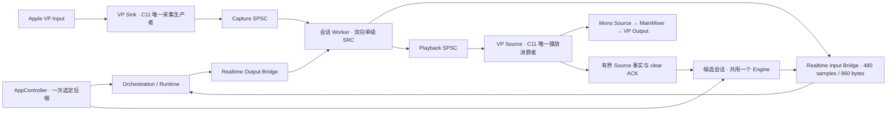

# AppleNativeVoiceTransport · P3 工程审核

2026-11-24（Asia/Shanghai）。基线 `8d4d2a6cbc1566dacba5229826bf98adac9b00c9`，P2 验收源码 `ece9e1f907fabc6ded60839bc79330f2c9a22995`。本轮验收源码 `ee4e38c9c0826c0dcf963b4395be587f48454ff2`。

## 主链接线

`AppController()` 默认使用冻结后端。候选只能通过显式构造注入 `.appleNativeCandidate`，同一选择提供采集源与播放出口。麦克风授权检查仍先于 Runtime/Provider 会话，候选完成配置后由原 Input、Output Bridge 启动。系统候选构造只提供工程接线。本轮没有候选设备启动入口、配置开关或后台自动切换。Cascaded 保留原样。

候选会话从控制线程启动 P2 Transport，Sink 和 Source 继续共用已协商的 VP Engine。非实时会话 service 驱动 Worker，按原捕获容量缓存组包。上行 PCM envelope 使用单调投递顺序，真实捕获 HostTime、内容段和时间资格保留在对应包内。投递顺序不充当捕获时间。下行使用原 Provider 格式、响应身份和序号，P2 ring 反压阻止下一块过早接收。正常 EOS 由 Source handoff 收口，后续响应沿用当前 Engine。

## Source、身份与清空

- C 记录真实 AudioTimeStamp flags、SampleTime、HostTime、frameCount、最终有效提交范围、非零统计及播放 token。Swift 只将当前 token、当前配置的事实绑定至原 Runtime generation / routeEpoch。空闲、欠载、取消静音、EOS 和无效输出有独立标志。
- Source 是有界 32 条事实队列的单一生产者。会话 Worker 是唯一消费者。满载记录缺失并撤销近期参考，PCM 回调和独立清空确认继续。Source 非零事实与 EOS handoff 仅表示数字提交，物理结束、声学参考与 Apple 内部 AEC 状态保持 UNKNOWN。
- Runtime/Orchestration 保持唯一取消权威。原语义融合决定交给 Controller，Controller 先暂停两个 Bridge，再发出一次播放侧失效。等待由会话控制任务持有，独立于被暂停的输入 pump。只有新 token 的 Source 实际清零并消费确认，Host 才记录 clear completed。超出 50ms 或设备故障进入安全停止。
- 纯播放取消推进 playback epoch/token，采集状态继续。Runtime 确认 N+1 后同图推进两侧 token，隔离旧内容，重置共享代际组包和时间映射。Device/configuration 变化关闭旧图，通过会话生命周期显式重开，权限撤回也走原停止与资源释放流程。

## 声学兼容与 SQ-M1

候选把后端中立的可选事实交给原分类器及 Acoustic Eligibility。P1 捕获时间状态不明时 PCM 仍可投递，声学资格保持未知。Apple VP 的 ERLE、线性输出、内部参考、滤波器和双讲分类映射为 UNKNOWN / N/A。原接口的布尔资格只表示证据准入，VP 启用本身不会打开 source gate。原 500ms、Semantic Proposal / Fusion、Provider Cancel、Host Clear、N+1 仍由现有链路执行。

Shadow 来源只在专用离线测试编译下存在。合成近端正控和纯回声负控通过同一 Eligibility、Runtime Fusion 及 Host 回执路径。SQ-M1 保持 OPEN。真实声源资格、实机格式/回调周期、物理延迟及 AEC 尚待独立授权后验收。

## 修改文件

| 文件 | 职责 |
| --- | --- |
| `AppController.swift`、`MacSpeechRealtimeBrainInputBridge.swift` | 固定会话后端，复用 Bridge、Eligibility 和 Runtime 授权序列。 |
| `MacSpeechAudioOutputHost.swift` | 输出事件增加 Source handoff 标记。旧播放实现逐字节校验。 |
| `MacSpeechNativeRealtimeSession.swift`、`MacSpeechNativeRealtimeFacts.swift` | 处理会话、双向 PCM、播放背压、回执和后端中立事实。 |
| `AppleNativeVoiceTransport.swift`、`NativeVoiceSessionGraph.swift`、`NativeVoiceRealtime.c/.h`、`NativeVoiceRealtimeLease.mm` | 实时事实交接、Source 清空确认和同图代际隔离。 |
| `Aftelle.xcodeproj`、P3 测试、P2 Fake、原证据测试入口、隔离 Guard | 在既有 App target 编译，按阶段验证冻结边界。专用 Shadow 入口只随 P3 离线测试编译。 |

## 离线结果

### P1／P2／P3

Normal、Release、TSan、ASan/UBSan 四种配置均实际执行。每组 P1 通过 1,770 项、100 万帧 SPSC、30,000 次清空和 2 个受控竞态。每组 P2 通过 114 项、4 套 C 回调与 4 个受控竞态。每组 P3 通过 30 项和 3 套 C 事实测试。

P3 覆盖原 Controller 和 Runtime 到 Fake Provider 的双向 PCM、连续 EOS、多轮同图、背压、取消期间真实回执、过期清空、N+1、旧 PCM/EOS、迟到 capture 回调、配置失效、启动回滚和权限撤回。回声负控在 Runtime 读回 far-end 分类，独立合成近端正控得到唯一 Runtime 决定。回执使用原 Runtime 确认时间到主机观察到实际 Source 清零的时间差。四组分别为 3.850、4.014、3.659、3.576ms，均在 Fake Provider ACK 挂起时完成。

### TSan 与 ASan／UBSan

P1/P2/P3 的 TSan、ASan（Swift 和 C/C++）及 UBSan（C/C++）执行通过，无 sanitizer 报告。

### 原路径专项

Realtime 状态 149 项、字幕 47 项、Particle 映射 14 项、Particle 表达 318 项、Narrative Memory 96 项均通过。固定离线 DR 的摘要和元数据相符。P3 只通过投影输出事件和原 Bridge 进入现有状态链。

### FULL_CURRENT

21/21 项全部实际执行并通过，复用 0。离线候选回归 7/7，11 条不变量通过。原 Test2 确认取消、旧音频拒绝、历史与投影覆盖均沿用原判据。父子收据与日志均通过 SHA-256 和源码身份核验。矩阵回执 `.build/t3_2_a_validation/full_current-y_i_co55/results.json`，SHA-256 `e18eb2c31b3bb89e1d30db1ec9f6e74c9b56146751bdd0b6293c6555fdcbb1f4`。

### Debug／Release

Debug 和未签名 Release 构建通过，均编译候选会话、事实适配、Controller 和实时桥。产物隔离通过，候选 Shadow 测试符号在两个 App 产物中均缺失。Debug 时序符号存在，Release 时序符号缺失，App 启动 0。

### Guard

Architecture、Secret、Release Route 和 P1/P2/P3 Isolation Guard 均通过。61 份冻结旧 App 文件逐字节比对，Output Host 的旧播放实现逐字节比对。RuntimeCore、既有安全阈值、Provider、Cascaded、P1 Worker/Clock/SRC 及旧采集和 Player 实现的差异为 0。Clang 实时调用图审计通过，O0 24 个可达函数、O2 10 个。四个新增或修改的候选 Swift 实现文件严格 SwiftLint 通过。

首轮正控定位到 Input Bridge suspend 会取消发起 acoustic 决策的 pump，导致同任务中的异步 Source 等待退出。会话控制任务现独立持有该命令，并在原 transition identity 围栏内接受回执。起始失败、诊断和修正回执均保留。

## Stage 7 Forbidden Checklist

结论 **PASS**。触碰红线 0。

- A、C。P3 只接入 macOS Host，沿用既有 App target 与 Controller→Orchestration 边界。
- B、D、E。Runtime 决策权、Runtime API、DR、fixture、Provider 契约和密钥路径保持。
- F、G、H。保留原 Memory、Trace、LiveState、调度、Cascaded 和 UI 状态边界。候选服务任务仅随已建立的语音会话存活。
- I。代码、测试和文档变更见文件表。平台 target 和 Stage 8 增量均为 0，完成后等待主控复核。

## 保护与停止线

按本轮授权从当前状态建立新基线，保留 P2 的索引异常历史。以 `GIT_OPTIONAL_LOCKS=0` 对两棵原工作树实施只读核验。相对 P3 基线，两棵原工作树的 HEAD、暂存记录、索引字节及 Git 状态相符。原 7 项冲突、14 份证据、3 份 fixture 元数据和 252 份历史文件相符。本轮工程收据位于 `.build/apple_native_voice_transport_p3_20261124/evidence/`。

P1 PASS，P2 PASS，P3 REVIEW_PENDING，P4 NOT_STARTED。设备运行、真实 Provider 请求和私人音频分析均为 0。AEC_ROOT_CAUSE 和 CLOCK_ROOT_CAUSE 为 UNKNOWN。SQ-M1 OPEN，T3.2-A 和 Formal Test3 BLOCKED，`Test3.execution_authorized=false`。本轮提交推送后停止等待主控。
