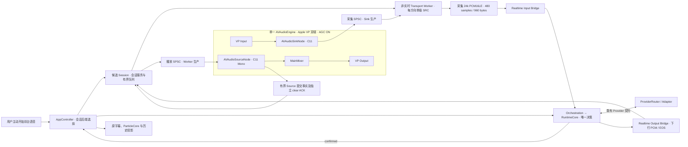

# AppleNativeVoiceTransport · P1–P4 冻结与独立审核

2026-11-25（Asia/Shanghai）。P4 基线 `b1dedd8b02680eb5bfa4c676421cd0da421e1afe`，P3 验收源码 `ee4e38c9c0826c0dcf963b4395be587f48454ff2`，原冻结运行源码 `574fc735ca239c9b334029debbdee546cda18d49`。本轮冻结候选源码 `c9838c99a5fd2d965587f5601a5c0377e1f58026`。构建与验收均指向该源码，交付提交只加审核文档。

## 1. 音频图、调用链与所有权



采集环的生产者是 Sink，消费者是 Worker。播放环的生产者是 Worker，消费者是 Source。Source 同时生产最多 32 条回调事实，由会话 Worker 消费。ObjC++ 节点块保有原始 C lease。控制侧推进 token 和图生命周期，环的生产者与消费者独立拥有索引。可变 frameCount、时间有效位和实际声道布局均来自回调。回调链只做有界内存及无锁操作。SRC、组包、HAL 查询、结果编码与保存均在非实时路径。

停止态开启双端 VP，AGC ON、bypass=false。Mixer→Output 采用 VP 输入客户端格式并重读两端。Sink 使用协商输入格式，Mono Source 使用协商采样率。HAL 验证默认输入／输出、AU 返回设备、可获得的 Aggregate 活动成员及相关流。必要监听失败回滚，实质变化使旧图失效并等待显式重开。一次会话只持有一个活跃图，权限撤回与关闭经过同一退场路径。

## 2. P4 收口与安全合同

- **N+1 内容栅栏**。Runtime 完成授权转换后，Transport 在发布采集新 token 之前以单调 Host 纳秒写入内容下界。Sink 在入口取 token，使用原 AudioTimeStamp 的有效整数 SampleTime 和可换算 HostTime 校验内容首帧。缺任一证据或首帧早于下界时拒收整块。最终提交再次核对 token，旧回调保有旧 lease。新边界可能丢弃跨边界的整块，丢失通过计数和下一次成功入环的缺口传递。因此 Bridge 恢复时保留已通过栅栏的 N+1 PCM。普通播放换轮、EOS 和仅播放取消不动采集时钟、SRC 或 ring。
- **连续性与有界读回**。SampleTime / SampleCount 决定内容顺序与包段。HostTime 独立决定时间映射及 500ms freshness。P1 继续按 UNKNOWN / INVALID 处理时间资格变化，并以独立观察恢复。真缺口重开内容段，不补零。封存区分 Sink 回调原生帧的接受／拒收、旧 token、缺证据、低于栅栏、环溢出和水位、Worker 内容段与尾样本、会话 25 包队列的投递与丢弃。设备读回连同采集／播放身份及实际图状态。各层按各自单位计数，环溢出与拒收等可以重叠。快照异步读取，当次计数可继续变化。
- **EOS 与取消**。Provider EOS 经单级 SRC 的尾部完成后到 Source，C 只在首次消费到 EOS 的回调发布该播放身份的数字交接，后续空闲回调保持原交接坐标。Controller 据此释放当前响应槽、更新字幕／Particle 和监听呈现。Source 回报数字提交的有效范围和非零帧。物理播放尾端、室内回声、真人声源仍为 UNKNOWN。Runtime 唯一产生确认与 Provider Cancel，Controller 暂停两个 Bridge、发一次 Host Clear。逻辑失效与 Source 消费侧清零确认有独立证据，保持原 confirmed→clear completed ≤50ms。超时安全停止，Runtime 完成决定后才推进 N+1。
- **资格**。采集时间不确定或过期时不可授予插话资格。Apple 的 ERLE、内部参考、滤波器和双讲分类保持 UNKNOWN／N/A。VAD、STS、队列、数字 EOS 和 VP 配置均不充当声源资格。Shadow 正负对照走原 Acoustic Eligibility、Semantic Proposal／Fusion、Runtime Decision 和取消命令。真实 SQ-M1 缺口继续 OPEN，正式声源资格仍缺证据。

## 3. 新旧后端与保留模块

| 项目 | 候选 | 冻结默认 |
| --- | --- | --- |
| macOS 音频图 | 会话 Engine + 双端 Apple VP，Sink / Mono Source，单级 SRC | 已冻结 Capture、PlayerNode、Tap 与原后端选择 |
| 身份与时钟 | P1 双时间、P2 图身份、P3 Runtime 绑定、P4 内容栅栏 | 原采集代际栅栏、时序及取消实现 |
| 状态与安全 | 原 Runtime、Provider、Input / Output Bridge、Orchestration、500ms 与 50ms 合同 | 生产路径、Cascaded、DR、Runtime API、Memory、历史、字幕、ParticleCore |
| 构建与准入 | 同一 macOS target，专门授权编译条件和精确候选参数 | 未标记的 Debug／Release 继续使用冻结默认，无自启动 |

隔离 Guard 对原源码的 61 份 App 文件逐字节比对，对旧 Output Host 的播放实现、默认初始化器 Release 分支及现有 Xcode 工程作精确校验。P4 仅允许下表工程文件变更。冻结 RuntimeCore、Provider 实现和契约、Cascaded、旧采集与旧播放器、DR 与安全阈值在本轮 Git 差异之外。

## 4. 离线验收矩阵

| 阶段 | 验收内容 | Normal / Release / TSan / ASan+UBSan |
| --- | --- | --- |
| P1 | C11 边界、回绕、100 万帧 SPSC、3 万次失效，单级 SRC 帧数和尾部、时钟异常恢复 | 各 1,770 项 Swift 检查及 C 测试通过 |
| P2 | Fake 图协商、Aggregate、失效与资源释放、4 套 C 回调 | 各 114 项 Swift 检查及 C 测试通过 |
| P3 | 两个 Bridge、同图多轮、回声负控与近端正控、背压、取消与旧代际拒绝 | 各 30 项 Swift 检查及 3 套 C 事实测试通过 |
| P4 | 新 token 下的迟到内容拒收、会话溢出、数字 EOS、非实时封存、入口隔离 | 各 52 项 Swift 检查及 C 内容时间栅栏通过 |

每组实跑，Swift／C／ObjC++ 的 TSan 和 ASan 及 C／ObjC++ 的 UBSan 无报告。Fake 同源码 confirmed→Source 清空观察实测 **1.688–5.927 ms**，取自 P3/P4 四种配置共八次。该数值只度量合成回调的工程回执。Controller 在 N+1 播放完成后回到监听呈现，读回仍记录物理播放和真人来源 UNKNOWN。

**FULL_CURRENT** 21/21 本轮实际执行，复用 0。子矩阵 7/7 执行、11 条不变量通过。原 Test2 取消、历史和展示投影沿用原判据。父子收据和逐项日志经 SHA-256 与源码核验。矩阵收据 `.build/t3_2_a_validation/full_current-iafd0ius/results.json`，SHA-256 `e76a395afc34629fa28ac977e1c800a9dd8fa7283a59f72955e768fcf520282e`。子矩阵 SHA-256 `65400a92c7fbda4b569013bb7066c3f9cc7386cc55197f6a98d26911df627d15`。

**Debug／Release** 同源码编译通过。标准 Debug 包含既有时序诊断，Release 不含。两个产物均无 Shadow 测试符号，Release 无候选 DEBUG 入口符号。授权条件的 Debug 路径另行通过编译器类型检查，带授权条件的 Release 和 Shadow 组合均由源码拒绝。所有 App 产物均未启动。

| 产物 | SHA-256 |
| --- | --- |
| Debug App executable | `ba9089464f20f26666c387772ee3829dd3242f89c7764aca208cba552a25e118` |
| Debug `Aftelle.debug.dylib` | `2a7a1fd4ea81f2985e7f7cda74fa96ee8cf9320ff084ada6c0ccd785ef0b4f81` |
| Release App executable | `aa7bf332773e7ec4f04b15f64e3774986dc97d71c9de88bf815537cbdb6c9867` |

**Guard** Architecture、Secret、Release Route 和 P1–P4 阶段隔离通过。Clang 回调 IR 审计 O0 为 24 个、O2 为 10 个可达函数。7 个修改的候选 Swift 实现通过严格 SwiftLint。原字幕 47 项、Particle 映射 14 项、Particle 表达 318 项、Narrative Memory 96 项通过。原 Realtime 状态 149 项通过。 首轮预检失败记录保留，包括 macOS Bash 空数组兼容、新增测试 ID 类型和空闲回调重复上报旧 EOS。两次过程矩阵中止并保留日志，终版从新源码全部实际执行。 组合 Fake harness 在 Swift 5 兼容模式仍报告一条诊断 JSON Data 跨 actor 的 Swift 6 严格并发告警。该告警位置在新测试调用，TSan 未检出竞态。

## 5. 授权入口、预检与集中验收

标准 Debug 和 Release 保持封存。在 Gemini 独立审核及主控裁定通过、用户明确授权之后，专用 DEBUG 构建才可具备 `APPLE_NATIVE_VOICE_P4_DEVICE_AUTHORIZED`。构建身份须重新登记。进程须提交唯一且完整的 `--apple-native-voice-candidate`，随后走现有前台语音启动和权限流程。重复或带值的候选参数、缺授权编译条件、与旧 `--apple-vp-*` 参数同时传入均关闭候选入口。该判断在麦克风授权与 Runtime／Provider 开启前。专用离线 Shadow 宏与设备授权宏互斥。原 PlayerNode／Tap 实验入口只处理自己的旧参数。

准备好的最小证据为现有 DEBUG 导出面板写入的一份原子 JSON。包括当前执行载荷摘要（Debug 有独立 dylib 时登记其摘要）、候选标识、实际图与 VP 标志、AU 与默认设备 ID/可读 Aggregate 成员、活跃或退场状态、Runtime 与配置身份、最近实际 Sink、Source、独立的最后非零提交、首次 EOS、清空事实及有界计数。不导出 PCM 或设备 UID。AU Global CurrentDevice 只说明 AudioUnit 当时返回的端点，实际物理麦克风绑定待实机核实。封存时现场须将操作者见证、候选源码／授权构建摘要、导出文件摘要与轮次绑定。无校验过的物理证据时保持 UNKNOWN。

| 后续场景 | 独立授权后需要收集的证据 |
| --- | --- |
| 居民独讲／纯回声负控 | 实际听到且听清居民音频的现场见证，Source 非零范围对齐 Sink。原正式声源判据及零错误取消独立判定。 |
| 真人独讲与自然双讲 | 真实人声起止、双方物理重叠及可懂度的独立见证，原 53-C 资格与声学判据。置信不足保留 UNKNOWN。 |
| 持续多轮会话 | 同一 Engine／配置、各轮实际 EOS、Sink 连续性／溢出统计、Source 欠载、字幕和 Particle 过渡。 |
| 插话取消与 N+1 | 有合格真人声源证据后才允许正式插话执行。记录单一 Runtime 决定、Provider Cancel、实际 Source 清零 ACK、50ms 与新代首次合格 Sink，物理尾音单列。 |
| 设备稳定性与退出 | 核对现场物理端点、实际协商、设备变化及安全终止，记录回调周期、时钟异常和安全重开。 |

现场顺序为身份与权限复核、居民独讲负控、真人基准及自然双讲、连续轮次、合格插话和设备稳定性。路由失效或关键证明缺失即结束该轮并封存现有证据。

目前仅完成静态、编译、Fake、Mock、合成 PCM 与离线预检。实际设备兼容性、回调周期、物理延迟和 AEC、时钟根因、真人声源资格均待验证。当前封存只有有界元数据。需要音频、真人来源或物理重叠证据的后续操作须由审核确定，按正式合同单独授权。正式验收统计维持原合同。

## 6. Gemini 独立架构审核文件

| 文件组 | 核对重点 |
| --- | --- |
| `apps/macos/NativeVoiceTransport/NativeVoiceRing.{c,h}`、`NativeVoiceClock.swift`、`NativeVoiceStreamingSRC.swift`、`AppleNativeVoiceTransportWorker.swift` | P1 SPSC、双时间、单级 SRC、包段与实际丢失 |
| `apps/macos/NativeVoiceTransport/NativeVoiceRealtime.{c,h}`、`NativeVoiceRealtimeLease.mm`、`NativeVoiceSystemEngine.swift`、`NativeVoiceGraph.swift`、`NativeVoiceHALRoute.swift` | P2 实时调用链、停止态 VP 协商、活跃设备验证、P4 Sink 提交栅栏 |
| `apps/macos/NativeVoiceTransport/AppleNativeVoiceTransport.swift`、`NativeVoiceSessionGraph.swift` | P2–P4 会话及重建、实际 Source 事实和清空、配置／Runtime 隔离及读回 |
| `apps/macos/Aftelle/AppController.swift`、`MacSpeechRealtimeBrainInputBridge.swift`、`MacSpeechRealtimeBrainOutputBridge.swift`、`MacSpeechAudioOutputHost.swift` | P3/P4 共享 Bridge、唯一后端、取消、代际、数字交接与前台授权边界 |
| `apps/macos/Aftelle/MacSpeechNativeRealtimeSession.swift`、`MacSpeechNativeRealtimeFacts.swift` | 会话队列、身份、时间／声源资格、释放和元数据封存 |
| `apps/macos/RuntimeCore/RuntimeCore.swift` 的 `completeRealtimeResidentBrainInterruption` 与原证据入口 | 只读核对 Runtime 确认、Provider Cancel、500ms freshness 和 N+1，源码未改。 |
| `tools/native_voice_transport_tests/`、`tools/native_voice_transport_p2_tests/`、`tools/native_voice_transport_p3_tests/`、`tools/native_voice_transport_p4_tests/CloseoutCases.swift`、`tools/realtime_interruption_evidence_tests/RealtimeInterruptionEvidenceTests.swift` | 可复验的离线入口、Guard、ASan／UBSan、TSan、Shadow 与真设备构建互斥 |
| `apps/macos/Aftelle/Aftelle.xcodeproj/project.pbxproj`、本报告与下列阶段报告 | 既有 target、全量收据、冻结候选和验收边界 |

本轮实际工程改动 19 份，核对 `git diff --name-only b1dedd8 c9838c99a5fd2d965587f5601a5c0377e1f58026`。P1/P2/P3 设计决策和基线另见 [P1 工程报告](AppleNativeVoiceTransport_P1_engineering_review.md)、[P1 收口](AppleNativeVoiceTransport_P1_closeout_review.md)、[P2 工程报告](AppleNativeVoiceTransport_P2_engineering_review.md)、[P2 收口](AppleNativeVoiceTransport_P2_closeout_review.md)、[P3 工程审核](AppleNativeVoiceTransport_P3_engineering_review.md)。

## 7. Stage 7 Forbidden Checklist

结论 **PASS**，触碰红线 0。检查在修改前和交付前执行。

| 检查项 | 核验 |
| --- | --- |
| A · 阶段 | macOS Host、既有 App target、Stage 7.5.11。平台 target、Stage 8 与预留功能增量均 0。 |
| B/C · Runtime 与 Host | Controller→Orchestration→Runtime 权威、Host 停止路径和平台边界保持。 |
| D/E · DR、Provider 与 Secret | Runtime API、DR Schema、fixture、Provider 接口和密钥路径改动均 0。真实 Provider 调用 0。 |
| F/G · Memory、Trace 与调度 | 复用原展示、Memory 和诊断所有权。会话 service 随前台会话生灭。 |
| H · 渲染与音频 | 原 Particle、字幕、Cascaded 保留。软件 AEC、后台常开通路和默认切换增量 0。 |
| I · 输出 | 工程、测试和文档文件见审核表及 Git 差异。工程收口停在独立审核，实机操作仍需明确授权。 |

## 8. 保护核验与停止线

以 `GIT_OPTIONAL_LOCKS=0` 对两棵受保护工作树作只读快照比较。两边 HEAD、暂存记录、索引字节与 Git 状态相符，原 7 项冲突、14 份证据、3 份 fixture 和 349 份已登记历史文件相符。P2 一次性索引例外保留原记录。新收据存于 `.build/apple_native_voice_transport_p4_20261125/evidence/`，包含独立验证、保护基线、构建身份和日志索引。交付只把选定分支快进到审核提交。

```text
P1 = PASS
P2 = PASS
P3 = ACCEPTED_PENDING_FINAL_CLOSEOUT
P4 = REVIEW_PENDING
DEVICE_RUNS = 0
AEC_ROOT_CAUSE = UNKNOWN
CLOCK_ROOT_CAUSE = UNKNOWN
SQ_M1 = OPEN
T3_2_A = BLOCKED
Formal_Test3 = BLOCKED
Test3.execution_authorized = false
```

源码冻结后停止。Gemini 统一独立架构审核在此交接，后续实机验收等待 ChatGPT 主控裁定及用户明确授权。
