# Stage 7.5.11 · AEC 全链路静态审计 · 2026-11-27

## 审计结论

历史 WebRTC AEC3 有两类独立证据。参考提交发生过内部缓冲重定位，部分近端能量也在残余抑制或后续 Host 声源门丢失。11 月 27 日的 Apple Native Voice 本地试次绕过旧路径，仍有近端受压的现场反馈和可辨识的居民残余。首要待证机制是双讲时实际回声路径、参考对齐和近端保护的相互作用。现有证据无法确认 Apple VP 内部的具体触发环节，也无法确认两种 AEC 存在同一缺陷。

| 核对对象 | 身份及证据边界 |
| --- | --- |
| 当前归档和技术合同 | 冻结审计基线 `68a6553b853687e04612ea1475661a68f48fecfe`。P1–P4 文档和 DEVLOG 支持工程接线、连续性和身份边界。 |
| 11 月 27 日实际载荷 | 签名 Debug dylib SHA-256 为 `172bbfe6a42ba82e2435443cca99e309f61cac75ac1284d64f1e522d147f88e2`。构建日志与调试对象指向本地 WAV 实验宿主。核心与冻结树相符。WAV 入口另有本地改动，未留存构建时全部未提交文件的逐字节清单。 |
| 旧 Apple VP | `574fc735ca239c9b334029debbdee546cda18d49` 和 Step 4 对照。 |
| 历史 AEC3 | 系统审计记录、固定依赖 `9f30e83c018647b05804571699cf22b1f0f3409e` 及 Aftelle 原生封装。历史软件近端定位、物理纯回声负控与本轮本地 WAV 数据分别解释。 |

[DEVLOG](../../../DEVLOG.md#L3) · [P1 时间资格](AppleNativeVoiceTransport_P1_closeout_review.md#L5) · [P2 VP 协商](AppleNativeVoiceTransport_P2_closeout_review.md#L5) · [P3 会话接线](AppleNativeVoiceTransport_P3_engineering_review.md#L5) · [P4 冻结合同](AppleNativeVoiceTransport_P4_engineering_review.md#L29) · [11 月 27 日试次](AppleNativeVoiceTransport_local_double_talk_2026-11-27.md#L7) · [WebRTC 固定版本](../../../third_party/webrtc_aec3/README.md#L1)

## 1. 实际信号流

```mermaid
flowchart LR
    WAV["本地 WAV 模式<br/>AppController.swift 2089、2185"] --> PCM["24 kHz 单声道 PCM16"]
    DELTA["实时居民音频 delta<br/>MacSpeechRealtimeBrainOutputBridge.swift 229"] --> PCM
    PCM --> W["新 Worker SRC → C11 播放环"]
    W --> SRC["单声道 Source<br/>NativeVoiceRealtime.c 266"]
    SRC --> NM["MainMixer → VP Output 客户端<br/>NativeVoiceRealtimeLease.mm 42"]
    PCM --> PLAYER["旧包络、SRC、PlayerNode<br/>MacSpeechAudioOutputPlayer.swift 502"]
    PLAYER --> OM["旧 MainMixer → Output"]
    PLAYER --> REF["旧 AEC3 参考：Mixer 前 Player Tap<br/>MacSpeechAudioCapture.swift 4029、4064"]
    NM --> SPK["HAL → 扬声器 → 房间回声"]
    OM --> SPK
    SPK --> MIC["USB 麦克风 + 近端声 → HAL"]
    MIC --> VP["Apple VoiceProcessingIO<br/>内部参考、滤波与增益状态 UNKNOWN"]
    NM -.-> VP
    OM -.->|旧 Apple VP| VP
    VP --> SINK["新 Sink → 通道 0 → C11 采集环<br/>NativeVoiceRealtime.c 152"]
    VP --> VTAP["旧 Apple VP Input Tap → 通道 0"]
    MIC --> RAW["旧 AEC3：普通 Input Tap → 48 kHz 单声道"]
    RAW --> AEC["AEC3：对齐、线性消除、残余抑制<br/>AftelleAECBridge.mm 87、110"]
    REF --> AEC
    AEC --> GATE["旧 Host 声源门：保留或清零<br/>MacSpeechAcousticEchoHost.swift 1994、2472"]
    SINK --> UP["Worker／包转换 → 24 kHz / 20 ms PCM"]
    VTAP --> UP
    GATE --> UP
    UP --> LAB["11 月 27 日：本地录证"]
    UP --> IB["正式接线：Input Bridge → Runtime → Provider"]
    IB --> POLICY["声学资格 + 语义证据 → Runtime 决策 → Clear / N+1"]
```



图中本地宿主行号来自该试次源码快照。11 月 27 日实际使用 WAV 入口，本地录证从 Worker 读取，绕过 Runtime、Provider 和插话门禁。实时 delta、代际和取消路径单独按 P3/P4 接线追踪。公开 Apple 合同允许停机时从任一 I/O Node 启用双端 VP。Source、Player Tap 均在 Mixer 前。数字提交可以核验，Mixer 后的逐声道波形、物理外放和 Apple 私有参考仍缺直接观测。三声道是协商的客户端格式，声道数和 Global CurrentDevice 都不足以证明单一物理端点或通道标签。

[Output Bridge](../../../apps/macos/Aftelle/MacSpeechRealtimeBrainOutputBridge.swift#L229) · [Native 图连接](../../../apps/macos/NativeVoiceTransport/NativeVoiceRealtimeLease.mm#L42) · [Source 与 Sink 回调](../../../apps/macos/NativeVoiceTransport/NativeVoiceRealtime.c#L152) · [HAL 设备绑定审核](T3_2_A_voice_processing_io_device_binding_audit.md#L5) · [Apple WWDC19](https://developer.apple.com/videos/play/wwdc2019/510/)

## 2. 架构差异与共同条件

| 维度 | 历史 WebRTC AEC3 | 旧 Apple VP | 新 Native Voice |
| --- | --- | --- | --- |
| 参考与时间 | Player Tap 转 48 kHz 单声道。Capture 和 Render 按 10 ms 分帧，依回调到达顺序进入串行 Host。Host 的关联时标未作为逐帧参数送给 AEC3。引擎内部另做参考对齐 | 同一图的 VP Output 承接渲染。Player Tap 的监测支路不向 Apple VP 注入参考。应用通知的 HostTime 关系用于内容资格 | Source 和 Sink 各自保留有效位、身份和回调时标。SampleTime 驱动内容连续性，HostTime 决定证据资格。两者都不会作为 AEC 参考参数送入 Apple VP |
| DSP 与增益 | 直接调用 EchoControl。可见线性估计、主导近端检测、残余估计和抑制增益。封装无独立 AGC/NS，`level_change` 固定传 false | 双端 VP，AGC ON，bypass=false。采集通道 0，再经过 48 kHz → 24 kHz 两级应用转换 | 双端 VP，AGC ON，bypass=false。Sink 取索引 0，每方向单级应用 SRC。Apple 内部滤波器、双讲状态、降噪和增益曲线 UNKNOWN |
| 暂停、恢复、重建 | 正常开播清 Host 关联历史、基线和声源门，保留 AEC3 实例。Fallback 恢复及路由重配存在重建分支。历史 provisional pause/resume 可以暂停播放并保留代际 | Player 停止与 Engine 停止有独立生命周期。空闲拆图或路由变更可重配。旧 HostTime 失效可锁存并截断采集 | EOS、换轮和纯播放取消保留 Engine 与采集 SRC。N+1 更换 token 与内容栅栏，更新 Worker 状态。实质设备配置变化使旧图失效，重建需要新身份 |

三者都依赖实际声场和完整的渲染／采集时间关系。USB 输入和内置扬声器跨设备时的声学延迟、增益与时钟漂移都未在同条件下完整测量。旧 AEC3 的参考排程、后级误判与 Apple 内部 AGC 属于不同证据层。应用零丢帧不能排除 AEC 内部参考失配。

[AEC3 参考提交](../../../apps/macos/Aftelle/MacSpeechAudioCapture.swift#L4064) · [AEC3 封装与输入电平变化参数](../../../tools/webrtc_aec3/bridge/AftelleAECBridge.mm#L128) · [旧 Host 生命周期](../../../apps/macos/Aftelle/MacSpeechAcousticEchoHost.swift#L1325) · [新图配置失效](../../../apps/macos/NativeVoiceTransport/AppleNativeVoiceTransport.swift#L279) · [Apple WWDC23](https://developer.apple.com/videos/play/wwdc2023/10235/)

## 3. 11 月 27 日阶段推演

| 阶段 | CONFIRMED | INFERRED / UNKNOWN |
| --- | --- | --- |
| 真人单讲 | 应用还没有提交非零居民声。VP 后混合 RMS **−17.70 dBFS**。导出 PCM 的 **34 个满幅样本**均在居民播放前 | 缺少远端激励，当前房间回声路径尚无从这段居民播放获得的辨识信息。Apple 内部初态和 ADC 过载未知。满幅也可能出现在 VP、SRC 或 PCM16 量化之后 |
| 居民开始播放 | **3.0067 s** 接受首块 WAV，原文件前 **1 s** 为全零。首次含非零内容的 Source 回调在 **4.0495 s**，其中首个非零样本约在 **4.0568 s** | Engine 运行、排队和零值参考无法证明收敛。实际声压起音和真人逐样本起点未知 |
| 冷启动双讲 | 用户确认听见居民时仍在讲话。起音前后各 0.5 s 混合 RMS 为 **−16.98 / −17.45 dBFS** | 首个非零激励可能已与近端重叠。纯冷启动仍是假说。最明显的下降出现在后续区间 |
| 持续播放与预期双讲 | 混合 RMS **−22.85 dBFS**，比近端参考段低 **5.15 dB**。700–3400 Hz 的参考匹配 `r=0.143`，固定延迟后段留出 `r=0.191`，错位及反向对照最高约 `0.075`。宽带匹配没有稳定超过对照 | 支持间歇居民残余。约 **129 ms** 是特定时间对齐下的匹配延迟。全段稳态双讲、实际近端衰减、物理延迟、AEC 参考偏移及 ERLE 均未量得 |
| 居民停止 | **7.7644 s** 为宿主轮询观察到的数字 EOS。录证得到 750 包，746 个时间资格有效、4 个未知。采集环丢帧、Worker 不连续及 Source 欠载为 0 | 物理播放结束和室内回声尾部未知。时间戳首包无有效 HostTime，末包锚定得到 WAV 零点约早 **49.3 ms** |
| 回声尾部与恢复 | 数字 EOS 后 **0.5–1.0 s** 的 RMS **−43.88 dBFS**，**1–2 s** 回升至 **−22.18 dBFS**，随后仍有波动 | 支持分段回升。讲话停顿、发声强弱与 VP 增益无法从混合录音分离。未测 AGC 恢复常数 |

本轮复用此前授权的统计。按未校正 WAV 时间轴重算，各段混合 RMS 最大只差约 0.021 dB。5.15 dB 只描述上行混合信号，无法估算真人单独衰减。129 ms 无法定位 AEC 内部参考偏移。

[11 月 27 日试次与设备读回](AppleNativeVoiceTransport_local_double_talk_2026-11-27.md#L15) · [旧 A/B 同源定量](T3_2_A_step4_ab_acoustic_attribution.md#L47) · [旧 C 同源对照](T3_2_A_step4_c_abc_acoustic_attribution.md#L58)

## 4. 确认的问题和根因候选

1. **历史 AEC3 有两层独立的近端损失和真实纯回声误资格。** 软件源阶段定位中，部分帧在线性输出尚有近端时，AEC clean 已接近零。另有 clean 仍具有效近端成分却被 Host 门清零。历史物理纯回声负控有 **42 个错误资格帧、4 条确认链**，发生过一次 provisional pause/resume，正式取消被拦住。证据定位到已归档历史版本，对当前实体真人损失比例仍无测量。
2. **历史 AEC3 参考排程和内部 Reset 可定位。** 历史实际约 **100 ms** 回调被整批拆为 10 ms 提交。固定版本有 **4 次非启动内部 Reset 和 145 次内部 underrun**。Capture 侧 excess 与 Insert overrun 的事件传播不对称在源码可见。因果 FIFO 对照把 Reset 降至 0 后仍有 **41 个误资格帧**，所以仅消除 Reset 不足以关闭失败。Host 的外部延迟值由设备 presentation latency 和处理耗时估计。固定依赖默认使用内部延迟估计，外部值仍可参与 Reset 时的初始缓冲设置。
3. **旧 D2-F1 格式协商缺口已修，旧 B 首轮时钟中止另有边界。** D2-F1 复现的是启用后 3ch/2ch 客户端协商缺口，旧运行与新图均保留停机重连及一致性校验。旧 B 首次 HostTime 锁存拒收发生在居民播放前。11 月 27 日实际图中未见支撑症状的重复 Engine 启动、错误后端或叠加软件 AEC 证据。
4. **当前插话资格还有明确缺口。** 新正式接线通过 Input Bridge 递交符合身份的 PCM，Qwen 路线可继续做 24 → 16 kHz 转换。Source 非零仍只提供数字事实，Native 真实 Apple 声源事实不足时为不确定，`sourceGateOpen` 为 false。Runtime 桥接另校验身份、时效、声源门及同响应语义，才授权 clear 与 N+1。该策略可影响插话，11 月 27 日录证绕过这条决策链。

[历史 AEC3 双层损失与设备证据](https://github.com/JerryYork3516/Eterna_Aftelle/blob/a7563f9a16aebeaa05398a155c6b38b604362f91/docs/stage7_5/test3_aec3_system_audit_20261012.md#L227) · [历史 Reset 与 FIFO 对照](https://github.com/JerryYork3516/Eterna_Aftelle/blob/a7563f9a16aebeaa05398a155c6b38b604362f91/docs/stage7_5/test3_aec_review_20261004/source-qualification-followup/findings.md#L51) · [D2-F1](T3_2_A_D2_F1_root_cause_and_silent_dry_run.md#L24) · [旧 B 时钟中止](T3_2_A_step4_b_resident_control_device_review.md#L54) · [Host 清零代码](../../../apps/macos/Aftelle/MacSpeechAcousticEchoHost.swift#L2472) · [Native 声学资格输入](../../../apps/macos/Aftelle/MacSpeechNativeRealtimeFacts.swift#L110) · [Runtime 双证据决策](../../../apps/macos/RuntimeCore/RuntimeCore.swift#L5813)

| 排序 | 支持证据 | 反证与缺口 |
| --- | --- | --- |
| **1. 参考估计与残余抑制共同影响双讲** | 历史 AEC3 有明确的 linear → clean 损失。旧 Apple 有声 B 对同源全零对照 A，播放窗内近端投影低 **7.84 dB**，变化已在应用 SRC 前出现。新轮仍有窄带居民残余 | Apple 内部线性、非线性输出和真实参考不可见。新轮缺近端独立参考，两种 AEC 共享同一机制仍为推断 |
| **2. 无远端预激励叠加参考延迟或跨设备时钟问题** | 本轮首个应用远端非零激励进入预期双讲。固定 AEC3 初态与未饱和的有效远端活动有关。历史 AEC3 确有内部缓冲重定位 | 新轮更深的变弱出现在后续，缺少冷／暖配对、实际声学延迟及 Apple 内部初态 |
| **3. 增益、声场与非线性** | 旧 C 将居民数字电平降低 12 dB 后，匹配窗近端投影部分回升 **4.26 dB**。本轮 TinyUSB 输入 **60.49%**、内置扬声器输出 **59.86%**，VP AGC ON | 音量百分比不能还原声压。改善不均匀。ADC、系统 Mic Mode、AGC 曲线及 Mixer 后逐路电平均未知 |
| **4. 声源门及会话策略放大插话异常** | 历史 AEC3 真实纯回声发生误资格。Host 也能清零真实候选。当前 Native 资格对可信声源事实缺失作保守处理 | 本地 WAV 录证未经过门禁，无法用门禁解释该录音的声学结果 |

## 5. 唯一优先验证动作和更换门槛

**获独立授权后，用冻结 Native Voice Lab 做一个预注册的冷／暖配对。** 固定设备、模式、音量、摆位、同一居民 WAV 和可重复的独立近端参考。两臂从相同图状态开始，唯一改变是双讲前的等长区间为静音，或有一段实际外放已确认的居民独讲。同步保留数字渲染、扬声器及近端见证、VP 后采集、有效时标和路由身份。比较同一近端内容的起音保留、居民残余和尾部恢复。暖臂改善才增强预激励假说，持续异常则仍需分离参考与增益效应。

先复现有独立近端见证的失败、证明参考及时序和声场可比、并把主要损失定位到 AEC 处理层，才有更换资格。替代候选须在相同负控和正控下同时改善近端保留与残余，且保持插话及取消安全。任一条件缺失，维持当前架构。

## 6. 对其他软件表现的解释边界

成熟 AEC 仍依赖送入的参考、回放／采集排程、实际设备声场与后级资格策略。Aftelle 历史上已证实参考层和后级门禁各自能造成问题。11 月 27 日的新链路移除了旧路径，却保留同类外放与 USB 采集场景。现有证据没有同设备、同内容的跨软件对照，也无法把两种 AEC 的失败统一归因为算法本体。

本轮只读源码、技术记录并复用既有脱敏统计。源码与配置无改动，未启动设备或调用 Provider，未再次读取原始音频。归档新增本报告一份。安全阈值沿冻结合同。Stage 7 Forbidden Checklist 的任务范围核查为 `PASS`。

```text
AEC_ROOT_CAUSE = UNKNOWN
CLOCK_ROOT_CAUSE = UNKNOWN
SQ_M1 = OPEN
Formal_Test3 = BLOCKED
Test3.execution_authorized = false
DEVICE_RUNS_THIS_REVIEW = 0
```
