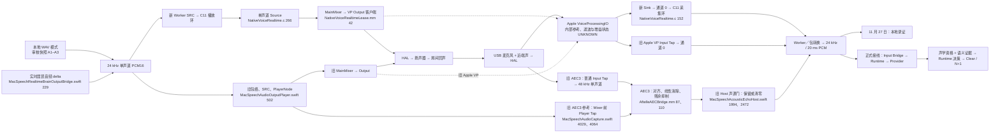

# Stage 7.5.11 · AEC 全链路静态审计 · 2026-11-27

## 审计结论

历史 WebRTC AEC3 记录了两类可分别确认的事实。参考调度下发生 AEC3 内部 Reset 和 underrun。另有同帧证据，把近端成分损失定位到 Linear 导出至 Clean，以及 Clean 至 Host 转发。FIFO 离线对照尚未闭合内部缓冲事件对近端损失或误资格的实时因果贡献。11 月 27 日 Apple Native Voice 本地试次绕过旧参考和插话门，仍有近端受压的听感与间歇居民相关残余。回声路径、参考对齐、增益和近端保护可以共同解释现象，各自贡献与跨后端共同根因仍为 UNKNOWN。

| 核对对象 | 身份及证据边界 |
| --- | --- |
| 审计基线 | 此报告首次审计的冻结源码为 `68a6553b853687e04612ea1475661a68f48fecfe`。本次修订审核基线为 `be754e0439887d65c4b6e01ab5cd6cbe9998e448`。 |
| 11 月 27 日实际运行载荷 | 签名 Debug dylib SHA-256 为 `172bbfe6a42ba82e2435443cca99e309f61cac75ac1284d64f1e522d147f88e2`，原报告登记与保留载荷复核一致。 |
| 已核验核心源码 | 对照 `b6320917305eae86339ab03de5aede748608182c`、冻结审计基线和本地实验工作树，Native Voice 核心目录及 Session 源无内容差异。构建日志关联该核心范围。 |
| 本地 WAV 宿主快照 | 审核时基于 `8e35f88dc2ae16f06bdd6f1d46a988c0bec9f621` 和保留的本地改动。行号与摘录绑定该快照。 |
| 构建时未提交内容 | 构建路径与部分 DWARF 行号可追查。构建时全部未提交文件字节为 UNKNOWN。审核时文件摘要只标识审核快照。 |
| 旧 Apple VP | `574fc735ca239c9b334029debbdee546cda18d49` 和 Step 4 对照。 |
| 历史 AEC3 | 系统审计、固定依赖 `9f30e83c018647b05804571699cf22b1f0f3409e` 及 Aftelle 封装。软件阶段定位、物理纯回声负控与新 WAV 试次各有独立证据边界。 |

[载荷、核心与宿主证据](Stage_7_5_11_AEC_static_audit_evidence_2026-11-27.md#wav-宿主审核快照) · [历史帧级证据和固定上游身份](Stage_7_5_11_AEC_static_audit_evidence_2026-11-27.md#e4-同帧见证)

[DEVLOG](../../../DEVLOG.md#L3) · [P1 时间资格](AppleNativeVoiceTransport_P1_closeout_review.md#L5) · [P2 VP 协商](AppleNativeVoiceTransport_P2_closeout_review.md#L5) · [P3 会话接线](AppleNativeVoiceTransport_P3_engineering_review.md#L5) · [P4 冻结合同](AppleNativeVoiceTransport_P4_engineering_review.md#L29) · [11 月 27 日试次](AppleNativeVoiceTransport_local_double_talk_2026-11-27.md#L7) · [WebRTC 固定版本](../../../third_party/webrtc_aec3/README.md#L1)

## 1. 实际信号流



图中 WAV 入口对应本地审核快照 A1–A3 中的 `AppController.swift:2089/2185`。摘录与调试对象定位见附录。11 月 27 日通过该入口播放 WAV，并从 Worker 取本地录证，未经过 Runtime、Provider 或插话门。实时 delta、代际和取消按 P3/P4 正式接线另行追踪。公开 Apple 合同允许停机时从任一 I/O Node 启用双端 VP。Source 与旧 Player Tap 均在 Mixer 前。可观察范围到应用数字提交，Mixer 后逐声道波形、物理外放和 Apple 私有参考均缺直接观测。三声道是协商的客户端格式。声道数及 Global CurrentDevice 无法确定物理端点或通道标签。

[本地审核快照 A1–A3](Stage_7_5_11_AEC_static_audit_evidence_2026-11-27.md#wav-宿主审核快照)

[Output Bridge](../../../apps/macos/Aftelle/MacSpeechRealtimeBrainOutputBridge.swift#L229) · [Native 图连接](../../../apps/macos/NativeVoiceTransport/NativeVoiceRealtimeLease.mm#L42) · [Source 与 Sink 回调](../../../apps/macos/NativeVoiceTransport/NativeVoiceRealtime.c#L152) · [HAL 设备绑定审核](T3_2_A_voice_processing_io_device_binding_audit.md#L5) · [Apple WWDC19](https://developer.apple.com/videos/play/wwdc2019/510/)

## 2. 架构差异与共同条件

| 维度 | 历史 WebRTC AEC3 | 旧 Apple VP | 新 Native Voice |
| --- | --- | --- | --- |
| 参考与时间 | Player Tap 转 48 kHz 单声道。Capture 和 Render 按 10 ms 分帧，依回调到达顺序进入串行 Host。Host 的关联时标未作为逐帧参数送给 AEC3。引擎内部另做参考对齐 | 同一图的 VP Output 承接渲染。Player Tap 的监测支路不向 Apple VP 注入参考。应用通知的 HostTime 关系用于内容资格 | Source 和 Sink 各自保留有效位、身份和回调时标。SampleTime 驱动内容连续性，HostTime 决定证据资格。两者都不会作为 AEC 参考参数送入 Apple VP |
| DSP 与增益 | 直接调用 EchoControl。可见线性估计、主导近端检测、残余估计和抑制增益。封装无独立 AGC/NS，`level_change` 固定传 false | 双端 VP，AGC ON，bypass=false。采集通道 0，再经过 48 kHz → 24 kHz 两级应用转换 | 双端 VP，AGC ON，bypass=false。Sink 取索引 0，每方向单级应用 SRC。Apple 内部滤波器、双讲状态、降噪和增益曲线 UNKNOWN |
| 暂停、恢复、重建 | 正常开播清 Host 关联历史、基线和声源门，保留 AEC3 实例。Fallback 恢复及路由重配存在重建分支。历史 provisional pause/resume 可以暂停播放并保留代际 | Player 停止与 Engine 停止有独立生命周期。空闲拆图或路由变更可重配。旧 HostTime 失效可锁存并截断采集 | EOS、换轮和纯播放取消保留 Engine 与采集 SRC。N+1 更换 token 与内容栅栏，更新 Worker 状态。实质设备配置变化使旧图失效，重建需要新身份 |

三者都依赖实际声场和完整的渲染／采集时间关系。USB 输入和内置扬声器跨设备时的声学延迟、增益与时钟漂移都未在同条件下完整测量。旧 AEC3 的参考排程、后级误判与 Apple 内部 AGC 属于不同证据层。应用零丢帧不能排除 AEC 内部参考失配。

[AEC3 参考提交](../../../apps/macos/Aftelle/MacSpeechAudioCapture.swift#L4064) · [AEC3 封装与输入电平变化参数](../../../tools/webrtc_aec3/bridge/AftelleAECBridge.mm#L128) · [旧 Host 生命周期](../../../apps/macos/Aftelle/MacSpeechAcousticEchoHost.swift#L1325) · [新图配置失效](../../../apps/macos/NativeVoiceTransport/AppleNativeVoiceTransport.swift#L279) · [Apple WWDC23](https://developer.apple.com/videos/play/wwdc2023/10235/)

## 3. 11 月 27 日阶段推演

| 阶段 | CONFIRMED | INFERRED / UNKNOWN |
| --- | --- | --- |
| 真人单讲 | 未观察到应用先前提交非零居民声。VP 后混合 RMS **−17.70 dBFS**。三个分析窗中的 **34 个 PCM16 满幅样本**都在近端参考窗 | 该窗没有可观察的远端预激励。Apple 内部初态、满幅形成位置和 ADC 是否过载未知 |
| 居民开始播放 | **3.0067 s** 接受首块 WAV，原文件前 **1 s** 为全零。首次含非零内容的 Source 回调在 **4.0495 s**，其中首个非零样本约在 **4.0568 s** | Engine 运行、排队和零值参考无法证明收敛。实际声压起音和真人逐样本起点未知 |
| 首次远端起音与重叠 | 用户确认听见居民时仍在讲话。起音前后各 0.5 s 混合 RMS 为 **−16.98 / −17.45 dBFS** | 首次观察到的非零远端激励可能已与近端重叠。是否处在未收敛状态仍未知。更深的下降出现在后续 |
| 持续播放与预期双讲 | 混合 RMS **−22.85 dBFS**，比近端参考段低 **5.15 dB**。700–3400 Hz 固定延迟整段 `r=0.143`，三个后段留出窗分别约 `0.007 / 0.005 / 0.191`。错位及反向对照全扫描最高约 `0.075`。宽带匹配未稳定超过对照 | 支持间歇居民残余。约 **129 ms** 是特定分析对齐下的匹配延迟。稳态双讲覆盖、独立近端衰减、物理延迟、AEC 参考偏移与 ERLE 均未量得 |
| 数字 EOS | **7.7644 s** 为宿主在已接受 EOS 后轮询到 `renderHandoff` 的时刻。750 个包中 746 个时间资格有效、4 个未知。采集环丢帧、Worker 不连续及 Source 欠载为 0 | 精确末个非零采样、物理播放结束与回声尾部未知。首包无有效 HostTime，末包单点对齐得到 WAV 零点约早 **49.3 ms** |
| 回声尾部与恢复 | 数字 EOS 后 **0.5–1.0 s** 的 RMS **−43.88 dBFS**，**1–2 s** 回升至 **−22.18 dBFS**，随后仍有波动 | 支持分段回升。讲话停顿、发声强弱与 VP 增益无法从混合录音分离。未测 AGC 恢复常数 |

本轮归档既有授权分析的输入摘要、脚本版本、分段、频带、延迟选择和留出对照。既有收据记录，按未校正 WAV 时间轴计算时各段混合 RMS 最大只差约 **0.021 dB**。混合信号包含近端、残余、噪声和处理增益，5.15 dB 无法用来分离真人衰减量。统计中的 129 ms 也无法定位 AEC 内部参考偏移。

[既有定量分析及统计口径](Stage_7_5_11_AEC_static_audit_evidence_2026-11-27.md#11-月-27-日定量分析留存)

[11 月 27 日试次与设备读回](AppleNativeVoiceTransport_local_double_talk_2026-11-27.md#L15) · [旧 A/B 同源定量](T3_2_A_step4_ab_acoustic_attribution.md#L47) · [旧 C 同源对照](T3_2_A_step4_c_abc_acoustic_attribution.md#L58)

## 4. 确认的问题和根因候选

1. **历史 AEC3 的两处阶段损失和纯回声误资格可分别定位。** E4 同帧见证中，普通和较大回声条件下 1201 的 Linear 仍保留近端，Clean 接近静音。隔离近端的 1204 有明显 Clean 近端成分，Host Gate 未给出相应非零覆盖。物理纯回声另有 **42 个错误资格帧、4 条确认链**及一次 provisional pause/resume，正式取消被拦住。源注入与帧证据未量得本轮实际真人损失，也未识别具体抑制判据。
2. **历史参考排程有关联的内部缓冲事件。** 约 **100 ms** 的实际回调被整批拆为 10 ms 提交。历史收据记录 **4 次 AEC3 非启动内部 Reset、145 次 AEC3 内部 underrun**。FIFO 消融消去了非启动 Reset。其 **41 个误资格**来自沿用原 Host 参考历史和控制时序的离线事后诊断。新决策实时可用时间未重建，预注册负控停止规则触发后软件正控未完成。**42→41 无法量化同条件实时改善**，结果仅表明该消融尚不足以证明修复。约 100 ms 回调、Reset 传播不对称及 `level_change=false` 本身均不足以定性为工程 Bug。Host 的外部延迟估计可参与 Reset 初始缓冲设置，固定 AEC3 默认仍用内部估计。以上记录未闭合缓冲事件对阶段性近端损失或资格误判的因果贡献。
3. **旧 D2-F1 格式协商缺口已修，旧 B 首轮时钟中止另有边界。** D2-F1 复现的是启用后 3ch/2ch 客户端协商缺口，旧运行与新图均保留停机重连及一致性校验。旧 B 首次 HostTime 锁存拒收发生在居民播放前。11 月 27 日实际图中未见支撑症状的重复 Engine 启动、错误后端或叠加软件 AEC 证据。
4. **当前插话资格还有明确缺口。** 新正式接线通过 Input Bridge 递交符合身份的 PCM，Qwen 路线可继续做 24 → 16 kHz 转换。Source 非零仍只提供数字事实，Native 真实 Apple 声源事实不足时为不确定，`sourceGateOpen` 为 false。Runtime 桥接另校验身份、时效、声源门及同响应语义，才授权 clear 与 N+1。该策略可影响插话，11 月 27 日录证绕过这条决策链。

[历史 AEC3 §6–7](https://github.com/JerryYork3516/Eterna_Aftelle/blob/a7563f9a16aebeaa05398a155c6b38b604362f91/docs/stage7_5/test3_aec3_system_audit_20261012.md?plain=1#L227) · [历史 FIFO 对照 §4–5](https://github.com/JerryYork3516/Eterna_Aftelle/blob/a7563f9a16aebeaa05398a155c6b38b604362f91/docs/stage7_5/test3_aec_review_20261004/source-qualification-followup/findings.md?plain=1#L51) · [E4 原帧定位与注入](Stage_7_5_11_AEC_static_audit_evidence_2026-11-27.md#e4-同帧见证) · [两份 FIFO 收据身份](Stage_7_5_11_AEC_static_audit_evidence_2026-11-27.md#历史-fifo-收据) · [D2-F1](T3_2_A_D2_F1_root_cause_and_silent_dry_run.md#L24) · [旧 B 时钟中止](T3_2_A_step4_b_resident_control_device_review.md#L54) · [Host 清零代码](../../../apps/macos/Aftelle/MacSpeechAcousticEchoHost.swift#L2472) · [Native 声学资格输入](../../../apps/macos/Aftelle/MacSpeechNativeRealtimeFacts.swift#L110) · [Runtime 双证据决策](../../../apps/macos/RuntimeCore/RuntimeCore.swift#L5813)

| 排序 | 支持证据 | 反证与缺口 |
| --- | --- | --- |
| **1. 参考估计与残余抑制共同影响双讲** | 历史 AEC3 有明确的 linear → clean 损失。旧 Apple 有声 B 对同源全零对照 A，播放窗内近端投影低 **7.84 dB**，变化已在应用 SRC 前出现。新轮仍有窄带居民残余 | Apple 内部线性、非线性输出和真实参考不可见。新轮缺近端独立参考，两种 AEC 共享同一机制仍为推断 |
| **2. 无远端预激励与参考时间关系** | 本轮首个可见远端非零激励进入预期双讲。固定 AEC3 的初始状态可受未饱和的有效远端活动影响。历史 AEC3 确有内部缓冲重定位 | 历史成熟阶段仍可损失近端，正常开播也不必然重建 AEC3。本轮更深下降出现在后续，缺少预激励配对、实际声学对齐和 Apple 内部初态 |
| **3. 增益、声场与非线性** | 旧 C 将居民数字电平降低 12 dB 后，匹配窗近端投影部分回升 **4.26 dB**。本轮 TinyUSB 输入 **60.49%**、内置扬声器输出 **59.86%**，VP AGC ON | 音量百分比不能还原声压。改善不均匀。ADC、系统 Mic Mode、AGC 曲线及 Mixer 后逐路电平均未知 |
| **4. 声源门及会话策略放大插话异常** | 历史 AEC3 真实纯回声发生误资格。Host 也能清零真实候选。当前 Native 资格对可信声源事实缺失作保守处理 | 本地 WAV 录证未经过门禁，无法用门禁解释该录音的声学结果 |

## 5. 后续验证候选与更换门槛

**有／无远端预激励配对：后续首选实验候选。** 仅供另行授权和预注册，未执行。历史成熟 AEC 阶段仍有近端损失，旧路径正常开播清 Host 关联状态时也可保留 AEC3 实例。未收敛是首个非零远端可能与近端重叠时的一项假说，其解释范围不能覆盖全部历史失败。

[成熟阶段近端损失](https://github.com/JerryYork3516/Eterna_Aftelle/blob/a7563f9a16aebeaa05398a155c6b38b604362f91/docs/stage7_5/test3_aec3_system_audit_20261012.md?plain=1#L240) · [正常开播与 AEC3 实例](https://github.com/JerryYork3516/Eterna_Aftelle/blob/a7563f9a16aebeaa05398a155c6b38b604362f91/docs/stage7_5/test3_aec3_system_audit_20261012.md?plain=1#L219)

| 草案项目 | 预注册要求 |
| --- | --- |
| 两臂与连续性 | A 臂固定静音，B 臂在相同长度的窗口用已实际外放的居民独讲预激励。每臂从一次可记录的 Engine 激活开始。同一实例连续经过预激励、双讲和恢复窗。单臂内避免重启、路由切换、SRC 或增益配置变更。两臂按相同 Engine 启动龄期进入目标片段，激活、双讲与冷却间隔及容差预先固定。 |
| 同条件记录 | 固定回放内容、可重复的独立近端参考、声源摆位、实际输入输出设备及路由身份、HAL 格式、增益、VP 模式。同步保留数字渲染、独立近端见证、物理居民起止、VP 后 PCM、时标及配置。双讲区间的近端与远端起音关系在两臂保持一致。记录每臂 Engine 连续性和启动龄期。 |
| 顺序和重复 | 草案以 **6 个有效配对**为单位，预定 3 个 AB、3 个 BA 的平衡顺序。预注册时同时锁定最大尝试数、臂间冷却及失败处理。路由、增益、启动龄期或呈现时序超差，以及掉帧、重启或关键见证缺失的配对作无效并保留原因。样本不足记 `INCONCLUSIVE`，不按结果增补。 |
| 分析窗口 | 以可独立观测的物理居民起音为零点，分开评价 **0–0.5 s** 起音和 **0.5–2.0 s** 重叠。以物理结束对齐，留 0.5 s 守卫后评价 **0.5–2.0 s** 恢复窗。对齐同一可重复近端内容，分别量化近端保留、居民残余与恢复。同步不足的窗不作比较。 |
| 判据 | 在揭盲前锁定近端指标、可重复性界限及居民残余恶化容限。草案要求至少 **5/6** 配对的主要近端指标同向改善，改善的配对中位数超过预注册重复性界限，且居民残余不超预注册恶化容限。无法取得独立分量见证或无法满足可比条件时为 `INCONCLUSIVE`。 |

预激励可同时改变回声学习、AGC、降噪和残余抑制。两臂可见配置一致时，Apple 私有内部状态仍可能不同。暖臂改善只支持播放历史效应，无法单独确认 AEC 收敛不足。暖臂未改善也不足以确认 Apple 算法缺陷。

评估更换的对象是整体 VP／语音前端的可观测效果。先要求可重复的基线失败和独立近端与物理回放见证，再让候选在同设备、路由、声场、输入、输出增益和时序下接受相同正负控。可复核的近端保留改善、残余变化、稳定性及副作用才可用于更换决策。苹果私有模块的唯一根因可保持 UNKNOWN。可比性、复现或改进证据任一缺失时维持冻结方案。

声学效果与正式插话资格分别验收。预激励结果即使改善也不解除 Native 路径的 `.uncertain`、`sourceGateOpen=false`，正式插话仍需独立可信声源事实、时效与 Runtime 授权证据。

## 6. 对其他软件表现的解释边界

成熟 AEC 的表现依赖参考、渲染／采集排程、设备声场、增益和后级资格策略。Aftelle 的历史证据确认了内部缓冲事件、AEC 输出前的阶段损失及 Host 清零或误资格，缓冲事件对实际失效的实时因果贡献未闭合。11 月 27 日新链路避开旧参考提交和 Host 门，仍在外放与 USB 采集场景出现相似听感。缺同设备、同内容的跨软件对照。现有证据足以界定故障可能发生在哪些层，无法确定其他软件的优势机制或归结为两种 AEC 共用的单一缺陷。

本次修订复用既有合成证据和脱敏统计。生产源码、配置及安全阈值保持冻结。未启动设备、调用 Provider、重读私有输入、重跑既有分析或执行候选实验。Stage 7 Forbidden Checklist 的文档范围核查为 `PASS`。

```text
AEC_ROOT_CAUSE = UNKNOWN
CLOCK_ROOT_CAUSE = UNKNOWN
SQ_M1 = OPEN
Formal_Test3 = BLOCKED
Test3.execution_authorized = false
DEVICE_RUNS_THIS_TASK = 0
```
