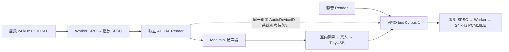

# Stage 7.5.11 · Apple AEC 开源实现对照与技术推演

审核基线 `c1846a6191a39ac6b99d2ec3645ff71bdede3640`。**Chromium 的 macOS 系统 AEC 路径确实把远端音频送到独立输出流，VPIO 播放回调只标记静音。这个接法值得先用现有 Chrome 实测。Aftelle 新增候选及生产切换均缺少声学依据。**

## 固定版本

- Chromium `30a0f3260db34fa01dcfde074e6d71366291e6d0`，WebKit `126477a9abf03ca69853cd3eaad79c2601dea1ad`。2026-11-28 冻结快照。[Chromium VPIO](https://github.com/chromium/chromium/blob/30a0f3260db34fa01dcfde074e6d71366291e6d0/media/audio/apple/audio_low_latency_input.cc#L477) · [WebKit CoreAudioCaptureUnit](https://github.com/WebKit/WebKit/blob/126477a9abf03ca69853cd3eaad79c2601dea1ad/Source/WebCore/platform/mediastream/cocoa/CoreAudioCaptureUnit.cpp#L75)
- 本机 Chrome Info.plist 为 `158.0.8127.37`，上游发行提交 `b8c2be851f62f6a394ec57955d7f31335d7cb6d4`。VPIO 输入、音频服务 stream factory、Blink echo 选择与处理布局、APM 配置和 MediaInternals 六份文件与所审 Chromium 快照逐字节一致。已在安装的 Framework 静态检出 Enforce、loopback、VPAU 和 AUHAL Render 标记。标记只能证明相关实现存在于产物。[发行版 VPIO](https://github.com/chromium/chromium/blob/b8c2be851f62f6a394ec57955d7f31335d7cb6d4/media/audio/apple/audio_low_latency_input.cc#L250) · [发行版 Feature](https://github.com/chromium/chromium/blob/b8c2be851f62f6a394ec57955d7f31335d7cb6d4/media/base/media_switches.cc#L1573-L1595)

## Chromium macOS 的实际链路

1. **远端 PCM**　`WebRtcAudioDeviceImpl::RenderData/PullRenderData` → `WebRtcAudioRenderer` 的 `kWebRtc` sink → `AudioDeviceFactory` 的 `AudioOutputDevice` 和输出 IPC → 浏览器 broker → Audio Service `OutputStream/OutputController` → `AudioManagerMac::MakeLowLatencyOutputStream` → `AUHALStream`。AUHAL 实例为 output-only `HALOutput`，在自己的 Render 回调通过 FIFO 或回调供数返回实际远端样本。WebRTC latency tag 为 `kRtc`。macOS 27+ 的 AVFoundation 输出另有 `kPlayback` 和 Feature 条件。[远端 PCM](https://github.com/chromium/chromium/blob/30a0f3260db34fa01dcfde074e6d71366291e6d0/third_party/blink/renderer/modules/webrtc/webrtc_audio_device_impl.cc#L112-L143) · [启动 renderer](https://github.com/chromium/chromium/blob/30a0f3260db34fa01dcfde074e6d71366291e6d0/third_party/blink/renderer/modules/webrtc/webrtc_audio_renderer.cc#L306-L350) · [输出工厂](https://github.com/chromium/chromium/blob/30a0f3260db34fa01dcfde074e6d71366291e6d0/third_party/blink/renderer/modules/media/audio/audio_device_factory.cc#L104-L130) · [Broker](https://github.com/chromium/chromium/blob/30a0f3260db34fa01dcfde074e6d71366291e6d0/content/browser/media/audio_output_stream_broker.cc#L213) · [Audio Service](https://github.com/chromium/chromium/blob/30a0f3260db34fa01dcfde074e6d71366291e6d0/services/audio/stream_factory.cc#L162) · [输出创建](https://github.com/chromium/chromium/blob/30a0f3260db34fa01dcfde074e6d71366291e6d0/services/audio/output_controller.cc#L303-L324) · [macOS 后端](https://github.com/chromium/chromium/blob/30a0f3260db34fa01dcfde074e6d71366291e6d0/media/audio/mac/audio_manager_mac.cc#L795-L834) · [AUHAL 配置与供数](https://github.com/chromium/chromium/blob/30a0f3260db34fa01dcfde074e6d71366291e6d0/media/audio/apple/audio_auhal.cc#L626-L671) · [Render](https://github.com/chromium/chromium/blob/30a0f3260db34fa01dcfde074e6d71366291e6d0/media/audio/apple/audio_auhal.cc#L463-L483) · [AVFoundation 条件](https://github.com/chromium/chromium/blob/30a0f3260db34fa01dcfde074e6d71366291e6d0/media/base/media_switches.cc#L2054-L2065)
2. **麦克风 PCM**　输入参数有 `ECHO_CANCELLER`、设备通过筛选且默认输出可用时，`Open` 选择 `OpenVoiceProcessingAU`。创建 VPIO，Global/1 写输入设备，Global/0 写为 AEC 选定的输出设备。输入通知后 `AudioUnitRender` 拉 bus 1，再经 FIFO 交给采集方。VPIO bus 0 回调 `OnGetPlayoutData` 仅设置 `kAudioUnitRenderAction_OutputIsSilence`、返回成功，函数体未写远端样本。若已选 VPIO 却 Open 失败，该次 Open 返回失败。[选择与 Open](https://github.com/chromium/chromium/blob/30a0f3260db34fa01dcfde074e6d71366291e6d0/media/audio/apple/audio_low_latency_input.cc#L191-L205) · [Open 失败处理](https://github.com/chromium/chromium/blob/30a0f3260db34fa01dcfde074e6d71366291e6d0/media/audio/apple/audio_low_latency_input.cc#L250-L289) · [VPIO 配置](https://github.com/chromium/chromium/blob/30a0f3260db34fa01dcfde074e6d71366291e6d0/media/audio/apple/audio_low_latency_input.cc#L477-L549) · [静音回调](https://github.com/chromium/chromium/blob/30a0f3260db34fa01dcfde074e6d71366291e6d0/media/audio/apple/audio_low_latency_input.cc#L151-L158) · [AudioUnitRender](https://github.com/chromium/chromium/blob/30a0f3260db34fa01dcfde074e6d71366291e6d0/media/audio/apple/audio_low_latency_input.cc#L1107-L1143) · [交付](https://github.com/chromium/chromium/blob/30a0f3260db34fa01dcfde074e6d71366291e6d0/media/audio/apple/audio_low_latency_input.cc#L1233-L1256)
3. **参考设备**　Renderer 启动和切换时发 `SetOutputDeviceForAec`。对已登记的 `ProcessedLocalAudioSource`，调用经 `WebRtcAudioDeviceImpl`、采集源、`AudioInputDevice` 和 Mojo，浏览器执行输出设备授权与 ID 翻译，音频服务按输入流 ID 把输出 ID 交给 `InputController` 和 VPIO 输入流。初始使用默认输出，同一 ID 直接返回。有效变化则重新创建 VPIO，按原运行状态重启。Aggregate 输入被拒绝，Aggregate 输出选择首个输出子设备。这条链传的是设备身份。Apple 内部取参考的位置、内容和时间仍 UNKNOWN。[切换 sink](https://github.com/chromium/chromium/blob/30a0f3260db34fa01dcfde074e6d71366291e6d0/third_party/blink/renderer/modules/webrtc/webrtc_audio_renderer.cc#L538-L574) · [分发](https://github.com/chromium/chromium/blob/30a0f3260db34fa01dcfde074e6d71366291e6d0/third_party/blink/renderer/modules/webrtc/webrtc_audio_device_impl.cc#L177-L188) · [采集代理](https://github.com/chromium/chromium/blob/30a0f3260db34fa01dcfde074e6d71366291e6d0/third_party/blink/renderer/modules/mediastream/processed_local_audio_source.cc#L449-L455) · [Mojo](https://github.com/chromium/chromium/blob/30a0f3260db34fa01dcfde074e6d71366291e6d0/third_party/blink/renderer/modules/media/audio/mojo_audio_input_ipc.cc#L73-L79) · [设备授权与翻译](https://github.com/chromium/chromium/blob/30a0f3260db34fa01dcfde074e6d71366291e6d0/content/browser/renderer_host/media/render_frame_audio_input_stream_factory.cc#L345-L406) · [配对](https://github.com/chromium/chromium/blob/30a0f3260db34fa01dcfde074e6d71366291e6d0/services/audio/stream_factory.cc#L150-L159) · [控制器](https://github.com/chromium/chromium/blob/30a0f3260db34fa01dcfde074e6d71366291e6d0/services/audio/input_controller.cc#L702-L713) · [设备筛选与重建](https://github.com/chromium/chromium/blob/30a0f3260db34fa01dcfde074e6d71366291e6d0/media/audio/apple/audio_low_latency_input.cc#L900-L1042)
4. **采样率、缓冲和时钟**　输入请求取设备名义率。VPIO 要求设备侧 ASBD 与请求率匹配，两端设单声道 client，采集 Float32 失败时尝试 S16。输入和 AUHAL 输出各协调 buffer frames、处理实际帧数和 FIFO。Chrome 用输入 HostTime 减估算输入硬件延迟，失效时回退 Now。AUHAL 以输出 HostTime、估算输出延迟和 SampleTime 跳变记录数字播放。两路分别有时钟与缓冲，AUHAL 出声、ADC/DAC 时钟同步及 Apple 参考对齐均不能由这些计算推定。 [输入参数](https://github.com/chromium/chromium/blob/30a0f3260db34fa01dcfde074e6d71366291e6d0/media/audio/mac/audio_manager_mac.cc#L679-L719) · [匹配与 buffer](https://github.com/chromium/chromium/blob/30a0f3260db34fa01dcfde074e6d71366291e6d0/media/audio/apple/audio_low_latency_input.cc#L551-L630) · [客户格式](https://github.com/chromium/chromium/blob/30a0f3260db34fa01dcfde074e6d71366291e6d0/media/audio/apple/audio_low_latency_input.cc#L653-L687) · [输入时标](https://github.com/chromium/chromium/blob/30a0f3260db34fa01dcfde074e6d71366291e6d0/media/audio/apple/audio_low_latency_input.cc#L1260-L1268) · [输出时标](https://github.com/chromium/chromium/blob/30a0f3260db34fa01dcfde074e6d71366291e6d0/media/audio/apple/audio_auhal.cc#L552-L623)

**Feature 与 AEC 互斥**　`EnforceSystemEchoCancellation` 在 macOS 默认关闭。启用后仍须 mono/stereo、可读 transport、非 Aggregate 输入和可用默认输出。Blink 的 `PlatformProvided` 保留平台 `ECHO_CANCELLER`，软件 `echo_cancellation=false`。选择软件 AEC 时清掉平台 AEC/AGC 位。APM 的 `echo_canceller.enabled` 直接取软件位。Enforce 会使 Chrome-wide AEC 分支退出。系统 loopback 可被强制优先，`all` 模式也可能选 loopback 喂软件 AEC，因此不能用网页 `echoCancellation:true` 单独验明后端。两种 AEC 在该正常布局中互斥。AGC/NS 有独立 tandem 参数，默认 false。Chrome 可设置系统 AGC，macOS 的系统 NS 可能保留，须与软件 NS 分开确认。[筛选](https://github.com/chromium/chromium/blob/30a0f3260db34fa01dcfde074e6d71366291e6d0/media/audio/apple/audio_low_latency_input.cc#L954-L993) · [开关与 tandem](https://github.com/chromium/chromium/blob/b8c2be851f62f6a394ec57955d7f31335d7cb6d4/media/base/media_switches.cc#L1573-L1596) · [Chrome-wide 判断](https://github.com/chromium/chromium/blob/30a0f3260db34fa01dcfde074e6d71366291e6d0/media/base/media_switches.cc#L1865-L1871) · [选择顺序](https://github.com/chromium/chromium/blob/30a0f3260db34fa01dcfde074e6d71366291e6d0/third_party/blink/renderer/platform/mediastream/media_stream_audio_processor_options.cc#L82-L104) · [loopback 优先级](https://github.com/chromium/chromium/blob/30a0f3260db34fa01dcfde074e6d71366291e6d0/third_party/blink/renderer/platform/mediastream/media_stream_audio_processor_options.cc#L141-L168) · [平台效果位](https://github.com/chromium/chromium/blob/30a0f3260db34fa01dcfde074e6d71366291e6d0/third_party/blink/renderer/modules/mediastream/media_stream_audio_processing_layout.cc#L37-L76) · [软件配置](https://github.com/chromium/chromium/blob/30a0f3260db34fa01dcfde074e6d71366291e6d0/third_party/blink/renderer/modules/mediastream/media_stream_audio_processing_layout.cc#L142-L164) · [APM](https://github.com/chromium/chromium/blob/30a0f3260db34fa01dcfde074e6d71366291e6d0/media/webrtc/helpers.cc#L145-L163) · [系统 AGC](https://github.com/chromium/chromium/blob/30a0f3260db34fa01dcfde074e6d71366291e6d0/media/audio/apple/audio_low_latency_input.cc#L702-L737) · [启动时启用](https://github.com/chromium/chromium/blob/30a0f3260db34fa01dcfde074e6d71366291e6d0/media/audio/apple/audio_low_latency_input.cc#L772-L796)

## WebKit Cocoa 的条件分支

- **采集**　EchoCancellation 请求选择默认 VPIO 单元。关闭时 macOS 用 HALOutput，iOS 家族用 RemoteIO。macOS VPIO 的 Global/1 绑定麦克风，Global/0 尝试绑定默认输出并登记结果。macOS 只对非 VPIO 采集显式设置 EnableIO。iOS 路由走 AudioSession 与首选麦克风，显式开启输入。VPIO mic 回调调用 `AudioUnitRender`，保留 sample/host 时标。采集和 speaker client 使用同率，有 producer 时取产出率。缓冲按 AudioSession 与不足时曾遇到的帧数配置，必要时 stop/reconfigure/start。macOS 可暂存 VPIO 实例。[EchoCancellation 选择](https://github.com/WebKit/WebKit/blob/126477a9abf03ca69853cd3eaad79c2601dea1ad/Source/WebCore/platform/mediastream/cocoa/CoreAudioCaptureSource.cpp#L225-L245) · [创建与缓存](https://github.com/WebKit/WebKit/blob/126477a9abf03ca69853cd3eaad79c2601dea1ad/Source/WebCore/platform/mediastream/cocoa/CoreAudioCaptureUnit.cpp#L75-L126) · [设备/初始化](https://github.com/WebKit/WebKit/blob/126477a9abf03ca69853cd3eaad79c2601dea1ad/Source/WebCore/platform/mediastream/cocoa/CoreAudioCaptureUnit.cpp#L371-L438) · [AudioSession](https://github.com/WebKit/WebKit/blob/126477a9abf03ca69853cd3eaad79c2601dea1ad/Source/WebCore/platform/mediastream/cocoa/CoreAudioCaptureUnit.cpp#L304-L322) · [格式与 buffer](https://github.com/WebKit/WebKit/blob/126477a9abf03ca69853cd3eaad79c2601dea1ad/Source/WebCore/platform/mediastream/cocoa/CoreAudioCaptureUnit.cpp#L452-L490) · [采集](https://github.com/WebKit/WebKit/blob/126477a9abf03ca69853cd3eaad79c2601dea1ad/Source/WebCore/platform/mediastream/cocoa/CoreAudioCaptureUnit.cpp#L578-L617) · [重建](https://github.com/WebKit/WebKit/blob/126477a9abf03ca69853cd3eaad79c2601dea1ad/Source/WebCore/platform/mediastream/cocoa/CoreAudioCaptureUnit.cpp#L651-L685)
- **播放**　Incoming WebRTC tracks 按设备混合并交给渲染单元。GPU 管理器在使用默认输出、连接最近负责音频采集、采集单元可渲染时注册 speaker producer，停止独立输出。VPIO callback 从该 producer 的共享环取真实远端 PCM。producer 缺失或重建期间清零、标静音。其余条件下走独立输出，macOS 为 DefaultOutput，iOS 家族为 RemoteIO。采集启停会切换消费方。macOS 的接管额外判断 `canRenderAudio()`，该实现返回 VPIO 选择。已核对的是 WebKit 路由条件，Safari 当前实机分支仍 UNKNOWN。[Track renderer](https://github.com/WebKit/WebKit/blob/126477a9abf03ca69853cd3eaad79c2601dea1ad/Source/WebCore/platform/mediastream/cocoa/AudioMediaStreamTrackRendererCocoa.cpp#L71-L78) · [混合提交](https://github.com/WebKit/WebKit/blob/126477a9abf03ca69853cd3eaad79c2601dea1ad/Source/WebCore/platform/mediastream/cocoa/IncomingAudioMediaStreamTrackRendererUnit.cpp#L177-L194) · [GPU 接管](https://github.com/WebKit/WebKit/blob/126477a9abf03ca69853cd3eaad79c2601dea1ad/Source/WebKit/GPUProcess/webrtc/RemoteAudioMediaStreamTrackRendererInternalUnitManager.cpp#L200-L232) · [producer 和共享环](https://github.com/WebKit/WebKit/blob/126477a9abf03ca69853cd3eaad79c2601dea1ad/Source/WebKit/GPUProcess/webrtc/RemoteAudioMediaStreamTrackRendererInternalUnitManager.cpp#L244-L319) · [生命周期](https://github.com/WebKit/WebKit/blob/126477a9abf03ca69853cd3eaad79c2601dea1ad/Source/WebKit/GPUProcess/webrtc/RemoteAudioMediaStreamTrackRendererInternalUnitManager.cpp#L322-L347) · [平台接管差异](https://github.com/WebKit/WebKit/blob/126477a9abf03ca69853cd3eaad79c2601dea1ad/Source/WebCore/platform/mediastream/cocoa/CoreAudioCaptureSource.cpp#L192-L198) · [VPIO 回调](https://github.com/WebKit/WebKit/blob/126477a9abf03ca69853cd3eaad79c2601dea1ad/Source/WebCore/platform/mediastream/cocoa/CoreAudioCaptureUnit.cpp#L539-L567) · [独立输出](https://github.com/WebKit/WebKit/blob/126477a9abf03ca69853cd3eaad79c2601dea1ad/Source/WebCore/platform/mediastream/cocoa/AudioMediaStreamTrackRendererInternalUnit.cpp#L168-L240)

## Aftelle 的三种接法及证据等级

| 方案 | 居民 PCM 出口 | 采集和参考选择 | 现有本机证据 |
| --- | --- | --- | --- |
| A AVAudioEngine Apple VP | SourceNode → Mixer → 同一 Engine 的 VP Output | VP 输入 → SinkNode，由同一图协商 | 历史 60.49% 试次为 16 kHz、3ch Sink/Output、单声道 Source。用户回听真人受压和居民残声。[接线](https://github.com/JerryYork3516/Eterna_Aftelle/blob/c1846a6191a39ac6b99d2ec3645ff71bdede3640/apps/macos/NativeVoiceTransport/NativeVoiceSystemEngine.swift#L43-L81) · [试次](Stage_7_5_11_native_transport_human_double_talk_wav_review_2026-11-28.md) |
| B Direct VPIO | 播放环 → 同一 VPIO bus 0 | VPIO bus 1 拉取，两个方向各读写设备 ID | 当前 TinyUSB + Mac mini 跑通，44.1 kHz 单声道。用户回听「和之前一样的问题。没有进步」。[接线](https://github.com/JerryYork3516/Eterna_Aftelle/blob/c1846a6191a39ac6b99d2ec3645ff71bdede3640/apps/macos/NativeVoiceTransport/NativeVoiceDirectVPIO.swift#L108-L173) · [试次](Stage_7_5_11_direct_VPIO_first_human_double_talk_2026-11-28.md) |
| C 独立 AUHAL + VPIO | 播放环 → 独立 AUHAL，VPIO bus 0 静音 | VPIO bus 1 同时采集，选定的输出 ID 与 AUHAL 一致 | 有 Chromium 源码先例。当前设备上的 C 启动、时钟和听感待验证 |

| 待验证陈述 | 裁定 |
| --- | --- |
| 1. Chromium 远端独立播放，VPIO 回调标静音 | **CONFIRMED**，限已追踪的 macOS 系统 AEC 路径。 |
| 2. Apple VP 可使用同一设备上的其他播放流 | **INFERRED**。Chromium 的接法依赖此行为。公开设备关联不能确认 Apple 内部包含哪些流、混音点或对齐精度。 |
| 3. 适用于 TinyUSB + Mac mini | **UNKNOWN**。B 已跑通，C 另受设备侧 ASBD、buffer 和并行输出约束。 |
| 4. Chromium 会正常串联 Apple 与软件 AEC | **CONTRADICTED**。所审平台效果位和 APM 选择互斥。AGC/NS 可独立配置 tandem。 |
| 5. WebKit 与 Chromium 的 Apple VP 用法有差异 | **CONFIRMED**。WebKit 可有条件让真实远端 PCM 进入采集 VPIO，也有独立输出分支。Chromium 所审 VPIO render 只标静音。 |
| 6. B 与 C 已有实质区别 | **CONFIRMED**。不同的是谁消费可听下行和何处提交系统播放。两者均可请求按方向绑定设备。 |
| 7. 出口差异能解释双讲症状 | **INFERRED**。这是可检验机制。参考进入点、缓冲、通道、延时和时钟关系可能变动。B 去掉 Source/Sink/Mixer 仍复现，说明三者并非症状发生的必要条件。A/B 同时改了客户端格式，播放窗混合 RMS 分别较前窗低 2.93/6.26 dB。独立真人衰减及 AEC/AGC 的贡献均 UNKNOWN。 |
| 8. 历史试次已覆盖 C | **CONTRADICTED**，限审阅记录。VP-C、R4 的居民走共享 VP 图。R3/R4 独立 NSSound 和 Step 4 Windows 播的是近端代理。B 的居民走 VPIO 自己的 bus 0。未找到固定居民 PCM 经独立输出同一 Mac mini 扬声器、VPIO 静音且核验平台 AEC 的同配置试次。 |

Apple 公开确认 FaceTime 使用 Voice Processing API，也介绍其它音频 ducking。FaceTime 的实际播放拓扑、参考及内部 DSP 保持 UNKNOWN。历史 VP-C 在共享 VP 图上有有限正向见证。单次结果与静态接线都不足以决定最优后端。[WWDC23](https://developer.apple.com/videos/play/wwdc2023/10235/) · [R4](T3_2_A_reference_host_R4_device_comparison.md) · [M25](T3_2_A_R5_M25_reference_host_differential_audit.md) · [Step 4](T3_2_A_step4_external_source_doubletalk_attribution.md)

## C 的最小实现边界



- **I/O 与时钟**　用公开 `kAudioUnitSubType_HALOutput` 建 output-only 单元。VPIO 保持双端启用，AGC ON，bypass OFF，bus 0 仅零填和标静音。独立输出与 VPIO 输出读回同一 AudioDeviceID，使用可用 ASBD 和回调上限，分别协商实际采集、播放率，Worker 每方向保持单级 SRC。各自保留 SampleTime/HostTime 和有效位，校验后用共同 HostTime 观测，漂移或断点触发原代际保护。Apple AEC 是唯一回声消除器。Aftelle 的 AUHAL 回调保持预分配和无锁，SRC、HAL 查询和诊断封存留在非实时侧。Chromium/WebKit 使用的 `AudioDeviceDuck` SPI 无需迁移。[Apple TN2091](https://developer.apple.com/library/archive/technotes/tn2091/_index.html) · [AUHAL 构造](https://github.com/chromium/chromium/blob/30a0f3260db34fa01dcfde074e6d71366291e6d0/media/audio/apple/scoped_audio_unit.cc#L20-L75) · [独立 SRC](https://github.com/JerryYork3516/Eterna_Aftelle/blob/c1846a6191a39ac6b99d2ec3645ff71bdede3640/apps/macos/NativeVoiceTransport/AppleNativeVoiceTransportWorker.swift#L99-L108)
- **兼容性与清空**　保留 C11 ring、Worker、24 kHz 单声道 PCM16LE 和 480 样本／960 字节包，Qwen STS 经原 Input/Output Bridge，兼容在数据合同上成立。两单元共享会话身份与 route epoch，回调各持安全上下文。独立 AUHAL 是播放环唯一消费者及 EOS/clear ACK 的发布者，VPIO 静音回调不消费。播放 token 先逻辑失效，物理尾音独立记账。须重验实际消费者 ACK 和 confirmed→clear completed ≤50 ms，超时按原合同停机。Runtime、500ms freshness、N+1、SQ-M1 和声源资格不变。[取消入口](https://github.com/JerryYork3516/Eterna_Aftelle/blob/c1846a6191a39ac6b99d2ec3645ff71bdede3640/apps/macos/NativeVoiceTransport/AppleNativeVoiceTransport.swift#L97-L125) · [消费者事实](https://github.com/JerryYork3516/Eterna_Aftelle/blob/c1846a6191a39ac6b99d2ec3645ff71bdede3640/apps/macos/NativeVoiceTransport/NativeVoiceRealtime.c#L381-L445) · [P4 合同](AppleNativeVoiceTransport_P4_engineering_review.md)
- **最小候选与回退**　仅在浏览器出现可复核的正向结果后再评审互斥 DEBUG 候选。复用 Direct VPIO 采集，增加 AUHAL Render 适配、合并路由校验和双单元关停收据。初始化、路由或释放失败时关闭整个候选并保留失效证据。回退为显式重新选择已冻结后端，避免隐式切换及两个可听出口。客户格式、缓冲漂移、双单元失败与清空延迟是首要工程风险。

## 唯一优先验证

**获单独授权后，用已安装 Chrome 做一次有平台 VPIO 和独立 AUHAL 运行收据的固定 WAV 真人双讲。** 方案复用现有浏览器、本机媒体播放与录音。无需编译 Chromium 或调整 Aftelle。

1. 隔离本地 Chrome profile。明确 `--enable-features=EnforceSystemEchoCancellation`、`--disable-features=SystemLoopbackAsAecReference,MacAVFoundationPlayback`。Enforce 已在内部关闭 Chrome-wide。以 localhost 本机页面运行，系统默认输出选择 Mac mini。保持 TinyUSB 60.49%、Mac mini 59.86%、Standard Mic Mode。用 `getUserMedia` 选 TinyUSB 单声道，要求 `echoCancellation:true`、`autoGainControl:true`、`noiseSuppression:false`。麦克风流只用于本机记录。独立 Web Audio 输出先送静音，再经同一输出流播放原幅固定 WAV（SHA-256 `774e450ce1ff92402051f89ae4fcd537d74367deff9c2f92670ba0f6637d47ea`）。
2. **先核验后端。** `--enable-logging=stderr --vmodule=audio_low_latency_input=1,webrtc_logging=1,media_stream_manager=1` 为源码对照的本地日志入口。相同输入流须有 `Open using VPAU`、成功采样、无启动错误和系统 AGC ON 收据。Blink `PLAS` 处理中应见 `aec: no`、`loopback aec: no`，并核对软件 NS/gain control 没有叠加。独立输出须见同设备的 `AUHALStream::Render` trace 或等效运行证据。MediaInternals Audio 辅助核对设备、流身份、格式和效果位。网页设置与 flags 只表明请求。收据缺失时记 **BACKEND_EVIDENCE_INSUFFICIENT**，停止固定 WAV 试次。[VPAU 启动标记](https://github.com/chromium/chromium/blob/b8c2be851f62f6a394ec57955d7f31335d7cb6d4/media/audio/apple/audio_low_latency_input.cc#L250-L289) · [AGC 读写](https://github.com/chromium/chromium/blob/b8c2be851f62f6a394ec57955d7f31335d7cb6d4/media/audio/apple/audio_low_latency_input.cc#L702-L736) · [APM 日志](https://github.com/chromium/chromium/blob/b8c2be851f62f6a394ec57955d7f31335d7cb6d4/third_party/blink/renderer/modules/mediastream/processed_local_audio_source.cc#L285-L309) · [标记定义](https://github.com/chromium/chromium/blob/30a0f3260db34fa01dcfde074e6d71366291e6d0/media/base/audio_processing.cc#L11-L25) · [renderer VLOG](https://github.com/chromium/chromium/blob/30a0f3260db34fa01dcfde074e6d71366291e6d0/third_party/blink/renderer/platform/webrtc/webrtc_logging.cc#L34-L38) · [MediaInternals](https://github.com/chromium/chromium/blob/b8c2be851f62f6a394ec57955d7f31335d7cb6d4/content/browser/media/media_internals.cc#L235-L292) · [输出 trace](https://github.com/chromium/chromium/blob/30a0f3260db34fa01dcfde074e6d71366291e6d0/media/audio/apple/audio_auhal.cc#L417-L438)
3. 通过后，同一短会话进行真人先讲、居民可听时继续讲、居民停后继续讲，再安静。确认物理出声与重叠见证，记录从输入启动到 WAV 起音的时间，采用固定居民模板及错时／反转负控。以用户回听判断近端保真与残声。浏览器格式、缓冲及录音编码需登记。有损录音可作听感参考，不能代替与历史 PCM16 的严格等值电平对照。只留本机证据。单次正向结果可支持后续评审 C 候选，因果差异与生产采用仍需独立核验。

Stage 7 Forbidden Checklist 为 `PASS`。仅新增本报告，生产代码、Runtime API、DR schema、平台 target 和 P1–P4 冻结合约保持。未启动设备或 Provider。

```ini
CHROMIUM_APPLE_AEC_PATH = CONFIRMED
AFTELLE_ADOPTION_FEASIBILITY = UNKNOWN
NEXT_ACTION = 获单独授权后，用现有 Chrome 验实系统 VPIO 与独立 AUHAL，再进行一次固定 WAV 真人双讲
AEC_ROOT_CAUSE = UNKNOWN
CLOCK_ROOT_CAUSE = UNKNOWN
SQ_M1 = OPEN
Formal_Test3 = BLOCKED
Test3.execution_authorized = false
DEVICE_RUNS_THIS_TASK = 0
```
