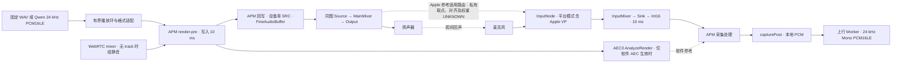

# Stage 7.5.11 · LiveKit Swift 实时音频底座可行性研究

## 裁定

**无 Room 的本地采集及同图流式 PCM 注入有公开入口。完整替换 Aftelle 音频底座仍被阻断。** 固定版本的默认 ADM 在开启采集时也驱动同一个 AVAudioEngine 的输出。`renderPreProcessingDelegate` 可以把居民 PCM 写进 WebRTC 的反向流，处理后的数据回到设备播放。发布版公开接口没有 Aftelle 所需的最终消费时标、代际清空 ACK，也没有通过 `startLocalRecording` 完整锁定 Apple 与软件 APM 两侧的模式。

**CONFIRMED** 表示由固定源码或既有已归档证据支持。**INFERRED** 是明确的工程推断。**UNKNOWN** 表示当前证据不能判定。**CONTRADICTED** 表示固定实现与命题冲突。本轮未下载或执行二进制、构建探针、接通设备或读取私人录音。

## 1. 固定依赖与源码身份

| 层 | 固定版本与佐证 |
| --- | --- |
| Aftelle | `b70cbe7a100859843650dd7adccc92d06c94f41d`，`Test3-AppleVP-Clean`。保留 Native Transport、Direct VPIO、Chromium 独立 AUHAL 路线。[P1–P4 信号链与合同](https://github.com/JerryYork3516/Eterna_Aftelle/blob/b70cbe7a100859843650dd7adccc92d06c94f41d/docs/stage7_5/test3_apple_vp_clean/AppleNativeVoiceTransport_P4_engineering_review.md#L13-L38) · [现有接法](https://github.com/JerryYork3516/Eterna_Aftelle/blob/b70cbe7a100859843650dd7adccc92d06c94f41d/docs/stage7_5/test3_apple_vp_clean/Stage_7_5_11_Apple_AEC_open_source_comparison.md#L24-L40) |
| LiveKit Swift | 正式版 `2.20.1`，`1f69f1d77c683a7f46dce653b891edf00660bfc3`。产品依赖 `LiveKitWebRTC 150.7871.08`、`LiveKitFFI 0.13.4` 与自身 ObjC/Proto 辅助模块。SwiftProtobuf 用于测试，DocC 用于文档。[工具链与平台](https://github.com/livekit/client-sdk-swift/blob/1f69f1d77c683a7f46dce653b891edf00660bfc3/Package.swift#L1-L13) · [包版本](https://github.com/livekit/client-sdk-swift/blob/1f69f1d77c683a7f46dce653b891edf00660bfc3/Package.swift#L21-L28) · [产品依赖](https://github.com/livekit/client-sdk-swift/blob/1f69f1d77c683a7f46dce653b891edf00660bfc3/Package.swift#L49-L57) |
| LiveKitWebRTC 包装 | `livekit/webrtc-xcframework@b34647c69f8f048d5ed1df3ddcb478f346621653`，二进制版本 `150.7871.08`。包使用 LK 前缀动态框架，发布 ZIP 的声明 SHA-256 为 `008dbf8187843ab708afa44b65b8041d8ce8da99e530608cd85aa6ea3551529a`。[二进制 URL 与校验值](https://github.com/livekit/webrtc-xcframework/blob/b34647c69f8f048d5ed1df3ddcb478f346621653/Package.swift#L13-L24) |
| 构建器 | 发布说明指定 `webrtc-sdk/webrtc-build@0d1a5f8344c05bf0cf92efd313edcf3f4caf398c`。根 `VERSION` 对应同一版本。工作流在无显式覆盖时使用该文件的 `WEBRTC_COMMIT`。Apple prefixed patch 影响产物命名和导出。[官方构建来源](https://github.com/livekit/webrtc-xcframework/blob/b34647c69f8f048d5ed1df3ddcb478f346621653/README.md#L1-L11) · [发布说明](https://github.com/livekit/webrtc-xcframework/releases/tag/150.7871.08) · [构建版本锁](https://github.com/webrtc-sdk/webrtc-build/blob/0d1a5f8344c05bf0cf92efd313edcf3f4caf398c/VERSION#L1-L4) · [解析版本](https://github.com/webrtc-sdk/webrtc-build/blob/0d1a5f8344c05bf0cf92efd313edcf3f4caf398c/.github/workflows/build.yml#L116-L145) · [Apple 补丁](https://github.com/webrtc-sdk/webrtc-build/blob/0d1a5f8344c05bf0cf92efd313edcf3f4caf398c/scripts/patches/apple_prefix.patch) |
| WebRTC C++/ObjC | `webrtc-sdk/webrtc@7c1a802ab4e0d74f28ee997678346b3e753ef42a`。本轮访问 `livekit/webrtc` 返回 HTTP 404，底层证据由公开 XCFramework 包指向的构建仓和提交提供。包清单与 release 资产元数据的摘要一致，未独立校验 ZIP 字节或重现二进制。[底层提交](https://github.com/webrtc-sdk/webrtc-build/blob/0d1a5f8344c05bf0cf92efd313edcf3f4caf398c/VERSION#L4) · [LiveKit 分支的无连接初始化差异](https://github.com/webrtc-sdk/webrtc/blob/7c1a802ab4e0d74f28ee997678346b3e753ef42a/pc/peer_connection_factory.cc#L97-L122) |

## 2. 房间外的实际调用链



图中的播放环、Qwen 与上行 Worker 是拟议适配。默认 SDK 不创建这些部分。

- **CONFIRMED　初始化与采集。** `RTC` 默认 `.audioEngine`，共享 APM 和 Factory。ObjC 工厂实例化 `AudioEngineDevice` 并注入同一个 ADM 和 APM。此 C++ 分支在有媒体的 Factory 内明确保有 `MediaEngineReference`，使 `WebRtcVoiceEngine::Init` 在没有 PeerConnection 时也注册 `AudioTransport`。`AudioManager.startLocalRecording` 在已授予麦克风权限的前提下直接启动这个 ADM，未调用 Room。`RecordedDataIsAvailable` 即便没有 sender，也会按输入率与通道做 remix/SRC 和 APM。没有 sender 时仅丢弃网络投递分支，本地 `capturePost` 已执行。Factory 仍初始化线程和 SSL，进程零网络出站需在探针另测。[默认 ADM](https://github.com/livekit/client-sdk-swift/blob/1f69f1d77c683a7f46dce653b891edf00660bfc3/Sources/LiveKit/Core/RTC.swift#L143-L151) · [共享 Factory](https://github.com/livekit/client-sdk-swift/blob/1f69f1d77c683a7f46dce653b891edf00660bfc3/Sources/LiveKit/Core/RTC.swift#L187-L224) · [ADM 与 APM 组装](https://github.com/webrtc-sdk/webrtc/blob/7c1a802ab4e0d74f28ee997678346b3e753ef42a/sdk/objc/api/peerconnection/RTCPeerConnectionFactory.mm#L370-L407) · [无连接保活](https://github.com/webrtc-sdk/webrtc/blob/7c1a802ab4e0d74f28ee997678346b3e753ef42a/pc/peer_connection_factory.cc#L114-L122) · [初始化引用](https://github.com/webrtc-sdk/webrtc/blob/7c1a802ab4e0d74f28ee997678346b3e753ef42a/pc/connection_context.cc#L226-L233) · [注册 AudioTransport](https://github.com/webrtc-sdk/webrtc/blob/7c1a802ab4e0d74f28ee997678346b3e753ef42a/media/engine/webrtc_voice_engine.cc#L524-L552) · [本地录音](https://github.com/livekit/client-sdk-swift/blob/1f69f1d77c683a7f46dce653b891edf00660bfc3/Sources/LiveKit/Audio/Manager/AudioManager.swift#L452-L471) · [零 sender 仍执行采集处理](https://github.com/webrtc-sdk/webrtc/blob/7c1a802ab4e0d74f28ee997678346b3e753ef42a/audio/audio_transport_impl.cc#L158-L214) · [capture-post 的位置](https://github.com/webrtc-sdk/webrtc/blob/7c1a802ab4e0d74f28ee997678346b3e753ef42a/modules/audio_processing/audio_processing_impl.cc#L1417-L1430)
- **CONFIRMED　设备模式本地录音也驱动输出。** ADM 启用、运行 input 后，`IsOutputEnabled/Running` 在输出可用时跟随 input。建图挂上 Int16 单声道 `AVAudioSourceNode → MainMixer → Output` 并启动 `AudioDeviceBuffer` playout。每个设备 render pull 由 `FineAudioBuffer` 按需取 10 ms 数据，经 `NeedMorePlayData` 请求。Swift `initPlayout/startPlayout/stopPlayout` 仅有内部测试封装，ObjC ADM 有公开控制。`isPlaying` 读的是显式 output 标志，单看它会漏掉由采集带起的 Source。[启动输入](https://github.com/webrtc-sdk/webrtc/blob/7c1a802ab4e0d74f28ee997678346b3e753ef42a/modules/audio_device/audio_engine_device.mm#L1505-L1519) · [输出跟随输入](https://github.com/webrtc-sdk/webrtc/blob/7c1a802ab4e0d74f28ee997678346b3e753ef42a/modules/audio_device/audio_engine_device.h#L191-L225) · [Source 与 Mixer](https://github.com/webrtc-sdk/webrtc/blob/7c1a802ab4e0d74f28ee997678346b3e753ef42a/modules/audio_device/audio_engine_device.mm#L2550-L2596) · [输出缓冲启动](https://github.com/webrtc-sdk/webrtc/blob/7c1a802ab4e0d74f28ee997678346b3e753ef42a/modules/audio_device/audio_engine_device.mm#L3014-L3026) · [播放标志与生命周期](https://github.com/webrtc-sdk/webrtc/blob/7c1a802ab4e0d74f28ee997678346b3e753ef42a/modules/audio_device/audio_engine_device.mm#L481-L522) · [Swift 内部接口](https://github.com/livekit/client-sdk-swift/blob/1f69f1d77c683a7f46dce653b891edf00660bfc3/Sources/LiveKit/Audio/Manager/AudioManager+Testing.swift#L19-L55) · [ObjC 公开控制](https://github.com/webrtc-sdk/webrtc/blob/7c1a802ab4e0d74f28ee997678346b3e753ef42a/sdk/objc/api/peerconnection/RTCAudioDeviceModule.h#L323-L338)
- **CONFIRMED　软件参考和扬声器数据使用同一注入帧。** mixer 在没有远端 tracks 时给静音。`NeedMorePlayData` 调 `ProcessReverseAudioFrame`，取可写 PCM 会展开静音。APM 在 `AnalyzeRender` 前调用公开 Swift `renderPreProcessingDelegate` 的底层适配器。只要 render-pre 模块存在，即使 AEC3 关闭，`RenderFullBandProcessingActive()` 也使处理后的 PCM 回写该帧，之后再按设备采样率交给 Source。此为代码上的数字参考与播放路径。它不保证内部处理实际开启、实时对齐、外放或消除效果。[空 mixer 输出](https://github.com/webrtc-sdk/webrtc/blob/7c1a802ab4e0d74f28ee997678346b3e753ef42a/modules/audio_mixer/frame_combiner.cc#L73-L82) · [可写 PCM](https://github.com/webrtc-sdk/webrtc/blob/7c1a802ab4e0d74f28ee997678346b3e753ef42a/api/audio/audio_frame.cc#L133-L152) · [反向处理与输出 SRC](https://github.com/webrtc-sdk/webrtc/blob/7c1a802ab4e0d74f28ee997678346b3e753ef42a/audio/audio_transport_impl.cc#L216-L253) · [原帧回写](https://github.com/webrtc-sdk/webrtc/blob/7c1a802ab4e0d74f28ee997678346b3e753ef42a/modules/audio_processing/include/audio_frame_proxies.cc#L47-L69) · [capture-post/render-pre 注册](https://github.com/webrtc-sdk/webrtc/blob/7c1a802ab4e0d74f28ee997678346b3e753ef42a/sdk/objc/components/audio/RTCDefaultAudioProcessingModule.mm#L39-L64) · [公开 delegate](https://github.com/livekit/client-sdk-swift/blob/1f69f1d77c683a7f46dce653b891edf00660bfc3/Sources/LiveKit/Audio/Manager/AudioManager.swift#L198-L227) · [先注入再 AnalyzeRender](https://github.com/webrtc-sdk/webrtc/blob/7c1a802ab4e0d74f28ee997678346b3e753ef42a/modules/audio_processing/audio_processing_impl.cc#L1571-L1623) · [回写分支](https://github.com/webrtc-sdk/webrtc/blob/7c1a802ab4e0d74f28ee997678346b3e753ef42a/modules/audio_processing/audio_processing_impl.cc#L408-L411)
- **CONFIRMED　采集导出语义。** `capturePostProcessingDelegate`、`add(localAudioRenderer:)` 共用采集后置适配器。自定义 delegate 在 APM 回调内拿到有效期有限的可写数据，使用 FloatS16 幅值及初始化回调的率、通道。通用 `AudioRenderer` 路径分配 Int16 `AVAudioPCMBuffer` 后异步转交，协议没有采集起点、原生时间戳有效性、序号或路由代际。已排队的 renderer 通知也能晚于移除操作到达。建议只把 probe 的有界副本交给非实时 Worker。[处理接口](https://github.com/livekit/client-sdk-swift/blob/1f69f1d77c683a7f46dce653b891edf00660bfc3/Sources/LiveKit/Protocols/AudioCustomProcessingDelegate.swift#L29-L49) · [delegate 与 renderer 转交](https://github.com/livekit/client-sdk-swift/blob/1f69f1d77c683a7f46dce653b891edf00660bfc3/Sources/LiveKit/Protocols/AudioCustomProcessingDelegate.swift#L114-L127) · [renderer 注册](https://github.com/livekit/client-sdk-swift/blob/1f69f1d77c683a7f46dce653b891edf00660bfc3/Sources/LiveKit/Audio/Manager/AudioManager.swift#L570-L594) · [FloatS16 幅值与封包](https://github.com/livekit/client-sdk-swift/blob/1f69f1d77c683a7f46dce653b891edf00660bfc3/Sources/LiveKit/Convenience/AudioProcessing.swift#L31-L59) · [通知队列](https://github.com/livekit/client-sdk-swift/blob/1f69f1d77c683a7f46dce653b891edf00660bfc3/Sources/LiveKit/Support/MulticastDelegate.swift#L89-L97)

### 本地播放入口取舍

| 入口 | 证据与可用性 |
| --- | --- |
| `renderPreProcessingDelegate` | **CONFIRMED** 支持逐块写入 streaming PCM。必须在当前 ADM 的设备输出运行、hook 实际被调用且格式确定时供数。填充空余帧为零，欠载分开计数。没有现成的 PCM FIFO、背压或清空 ACK。 |
| `mixer.capture(appAudio:)` | **CONTRADICTED** 作为下行播放入口。它转换后排队到输入 mixer，进入采集 `Sink` 和 APM。比麦克风更晚进入，无法证明同一居民数据送到扬声器。误接会污染上行。[输入接线](https://github.com/livekit/client-sdk-swift/blob/1f69f1d77c683a7f46dce653b891edf00660bfc3/Sources/LiveKit/Audio/MixerEngineObserver.swift#L174-L230) · [appAudio scheduleBuffer](https://github.com/livekit/client-sdk-swift/blob/1f69f1d77c683a7f46dce653b891edf00660bfc3/Sources/LiveKit/Audio/MixerEngineObserver.swift#L335-L357) |
| `SoundPlayer` | **CONFIRMED** `.local` 在第二个 AVAudioEngine 播放预读并缓存的文件，`.remote` 通过采集 mixer 送往上行。**CONTRADICTED** 它作为原生流式 Qwen PCM 队列或软件 AEC3 的反向入口。其本地播放是否被 Apple VP 收入内部参考 **UNKNOWN**。缺少 Chromium 对同一参考设备的显式选择证据。[独立 Engine](https://github.com/livekit/client-sdk-swift/blob/1f69f1d77c683a7f46dce653b891edf00660bfc3/Sources/LiveKit/Audio/SoundPlayer.swift#L34-L54) · [本地引擎启动](https://github.com/livekit/client-sdk-swift/blob/1f69f1d77c683a7f46dce653b891edf00660bfc3/Sources/LiveKit/Audio/SoundPlayer.swift#L171-L200) · [两种播放路径及文件预读](https://github.com/livekit/client-sdk-swift/blob/1f69f1d77c683a7f46dce653b891edf00660bfc3/Sources/LiveKit/Audio/SoundPlayer.swift#L262-L287) |
| `AudioEngineObserver` | **CONFIRMED** 可在建图和启停时接入，禁止持有内部 Engine。**INFERRED** 给 Apple 模式加同图 Source 可见证最终数字消费，但仍须通过 graph 格式与生命周期测试。若直接把真实 PCM 并入 Mixer，软件反向流没有这部分 PCM，除非另建可核验的 reference feed。首个探针只走 render-pre。[建图钩子](https://github.com/livekit/client-sdk-swift/blob/1f69f1d77c683a7f46dce653b891edf00660bfc3/Sources/LiveKit/Audio/AudioEngineObserver.swift#L22-L41) · [输出连接与观察者顺序](https://github.com/webrtc-sdk/webrtc/blob/7c1a802ab4e0d74f28ee997678346b3e753ef42a/modules/audio_device/audio_engine_device.mm#L2587-L2609) |

结论是 **不需要 Room 来驱动两个方向的数据面**。启停、模式与消费者资格仍有接口缺口。单纯加 observer 或开 Room 都不会生成末级清空 ACK。

## 3. Apple VP 与软件 APM 的实际控制

| 项目 | 固定源码结论 |
| --- | --- |
| 平台处理 | **CONFIRMED** audio-engine ADM 在建图窗口调用 `setVoiceProcessingEnabled`。Apple AEC/NS 在一个共享平台路径上，AGC 开关独立，但只有共享路径激活时按平台生效计。平台回读来自实际 input node 的 VP、bypass、AGC，未实例化时 active 可以缺失。私有参考取点、时延、滤波器、双讲判定及实际衰减保持 **UNKNOWN**。[开启 VP](https://github.com/webrtc-sdk/webrtc/blob/7c1a802ab4e0d74f28ee997678346b3e753ef42a/modules/audio_device/audio_engine_device.mm#L2447-L2466) · [原生平台读回](https://github.com/webrtc-sdk/webrtc/blob/7c1a802ab4e0d74f28ee997678346b3e753ef42a/modules/audio_device/audio_engine_device.mm#L1177-L1225) |
| 软件 AEC | **CONFIRMED** APM 的 `echo_canceller.enabled` 控制默认 `EchoCanceller3`，render-pre 先于反向学习分析。NS、GC1/GC2 和 HPF 各有配置或读回，不能把 `AudioProcessingOptions` 当滤波器已运行的证明。[AEC3 构造](https://github.com/webrtc-sdk/webrtc/blob/7c1a802ab4e0d74f28ee997678346b3e753ef42a/modules/audio_processing/audio_processing_impl.cc#L1858-L1885) · [APM 配置及读回](https://github.com/webrtc-sdk/webrtc/blob/7c1a802ab4e0d74f28ee997678346b3e753ef42a/media/engine/audio_processing_controller.cc#L375-L445) |
| 正常仲裁 | **CONFIRMED** 完整 controller 在 Apple 共享路径拒绝 `.platform` AEC 搭配软件或关闭的 NS，反向也一样。共享路径移除后允许软件 AEC/NS。automatic 可在平台不可用时选软件。软件 AGC 可以伴随 Apple AEC/NS，软件 HPF 也独立，因此仍可能有跨层处理。**CONTRADICTED** 正常仲裁默认串联两个 AEC。外部注入/绕过仲裁后的手工设置仍可造成叠加。[平台组合校验](https://github.com/webrtc-sdk/webrtc/blob/7c1a802ab4e0d74f28ee997678346b3e753ef42a/api/audio/audio_processing_options_resolver.cc#L67-L101) · [共享路径与 AGC 分别决策](https://github.com/webrtc-sdk/webrtc/blob/7c1a802ab4e0d74f28ee997678346b3e753ef42a/media/engine/audio_processing_controller.cc#L199-L309) |
| 纯本地的限制 | **CONFIRMED** `startLocalRecording(audioProcessingOptions:)` 将 options 交给 ADM 的 `ApplyAudioProcessingOptionsToEngineState`。它只为 Apple 引擎设置初态，验证失败会记录跳过并留原状态，录音仍可成功。它没有覆盖共享 APM 的全部配置。`LocalAudioTrack.setAudioProcessingOptions` 无 sender 时储存选项，已有 sender 的流程才继续应用。Factory 默认曾应用 AEC/NS/AGC/HPF。仅通过录音入口请求 `.software`，可能关闭 VP 后仍未打开软件 AEC3。反向切换也须核验 APM。[options 落点](https://github.com/webrtc-sdk/webrtc/blob/7c1a802ab4e0d74f28ee997678346b3e753ef42a/sdk/objc/api/peerconnection/RTCAudioDeviceModule.mm#L385-L403) · [平台 seed 不覆盖 APM](https://github.com/webrtc-sdk/webrtc/blob/7c1a802ab4e0d74f28ee997678346b3e753ef42a/modules/audio_device/audio_engine_device.mm#L126-L161) · [Factory 默认值](https://github.com/webrtc-sdk/webrtc/blob/7c1a802ab4e0d74f28ee997678346b3e753ef42a/media/engine/webrtc_voice_engine.cc#L533-L552) · [未发布只储存](https://github.com/webrtc-sdk/webrtc/blob/7c1a802ab4e0d74f28ee997678346b3e753ef42a/pc/audio_track.cc#L57-L79) · [发布后的应用语义](https://github.com/livekit/client-sdk-swift/blob/1f69f1d77c683a7f46dce653b891edf00660bfc3/Sources/LiveKit/Track/Local/LocalAudioTrack.swift#L114-L134) |
| 硬读回与状态范围 | **CONFIRMED** `PlatformVoiceProcessingState` 与 `AudioProcessingState` 区分请求、解析与可读 active。APM 的 software active 来自实际配置，平台组件来自可读 input node。无可信 active 值时，汇总 backend 可能使用 resolved 作为回退。优先看原字段与实际采集/输出帧。低层公开 Factory 可注入 `LKRTCDefaultAudioProcessingModule`，再用 `config` 显式设定及读取 AEC、NS、GC1、GC2 和 HPF，整个 Factory 共享，不能当作每个会话独占状态。[Swift 两类读回](https://github.com/livekit/client-sdk-swift/blob/1f69f1d77c683a7f46dce653b891edf00660bfc3/Sources/LiveKit/Audio/Manager/AudioManager.swift#L336-L404) · [汇总 backend 的回退](https://github.com/webrtc-sdk/webrtc/blob/7c1a802ab4e0d74f28ee997678346b3e753ef42a/media/engine/audio_processing_controller.cc#L154-L189) · [公开注入与诊断](https://github.com/webrtc-sdk/webrtc/blob/7c1a802ab4e0d74f28ee997678346b3e753ef42a/sdk/objc/api/peerconnection/RTCPeerConnectionFactory.h#L64-L80) · [配置写入与读回](https://github.com/webrtc-sdk/webrtc/blob/7c1a802ab4e0d74f28ee997678346b3e753ef42a/sdk/objc/components/audio/RTCDefaultAudioProcessingModule.mm#L91-L99) · [APM 配置字段](https://github.com/webrtc-sdk/webrtc/blob/7c1a802ab4e0d74f28ee997678346b3e753ef42a/sdk/objc/components/audio/RTCAudioProcessingConfig.h#L22-L33) |

## 4. 设备、缓冲和对照

- **CONFIRMED　默认图。** macOS 读系统 I/O 的客户端格式，无硬编码固定 16 kHz/3ch。麦克风经内部 `InputMixer → Sink` 转单声道，以当前输入率在 Sink 做 Int16 转换，输出也以当前输出率给单声道 Source。ADM/FineAudioBuffer 按可变回调拼拆 10 ms，WebRTC APM 和 `AudioTransport` 再按处理所需做 SRC。该路径没有 P1–P4 的单级 SRC 或逐块身份保证。[输出协商与 pull](https://github.com/webrtc-sdk/webrtc/blob/7c1a802ab4e0d74f28ee997678346b3e753ef42a/modules/audio_device/audio_engine_device.mm#L2510-L2567) · [输入率与单声道](https://github.com/webrtc-sdk/webrtc/blob/7c1a802ab4e0d74f28ee997678346b3e753ef42a/modules/audio_device/audio_engine_device.mm#L2641-L2703) · [转换与 Sink](https://github.com/webrtc-sdk/webrtc/blob/7c1a802ab4e0d74f28ee997678346b3e753ef42a/modules/audio_device/audio_engine_device.mm#L2711-L2768) · [输入 mixer](https://github.com/webrtc-sdk/webrtc/blob/7c1a802ab4e0d74f28ee997678346b3e753ef42a/modules/audio_device/audio_engine_device.mm#L2773-L2826) · [10 ms 拼拆](https://github.com/webrtc-sdk/webrtc/blob/7c1a802ab4e0d74f28ee997678346b3e753ef42a/modules/audio_device/fine_audio_buffer.cc#L51-L130)
- **CONFIRMED　macOS 路由控制。** 提供设备枚举、显式 input/output 和默认设备更新。尝试对 input AU 写 `CurrentDevice Global/1`、output AU 写 `Global/0`，失败回滚。默认选择交给系统。公开设备 getter 由 ADM 选择索引映射，须另外取得实际 AU/流及设备身份，才能把 TinyUSB→Mac mini 归属到本轮。设备移除可回落到系统默认，默认变化与 VP 切换可重建 Engine。Aftelle 需要接管失效时的 token 和路由资格。SDK 有中断恢复、停止和有限启动重试。AU stop 的单项错误可只是日志。没有取得其自动恢复在本硬件上的成功证据。[设备控制](https://github.com/livekit/client-sdk-swift/blob/1f69f1d77c683a7f46dce653b891edf00660bfc3/Sources/LiveKit/Audio/Manager/AudioManager.swift#L229-L284) · [输出 getter 语义](https://github.com/webrtc-sdk/webrtc/blob/7c1a802ab4e0d74f28ee997678346b3e753ef42a/sdk/objc/api/peerconnection/RTCAudioDeviceModule.mm#L261-L279) · [输入 getter 语义](https://github.com/webrtc-sdk/webrtc/blob/7c1a802ab4e0d74f28ee997678346b3e753ef42a/sdk/objc/api/peerconnection/RTCAudioDeviceModule.mm#L306-L317) · [请求按方向绑定](https://github.com/webrtc-sdk/webrtc/blob/7c1a802ab4e0d74f28ee997678346b3e753ef42a/modules/audio_device/audio_engine_device.mm#L2962-L3011) · [设备丢失与更新](https://github.com/webrtc-sdk/webrtc/blob/7c1a802ab4e0d74f28ee997678346b3e753ef42a/modules/audio_device/audio_engine_device.mm#L256-L316) · [重建条件](https://github.com/webrtc-sdk/webrtc/blob/7c1a802ab4e0d74f28ee997678346b3e753ef42a/modules/audio_device/audio_engine_device.h#L438-L471) · [启停恢复](https://github.com/webrtc-sdk/webrtc/blob/7c1a802ab4e0d74f28ee997678346b3e753ef42a/modules/audio_device/audio_engine_device.mm#L3061-L3097) · [AU Stop 状态](https://github.com/webrtc-sdk/webrtc/blob/7c1a802ab4e0d74f28ee997678346b3e753ef42a/modules/audio_device/audio_engine_device.mm#L1635-L1649)
- **CONFIRMED　时钟证据有限。** 当前 Source 回调未把 AudioTimeStamp 送至应用 APM delegate，Sink 用 `mHostTime` 换算 ns，该回调未检查时标 flags。FineAudioBuffer 给拆出的 10 ms 块转交回调时间，AudioDeviceBuffer 再经 TimestampAligner。设备代码给出的采放 delay seed 都是 0，`RecordedDataIsAvailable` 未消费 `clock_drift` 参数。**UNKNOWN** USB 与内置输出的实际差分漂移、Apple 内部参考对齐及长时间延迟。采样率转换、AEC3 统计或两路都有计数无法填补这些证据。[固定 delay seed](https://github.com/webrtc-sdk/webrtc/blob/7c1a802ab4e0d74f28ee997678346b3e753ef42a/modules/audio_device/audio_engine_device.mm#L58-L59) · [输出未转交时标](https://github.com/webrtc-sdk/webrtc/blob/7c1a802ab4e0d74f28ee997678346b3e753ef42a/modules/audio_device/audio_engine_device.mm#L2556-L2567) · [捕获时标](https://github.com/webrtc-sdk/webrtc/blob/7c1a802ab4e0d74f28ee997678346b3e753ef42a/modules/audio_device/audio_engine_device.mm#L2742-L2768) · [时间传递](https://github.com/webrtc-sdk/webrtc/blob/7c1a802ab4e0d74f28ee997678346b3e753ef42a/modules/audio_device/fine_audio_buffer.cc#L110-L130) · [时戳对齐](https://github.com/webrtc-sdk/webrtc/blob/7c1a802ab4e0d74f28ee997678346b3e753ef42a/modules/audio_device/audio_device_buffer.cc#L284-L305) · [clock_drift 参数](https://github.com/webrtc-sdk/webrtc/blob/7c1a802ab4e0d74f28ee997678346b3e753ef42a/audio/audio_transport_impl.cc#L135-L147)
- **CONFIRMED　平台分支。** Swift 默认音频 ADM 为共享 `.audioEngine`。iOS、visionOS、tvOS 加入 `AudioSessionEngineObserver`，macOS 走 HAL 设备控制。显式 `.platformDefault` 选择另一条实现，macOS 为 `AudioDeviceMac` 的 Core Audio IOProc，iOS 的旧 ADM 使用 `VoiceProcessingAudioUnit`。visionOS 的默认 Engine 路径有包平台声明，不能推定旧 ADM 在 xr 上提供等价功能。当前 Swift 包要求 visionOS 26，且模拟器平台 VP 不可用。本轮未在任何平台运行。[平台 observer](https://github.com/livekit/client-sdk-swift/blob/1f69f1d77c683a7f46dce653b891edf00660bfc3/Sources/LiveKit/Audio/Manager/AudioManager.swift#L558-L566) · [最低工具链与平台](https://github.com/livekit/client-sdk-swift/blob/1f69f1d77c683a7f46dce653b891edf00660bfc3/Package.swift#L1-L13) · [旧 ADM 选择](https://github.com/webrtc-sdk/webrtc/blob/7c1a802ab4e0d74f28ee997678346b3e753ef42a/modules/audio_device/audio_device_impl.cc#L240-L257) · [macOS IOProc](https://github.com/webrtc-sdk/webrtc/blob/7c1a802ab4e0d74f28ee997678346b3e753ef42a/modules/audio_device/mac/audio_device_mac.cc#L1256-L1265) · [iOS 实例](https://github.com/webrtc-sdk/webrtc/blob/7c1a802ab4e0d74f28ee997678346b3e753ef42a/sdk/objc/native/src/audio/voice_processing_audio_unit.mm#L95-L106) · [xr 构建分支](https://github.com/webrtc-sdk/webrtc/blob/7c1a802ab4e0d74f28ee997678346b3e753ef42a/sdk/BUILD.gn#L661-L667) · [模拟器 VP 状态](https://github.com/webrtc-sdk/webrtc/blob/7c1a802ab4e0d74f28ee997678346b3e753ef42a/modules/audio_device/audio_engine_device.mm#L1177-L1190)

| 方案 | 播放与参考 | 与 Aftelle 已见症状的关系 |
| --- | --- | --- |
| Aftelle AVAudioEngine Apple VP | 同图 Source→Mixer→VP Output，Sink→应用环和单级 SRC。 | 历史双讲有真人受压与居民残余。Apple 参考细节未知。[实现](https://github.com/JerryYork3516/Eterna_Aftelle/blob/b70cbe7a100859843650dd7adccc92d06c94f41d/docs/stage7_5/test3_apple_vp_clean/AppleNativeVoiceTransport_P4_engineering_review.md#L13-L38) |
| Aftelle Direct VPIO | 一个 VPIO，居民 PCM 交给 bus 0，bus 1 拉取 VP 后捕获。 | 去掉 Source/Sink/Mixer 后同一设备组合仍复现，操作者回听未改善。排除它们作为症状发生的必要条件。[实机试次](https://github.com/JerryYork3516/Eterna_Aftelle/blob/b70cbe7a100859843650dd7adccc92d06c94f41d/docs/stage7_5/test3_apple_vp_clean/Stage_7_5_11_direct_VPIO_first_human_double_talk_2026-11-28.md#L5-L18) |
| Chromium 独立 AUHAL + VPIO | 独立输出真正播放。VPIO 播放端给静音，独立采集 VPIO 选择参考输出设备。 | 有固定源码证据。Aftelle 当前组合的跨流参考及效果仍待核验，本轮不改变既有路线。[固定引用与平台分支](https://github.com/JerryYork3516/Eterna_Aftelle/blob/b70cbe7a100859843650dd7adccc92d06c94f41d/docs/stage7_5/test3_apple_vp_clean/Stage_7_5_11_Apple_AEC_open_source_comparison.md#L9-L17) · [证据限度](https://github.com/JerryYork3516/Eterna_Aftelle/blob/b70cbe7a100859843650dd7adccc92d06c94f41d/docs/stage7_5/test3_apple_vp_clean/Stage_7_5_11_Apple_AEC_open_source_comparison.md#L26-L40) |
| LiveKit 默认 Engine + Apple VP | 同图 Source/Mixer/Output，输入 mixer、10 ms ADM、跨层读回。 | **INFERRED** 可改分块、混音/SRC、设备恢复、AGC/NS/ducking 配置。和 Aftelle Engine 共享 VP 拓扑。没有证据指向这些差异能消除双讲问题。 |
| LiveKit 默认 Engine + 软件 AEC3 | 同一个 Engine 去掉 Apple VP，WebRTC 从 render-pre 后取显式数字反向流。 | **CONFIRMED** 数字参考拓扑有实质变化。**UNKNOWN** 目标设备对齐、延迟、双讲和回声改善。Aftelle 不应据此切换处理器。 |

## 5. 替换准入与实施代价

| 合同 | 裁定与最小工作 |
| --- | --- |
| Qwen STS 双向 PCM | **SUPPORTED　数据适配。** 入站 24 kHz Mono PCM16LE 经非实时有界队列和连续 SRC 到 APM 处理率，按实际 hook 帧数写 FloatS16。上行从 capture-post 拷贝到 Worker，重采样到 24 kHz 后每 480 samples/960 bytes 打 20 ms 包。保留间断、EOS、背压与队列拒绝。APM 重新初始化等同换格式/配置。无需改变 Qwen 协议、Runtime 或 ProviderRouter。SDK 含内部 SRC，须重新量化端到端转换与延迟。 |
| 同一次长会话设备连续运行 | **INFERRED** 保持同一个已授权 ADM/Engine，逐轮开始、EOS 或清空只改变 PCM 供给，空闲播放零。要禁用无人值守预开麦，结束时停止两方向、等待最后回调退出、清理 probe own buffers。路由变化、中断或意外重建触发失效并记录首因。不能靠 SDK 自动回退取得相同 route。 |
| 截停、陈旧回调与 ≤50 ms | **BLOCKED　公开合同缺口。** `StopPlayout` 清显式播放 flags，采集可能仍驱动图。在 render-pre 清队列也可能漏掉 `FineAudioBuffer` 里已出 hook 的帧与输出管线在途 PCM。没有最终 callback 的 token、内容时标和清空 ACK。需在最后数字提交点做世代校验、读取消栅栏、检查无旧 PCM，向现有 owner 回执。以真实 confirmed → ACK 实测 ≤50 ms，物理声尾单记。路由/配置销毁须隔离 capture token、playback token、route epoch 和迟到引用。[停止标志](https://github.com/webrtc-sdk/webrtc/blob/7c1a802ab4e0d74f28ee997678346b3e753ef42a/modules/audio_device/audio_engine_device.mm#L513-L522) · [采集仍驱动播放](https://github.com/webrtc-sdk/webrtc/blob/7c1a802ab4e0d74f28ee997678346b3e753ef42a/modules/audio_device/audio_engine_device.h#L205-L224) · [末级前残余样本](https://github.com/webrtc-sdk/webrtc/blob/7c1a802ab4e0d74f28ee997678346b3e753ef42a/modules/audio_device/fine_audio_buffer.cc#L67-L105) · [既有世代与 ACK 契约](https://github.com/JerryYork3516/Eterna_Aftelle/blob/b70cbe7a100859843650dd7adccc92d06c94f41d/docs/stage7_5/test3_apple_vp_clean/AppleNativeVoiceTransport_P4_engineering_review.md#L29-L38) |
| 实时、安全门与所有权 | **BLOCKED　现成回调链不能继承现合同。** C++ AudioTransport/APM 有锁和 AudioFrame 分配，ObjC 自定义适配器 try-lock 失败跳过并记日志，成功也构造包装对象。Swift renderer 异步复制。不能把此路径直接替换现有 C11 实时边界，必须单独审核回调成本、欠载、丢包、恢复及私有音频生命周期。禁止用 VAD、muted speech 或回声统计提升 SQ-M1。保留 Runtime 唯一取消权威、500 ms freshness 和 `UNKNOWN/INVALID` fail-closed。[采集锁及分配](https://github.com/webrtc-sdk/webrtc/blob/7c1a802ab4e0d74f28ee997678346b3e753ef42a/audio/audio_transport_impl.cc#L158-L193) · [输出调用线程内的 APM 锁](https://github.com/webrtc-sdk/webrtc/blob/7c1a802ab4e0d74f28ee997678346b3e753ef42a/modules/audio_processing/audio_processing_impl.cc#L1571-L1589) · [delegate 丢失和包装](https://github.com/webrtc-sdk/webrtc/blob/7c1a802ab4e0d74f28ee997678346b3e753ef42a/sdk/objc/components/audio/RTCAudioCustomProcessingAdapter.mm#L49-L75) · [Aftelle 安全边界](https://github.com/JerryYork3516/Eterna_Aftelle/blob/b70cbe7a100859843650dd7adccc92d06c94f41d/docs/stage7_5/test3_apple_vp_clean/AppleNativeVoiceTransport_P4_engineering_review.md#L29-L38) |

**实施层级。** 研究级的同图注入可以用现有 Swift 公开 hooks，或用同一版本的 `LiveKitWebRTC` 原生公开 Factory、ADM 和 APM。后者可直接显式配置本地 APM，不改 SDK 或引入 Room。若坚持以高层 Swift `AudioManager` 做两种强制模式，需给同一 Factory 增加受控的 APM 配置入口，避免建第二套 Engine。若选择生产候选，必须验证 output observer 可否建立同图最后消费回执并保持 AEC3 同一反向数据。当前 render-pre 无法提供。缺少该接口时需最小底层扩展或由自有末级消费者按同一 reference 合同提供。把真实 PCM 绕到 observer Source 并停用现有 Source 会改变软件 AEC3 参考合同，必须重新证明。实现成本按范围分级。验证级适配可限制在一个探针。替代现有后端还涉及底层回调与保留合同，成本显著更高。当前证据不足以批准候选投入。

**维护与分发。** SDK 有较成熟的设备状态机、模式能力/active 区分、音频会话和可用性观察，macOS/iOS/visionOS 有各自适配边界。代价是全局 Factory/APM 归属、额外编解码和媒体依赖、二进制更新/复现、签名、SBOM 和随平台升级回归的维护。发布 ZIP 为 687,287,540 字节，多平台下载尺寸不代表 macOS 单 slice 或 App 增量。全 SDK 还含独立 FFI，最终体积、已有 WebRTC 符号/库共存、App Store 权限和隐私清单需按实际候选核验。SDK 为 Apache-2.0，包装仓 MIT，WebRTC BSD-3-Clause 风格并附 PATENTS。随实际切片核查第三方通知与分发权利。Room、Cloud、Agent Server 和服务许可均非此本地方案的前提。[Swift 许可证](https://github.com/livekit/client-sdk-swift/blob/1f69f1d77c683a7f46dce653b891edf00660bfc3/LICENSE) · [包装许可证](https://github.com/livekit/webrtc-xcframework/blob/b34647c69f8f048d5ed1df3ddcb478f346621653/LICENSE) · [WebRTC 许可证](https://github.com/webrtc-sdk/webrtc/blob/7c1a802ab4e0d74f28ee997678346b3e753ef42a/LICENSE) · [专利授权](https://github.com/webrtc-sdk/webrtc/blob/7c1a802ab4e0d74f28ee997678346b3e753ef42a/PATENTS) · [许可证打包](https://github.com/webrtc-sdk/webrtc-build/blob/0d1a5f8344c05bf0cf92efd313edcf3f4caf398c/scripts/build.py#L791-L803) · [发布资产](https://github.com/livekit/webrtc-xcframework/releases/tag/150.7871.08)

## 6. 最小独立验证设计

独立进程只锁定 `LiveKitWebRTC 150.7871.08`，单实例使用与 Swift `startLocalRecording` 相同的 `initAndStartRecording(audioProcessingOptions:)` ADM 入口和可配置 APM。无 Room、登录、PeerConnection、Provider 请求或 Aftelle 主链。先用无设备的 manual rendering、合成 PCM 和有界统计验证回调、源格式与数据映射。manual loop 拉取反向帧但不送设备，且时间戳由循环生成，结果仅用于软件拓扑、分包和清退测试。若看不到回写后 PCM 或 AEC3 帧计数，仅补最小离线见证，不能据此宣告硬件验证成功。[本地入口](https://github.com/webrtc-sdk/webrtc/blob/7c1a802ab4e0d74f28ee997678346b3e753ef42a/sdk/objc/api/peerconnection/RTCAudioDeviceModule.mm#L385-L403) · [无设备循环的边界](https://github.com/webrtc-sdk/webrtc/blob/7c1a802ab4e0d74f28ee997678346b3e753ef42a/modules/audio_device/audio_engine_device.mm#L3206-L3248)

| 未来授权臂 | 后端确认和停止条件 |
| --- | --- |
| 强制 Apple 平台 | 选择 `.audioEngine`，请求平台 AEC/NS/AGC，显式关闭软件 AEC、NS、GC1、GC2 及额外 HPF。Factory 初始化后再核对一次 APM，避免默认值覆盖。设备启动后读取 input/output VP、bypass、AGC 和两方向当前路由、Mic Mode，确认同图 Source 接收本轮非零帧且确实听到扬声器。任一后端或路线事实缺失则该臂无效。能确认平台和可用参考的应用路径。Apple 内部 reference 仍 UNKNOWN。 |
| 强制 WebRTC 软件 | 同一 ADM 明确禁用平台 VP，读回实际 VP/AEC/NS/AGC inactive，显式开 APM AEC3。为了隔离重复处理，关闭独立软件 NS/AGC 和额外 HPF，记录 AEC3 自身关联的滤波。用有界、脱敏的帧数/信号标签确认相同居民 PCM 从 render-pre 进入 AEC3 `AnalyzeRender` 和实际 Source，以及采集经过 APM。仅 enum 或 config 成功不足。无法取得这些事实时判无效，不能以本地回听替代后端见证。 |

两臂经独立授权后才可在相同 TinyUSB + Mac mini、Standard、历史输入约 60.49%/输出 59.86% 和固定增益下各做一次 15 秒。固定居民 WAV 摘要 `774e450ce1ff92402051f89ae4fcd537d74367deff9c2f92670ba0f6637d47ea`。应用在第 3 秒送入素材，第 11 秒提示停讲。记录真实数字非零区间及用户的出声见证。前置静音和设备延迟使两者不能由排程反推。近端单讲、实际双讲、恢复、安静窗沿用历史口径，原幅回听与居民模板负控并列。不能由混合 RMS 推出真人独立衰减、ERLE 或谁在说话。一轮运行到结束、独立验证停止和资源释放。本机音频仍须明确授权，实验报告只留脱敏结果。此短试仅检验路径与初步声学。生产还须独立验证长时运行、取消时界和正式声源门。[历史条件、时轴与分析口径](https://github.com/JerryYork3516/Eterna_Aftelle/blob/b70cbe7a100859843650dd7adccc92d06c94f41d/docs/stage7_5/test3_apple_vp_clean/Stage_7_5_11_direct_VPIO_first_human_double_talk_2026-11-28.md#L7-L41)

## 7. 最终决定

同版本可重用的工程能力是 Apple/软件处理选择、设备状态和独立于连接的双向数据面。在 Aftelle 的冻结目标下，证据仅支持先做独立验证。两种 Apple VP 接法都曾复现症状，LiveKit 默认 Apple 路径与其中一条同类。软件 AEC3 数字参考另有结构差异，尚无同设备证据支持改变选型。

```ini
LIVEKIT_LOCAL_CAPTURE = SUPPORTED
LIVEKIT_LOCAL_PCM_PLAYOUT = SUPPORTED
LIVEKIT_AEC_REFERENCE_PATH = UNKNOWN
LIVEKIT_ROOM_FREE_DUPLEX = BLOCKED
LIVEKIT_AFTELLE_ADOPTION = BLOCKED
NEXT_ACTION = 另行授权后，仅做一个独立无 Room 的 LiveKitWebRTC 150.7871.08 合成 PCM 探针，核验上下行、实际 APM 配置与反向帧回写，取得结果后再决定是否申请设备试验
AEC_ROOT_CAUSE = UNKNOWN
CLOCK_ROOT_CAUSE = UNKNOWN
SQ_M1 = OPEN
Formal_Test3 = BLOCKED
Test3.execution_authorized = false
DEVICE_RUNS_THIS_TASK = 0
```

`SUPPORTED` 限于固定源码支持本地数据流。`LIVEKIT_AEC_REFERENCE_PATH` 按目标硬件上的有效端到端参考给出，软件数字路径已能从代码追查。`BLOCKED` 对应完整准入合同，主要缺口为最后消费事实、无旧音频的时界与身份、真实路由/参考，以及现有实时约束审计。

Stage 7 Forbidden Checklist **PASS**。本次仅增报告，未改生产代码、Runtime API、DR schema、AEC 配置或门禁，未新增依赖和平台 target，未进入 Stage 8。
