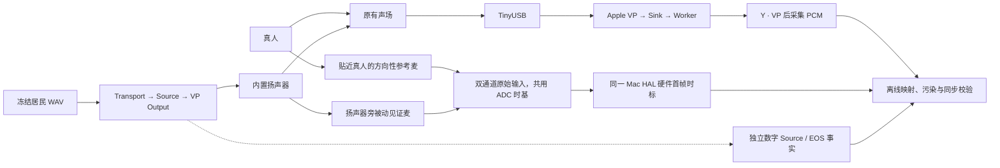

# Stage 7.5.11 · 独立声学见证方案设计与可行性评估 · 2026-11-28

`ACOUSTIC_WITNESS_FEASIBILITY = CONDITIONAL`

推荐用**一套独立双通道原始采集输入**同时录制贴近真人的参考麦克风和扬声器旁的见证麦克风。保留原来的 Mac mini、TinyUSB、内置扬声器和 Apple VP 音频图。用同一主机的有效硬件时标将侧录与 VP 后 PCM 对齐，并通过单声源对照验证两路串漏、对齐误差和加装侧录后的链路一致性。现有设备和现有导出能支撑被测路径与数字事实，还不能独立完成三轨测量。双通道原始输入、两支麦克风及合适固定件均为待确认条件。

## 1. 核查基线与已有证据

审计开始时，隔离工作树及 GitHub `Test3-AppleVP-Clean` 的实时 HEAD 均为 `993a50ca487fca30bc65ce2804db30de55646db1`。仓库核心采用该版本。本地 WAV 宿主采用前次核验的 `8e35f88dc2ae16f06bdd6f1d46a988c0bec9f621` 加本地改动的审核快照，两个 Swift 文件摘要和附录记录一致。被查范围内的 Native Transport 源码与审核基线一致。下文宿主行号引用此本地快照。 [静态审计](Stage_7_5_11_AEC_end_to_end_static_audit_2026-11-27.md#L71-L86) · [宿主与载荷身份](Stage_7_5_11_AEC_static_audit_evidence_2026-11-27.md#wav-宿主审核快照) · [配对就绪性审计](Stage_7_5_11_remote_preexcitation_pair_readiness_audit_2026-11-27.md#L56-L68)

11 月 27 日留下居民数字素材、VP 后单路 24 kHz PCM 和数字起音／EOS 等技术事实。Source 非零回调是数字边界，轮询 EOS 是宿主观察时刻。听感能确认出现重叠，缺同步物理外放和独立真人轨。49.3 ms 来自一次末包锚定对齐，约 129 ms 是该数据和方法下的相关峰。两者均不能用作本方案的固定时延或校准容差。 [原试次及时间线](AppleNativeVoiceTransport_local_double_talk_2026-11-27.md#L7-L39) · [既有对齐与分量证据边界](Stage_7_5_11_AEC_static_audit_evidence_2026-11-27.md#L158-L187)

## 2. 候选方案

| 方案 | 设备与采集链路 | 同步 | 近端／居民隔离与可报告指标 | 干扰、复杂度和风险 |
| --- | --- | --- | --- | --- |
| **A · 纯软件与现有单麦** | 复用 TinyUSB → VP → Sink → Worker 录证及居民 WAV／Source 事实。无需新增设备。 | 使用现有 HostTime、包样本序与 Source 读回，局限于应用数字域。 | 单路混合。只能报告混合能量与探索性的居民相关残余，不能独立测近端保留或确定物理外放起止。 | 改动最少。主要风险是把数字内容、物理发声和 VP 后混合错误地视作同一事实。 |
| **B · 独立双路声学见证，推荐** | 两支固定麦克风进入同一双通道原始输入。近端贴近人声，远端贴近实际扬声器声源。原图仍用 TinyUSB。只加一支独立麦克风时仅补一个观测，另一项仍缺。 | 两路共用一个硬件采样时钟，经同一 Mac 的有效 HAL 输入时标映射到 HostTime。独立录音机须另有可复核时基桥接。 | 双向串漏对照及留出验证通过后，可报告参考相关的近端保留及居民残余，并取得物理边界。两轨仍可能互相串入。 | 两个拾音位置和一套采集接口。要校准位置、串漏、硬件延迟、时钟与接入负载。侧录无需进入被测图。 |
| **C · 可重复近端声源加物理见证** | 在原近端位置放一个可独立驱动的声源，播放冻结近端素材。保留物理近端和扬声器见证输入及原链路。数字近端素材只用于内容身份，实际声压仍由参考麦克风核验。 | 以 B 的两路物理数据为时基，记录实际出声。声源设备的播放指令和内部时钟只作辅助。 | 固定近端素材有利于重复性和留出对照。来源可辨时能算该受控刺激下的保留和残余。真人结果另须 B 的真人试次。 | 增加近端播放源、摆位和电平校准。扬声器的辐射、频响和人声口部不同，可能改变声场及 VP 行为。适合作为校准正控。 |
| **D · 可区分的双源带内探针** | 在另行授权的工程对照中，用受控近端声源和原远端扬声器并发发出独立且预先登记的标签，可选互斥频带。复用 B/C 的侧录和固定件。 | 仍用校准后的共同时间基准。每路标签的起止由其物理轨验出。 | 通过单源对照、另一标签带内的泄漏及双源校验后，对通过控制且可匹配各自标签的分量独立归属，舍弃混淆和互调项。无法从标签带推回全频带真人保留或全部回声。 | 可复用 C 的设备，分析复杂度较高。非线性可能产生串频或互调，探针也会改变 VP 的受激状态。只作为隔离与分析验证，正式配对继续用冻结居民 WAV。 |

选 B 的原因是可以保留真人和原被测声场，两个声学观测也可共用一个见证采样时钟。C 给出可重复的工程校准材料，D 检验能否确实分开已知分量，A 留作数字技术核对。ITU-T P.502 附录 III 的单讲对照与双讲时域分析说明了时序和时变处理会影响双讲测量。本方案仅借鉴对照和校准思路，阈值须按当前布局建立。 [ITU-T P.502 双讲分析附录](https://www.itu.int/rec/T-REC-P.502-201409-I!Amd2/en)

## 3. 设备与采集架构

| 能力 | 复用及最小条件 |
| --- | --- |
| 被测播放与采集 | 复用 Mac mini、内置扬声器与 TinyUSB。保持原音频路由、格式协商、AGC、bypass 和增益设置。设备名及当次 I/O 值在获准校准时只读核验。内置扬声器负责真实发声，TinyUSB 继续服务 Apple VP。 |
| 真人轨与扬声器轨 | 需要两支独立麦克风、固定件及一台可同时采集两路、稳定增益、可读原始 PCM／硬件时标的同钟输入接口。设备可以借用或复用，现有可用硬件未确认。两台各自录 WAV 的设备须单独验证同步和原始链路。 |
| 同步与校准 | 优先从同一 Mac 的显式指定设备做只读输入侧录，基于原始硬件时间戳。核验驱动与硬件没有无法旁路的增益、降噪或回声消除。侧录不调用 Apple VP，不选为默认设备或原图输入，不做监听回放，不建系统 Aggregate。 |



**拾音布局。** 参考麦固定在真人嘴侧的近场，主轴对准人声，将较弱拾音方向朝向居民扬声器。具体位置与方向靠单声源对照确定。每臂同一说话者、脚本、朝向、坐姿和摆位。远端见证麦在扬声器旁接收实际声压，避免接触箱体、遮挡出声口或把支架摆进关键传播路径。两路在房间中仍可能互相听见。物理边界按可识别的居民声音作带不确定度的观测。 [历史物理见证缺口](Stage_7_5_11_remote_preexcitation_pair_readiness_audit_2026-11-27.md#L61-L66)

**接入约束。** 侧录使用外部原始输入的数据路径，避免启用输入处理或把 PCM 回灌到 Mac mini 扬声器、AEC 参考或 Runtime。保持硬件和布置贯穿两臂，不在臂间插拔。未来校准须核验默认与实际 AU 路由、格式、VP 状态、硬件增益和静音，同时检查侧录运行是否改变回调质量。为安装及侧录运行设置独立对照，检查相同激励下的原链路读回、采集连续性、Source 欠载与场内声压变化。若安装位置改变房间反射、发音或原设备选择，调整独立见证布置后重新校准。当前无法证实加装对声场和图没有影响。 [实际 VP 及设备快照](../../../apps/macos/NativeVoiceTransport/NativeVoiceSystemEngine.swift#L67-L88) · [VP 有效配置](../../../apps/macos/NativeVoiceTransport/NativeVoiceSystemEngine.swift#L114-L137) · [现有设备监听范围](../../../apps/macos/NativeVoiceTransport/NativeVoiceHALRoute.swift#L158-L177)

## 4. 可复核的共同时间基准

1. **保留两路独立原始时钟证据。** B 的两支麦克风共享接口采样时钟与帧号。采用显式指定见证设备的 HAL 输入回调，例如 `AudioDeviceIOProc`，保存每段的首帧样本位置、`inInputTime` 的原始 HostTime 和有效位、采样率、连续帧数及丢帧。`inInputTime` 对应输入块在硬件采集的首帧。`inNow` 包含 I/O 调度时刻信息，写盘时刻和 UI cue 也不能代用。设备是否实际提供合格时标须实测校准。 [Apple 输入时标参数](https://developer.apple.com/documentation/coreaudio/audiodeviceioproc.md)
2. **结合被测轨原始 Sink 和导出包。** Core Audio `mHostTime` 使用主机时基。现有 C 采集用 Mach timebase 换算到 ns，保留原始回调值与有效位。Worker 按真实回调首帧建立独立观察，部分消费的续帧和 24 kHz 包时刻按样本位置映射。Sink 时标描述 VP 后回调的数据时序，其与实际拾音的偏差仍须校准。扩展后的本地录证应留存双端有效原始锚点序列、包到 SRC 段的映射、段内样本范围和断点。Source 时标另存用于数字到物理比较。750 个采集包不等于 750 个独立时钟锚点。 [Apple 主机时基](https://developer.apple.com/documentation/coreaudiotypes/audiotimestamp/mhosttime.md) · [原始 Sink 时标](../../../apps/macos/NativeVoiceTransport/NativeVoiceRealtime.c#L169-L192) · [Mach 换算参数](../../../apps/macos/NativeVoiceTransport/AppleNativeVoiceTransport.swift#L330-L347) · [Worker 观察与包映射](../../../apps/macos/NativeVoiceTransport/AppleNativeVoiceTransportWorker.swift#L218-L275)
3. **验证映射、时延和漂移。** 对见证输入与被测输入分别按连续段，用原始有效锚点建立 `host_ns = α + β × sample_index`。比对实际斜率相对名义采样率的漂移，保留残差、缺包／重锚和开始、中段、结束的独立检验点。样本时间先进入同一域，再记录传播、器件群时延和 SRC 内容边界带来的不确定度。用同源校准检查两见证输入的通道偏移，并在独立校准试次用可重复的近端瞬态检查见证与 VP 后时间轴的实际偏差和稳定性。留出事件用于复核。保留原始采样率，离线按时标映射到共同分析网格，固定抗混叠边界及重采样延时口径。双讲时不靠拟合近端或居民与 `Y` 的相关峰重定时，不静默消去可能的 VP 时变延迟。合成的误差预算须覆盖映射残差、漂移、事件定位和校准重复性，超预算的窗口判无效。 [Native 时钟有效性逻辑](../../../apps/macos/NativeVoiceTransport/NativeVoiceClock.swift#L29-L87)
4. **独立录音机备选。** 若同 Mac 侧录改变路由或回调质量，可评估独立多通道录音机。它的时间轴还须通过同一个可验证的事件与 Mac 时基桥接，例如外部设备和带有效 HostTime 的 Mac 侧专用输入各自录到同一非声学电边沿。接口需有足够独立通道或等效的时码输入，并在各阶段保留实测边沿以解偏移和漂移。软件发送时刻、USB 写入完成或单次手工对齐无法作该证据。此为备选能力，辅助设备与同步链路均未确认。

校准同步事件与正式配对分开，正式臂内禁止经被测扬声器发送同步声、导频或额外预激励。采用独立时钟标记时也应确保不泄入原图、声场或 VP 参考。

## 5. 最小测量合同

### 独立参考、串漏与物理外放

- **信号。** 两路原始见证记为 `N_ref` 和 `F_ref`，VP 后 24 kHz PCM 记为 `Y`。两支见证麦的采样和固定增益相互可复核。居民数字 WAV 与 Source span 用于验证内容身份、事件顺序和候选查找。数字波形不替代 `F_ref`。
- **隔离检查。** 固定布局和量程，另行授权后分别录环境静音、仅居民、仅近端。仅居民时估计 `N_ref` 的居民串漏，仅近端时估计 `F_ref` 的人声串漏。在同一见证通道、固定增益和登记的两源活动声级下，按频带计算错源和目标 RMS 的 dB 比值。低于检测限时留存上界。记录噪声余量，检查削波、设备自带处理和通道交换。两条轨均可能是混合，在留出校准片段验证可区分度与误归属地板。若更换摆位或增益，重新校准。重复人声的内容、相对时间和参考电平须匹配到预登记范围。
- **物理起止。** 用 `F_ref` 对本阶段冻结居民内容作预登记的带内匹配，通过单居民和仅近端对照估计检测灵敏度与误报。报告首次和末次可信直接声的时间区间及不确定度，明确内部语句停顿和最后一次发声的区别。只有可靠的阳性校验和足够覆盖才能把未检出报为冷臂静音。停声定义以固定见证点为准，房间尾音及声达 TinyUSB 的时刻另列。Source 非零、EOS 及耳听证词各保留原语义。

### 双讲窗口、近端保留与居民残余

确定共同时间轴后，在冻结频带、窗口和允许时延内，用通过隔离验证的两参考对 `Y` 做联合参考投影。最小方法是固定有限时延范围和模型复杂度的两输入拟合，分别估计与 `N_ref`、`F_ref` 一致的输出分量。串漏明显时只在单源校准表明稳定可分且留出通过的情况下使用校准的串漏校正。两个参考高度依赖、相互假归属大、噪底或时钟误差足以解释效果时，该分量不出数。时延搜索范围、频带、模型复杂度、训练／留出划分和误归属界限在看配对结果前锁定。两臂应用同一规则，报告留出表现与失去可分性的时间段。非线性与时变作用可留在未解释项，不强制拆成两项。 [时变双讲测量限制](https://www.itu.int/rec/T-REC-P.502-201409-I!Amd2/en)

| 独立指标 | 定义和报告范围 |
| --- | --- |
| 近端保留 | 在独立近端有效窗内，以 `20 log10(RMS(近端相关输出) / RMS(经校准的 N_ref))` 得到参考归一化电平。对匹配的近端内容和声级报告暖臂减冷臂 dB，可另给与经时序核验的近端单讲对照的差。报告重复性和不确定度。它测可辨的近端成分，参考麦量程与 TinyUSB 的物理增益分开。混合 RMS 不进入此分量定义。 |
| 居民残余 | 同窗以归属居民的 `Y` 分量报告 dBFS，并记录相对固定增益 `F_ref` 的归一化结果、当地误归属地板和未解释能量。物理停声后若使用预注册的远端历史来估尾音，必须能由留出验证支持。此时不除以已静音的参考。当前缺 TinyUSB 同点预 VP 回声分量，无法计算 ERLE。 [ERLE 的输入和使用范围](https://arxiv.org/html/2009.04972v3) |
| 起音与恢复 | 用物理居民起音对齐 0–0.5 s 和 0.5–2.0 s 窗。以物理结束对齐后保留 0.5 s 守卫，核对 0.5–2.0 s 恢复窗的独立近端。双讲有效窗须有两源物理活动证据，恢复窗须有可比近端活动。合格分量的短窗变化、恢复及未覆盖区间分别报告。上述窗口沿用配对草案，保护时长的适用性仍需核验。 [原窗口定义](Stage_7_5_11_AEC_end_to_end_static_audit_2026-11-27.md#L110-L116) |

### 容差来源与有效性

| 容差与门槛 | 依据与状态 |
| --- | --- |
| 时标映射、通道偏移、起止检测与漂移 | 用独立锚点的残差和跨全臂漂移、重复同源事件的实际错位、时标量化及有效窗口边界建立误差预算。容差须保证扣除边界不确定度后仍有共同有效双讲覆盖。指标对容差内偏移敏感时纳入不确定度，避免按输出方向选择对齐。设计值为 `TO_BE_CALIBRATED`。 |
| 串漏、噪底、动态范围、可分性与近端复现 | 用单源和静音对照建立两方向串漏、误归属的上界及最小可信活动，比较参考间独立性，量程留出削波余量。用重复近端单讲确定相同内容和声级可比范围。各分析带容差为 `TO_BE_CALIBRATED`。 |
| 同条件与效应判据 | 图／路由／设备变化为硬性身份失效。可测的硬件电平、声场、启动龄期容差及近端重复性界限、居民残余恶化容限以独立校准和工程上需区分的效应登记。数值为 `TO_BE_CALIBRATED`。历史相关延迟、计数和 VP 时钟的服务新鲜度阈值不承担物理容差。 |

若缺必需轨道或身份、锁不住共同时间轴、物理事件不可验证、原图或增益越界、样本不连续或串漏校验失败，受影响的必要窗或实验臂标记 `INVALID` 并保留原因。通过完整性检查但剩余可信分量过弱、估计不确定度无法区分效应，或未达到有效配对数时，对相关指标或整体结论标记 `INCONCLUSIVE`。缺失与判废项均不以零残余、零衰减或插值代记。

## 6. 需要补充的 Lab 能力与代码位置

以下只列设计落点。当前归档 Lab 的阶段选择只改变提示并启动 Runtime／Provider 会话。未来测量仅接本地 WAV 路径。Native Transport 中的数字时标和设备检查可以复用。 [归档 Lab 启动](../../../apps/macos/Aftelle/AppController.swift#L1873-L1885) · [本地绕行路径与快照](Stage_7_5_11_remote_preexcitation_pair_readiness_audit_2026-11-27.md#本地-wav-快照定位)

| 缺口 | 现有位置与最小设计 |
| --- | --- |
| 每臂接续、激活时刻及相同路由 | 本地 `AppController.swift:2089–2221` 的 `runNativeVoiceAcousticLabLocal()/serviceNativeVoiceAcousticLabLocal()` 只调度一个 WAV。未来编排激活、预窗口、目标和尾部，关联实例、臂和后继 token。保留启动、关闭和故障事实。关键边界补完整设备、音量和时标摘要。 [核心打开与激活](../../../apps/macos/NativeVoiceTransport/AppleNativeVoiceTransport.swift#L227-L250) · [续播 token](../../../apps/macos/NativeVoiceTransport/AppleNativeVoiceTransport.swift#L81-L101) · [逻辑路由与时序读回](../../../apps/macos/NativeVoiceTransport/NativeVoiceSessionGraph.swift#L105-L145) |
| 有界的原始时间证据与数字分段 | `nvt_rt_capture()` 已携带原始回调时标，Worker `drainCapture()` 只更新 `lastSinkFact`，`bridgeService()` 提供采集包、Source 事实、丢包与 handoff 计数。未来在现有非实时消费侧保留必要的独立原始锚点、包内容映射和各 token 边界及连续性。事实缺口需显式标记。 [Sink 入口](../../../apps/macos/NativeVoiceTransport/NativeVoiceRealtime.c#L201-L244) · [Worker 消费与锚点](../../../apps/macos/NativeVoiceTransport/AppleNativeVoiceTransportWorker.swift#L197-L275) · [数字事实与有效 token](../../../apps/macos/NativeVoiceTransport/AppleNativeVoiceTransport.swift#L178-L223) |
| 外部见证、污染与校准收据 | 本地 `NativeVoiceAcousticLabDoubleTalk.append()/NativeVoiceAcousticLabDoubleTalkManifest`（`AppController.swift:311–376`）只存 VP 后单路、首末包时标和数字边界。加单独的本地技术清单，绑定臂、轨、有效时钟段、见证硬件身份、校准和无效原因。侧录 PCM 留在独立路径，后处理连接三轨。 [本地字段定位](Stage_7_5_11_remote_preexcitation_pair_readiness_audit_2026-11-27.md#本地-wav-快照定位) |
| 私有保存及脱敏摘要 | 本地 `exportNativeVoiceAcousticLabDoubleTalk()/publishNativeVoiceAcousticLabFiles()`（`AppController.swift:2224–2293`）在结束后显式把 WAV／JSON 本机封存，已有 0700/0600 和原子发布。未来三轨的采集和保留范围事前另获授权，本机目录沿用严格文件权限，注明保留期限与撤权。原始音频、时钟锚点和清单在本机私有位置关联封存。对外只给批准的指标、误差与失败数量、去标识配对身份和必要技术摘要，去掉绝对路径、设备 UID、逐字内容与可还原音频。不自动上传。 [本地导出定位](Stage_7_5_11_remote_preexcitation_pair_readiness_audit_2026-11-27.md#本地-wav-快照定位) |

## 7. 与冷／暖配对衔接及尚未验证的风险

独立校准通过后，仍须另行授权实现和执行。正式配对保留 3 组 AB 与 3 组 BA、相同目标 WAV、启动龄期及每臂内同一 Engine。冷臂确认预窗口真实无居民外放，暖臂确认预窗口居民独讲、物理停声和后继播放 token。相同窗口和封存合同对两臂均适用。冻结最大尝试数和判废规则，先汇总有效性再比较效应。主报告的 5/6 同向与配对中位数、残余容限判据仍需独立校准后才能执行。 [原配对计划与判据](Stage_7_5_11_AEC_end_to_end_static_audit_2026-11-27.md#L104-L122) · [六配对现有能力判定](Stage_7_5_11_remote_preexcitation_pair_readiness_audit_2026-11-27.md#L77-L100)

当前未验证原始双路设备是否可用、固定摆位的双向串漏余量、两设备有效时间戳及真实延迟漂移、侧录接入是否影响原图，以及人声重复性和 VP 时变失真能否留下足够独立分量。若同 Mac 方案干扰被测路径且独立时基备选也无法验证，完整测量仍不可开展。若只能验证物理外放而无法分离近端，保留物理事实，近端指标标记 `INCONCLUSIVE`。该设计仅检验可观测声学效果，Apple VP 私有参考、滤波器及增益状态仍为 UNKNOWN。

## 8. 范围核验

Stage 7 Forbidden Checklist 的文档范围核查为 `PASS`。生产代码、AEC 参数、Runtime API、DR Schema、声源门和平台 target 均保持冻结。本轮未运行 App、设备、Provider 或声学试次，未读取原始录音，未采购或假设已经具备任何新增硬件。 [Stage 7 Forbidden Checklist](../../stage7_forbidden_checklist.md)

```ini
AEC_ROOT_CAUSE = UNKNOWN
CLOCK_ROOT_CAUSE = UNKNOWN
EXPERIMENT_READINESS = NOT_READY
SQ_M1 = OPEN
Formal_Test3 = BLOCKED
Test3.execution_authorized = false
DEVICE_RUNS_THIS_TASK = 0
```
