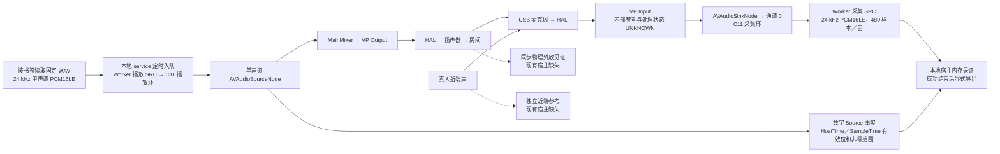

# Stage 7.5.11 · 有／无远端预激励配对实验就绪性审计 · 2026-11-27

`EXPERIMENT_READINESS = NOT_READY`

现有 Native Voice Lab 无法执行有效的有／无远端预激励六配对。归档版的阶段选择只改变提示，它启动的是 Runtime／Provider 会话。本地 WAV 宿主有固定时长的单次双讲和数字录证。Native Transport 已支持在一个 Engine 上切换播放身份，但宿主没有编排暖臂第二次播放，也缺少物理外放、独立近端和配对有效性的记录。

## 1. 审核基线与证据等级

目标分支 `Test3-AppleVP-Clean` 的实时远端和交付工作树在审计开始时均为 `63da1ed19a6acc82e48f20223219b8481ce7f11e`。源码定位分为两类。

| 范围 | 身份及定位 |
| --- | --- |
| 归档 Lab 与 Native Transport | 下文的仓库代码链接指向本次审核树中的归档实现。入口由 `AftelleEntry.main()` 选择独立 Debug 窗口，要求两项专用编译开关及唯一 Lab 参数。 [归档入口](../../../apps/macos/Aftelle/AftelleApp.swift#L30-L47) · [参数门禁](../../../apps/macos/Aftelle/AppController.swift#L258-L271) |
| 本地 WAV 宿主 | 只读核对了 `8e35f88dc2ae16f06bdd6f1d46a988c0bec9f621` 加本地改动的审核快照。`AftelleApp.swift` 与 `AppController.swift` 摘要和前次附录一致。其 Native 核心目录及三个候选会话、事实、录证源文件与审核基线无差异。11 月 27 日运行载荷可追查，构建时全部未提交源字节为 UNKNOWN。下文「本地」行号均属于这个快照。 [快照身份与摘录](Stage_7_5_11_AEC_static_audit_evidence_2026-11-27.md#wav-宿主审核快照) · [本次补充定位](#本地-wav-快照定位) |

`CODE` 表示已沿实际静态调用核对。`HISTORY` 表示已封存的试次、标量或现场见证。`UNKNOWN` 表示现有输出无法建立相应事实。能力表的 `READY` 要求整项合同可执行且可核验，`PARTIAL` 表示已有一部分路径或事实，`MISSING` 表示必要环节无现成实现。历史单次观察不给当前设备状态或新配对授予资格。

[静态审计主报告与配对草案](Stage_7_5_11_AEC_end_to_end_static_audit_2026-11-27.md#L104-L122) · [11 月 27 日原试次](AppleNativeVoiceTransport_local_double_talk_2026-11-27.md#L7-L39) · [既有定量分析](Stage_7_5_11_AEC_static_audit_evidence_2026-11-27.md#11-月-27-日定量分析留存)

## 2. 实际信号流与时间轴

### 本地 WAV 路径



本地 `runNativeVoiceAcousticLabLocal()` 直接创建 `AppleNativeVoiceTransport.macOS()`，用本地身份启动图和 `bridgeService()`，结束后关闭图。此声学路径未将 PCM 递交声源门、Runtime 或 Provider。归档窗口则由 `startNativeVoiceAcousticLab()` 调用 `startRealtimeFullDuplexSpeech()`，创建 Runtime Qwen 会话及 Bridge。它的阶段 Picker 只更新 `windows.*` 提示。Provider 响应、播放分轮和正式取消逻辑可以改变该入口的实验刺激与时序，因此配对设计使用本地 WAV 路径。两种入口共享 Native Transport，实验资格和正式插话仍分别验收。 [本地调用链](Stage_7_5_11_AEC_static_audit_evidence_2026-11-27.md#wav-宿主审核快照) · [归档阶段控件](../../../apps/macos/Aftelle/AftelleApp.swift#L269-L284) · [归档启动](../../../apps/macos/Aftelle/AppController.swift#L1873-L1885) · [Runtime 会话调用](../../../apps/macos/Aftelle/AppController.swift#L4232-L4258) · [正式 Input Bridge](../../../apps/macos/Aftelle/AppController.swift#L4323-L4334) · [核心图连接](../../../apps/macos/NativeVoiceTransport/NativeVoiceRealtimeLease.mm#L23-L62) · [PCM 转换](../../../apps/macos/NativeVoiceTransport/AppleNativeVoiceTransportWorker.swift#L95-L104)

### 已有试次时间轴

| 事件 | 可用时刻与语义 |
| --- | --- |
| Engine 打开并激活 | `open()` 启动、核验绑定、激活 C 回调后进入 `running`。本地 manifest 没有独立 Engine 启动／激活时间，不能从 cue 还原启动龄期。 [激活代码](../../../apps/macos/NativeVoiceTransport/AppleNativeVoiceTransport.swift#L227-L250) |
| 讲话提示 | 以首个非空采集包批次在宿主轮询中被看到为 0 s，启动 3 秒入队和 15 秒停止计划。真实人声起点无独立记录。 |
| 首次数字播放 | 首块 PCM 在 cue 后约 3.006674 s 被接受。WAV 有约 1 s 前导静音。首次含非零的 Source 回调为 4.049461 s，按 16 kHz 回调内偏移估算首个非零样本约 4.056836 s。扬声器起音未同步测量。 |
| 数字结束 | 7.764372 s 为 EOS 接受后宿主轮询到 `renderHandoff`。底层可给 Source EOS 回调事实，当前宿主保存的是轮询时刻。物理外放停止、尾音长度和居民声到达麦克风的时刻仍未知。 |
| 采集结束 | 调度目标为 cue 后 15 s，历史图关闭确认约 15.178249 s，留存 750 包共 15 s。746 包时钟资格有效、4 包未知。用户确认实际听见居民时仍在讲话，未记录精确物理时间窗。 |

[试次时间表与用户见证](AppleNativeVoiceTransport_local_double_talk_2026-11-27.md#L15-L39) · [宿主 cue、数字 EOS 和末包锚点](Stage_7_5_11_AEC_static_audit_evidence_2026-11-27.md#L101-L169)

## 3. 实验能力检查

| 项目 | 状态 | 现有实现与代码定位 | 缺失能力与证据 |
| --- | --- | --- | --- |
| 1. 冷臂静音后进入双讲 | PARTIAL | 本地 `serviceNativeVoiceAcousticLabLocal()` 2162–2188 在首批采集后的 3 s 才开始送 WAV。C `nvt_rt_render_at_time()` 启动未入队时零填充。历史首次可见非零居民激励发生在真人已获讲话提示之后。 [本地 cue 和入队](Stage_7_5_11_AEC_static_audit_evidence_2026-11-27.md#L101-L121) · [Source 空闲](../../../apps/macos/NativeVoiceTransport/NativeVoiceRealtime.c#L266-L318) | `CODE + HISTORY` 支持一次无本地远端预激励的路径。缺以 Engine 激活为准的冷臂计划、独立静音确认及近端起音见证。其他声源和 VP 初态为 `UNKNOWN`。 |
| 2. 暖臂居民独讲后进入相同双讲 | MISSING | 本地 `startNativeVoiceAcousticLabLocal()` 2041–2050 每次选单模式。`serviceNativeVoiceAcousticLabLocal()` 2143–2215 只有一份 PCM、一组 `offset/sentEOS/handoff` 和一个播放身份。先运行居民单讲再另启双讲会执行新的 `runNativeVoiceAcousticLabLocal()`，原图已关闭。 [本地快照定位](#本地-wav-快照定位) · [核心后续 token 合同](../../../apps/macos/NativeVoiceTransport/AppleNativeVoiceTransport.swift#L81-L101) | `CODE` 确认核心具备继续播放的接口。缺在原图上编排同一臂的居民预激励、尾音守卫和目标双讲，及各段的物理见证。 |
| 3. 两臂的启动龄期、同设备／路由／增益／格式／VP | PARTIAL | `NativeVoiceSystemEngine.negotiate()/snapshot()/requireVoiceProcessing()` 读回格式、默认与 AU 设备、内部检查的 HAL binding、双端 VP、AGC、bypass、输入 mute。`NativeVoiceHALRoute.watchDevice()` 监听可用性、采样率、流和 Aggregate 属性。`NativeVoiceSessionGraph.readback()` 导出部分设备身份及协商格式。 [图状态](../../../apps/macos/NativeVoiceTransport/NativeVoiceSystemEngine.swift#L24-L38) · [路由快照](../../../apps/macos/NativeVoiceTransport/NativeVoiceSystemEngine.swift#L76-L88) · [VP 读回](../../../apps/macos/NativeVoiceTransport/NativeVoiceSystemEngine.swift#L114-L125) · [设备监听](../../../apps/macos/NativeVoiceTransport/NativeVoiceHALRoute.swift#L158-L177) · [导出范围](../../../apps/macos/NativeVoiceTransport/NativeVoiceSessionGraph.swift#L105-L121) | `CODE` 支持图内约束。预检 `MacSpeechAudioHost.refreshAuthorization()` 没有输入／输出硬件增益及输出静音字段。旧试次的音量读回是单次历史记录。缺启动时刻、跨臂路由与增益比较、阶段边界快照和漂移判废。默认／AU 设备 ID 是可见路由事实，无法单独证明物理端点。系统 Mic Mode、物理声压与 Apple 私有状态无配对证据。 [预检字段](../../../apps/macos/Aftelle/MacSpeechAudioHost.swift#L23-L37) · [历史设备读回](AppleNativeVoiceTransport_local_double_talk_2026-11-27.md#L9-L13) |
| 4. 臂内 Engine／图与处理器连续 | PARTIAL | 本地 `runNativeVoiceAcousticLabLocal()` 2089–2140 只有一次 start 和最终 close。核心 `beginPlayback()/finishPlayback()/cancelPlayback()/transitionPlayback()` 更新播放 token、队列及播放 Worker，正常成功分支复用 Engine、图及采集身份。Engine 禁止自动 shutdown，图／权限断言失败则关闭或标记应重建。 [本地 start/close](#本地-wav-快照定位) · [EOS](../../../apps/macos/NativeVoiceTransport/AppleNativeVoiceTransport.swift#L150-L165) · [设备失效与播放更新](../../../apps/macos/NativeVoiceTransport/AppleNativeVoiceTransport.swift#L279-L327) · [Worker 按身份重置](../../../apps/macos/NativeVoiceTransport/AppleNativeVoiceTransportWorker.swift#L109-L132) | `CODE` 确认成功路径无应用侧隐式重建。现有宿主没有完整暖臂或逐阶段实例证据，固定的本地 token／configurationID 会在新 run 重用。Apple 内部 AEC、AGC、降噪状态是否变化为 `UNKNOWN`。 |
| 5. 数字起音、物理起止及有效 HostTime | PARTIAL | `nvt_rt_render_at_time()/publish_render()` 按交付非零 span 记录 Source 事实和 AudioTimeStamp 的有效位。`NativeVoiceRenderFact.init()` 保留空值，`NativeVoiceClock.observe()/qualifiedHost()` 独立核验采集连续性和 HostTime。宿主保存首次非零 Source、EOS 轮询和采集首末包 HostTime。 [Source 事实](../../../apps/macos/NativeVoiceTransport/NativeVoiceRealtime.c#L248-L331) · [Swift 解码](../../../apps/macos/NativeVoiceTransport/NativeVoiceSessionGraph.swift#L4-L31) · [采集时钟](../../../apps/macos/NativeVoiceTransport/NativeVoiceClock.swift#L29-L76) · [原试次对齐](Stage_7_5_11_AEC_static_audit_evidence_2026-11-27.md#分段频带与时钟) | `CODE + HISTORY` 支持数字时标和缺失状态。缺同一时间基准下的物理扬声器实际起止、各播放段数字边界及同步误差。首个 Source 非零可被保存但 HostTime 仍可能为空，事实队列也可能丢记录。 |
| 6. 独立且可重复的近端参考 | MISSING | 本地 `NativeVoiceAcousticLabDoubleTalk.append()` 331–344 只聚合 VP 后 Worker 包。`nearEndOnly` 进入不录证的单讲分支。界面讲话提示是采集批次触发的 UI 事件。 [本地采集及模式定位](#本地-wav-快照定位) · [历史试次](AppleNativeVoiceTransport_local_double_talk_2026-11-27.md#L9-L13) | `CODE + HISTORY` 确认没有同期独立近端轨、说话实际起止或两臂同一近端内容／声级校验。不能估计近端保留量。 |
| 7. 分别评价残余、近端、起音与恢复 | PARTIAL | 保存的居民数字参考、VP 后混合 PCM 和首末锚点支持探索性相关及混合分段能量。旧报告的留出窗只在部分区域见可辨识分量。`NativeVoiceAcousticLabDoubleTalkManifest` 352–376 未编码物理起落或近端轨；Worker 产出单路 PCM。 [Worker 输出](../../../apps/macos/NativeVoiceTransport/AppleNativeVoiceTransportWorker.swift#L249-L275) · [已有窗口和留出](Stage_7_5_11_AEC_static_audit_evidence_2026-11-27.md#L158-L187) | `CODE + HISTORY` 支持有限的居民相关残余和混合变化。缺可验证的双源分离、独立近端保留和物理起止对齐；暂无可用的双讲起音、恢复配对指标。混合 RMS 与相关峰无法转换为近端衰减、ERLE 或 AEC 参考偏移。 |
| 8. 三组 AB、三组 BA 与无效记录 | MISSING | 归档 `stageControls()` 是提示 Picker。本地 `startNativeVoiceAcousticLabLocal()` 只运行一个 Task。取消或异常设定终态／有限 UI 错误，`runNativeVoiceAcousticLabLocal()` 仅把成功、完整的录证留给导出。 [归档 Picker](../../../apps/macos/Aftelle/AftelleApp.swift#L269-L284) · [本地 Task 和终态](#本地-wav-快照定位) | `CODE` 确认无预注册顺序、配对 ID、两臂槽位、最大尝试或无效试次封存登记。重复手动单次运行无法补齐配对证据。 |
| 9. 录证、摘要、身份与脱敏导出 | PARTIAL | 本地 `exportNativeVoiceAcousticLabDoubleTalk()` 2073–2085、2224–2253 在成功且关闭后显式封存 WAV／JSON。Manifest 有 RunID、运行二进制／源 WAV／采集 SHA-256、样本数、时间统计、图快照。`publishNativeVoiceAcousticLabFiles()` 2256–2293 使用专用缓存、0700/0600 和原子发布。归档 `manageNativeVoiceAcousticLabEvidence()` 提供独立声学证据授权及保存／撤权。 [本地导出定位](#本地-wav-快照定位) · [归档证据入口](../../../apps/macos/Aftelle/AppController.swift#L1821-L1828) · [独立授权](../../../apps/macos/Aftelle/AppController.swift#L10227-L10274) | `CODE + HISTORY` 支持单次技术身份与本机保存。现有本地导出包含私人 PCM。缺同时绑定预注册、臂次、失效原因、外部轨摘要、同步状态及可分享脱敏标量的配对记录。历史脱敏 Markdown 归档由事后人工整理。 |

## 4. 会影响解释的历史与生命周期风险

- **首个远端非零可能直接遇到近端。** 本地程序先提示讲话，再送入含前导静音的 WAV。现场见证支持期间有重叠，无法定位相对第一非零样本的真人起音。首个可见远端激励前未见本地播放。预激励能同时改变路径学习、AGC、降噪和残余抑制，比较所得只能归于播放历史效应。 [原试次过程](AppleNativeVoiceTransport_local_double_talk_2026-11-27.md#L13-L25) · [草案解释合同](Stage_7_5_11_AEC_end_to_end_static_audit_2026-11-27.md#L106-L122)
- **播放轮次与 Engine 生命周期分离。** 上一个 token 的 Source EOS ACK 可让新 token 在同一图开播。正常 EOS 刷出播放 SRC 尾段，取消递增 token／epoch 并等 Source clear ACK，候选下一响应沿用图。Runtime N+1 在身份受控时复用图但更新采集内容栅栏与 Worker 状态。显式重建、权限关闭、配置变化或播放转换失败可结束旧图，不能作为有效臂的续接。每次从当前本地窗口重新点开始会新建图。 [播放转换与 N+1](../../../apps/macos/NativeVoiceTransport/AppleNativeVoiceTransport.swift#L81-L129) · [候选开播及响应 EOS](../../../apps/macos/Aftelle/MacSpeechNativeRealtimeSession.swift#L139-L199) · [候选取消](../../../apps/macos/Aftelle/MacSpeechNativeRealtimeSession.swift#L249-L275) · [显式重建与配置事件](../../../apps/macos/NativeVoiceTransport/AppleNativeVoiceTransport.swift#L54-L79)
- **可见 VP 配置只能证明图合同。** 应用可以读双端 VP、AGC 启用、bypass、输入 mute 和协商格式。Apple 内部参考、AEC 滤波器、降噪强度、AGC 增益轨、双讲与残余抑制状态仍是 UNKNOWN。即使应用图和回调身份连续，也不能据此承诺 Apple 状态未改变。暖臂无改善亦不足以确认算法缺陷。 [VP 可见字段](../../../apps/macos/NativeVoiceTransport/NativeVoiceSystemEngine.swift#L114-L125)
- **旧 AEC3 有成熟期反证。** 历史正常开播可保留 AEC3 实例，成熟阶段仍记录过近端损失。E4 的 Linear 到 Clean 和随后 Gate 损失是不同阶段事实，不能以未收敛统一解释。本地 WAV 避开正式门禁。当前 Native 的 `.uncertain` 和 `sourceGateOpen=false` 原样保留，声学改善不会解除它们。 [历史正常开播](https://github.com/JerryYork3516/Eterna_Aftelle/blob/a7563f9a16aebeaa05398a155c6b38b604362f91/docs/stage7_5/test3_aec3_system_audit_20261012.md?plain=1#L219) · [历史成熟期反证](https://github.com/JerryYork3516/Eterna_Aftelle/blob/a7563f9a16aebeaa05398a155c6b38b604362f91/docs/stage7_5/test3_aec3_system_audit_20261012.md?plain=1#L240) · [Native 正式声源字段](../../../apps/macos/Aftelle/MacSpeechNativeRealtimeFacts.swift#L139-L149)

## 5. 缺口优先级与最小补充设计

以下为设计草案。本轮没有修改任何实验入口、调度或录证代码。

| 优先级 | 缺口 | 最小设计 |
| --- | --- | --- |
| P0 | 冷／暖编排、实例证明、启动龄期及同条件 | 限本地入口。每臂创建一张新图，记录 Engine start 返回和回调激活的单调时刻及实例身份，臂内连续持有。A 送等长静音，B 送固定居民预激励。等长使用相同方式送入 PCM，保存两臂数字事实并以相同方式换到后继播放 token，在同一预定启动龄期送入同一目标 WAV。把 EOS ACK 用作数字阶段事实，物理结束另验。开始及关键边界比较默认与实际路由、HAL／VP 格式、硬件输入输出增益和静音、模式及图身份。固定声场摆位与内容，超预注册容差时判废。 |
| P0 | 物理回放、独立近端与共同时间基准 | 本地留一条可独立识别居民起止的扬声器物理见证，同时取得独立近端参考，例如布置固定的贴近参考麦克风并复读同一脚本。与 VP 后采集做预注册同步校验，验证参考隔离、声音重叠及窗口误差。同步校验不能经试次远端输出额外激励冷臂。若居民／近端分量在双讲窗内不可稳定辨识，判该窗无效。工程音源对照可支持可重复性，真人自然插话仍需另验。 |
| P0 | 顺序和无效试次可审计 | 一张冻结的配对表即可。预先锁定 3 个 AB、3 个 BA 的顺序、臂间间隔、最大尝试、同期声学／时钟容差和无效编码。在每次尝试登记配对、臂次、内容摘要、图与设备身份、起止与同步质量、关键丢失和终态。记录启动失败、取消、重启、音量或路由变化、掉帧／事实丢失及缺独立见证。以无声学内容的记录保留这些判废理由。 |
| P1 | 标准化脱敏结果 | 补最小技术侧表，按臂引用本机证据的 SHA-256 与有效窗口，仅对外导出汇总数值、理由及脱敏身份。由独立同源检查验证残余指标和近端指标互不替代。原始轨本地封存须独立授权。 |
| P2 | 额外诊断与操作便利 | 可选的阶段可视化、事后时漂图和批量摘要。Apple 私有 DSP 状态仍可保持 UNKNOWN。配对不依赖新增 Tap、软件 AEC 或产品路径调整。 |

### 两臂计划时间轴（设计）

| 时段 | A 无预激励 | B 有预激励 | 合同 |
| --- | --- | --- | --- |
| 激活与预窗口 | 新 Engine 激活后按窗保持远端静音 | 新 Engine 激活后、同一长度窗口播放固定居民独讲 | 激活钟、路由、状态、声级设置和窗口长度匹配。两臂近端均保持静音，另分别核验 A 的物理静音、B 的物理外放。 |
| 预窗口末端至目标起音 | 记录数字 EOS，保持物理静音至目标时刻 | 记录数字 EOS 和预片段物理停止，核验预定保护时长 | 两臂用后继播放 token，图与采集身份在各自臂内连续，固定目标进入龄期。记录实测物理首个有效居民声音作为目标 `t0`，核验真人起音关系。 |
| 目标双讲 | 同目标 WAV 与独立近端 | 同目标 WAV 与独立近端 | 用 `t0` 划分 0–0.5 s 起音、0.5–2.0 s 重叠。近端保留对同一时间校准的独立参考，居民残余对预注册的远端参考与物理见证，留出窗验证。 |
| 居民物理结束及恢复 | 保持原图、不中断采集 | 保持原图、不中断采集 | 按独立物理结束对齐，留 0.5 s 守卫，评估结束后 0.5–2.0 s；结束后再关闭图。同步或近端参考失效时不得以混合 RMS 代替。 |

## 6. 六配对可执行性

现有功能可完成单次本地混合声采集及数字时标检查。按现有入口无法生成一个合格暖臂，因此重复十二次同模式也无法得到草案的六个有效配对。至少须补齐三个 P0 后，才可按已给出的 3 AB／3 BA、配对有效性及固定窗口预注册，并另行取得执行授权。保留主报告至少 5/6 同向、配对中位数超过预注册重复性界限且居民残余不超恶化容限的草案判据。现有证据不能用于预先计算该判据或授予正式插话资格。 [原配对计划与判据](Stage_7_5_11_AEC_end_to_end_static_audit_2026-11-27.md#L110-L122)

## 本地 WAV 快照定位

这些定位统一使用上面的本地快照文件摘要，归档树的同名文件行号另有含义。下表只摘控制与记录字段，无私人路径和采集内容。

| 文件、函数与行号 | 可复核内容 |
| --- | --- |
| `AftelleApp.swift:219–226`，`NativeVoiceAcousticLabView.body` 的 Start | `if mode == .qwen` 走 `startNativeVoiceAcousticLab()`，否则调用 `startNativeVoiceAcousticLabLocal(mode)`。 |
| `AppController.swift:288–296, 2033–2050, 2053–2066`，模式选择、`canStartNativeVoiceAcousticLabLocal()/startNativeVoiceAcousticLabLocal()/stopNativeVoiceAcousticLab()` | 模式为 `residentOnly, nearEndOnly, doubleTalk, qwen`。仅两种模式要求单个 WAV，`recordDoubleTalk: mode == .doubleTalk`。单一运行 Task，停止取消它并等待完成，关闭清待导出记录。 |
| `AppController.swift:2089–2114, 2132–2140`，`runNativeVoiceAcousticLabLocal()` | 单次 `graph.start(identity:)` 和 `serviceNativeVoiceAcousticLabLocal(…, playback: identity.playback, …)`。图关闭后只有 `terminal == .finished` 且有完整录证及读回时保留录证。 |
| `AppController.swift:2143–2158, 2160–2195, 2197–2221`，`serviceNativeVoiceAcousticLabLocal()` | 单一 `playback`、`pcm`、`offset`、`sentEOS` 和 `handoff`，首批包决定时间计划。轮询等待使用 5 ms sleep，没有实际调度延迟保证。采集包不连续或不足、播放超时及取消走终止分支。 |
| `AppController.swift:311–344, 352–376`，`NativeVoiceAcousticLabDoubleTalk.append()/NativeVoiceAcousticLabDoubleTalkManifest` | 按 `packet.segment == captureSegment`、连续样本数、960 字节验包，累积到 750 包。记录 `firstNonzeroSource`、`digitalHandoffObservedUptimeNanoseconds`、首末包时标与结束图，无外部轨字段或预激励配对数据。 |
| `AppController.swift:2073–2085, 2224–2293, 2297–2309`，`exportNativeVoiceAcousticLabDoubleTalk()/publishNativeVoiceAcousticLabFiles()/readNativeVoiceAcousticLabWAV()` | 选取文件经只读书签解析，`AppleVPAcousticWAV.read()`（9626–9659）校验文件结构并摘要。结束后显式导出私有 WAV 和技术 JSON。现有记录没有发布配对脱敏指标的入口。 |

[已有 A1–A3 源码摘录](Stage_7_5_11_AEC_static_audit_evidence_2026-11-27.md#wav-宿主审核快照)

## 范围核验与阶段状态

Stage 7 Forbidden Checklist 的本轮文档范围核查为 `PASS`，无红线触碰。生产源码、运行配置、Runtime API、DR Schema、平台 target 和阶段门禁均保持冻结。本轮未构建或启动 App、设备及 Provider，未读取私人原始 WAV 或执行任何声学实验。 [Stage 7 Forbidden Checklist](../../stage7_forbidden_checklist.md)

```ini
AEC_ROOT_CAUSE = UNKNOWN
CLOCK_ROOT_CAUSE = UNKNOWN
SQ_M1 = OPEN
Formal_Test3 = BLOCKED
Test3.execution_authorized = false
DEVICE_RUNS_THIS_TASK = 0
```
