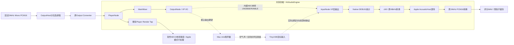

# T3.2-A / R5-M11 · Apple VP设备绑定与参考路径离线审计

schema_version：1。日期：2026-10-23。模式：OFFLINE ONLY。

**结论：没有找到能够解释M07 A良好、M09-D1 A回声可闻的确定性接线或启动顺序BUG。两次候选的关键音频实现相同，但现有证据没有取得进程分方向设备绑定，也不能观测Apple内部AEC参考。另确认缓存VP检查、配置变更通知覆盖方面的证据缺口。根因仍UNKNOWN，不建议据此修改DSP、Mono/3ch或图接线。**

M10提交后，用户新增试听原话：**“M09-D1 A能听到居民语音，M07 A听不到”**。该反馈补齐M09-D1的可闻残留证据，本轮沿用主控给定的M09-D1 A=FAIL；不把反馈改写为算法BUG。M03 A既有FAIL、M07 A正向评价均保留。本轮不读取任何WAV；沿用[M10](T3_2_A_R5_M10_echo_residual_difference_review.md)的模板/负控数值，不重复声学分析。

## 1. Git、版本与来源

开始时干净隔离Worktree的HEAD、upstream、实时远端均为 `54055f13800663dad87ed9a18f2a24df57bad57e`。读取白名单经用户确认；原7冲突、索引及未跟踪现场只读保护。仅新增本报告，不改AGENTS、正式Stage状态或生产源码。

| 运行候选 | 可追溯源码commit | 实机Debug dylib SHA-256 |
|---|---|---|
| M03 A | `e91a123f6fde633fe054f5372410f4acc06d58f7` | `6f81387668c4625c88f80895778dad46e4a8a39badde25ad95527ae4492e2eef` |
| M07 A | `fd990fd418272c7e686b1948f85b209bc3894dd3` | `f1339555b1de0be412629e58013ba6686d0de09851a37496b835a3d5b1812fd7` |
| M09-D1 A | `730d96324d9efba789b52cb941c73b1fb7dea8db` | `5cec419639ec2a8d8a1da229a3b64c82eede47dedd6f81da826aada863c5701a` |

二进制身份来自各次已提交的实际加载报告，本轮没有重建或启动二进制。M07后来交付的`094ce973…`未用于该次录音，不能替代实机`f1339555…`。`git show`定点取得上述版本的7份同名文件，Capture源码SHA分别匹配：M03 `c2385929dcda156c45095b4cc7f52f862c77ff5b79067662527b9a4a1f496ca1`；M07 `8a8ca38221c61375303f445b7d14feb36f91151f04d77504e51454064f5bfe18`；M09 `a1a1bfac46fb685fdd2091ad9400c2a17a720b24e435d1e5908e407919248f6d`。当前7份文件与M09版本全部相同。

报告级历史依据：[M03第9节](T3_2_A_R5_M03_BT_ABC_acoustic_review.md)、[M04](T3_2_A_R5_M04_runtime_readback_offline_preparation.md)、[M05](T3_2_A_R5_M05_runtime_io_device_review.md)、[M06](T3_2_A_R5_M06_pre_vp_raw_capture_feasibility.md)、[M07](T3_2_A_R5_M07_human_ABC_acoustic_review.md)、[F1](T3_2_A_R5_M07_F1_human_onset_device_review.md)、[M09](T3_2_A_R5_M09_raw_timestamp_diagnostics.md)、[M09-D1](T3_2_A_R5_M09_D1_raw_timestamp_device_review.md)。未读取历史私人Manifest。

本轮唯一读取的私人JSON为M09-D1 RunID `29B4B89A-DBE0-418D-93EE-ADF5CC8D18E7`：完整SHA重新核验为 `1475a4ad1fb013a11e730062878eaef1b02a662124d1e712372464d490de83de`。只提取运行态快照、配置/路由事件及身份字段；原件、设备标识符、完整时间日志不上传。

## 2. 实际代码链路与生命周期

以下代码行号均指本轮基线。实线是可核对的软件调用/连接；虚线是待独立证明的物理或Apple内部关系，不是新增接线。



1. **共享Engine，CONFIRMED。** [AppController:1067](../../../apps/macos/Aftelle/AppController.swift#L1067)只创建一个`speechAudioEngine`，传给Capture；[1080](../../../apps/macos/Aftelle/AppController.swift#L1080)将同一个对象传给OutputPlayer。OutputPlayer的默认构造器虽然可创建Engine，但本路径显式注入，没有使用该默认值。
2. **停止状态下启用VP并协商格式，CONFIRMED。** [Capture:2727](../../../apps/macos/Aftelle/MacSpeechAudioCapture.swift#L2727)创建Engine、attach Player，确认未running，再调用[2784](../../../apps/macos/Aftelle/MacSpeechAudioCapture.swift#L2784)的`inputNode.setVoiceProcessingEnabled(true)`，设置bypass=false、inputMuted=false、AGC-ON。随后以Input输出格式连接Mixer→Output，再读取localFormat、连接Player→Mixer并创建原转换器。输入输出格式不一致会拒绝；没有发现“Engine运行后切换VP”或忽略启用错误的路径。
3. **两端只需一处启用调用，CONFIRMED。** SDK规定任一I/O节点启用VP会联动另一端；两端格式须相同，切换VP及格式必须停机。代码随后实际检查Input/Output VP，因此缺少第二次`outputNode.setVoiceProcessingEnabled`不是已确认缺陷。[Apple AVAudioIONode](https://developer.apple.com/documentation/avfaudio/avaudioionode)、[WWDC19 510，约0:43–1:55](https://developer.apple.com/videos/play/wwdc2019/510/)。
4. **原Tap先安装、Engine后启动，CONFIRMED。** [Capture:2490](../../../apps/macos/Aftelle/MacSpeechAudioCapture.swift#L2490)验证处理状态、绑定generation/configuration、安装Input Tap，再经[2714](../../../apps/macos/Aftelle/MacSpeechAudioCapture.swift#L2714)执行prepare/start。M04第一次运行态读回位于start成功之后。
5. **先Prepare Output、再Capture、预热后评分，CONFIRMED。** [AppController:7923](../../../apps/macos/Aftelle/AppController.swift#L7923)固定Apple模式并arm run；[7939](../../../apps/macos/Aftelle/AppController.swift#L7939)先准备Output，再启动Capture；评分计划在Capture成功后建立，4秒内持续drain，score+3请求居民。源文件另有1秒全零，不能把score+3等同实际声音起点。
6. **居民走原共享图，CONFIRMED。** [OutputPlayer:332](../../../apps/macos/Aftelle/MacSpeechAudioOutputPlayer.swift#L332)从同一Engine取得localFormat；原Converter从24kHz Mono PCM16转换，无新gain/channelMap设置。[OutputHost:293](../../../apps/macos/Aftelle/MacSpeechAudioOutputHost.swift#L293)先schedule chunks，再`player.start()`，最终[Capture:2629](../../../apps/macos/Aftelle/MacSpeechAudioCapture.swift#L2629)验证VP、必要时启动同一Engine、`Player.play()`。M04第二次读回在play返回后；不是非零Render或物理发声时刻。
7. **软件Render Tap不是Apple参考输入，CONFIRMED。** [Capture:3219](../../../apps/macos/Aftelle/MacSpeechAudioCapture.swift#L3219)观察Player输出，并将转换结果交给软件Host；[AcousticHost:1004](../../../apps/macos/Aftelle/MacSpeechAcousticEchoHost.swift#L1004)只在WebRTC模式处理Render。Apple输入走[1183](../../../apps/macos/Aftelle/MacSpeechAcousticEchoHost.swift#L1183)透传；M02的Render/Delay错误隔离仍在，没有将软件AEC3估计当作Apple的内部参考。
8. **Stop/重建有代次保护，CONFIRMED。** [Capture:2887](../../../apps/macos/Aftelle/MacSpeechAudioCapture.swift#L2887)先失效configuration/active状态，移除Tap、等待原处理锁、stop/detach/reset；[2938](../../../apps/macos/Aftelle/MacSpeechAudioCapture.swift#L2938)在路由重建时封存旧Native，重新配置时重新启用VP，不直接恢复旧Capture资格。[AppController:8223](../../../apps/macos/Aftelle/AppController.swift#L8223)保存封存前统计后close Output、shutdown Capture并结束run。Native/PCM终态快照不是原子同时取得，尾包限制继续保留。

未发现本次需要修改的确定性初始化/接线BUG。上述符合公开前置条件，只证明合法的软件路径，**不证明Apple内部参考有效或AEC已收敛**。

## 3. 五类设备/参考身份不能混用

| 层级 | 当前证据实际表示什么 | 不足以证明什么 |
|---|---|---|
| 系统默认设备 | [DeviceMonitor:44](../../../apps/macos/Aftelle/MacSpeechDeviceMonitor.swift#L44)读取系统default input/output；历史目标为TinyUSB→内置扬声器 | 不等于指定PID已经沿这两方向使用设备，也不是声压测量 |
| AU公开deviceID | M04从两个节点的`auAudioUnit.deviceID`分别读取，再查询该对象的HAL元数据 | 不是公开合同保证的两个方向独立物理端点；字段名`actualInput`不能扩大getter语义 |
| 进程方向绑定 | SDK提供PID→Process，再以input/output scope读取`kAudioProcessPropertyDevices` | 现有M04未实现、M07/M09未记录；新运行的查询不能回填旧run |
| 真实物理输入/输出 | 还需结合进程列表、设备方向/stream、合法Aggregate成员及独立声源见证 | 默认名、Native格式、相同声道、软件PLAY成功都不能独立证明空气声来源或实际声压 |
| Apple内部AEC参考 | 本任务所核对公开接口没有参考PCM、实际选择矩阵、参考同步/适应状态的读取合同 | **UNOBSERVABLE**；不能由VP=true、图连接或上述任一设备身份推断已绑定/有效 |

### M04两个AU ID为何相同

**CONFIRMED：** `AUAudioUnit.h:1271–1283`只有一个I/O设备getter；`AudioUnitProperties.h:2426–2431`的CurrentDevice为Global。没有由该getter保证的“InputNode返回麦克风、OutputNode返回扬声器”合同。[Apple deviceID](https://developer.apple.com/documentation/audiotoolbox/auaudiounit/deviceid)、[CurrentDevice](https://developer.apple.com/documentation/audiotoolbox/kaudiooutputunitproperty_currentdevice)。

**HYPOTHESIS：** VP共享底层I/O单元或系统包装可解释两个getter同指默认输出。**UNKNOWN：** 该run的两个AU wrapper/底层AudioUnit是否同一对象，及TinyUSB如何映射进其输入。现有快照没有记录对象同一性，不能把合理解释升级为实测事实，也不能反过来判输入错接。

M09两份JSON直接复核：getter ID均等于defaultOutput、不同于defaultInput；对象非Aggregate，Aggregate列表空。两次绑定状态均`UNKNOWN_UNVERIFIED_BINDING`。与M05/M07/F1已公开报告的关系一致，没有发现可用于解释M07/M09差异的新ID关系。

[DeviceReadback:196](../../../apps/macos/Aftelle/MacSpeechDeviceMonitor.swift#L196)只对AU所指对象及默认对象做有界读取。若为Aggregate，会按[Capture:1863](../../../apps/macos/Aftelle/MacSpeechAudioCapture.swift#L1863)核验成员、活动成员、方向、stream排列及无tap条件；复杂或无法读取者保留UNKNOWN，不一概判错。该资格仍不证明内部AEC参考。M09没有Aggregate，不能用Aggregate机制替其补造物理输入证据。

### 可观测性上限

`AVAudioIONode.h:141–164`描述VP对输入的处理及两端联动；`AudioUnitProperties.h:2620–2725`公开的相关控制涵盖bypass、AGC、mute、语音活动和其他音频ducking。已核对这些公开声明及Apple文档，**没有取得Apple内部参考样本或实际参考选择的公开观测入口**。因此本报告标记`AEC_INTERNAL_REFERENCE=UNOBSERVABLE`，不是断言Apple私有实现没有参考，也不建议用新Output Tap冒充内部探针。[AVAudioInputNode](https://developer.apple.com/documentation/avfaudio/avaudioinputnode)。

方向查询是较窄且有公开依据的补证：`AudioHardware.h:589–595,1953–1968`明确PID翻译、进程input/output设备列表及running方向。它是进程级，不是AU级或ADC Raw证明；同PID若有多条音频链，也不能自动归属到本VP实例。[PID映射](https://developer.apple.com/documentation/coreaudio/kaudiohardwarepropertytranslatepidtoprocessobject)、[Process Devices](https://developer.apple.com/documentation/coreaudio/kaudioprocesspropertydevices)。本轮只核验声明，未调用任何HAL设备/进程查询。

## 4. M07与M09同口径对照

| 项目 | M07 A | M09-D1 A | 可下的结论 |
|---|---|---|---|
| 声学 | 用户听不到居民；M10同窗RMS−57.83dBFS | 用户听到居民；M10同窗−17.16dBFS，模板匹配明显 | 残留输出不同；不是ERLE，也未证明源声压相同 |
| 实验控制 | 真人ABC批次中的A；无真人/BT播放要求 | 原M03标签的A；无BT/REF/近端播放 | 均居民独讲目标；控制标签不同，不能冒称完全同一运行配置 |
| 音频合同 | AGC-ON、4秒预热＋15秒评分、同一居民SHA | 相同 | 没有有意改变音频处理参数 |
| 名义设备/音量 | TinyUSB 60%，内置55%、未静音 | 相同；本次HAL输入0.6049382687，输出0.5500001311 | 百分比不是声压；不能要求输入标量精确0.6或回填历史精确值 |
| 新鲜运行态读回 | 两次VP两端ON、AGC ON、bypass/mute=false、running=true | 两次相同，无issue；同run/gen=1/config=2 | 仅两个时间点正常，不等于全程内部状态相同 |
| 图/端口格式 | 16kHz/3ch Float32；Output输出端口16kHz/2ch；HAL枚举48kHz | 两次六处格式完全相同，连接存在，报告口径与左相同 | 端口格式不等于物理HAL stream；不据3ch→2ch直接判错误 |
| HAL耗时 | 2.343/1.602ms | 2.284/1.480ms | 同步读取仍可能影响时序；没有其造成40dB差异的证据 |
| Player非零Render | score 4.225577–7.973246s | 4.193826–7.941488s | 约32ms偏移；M10已搜索对齐，不能把它直接定为抑制差异原因 |
| 观测/连续性 | DEBUG Input skip5；Native190 buffers、304000帧，已接纳PCM连续，A时钟拒收0 | skip0、Native190/304000，PCM连续，Native拒收全0 | M07观测缺口不冒充真实丢帧；M09无已记录的时钟触发 |
| 配置/路由 | 报告中的运行态configuration一致，route事件0；终态identityChanges=1 | 两快照configuration=2，route事件0；configuration事件2次，后一次在Stop后 | 终态代次失效符合teardown，不是已证实评分中切路由 |
| Mic Mode/物理路径 | UNKNOWN | UNKNOWN | 单元mute/bypass读回不能替代系统模式、物理输入或声压证据 |

源码比较结果（均由本轮`git show`/完整文件SHA及非空函数提取验证）：

- **M03/M07/M09的OutputPlayer、OutputHost、AcousticEchoHost及AudioHost文件逐字节相同。** 没有播放Converter、软件透传或Host路由策略在这三次间变更的证据。
- **M07/M09的14个Capture目标函数逐字节相同：** `startCapture`、`prepareOutput`、`startOutput`、`startEngineIfNeeded`、`configureIfNeeded`、`configureVoiceProcessingIO`、`updateVoiceProcessingSnapshot`、`tearDownGraph`、`routeWillRebuild`、`routeDidRebuild`、`rebuildAudioFormatsLocked`、`installRenderReferenceTapLocked`、`readRuntimePayload`、`voiceProcessingSnapshot`。
- M03比M07少M04读回；其VP配置/图连接核心函数仍相同。原DeviceMonitor主体未改，M04只是添加DEBUG读取帮助代码。M07→M09的Capture差异落在原始时间戳DEBUG记录接入；其调度影响不能仅凭“DEBUG”排除，但无证据把它定为回声原因。
- AppController的模式Prepare、音频Start、居民pump、采集循环在M07/M09相同；评分schedule/Stop多传F1 onsetProfile，guide增加真人提示记录。没有据此发现播放波形、Engine拓扑或AGC策略改变。

**共同代码/相同属性仍不证明Apple、驱动或物理声学状态相同。** 已退出M07/M09进程的方向绑定不能在本轮补读。低能量M07 A缺独立物理播放声压记录，不能把另组C的现场见证跨RunID用于A；用户对A的正向试听结论仍保留。

## 5. 已确认覆盖缺口与原因矩阵

### 两项必须保留的源码事实

**缓存检查不等于新鲜VP读回。** [Capture:2451](../../../apps/macos/Aftelle/MacSpeechAudioCapture.swift#L2451)返回缓存`processingSnapshot`；[AppController:8073](../../../apps/macos/Aftelle/AppController.swift#L8073)每轮资格检查沿用它。节点属性在configure、Capture start和Output start验证点读取；M04另有两个真实runtime读取点。M04的`record`最多2份，不能证明两点之间、播放期间或结束后属性未短暂变化；本轮没有证据证明实际发生过变化。

**默认路由监听不覆盖全部Engine配置变化。** [DeviceMonitor:55](../../../apps/macos/Aftelle/MacSpeechDeviceMonitor.swift#L55)只监听设备列表/default input/default output；[AudioHost:388](../../../apps/macos/Aftelle/MacSpeechAudioHost.swift#L388)按设备身份/可用性停止并重建；OutputHost也按该合同失效旧播放。定点核对相关7文件，没有Engine配置变化通知的订阅或进程方向查询。

本机`AVAudioEngine.h:574–585,1036–1060`注明：显式设置Mixer→Output格式后，配置变化时由客户端按需更新连接；I/O采样率/声道变化可使Engine自行停止并发通知。当前[Capture:2805](../../../apps/macos/Aftelle/MacSpeechAudioCapture.swift#L2805)确实显式连接，故**同设备ID下的格式变化/Engine自动停止没有独立事件覆盖，是已确认的合同覆盖风险**。它不是已复现的AEC根因；M09完整Native内容、一次显式Engine.start及两次running快照，反而不支持本次发生持续的停机/错误重启。不能把“没有监听”写成“已经发生了配置变化”。[Apple配置变化通知](https://developer.apple.com/documentation/avfaudio/avaudioengine/configurationchangenotification)。

| 候选机制 | 已有代码/证据与等级 | 能否解释M07/M09差异；缺什么 |
|---|---|---|
| 错误启用VP顺序、两端未联动 | CONFIRMED：按SDK停机启用，两点实际两端ON；未找到错误顺序 | 当前证据不支持；不能解释已观测差异 |
| Player接错Engine或绕开原输出图 | CONFIRMED：同一实例注入、相同源代码、连接读回存在 | 未发现该类BUG；实际内部参考内容仍UNOBSERVABLE |
| AU ID相同表示输入错接 | CONFIRMED：getter相同；“代表错接”不成立 | 实际方向绑定UNKNOWN，可能相关但缺进程方向及物理源证据 |
| 同ID格式变化/VP重启状态污染 | CONFIRMED：通知覆盖不足；实际触发是HYPOTHESIS | 理论可影响生命周期，但M09持续内容和事件未显示触发；缺原配置通知/进程设备时间线 |
| VP、mute或系统处理状态变化 | CONFIRMED：检查包含缓存，只有两个新鲜点；变化本身UNKNOWN | 可以是隐藏混淆；缺全程变化证据。不能仅凭属性相同排除，也不据缺证猜测BUG |
| 实际声压、Mic Mode或设备状态不同 | UNKNOWN；各次目标百分比相同，缺声压/模式真值 | 可解释输出强弱，尚不能与内部处理状态分开 |
| Apple内部参考/适应差异 | 公开接口UNOBSERVABLE；具体机制HYPOTHESIS | 合理候选，无法由Player Tap/VP开关/4秒安静预热直接确认 |
| 后级PCM整体损伤或旧软件AEC3 fallback | 同窗Native/PCM接近；M02隔离及透传文件三次相同 | 优先级降低；大窗比较不逐字排除所有局部损伤。既有时钟拒收另行OPEN |

**NO_CONFIRMED_CODE_ROOT_CAUSE。** 覆盖缺口、潜在条件性风险及真正触发的产品缺陷分开。本任务不实施修复；没有证据支持调整AGC/NS/AEC、channelMap、格式或Mixer。

## 6. 下一次最小受控实验（仅方案，未授权）

**唯一建议：先由主控批准最小只读补证准备，再另行授权一次居民独讲A。** 当前缺少进程方向及Engine配置事件，原样再录一遍A无法回答这两个问题；不重跑B/C，也不启动Raw或蓝牙研究。

未来准备仅需两类有界观测，M11不实现：

1. 复用确切PID及二进制SHA核验，在已有Engine-start、Player-play两时点，用PID翻译Process对象，核对Process PID，再分别读input/output设备列表。仅目标PID，不枚举其他进程；按既有HAL帮助代码核验设备方向和必要的Aggregate成员/stream，记录开始/结束时间及OSStatus。读失败/对象不存在记UNKNOWN，不伪造缺省设备。启动前Process对象尚不存在可以是正常情况；活动阶段无法读清则阻塞证据资格。
2. 仅绑定本Engine的配置变化通知，保存计数和首次事件的run/generation/configuration/单调时间；不新增Tap、Engine或状态Owner，不在通知回调内读HAL、拆图或重启。运行期事件通过原控制停止路径处理，禁止在Engine内部通知线程同步teardown；SDK明确提示存在死锁风险。沿用M04两份快照，不扩成持续HAL轮询。

离线审核通过并取得新设备授权后，才可执行：同一冻结构建/素材、TinyUSB60%、内置55%、AGC-ON、4秒持续预热＋15秒评分、score+3一次居民播放、无近端/BT/REF。保持原系统和应用同意/导出；不更改音量/路由/Mic Mode。用户只需安静，并现场确认**该次A**的实体扬声器确实发出居民声音，结束后听一次录音；无需讲话或手动计时。见证不冒充绝对声压测量。单次Capture/Playback，不重试；评分最多720000 bytes，预热PCM不保存，尾部不足照实保留。

停止条件：身份/SHA/权限不符、设备或路由变化、VP实际不符、活动阶段必要方向读回失败/不明、配置变化事件、严重拒收或无法正常停止/封存时安全终止。原失败数据保留，不现场修改算法或自动恢复。若通过前置门禁仍发生声学FAIL，保存该次证据并结束，不追加第二次。

该实验能够区分“可观察的方向/配置异常”与“外部方向证据正常但仍回声可闻”；后者仍不证明Apple算法BUG或内部参考正确。若再次良好则记NOT_REPRODUCED，不关闭间歇问题；方向列表是进程级，合法Aggregate/系统代理仍可能需要保留来源限制。新增观测可能扰动时序，必须记录耗时，不称严格单变量AEC因果实验。

## 7. 实际检查、来源与隐私

实际执行：Git三方/工作区及7冲突保护核验；限定源码`rg`/带行号读取；指定commit的7文件SHA及14个非空Capture函数比较；M09-D1指定JSON SHA/身份/两点快照和事件提取；SDK静态核验；Apple官方资料查询。以上均exit0；一次定点`rg`无匹配返回exit1，是搜索语义，未运行失败的音频实验。未执行Swift测试、编译、App/Engine、设备查询、播放或录音；各0次，WAV读取0次。

SDK版本27.0，来源为本机Xcode SDK。可复核锚点及SHA：

| SDK头文件 | 主要锚点 | SHA-256 |
|---|---|---|
| AVAudioIONode.h | 103–104默认I/O；141–164 VP及格式合同 | `a6e9c0b24054e423def547b2bba1099d01f57f11d7d5189e976e8eb000186eb9` |
| AUAudioUnit.h | 1271–1283 I/O deviceID | `f471a799bbe5c508d6aff8fedea6a6090026f077dbc2042f64c30dfc29016308` |
| AudioUnitProperties.h | 2426–2431 Global设备属性；2620–2725 VP属性 | `985fd288a180868db0f8ffccaad4c9151d20a28f0c685c63e846031ce6b0de43` |
| AudioHardware.h | 589–595 PID翻译；1953–1968进程方向设备 | `a699437248e079d9ebe47078ef3861492d8253fef1a6007e476031031d3535ca` |
| AVAudioEngine.h | 574–585显式连接责任；1036–1060配置通知 | `fd29c9aaeaf809d020b95ff6f56220f24e707da08477710c2d2dcad50b3619ee` |

官方DocC的deviceID、Process Devices、PID翻译3份响应均HTTP200；后两者仅提供符号信息，方向语义取自SDK明确注释。网页JS壳不当作API缺失。来源摘要和限定数值回执只留Git忽略目录；不提交SDK副本、私人JSON、WAV、UID、进程设备ID值或完整日志。

交付检查：`git diff --cached --check`、单报告暂存白名单、来源/相对链接/报告隐私检查；`bash tools/secret_guard/check.sh`一次exit0。原7冲突文件、索引、状态、HEAD与14个未跟踪条目的stat前后与登记保护基线一致；无stash/pop、reset/clean、强推或原工作区写入。

五维SELF_REVIEW：范围/架构PASS；源码/版本身份PASS；观测语义PASS_WITH_LIMITATIONS；因果与物理结论UNKNOWN；隐私/Git保护PASS。新增确认产品代码BUG CRITICAL/MAJOR/MINOR=0/0/0；方向归属与配置变化覆盖属于阻塞根因定位的证据缺口，不包装为已复现缺陷。既有声学FAIL、时钟及尾包风险OPEN。

Stage7 Forbidden Checklist：PASS。红线触碰无；仅新增本报告，不改生产/DEBUG代码、Runtime API、DR schema、平台target或正式Gate，不进入Stage8/Test3下一节点。无必要扩大读取或运行大型回归。

```ini
R5_M11=OFFLINE_REVIEW_PENDING
CONFIRMED_CODE_ROOT_CAUSE=NONE_IDENTIFIED
PROCESS_DIRECTIONAL_BINDING=NOT_CAPTURED
AEC_INTERNAL_REFERENCE=UNOBSERVABLE
NEXT_OBSERVATION_ADAPTATION=REQUIRES_SEPARATE_APPROVAL
DEVICE_EXECUTION=NOT_AUTHORIZED
AEC_ROOT_CAUSE=UNKNOWN
CLOCK_ROOT_CAUSE=UNKNOWN
R3-M01=OPEN
T3.2-A=BLOCKED
Formal_Test3=BLOCKED
Test3.execution_authorized=false
T3.3=NOT_STARTED
```
