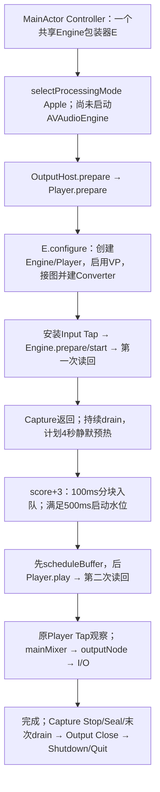

# T3.2-A / R5-M30：Apple VP软件集成根因定点审计

日期：2026-10-31（Asia/Shanghai）。TARGETED_SOFTWARE_ROOT_CAUSE_AUDIT；设备运行0次。

**NO_CONFIRMED_CODE_ROOT_CAUSE。** 本轮逐调用点核对创建、准备、Capture、首次排程、完成回调、代际与Shutdown，没有找到可以重复触发、并解释M27-R2强残留的软件状态分歧。没有新增CONFIRMED_CODE_DEFECT或REPRODUCIBLE_STATE_RACE，不改生产代码，不以Mock制造AEC失败。此结论不等于证明所有软件行为或Apple内部状态正确。

## 1. Git、源码身份与范围

开始时干净隔离Worktree的HEAD / upstream / 实时远端均为`17e707f26b33b1c194d3f9790830382a060beb35`；本地分支`codex/reference-host-comparison-preparation`，推送`Test3-AppleVP-Clean`。读取范围先报备，沿用用户免除重复读取确认的指令；不继承任何设备或私人证据授权。

仅定点读取M17/M25/M27/M28/M29公开报告、下列六份源码的相关函数及冻结旧REF的三个对应文件。后两份HOST辅助文件用于直接核对Actor挂起点和水位常量，已补充报备；没有展开其他Runtime/Provider实现、全仓源码或远程软件调查。适用aftelle-context-mode与aftelle-caveman：单报告交付，不扩建诊断框架。

| 当前文件（`apps/macos/Aftelle/`） | 本轮实算SHA-256 |
|---|---|
| MacSpeechAudioCapture.swift | `f8cf47b0de2205e7e70177db6c16ceb0a615730892d4ae605e6fdee9cc45d49c` |
| MacSpeechAudioOutputPlayer.swift | `4de8d49818f07e761211f63d7eaa95a53bb83e065853d26d38a083e49d0a5602` |
| MacSpeechAudioOutputHost.swift | `b24257fd2ff576d2fe08c7485252af6a843bdd4677beb8392ee43da1d777975a` |
| MacSpeechAudioHost.swift | `3db300b9b9df462255a60547a07d880e7d17211fa178cbb48edc7a9876adb434` |
| MacSpeechPCMPlaybackBuffer.swift | `be4865efd81635f67430cfe18b5f4b4e1966509b3fc242aa67a2d241671f67b9` |
| AppController.swift | `2b7300d9e0999b4b1bc71b97e054382f3fa58a5c15248114222828b6ddc46ddc` |

对M27执行前源码`0d6b0aed01c9e9d2995ef0dc71fa0eaf24a23a31`作Git差异核验：六文件diff为空；整个提交范围也只有M27/M28/M29三份报告变化。当前审计对应M27原实现，不是另一份修订后的生产链。M27已登记实际加载dylib为`cac8ebb261362d6d5c443fbd5c4d5ddf179b7744589df3e335bfe5ee06b904f7`，本轮只引用该报告身份，没有重建、加载或重新运行二进制。

旧REF只读源码基线`c64c7e2629ec775062fdc2ea1e4a934c73c1fa75`：`AppleEngineDriver.swift`、`VPCSession.swift`及`VPCWindow.swift`，没有运行原程序。本文HOST行号以本轮起点为准；旧REF行号以冻结提交为准。

用户补充“同一硬件在其他通话App能正常AEC”，作为本轮优先查软件的背景保留；没有重新调查硬件，也没有把这项背景当成已经取得相同素材、时序和内部处理合同的受控代码对照。

## 2. 实际生命周期与图



依赖对象在[Controller:1247–1263](../../../apps/macos/Aftelle/AppController.swift#L1247)共用同一个E；E的构造函数只存模式/软件Host，真正的`AVAudioEngine()`在Output准备期间才创建（[Capture:3167、3511](../../../apps/macos/Aftelle/MacSpeechAudioCapture.swift#L3511)）。另一构造函数或类型默认参数不是本次入口同时启动第二个Engine的证据；[restoreNormalConfiguration:1418](../../../apps/macos/Aftelle/AppController.swift#L1418)在隔离模式直接返回。

| 顺序 / 实际状态改变 | 源码证据与边界 |
|---|---|
| 模式选择、准备Capture代次、arm DEBUG | [Controller:8197–8210](../../../apps/macos/Aftelle/AppController.swift#L8197)逐次await后检查Run；[Capture:4154–4174](../../../apps/macos/Aftelle/MacSpeechAudioCapture.swift#L4154)在idle下登记统计。AGC-ON将AGC-OFF context置nil，不在此启动Engine |
| Output Prepare建立图 | [OutputHost:187–212](../../../apps/macos/Aftelle/MacSpeechAudioOutputHost.swift#L187)同步调用Player.prepare；[Player:474–498](../../../apps/macos/Aftelle/MacSpeechAudioOutputPlayer.swift#L474)同步调用E.prepareOutput并缓存输出Converter/format |
| 真正建立OutputNode输入 | [Capture:3563–3589](../../../apps/macos/Aftelle/MacSpeechAudioCapture.swift#L3563)在新Engine未运行时启用VP、设置bypass/mute/AGC，再以VP后的Input格式连接**mainMixer→outputNode**。不是首次Player.play才建立该连接 |
| Player连接与格式缓存 | [Capture:3511–3543](../../../apps/macos/Aftelle/MacSpeechAudioCapture.swift#L3511)先attach，启用VP及协商I/O，再取Mixer localFormat连接Player→Mixer，重建三份Converter、登记configurationID并安装原Render Tap。尚未排居民buffer |
| Capture真正启动 | [Controller:8213–8255](../../../apps/macos/Aftelle/AppController.swift#L8213)先await Output准备，再startPreparedCapture；[Capture:3253–3299](../../../apps/macos/Aftelle/MacSpeechAudioCapture.swift#L3253)校验VP、reset代次、安装Input Tap，最后prepare/start Engine。图已连接，没有提前排居民或调用Player.play |
| 预热与排程原点 | [Controller:8262–8276、8332–8378](../../../apps/macos/Aftelle/AppController.swift#L8262)以既有window plan连续drain；[8441–8460](../../../apps/macos/Aftelle/AppController.swift#L8441)到score+3才创建播放泵。4秒静默不是AEC收敛证明 |
| 首次缓冲和play | [Controller:8297–8323](../../../apps/macos/Aftelle/AppController.swift#L8297)每次4800 bytes（24kHz Mono PCM16的100ms）入队；原[configuration:39–45](../../../apps/macos/Aftelle/MacSpeechPCMPlaybackBuffer.swift#L39)要求500ms启动水位、最多4个在途buffer；[OutputHost:293–317](../../../apps/macos/Aftelle/MacSpeechAudioOutputHost.swift#L293)先scheduleAvailableChunks，再player.start，不是空队列先play |
| 首次play改变什么 | [Player:502–529](../../../apps/macos/Aftelle/MacSpeechAudioOutputPlayer.swift#L502)先做原Fade/Converter；[Capture:3379–3429](../../../apps/macos/Aftelle/MacSpeechAudioCapture.swift#L3379)要求buffer.format == outputFormat再排程，设置播放状态，Engine已running则不再start，Player未playing才play。这里没有connect、重建Converter或修改VP参数 |
| 完成与正常Stop | [OutputHost:501–545](../../../apps/macos/Aftelle/MacSpeechAudioOutputHost.swift#L501)按代次接收完成，队列/在途全空且source结束才completed；[Capture:3438–3446](../../../apps/macos/Aftelle/MacSpeechAudioCapture.swift#L3438)不销毁Engine。stopOutput在Capture活动时也不停止共享Engine（3463–3474） |
| Seal、清理与拆图 | [Controller:8598–8667](../../../apps/macos/Aftelle/AppController.swift#L8598)经统一Shutdown；[AudioHost:389–408](../../../apps/macos/Aftelle/MacSpeechAudioHost.swift#L389)先停/Seal再末次drain，随后close Output并shutdown Capture；[Capture:3671–3720](../../../apps/macos/Aftelle/MacSpeechAudioCapture.swift#L3671)使旧身份失效，移除Tap、等待在途处理，再stop、断开Player、detach/reset |

**运行中应用代码接线结论：** 本路径的connect集中于未运行的新Engine配置；显式断连/析构集中于失败清理或拆图。未找到首次居民排程偷偷重接OutputNode的分支。Apple框架内部是否重新配置不能由这份调用表证明；原配置通知属于独立证据。

## 3. 首次参考建立：哪些可观察，哪些不可

源码能证明连接调用顺序；原Player Tap能证明该观察点出现了数字样本；运行态getter能证明当时公开属性和连接点。**三者都不能证明Apple内部AEC已经取得有效居民参考或完成适应。**

[M28生命周期表](T3_2_A_R5_M28_targeted_residual_differential.md)记录：三轮首Input均约score−4.020秒，首Render均约−3.92125秒；不是直到首次居民play才出现软件Render。Engine.start耗时约134.010/130.093/133.735ms，Player.play约19.589/14.337/27.751ms；play返回均约score+3.0538秒，非零Render约4.1821–7.9298秒。顺序一致，耗时不同；没有R2独有失序。上述都是既有报告的时间，不是本轮重新测量或物理延迟。

两点HAL读回约4ms与3.2–3.4ms，位于控制生命周期锁内，不在音频回调。Engine.start后的读回发生在居民排程前，不适用居民缓冲预算；首次Player.start前则最多排4个约100ms缓冲，Player.play后3.2–3.4ms读回本身没有耗尽这一级名义缓冲预算的证据。**这不保证补给线程从未迟到，也不把Actor在途计数当作硬件队列测量。**

内部AEC参考信号、实际滤波/适应状态与瞬时AGC增益在现有公开读回/证据中为UNOBSERVABLE。Engine running、VP ON、isPlaying、非零Render及dataPlayedBack各自均不能单独升级为参考正确或AEC有效。

## 4. 状态、锁、挂起点与候选分级

表中NOT_A_DEFECT限所审的受保护路径；不是对全系统或任何任意调用次序的无缺陷保证。

| 候选 | 写/读、线程、顺序及异常路径 | 触发条件、M27反证及裁定 |
|---|---|---|
| A：Engine/Player启动交错 | E的engine/player/isConfigured/isOutputPrepared/isCaptureActive/isOutputPlaying/configurationID由`lifecycleLock`串行控制，状态读写再经`lock`（Capture:3109–3134、3363–3508）。OutputHost.start内schedule→start没有await，完成回调转Task回同一Actor（OutputHost:418–447、512–528） | 未找到callback可在同一次同步start中重入并提前拆图的路径。schedule/VP/start错误会走failed；M27完整完成且无播放拒收。**NOT_A_DEFECT；REPRODUCIBLE_STATE_RACE未建立** |
| B：VP配置或AGC状态竞争 | selectProcessingMode要求Capture/Output均idle，Controller在跨Actor await前后检查stopGeneration（Controller:4004–4022；AudioHost:139–147；Capture:3193–3210）。配置只在停机图执行；AGC-ON arm清除OFF context，Capture/Output启动两处重读公开VP值（Capture:3601–3646、4154–4174），不是持续测量内部状态 | M27新App、AGC-ON、双端VP开启；没有目标期间切换AGC/模式的执行分支证据。**NOT_A_DEFECT**。未公开的系统处理状态仍**UNOBSERVABLE**，不能由开关同值推为相同 |
| C：Output Prepare与Capture启动竞态 | Controller先await输出prepare、检查Run，再await startPreparedCapture。AudioHost准备授权时以attemptID阻止Stop后的旧返回，启动时要求preparedGeneration与generation一致（AudioHost:282–367）。E配置和安装Tap共享生命周期锁 | 对已由这些控制路径处理的Stop/路线变化，Run/代次/状态守卫会拒绝继续；不据此保证所有未观察到的系统瞬态都被覆盖。M27无对应失败/代际污染。**NOT_A_DEFECT** |
| D：首次排程/流式补给 | OutputHost队列、在途字节、Fade、providerResponseFinished均Actor隔离；只有满队列等待允许挂起，恢复后重查generation/state（221–263）。scheduleAhead=4；完成处理补队列，超时/调度错误经fail停止（418–559、631–646） | 线程迟到超过已有缓冲预算属于**CONFIGURATION_RISK**，但没有本轮可复现的真实欠供触发或M27对应记录。M27 underrun/rejected均0、Render时间连续；也不能由这些计数证明每个应播样本均已呈交。没有把延迟Mock当实际音频欠供或AEC RED |
| E：Stop与旧代次交叉 | MainActor的RunID/stopGeneration/phase在每次关键await后复核（Controller:8297–8327、8589–8595）。Shutdown单operation，先推进stopGeneration；Output失效会推进播放代次、清队列、恢复等待入队，旧完成拒绝（Controller:3689–3716；OutputHost:649–675）。Capture按config/generation/fence拒绝旧回调（Capture:3823–3935） | Stop不是只cancel Task而留下满队列等待者；清理先close输出，再await旧播放泵退出。M27跨App生命周期不共享这些内存对象，拒收计数0。**NOT_A_DEFECT**；没有声学根因相关竞态复现 |
| F：路由/旧格式缓存 | Player的converter/localFormat受锁保护，route reset/close清空（Player:474–498、558–575）；E routeWill先失效拆图，routeDid仅在停机新图重配（Capture:3723–3767）。Output route改变会fail、清缓存并换代次（OutputHost:687–715）；Capture route改变会停止当前/已准备代次（AudioHost:412–433） | 同ID的完整ASBD/layout变化覆盖仍是M17/M25已登记的**CONFIGURATION_RISK**，不是新BUG。snapshot格式描述及route ID检查并非所有格式字段的持续验证；M27两点完整格式同值、Engine通知0，无变化触发证据。本轮不重复制造格式Fake或放宽guard |

补充两项锁边界：`removeTap`在状态锁释放后调用，避免它等待的回调反过来等同一状态锁（Capture:3315–3339）；拆图先使旧config失效，再等待Capture/Render处理锁（3671–3712）。未找到这两处已存在的相反锁序或等待Actor完成而造成M27路径死锁的触发证据。

M28中共同出现的生命周期configurationChanged=2、收尾identityChanges=1，不能当作运行中混代：安装Render Tap和拆图会各自记账（Capture:4018–4019、3705–3708），真正Engine通知另外计数。M27三轮该通知均0，不能把两个计数混在一起创造“重建竞态”。

## 5. 旧REF/HOST增量差异及关闭范围

旧REF定位均冻结到`c64c7e2629ec775062fdc2ea1e4a934c73c1fa75`下的`tools/apple_vp_reference_v1/Sources/`；未把R4 GUI派生REF冒充原成功版本。

| 差异 | 本轮对应源码 / 已有反证 | 软件故障与离线验证结论 |
|---|---|---|
| 整段预排 vs 流式补给 | REF `VPReferenceAudio/AppleEngineDriver.swift:54–56`与`VPReferenceCore/VPCWindow.swift:72–79`先schedule再prepare/start；HOST见§2/4D，先达到水位、排4块再play | 差异真实，HOST未发现先空play的错序。R1普通离线图不覆盖真实补给，不能扩大其PASS；当前无具体新失败触发，不为既知差异再建Mock |
| Input/Mixer Render ready vs 静默预热 | REF `VPCSession.swift:123–139`检查两流已写入，`VPCWindow.swift:88–99`有界等待；HOST没有同一ready barrier，但M27在居民前已收到两流回调 | ready与静默均不证明AEC参考有效/收敛。关闭“HOST直到居民开始才首次有任何Render”的解释；没有因果证据把缺同一barrier认定为BUG |
| Mono Mixer vs 3ch Player | REF `AppleEngineDriver.swift:40–51`以material.format连接；HOST按localFormat预转换后排程。M25/R1已测数字分配差异；M26两种分配均可能低残留，M27三轮全为TRIPLE_EQUAL | 固定差异不能单独解释跨运行变化；未找到新格式/增益状态分支。关闭“3ch必然错误”和重复通道研究，不强制改Mono/Stereo |
| 首次play的返回资格 | **本轮精确复核：** REF `VPCSession.swift:146–151`在play后读isPlaying并require；HOST Capture:3416–3424仅在调用前读isPlaying，调用后记录事件/运行态，OutputHost把start正常返回记为started。运行态payload（Capture:4362–4366）没有Player.isPlaying字段 | **CONFIGURATION_RISK：即时播放状态的资格覆盖不同**，非确认缺陷。HOST后续仍要求完成、非零Render及技术资格；M27均取得。仅把Fake布尔改成false不能证明生产Player实际未启动，更不能解释持续3.28秒模板；不单独立项补getter作为AEC修复 |
| 配置变化恢复 | REF固定格式计划及observer；HOST显式失效/换代/重配/拒收，见§4F | M17/M25已登记全字段格式资格差异。没有新变化证据则关闭本轮重复调查，不宣称所有隐藏变化不可能 |

[M17](T3_2_A_R5_M17_apple_vpio_integration_audit.md)与[M25](T3_2_A_R5_M25_reference_host_differential_audit.md)的相同点继续复用：共享Engine、停机启用VP、I/O联动、合法client协商、Native处于VP后；本轮没有把它们重命名为新发现。M22/M24的短突发不能证明适应收益，亦不作为本轮竞争复现或AEC收敛证据。

## 6. 与M27强残留的因果关联

[M27](T3_2_A_R5_M27_original_aec_stability.md)和[M28](T3_2_A_R5_M28_targeted_residual_differential.md)已经确认的Native强差异、多段居民模板、非满幅主导及连续性事实直接引用，不重读原件、不再做波形/ASR/DTW。它们使“后级PCM整体增益”和“输入ch0选择”不再成为本轮调查项。

M27没有显示本轮候选需要的失序、代际穿透、播放失败、配置通知或格式分组差异；Node启动与HAL读回耗时变化也没有形成R2特有的可重复条件。故**M27_CAUSAL_RELEVANCE=NOT_ESTABLISHED**。公开属性一致不证明内部状态一致，同一源码也不保证相同实时调度；两者均不构成把HYPOTHESIS升级为BUG的依据。

新增确认缺陷的FILE/FUNCTION、TRIGGER_CONDITION、DETERMINISTIC_REPRODUCTION及MINIMAL_FIX：**无可填写的已证实实例**。没有以已知M18-E01尾部问题或历史已修复竞态替代目标根因。

## 7. 唯一剩余软件观测缺口与建议

**停止对相同源码重复静态审计。唯一建议交主控审定的工程项：已有Player Tap对“实际排程后的Buffer→实际Render内容与覆盖”是否需要补齐有界一致性见证。** 当前这是可直接针对HOST输出传播而又不要求独立硬件的缺口；不是批准实施或设备运行。

源码依据：[Capture:2912–2928](../../../apps/macos/Aftelle/MacSpeechAudioCapture.swift#L2912)对schedule只累加帧/非零计数；[2896–2909](../../../apps/macos/Aftelle/MacSpeechAudioCapture.swift#L2896)对Render保存时间、帧数及非零范围/计数；M26见证位于schedule前（3379–3396、4296–4308）。这些统计以及dataPlayedBack没有建立每块实际内容的一一对应。**callback时间连续不等于应播信号内容连续；已排程分配正确也不等于Mixer/Output/AEC参考正确。**

该项可在现有软件架构内验证到**原Player Tap这一层**：未来若主控批准，只对固定居民、同Run/config/generation的已转换且实际schedule的buffer与原Tap内容，登记有界摘要、序号和内容覆盖对应，不保存新原音、不加Engine/Tap；采用已排程内容作预期，不能借机修M18-E01或要求源文件未提交的EOF尾音。合成错样/缺块只能验证见证器能检错，不是生产AEC RED。当前无此实测闭环，本轮不实现新的观测代码。

若该层发现可重复的源/内容/时序不一致，才有新的HOST传播缺陷候选；若该层一致而Native残留仍变化，则降低该层解释优先级。即便一致，**Mixer/Output实际呈交与Apple内部AEC参考之间的关系仍未被证明**；不能用摘要成功宣称AEC PASS。现有公开getter不能把这项内部关系变成可观测事实。

不再默认追加无目标三轮，不重新开M29参照路线，不改AGC或声道，也不重建REF。主控只审核上述一项是否值得另行立项；本任务到此收口。

## 8. 实际验证、隐私与交付

| 本轮操作 | 结果与次数 |
|---|---|
| Git三方起点、status及受保护工作区元数据 | PASS；7冲突、原索引/未合并记录/status、14项未跟踪size/mtime前后不变，不读取内容 |
| 六源码`shasum -a 256`；对M27准备提交的`git diff --exit-code … -- <六文件>`；全提交差异名称 | exit0；源码相同，范围内只变更三份历史报告 |
| 定点`nl/sed/rg`与冻结REF的`git show` | exit0；实际函数/锁/挂起点核验，不作为运行测试 |
| 新生产缺陷RED / GREEN、Fake / Debug / Release构建 | **NOT_RUN / 0**；没有具体可触发的新增合同失败，故不构造Mock失败或重复大型回归 |
| 文件白名单、报告链接/隐私扫描、`git diff --check`及staged diff、Secret Guard | PASS；仅本报告，不含私人绝对路径、UID、录音、JSON原件或日志 |
| App / Engine / 麦克风 / 扬声器 / 系统设置操作 | **NOT_RUN / 0**；无新采集、播放、权限请求、下载或设备设置变更 |

只新增本报告，无跨文件修改，不需额外回滚提交。正常Commit+Push至原目标，最终三方SHA以交付核验为准；不stash/pop、reset/clean、强推或修改原冲突现场。

Stage7 Forbidden Checklist前/后：**PASS**。触碰红线：无；改代码/Runtime API/DR schema/新增平台target/进入Stage8：均否；仅新增本报告，无需额外读取确认；设备执行未授权，完成交付即停止。

```ini
M30_SOFTWARE_AUDIT=NO_CONFIRMED_CODE_ROOT_CAUSE
M30_NEW_CONFIRMED_CODE_DEFECT=NONE
M30_REPRODUCIBLE_STATE_RACE=NOT_ESTABLISHED
M30_DEVICE_EXECUTION=NOT_AUTHORIZED
M30_DEVICE_RUNS=0
M29_REFERENCE_ROUTE=CLOSED
AEC_ROOT_CAUSE=UNKNOWN
CLOCK_ROOT_CAUSE=UNKNOWN
M18_E01=DEFERRED
T3.2-A=BLOCKED
Formal_Test3=BLOCKED
Test3.execution_authorized=false
T3.3=NOT_STARTED
```
